# 15. Governance, Human-in-the-Loop & Feature Flags

> **What this document covers:** every gate a request or a run must pass — company suspension, credit gates, cost circuit-breakers, HITL approval checkpoints, rate limits — plus the complete feature-flag catalogue that turns platform behaviour on and off.
> **Who should read it:** anyone debugging "why did my run stop?", anyone rolling out a risky change behind a flag, and anyone operating the platform.
> **Prerequisites:** [05 — Agent kernel](05-agent-kernel.md) for the loop these gates sit inside, and [14 — Billing and credits](14-billing-and-credits.md) for the wallet the credit gates read.

---

## Table of contents

1. [The 60-second version](#1-the-60-second-version)
2. [The gate stack](#2-the-gate-stack)
3. [Company suspension](#3-company-suspension)
4. [The GovernanceService](#4-the-governanceservice)
5. [Credit gates and the circuit breaker](#5-credit-gates-and-the-circuit-breaker)
6. [The entity governance block](#6-the-entity-governance-block)
7. [Human-in-the-loop checkpoints](#7-human-in-the-loop-checkpoints)
8. [Parking on a decision](#8-parking-on-a-decision)
9. [Custom expression triggers](#9-custom-expression-triggers)
10. [Rate limiting](#10-rate-limiting)
11. [Tool cost resolution](#11-tool-cost-resolution)
12. [Feature flags — the system](#12-feature-flags--the-system)
13. [Feature flags — the complete catalogue](#13-feature-flags--the-complete-catalogue)
14. [Operational runbook](#14-operational-runbook)
15. [Key files reference](#15-key-files-reference)
16. [Gotchas](#16-gotchas)

---

## 1. The 60-second version

Governance is the layer that answers **"is this allowed to happen, and can they
afford it?"** It is deliberately thin — from
[governance/README.md](../../backend/src/ai/governance/README.md):

> The thin "is the agent allowed to spend this?" layer between the loop and the
> LLM / tool providers.

Three separate concerns get lumped under "governance":

1. **Money gates** — can this company afford to start, continue, or spawn?
2. **Human gates** — should a person approve this before it proceeds?
3. **Feature flags** — is this code path even switched on for this tenant?

```mermaid
flowchart TD
    REQ["HTTP request"] --> SUSP{"Company suspended?"}
    SUSP -->|yes| B403["403 Forbidden"]
    SUSP -->|no| AUTH["Auth + RBAC"]
    AUTH --> CG{"check_credit_gate<br/>can they afford to start?"}
    CG -->|no| BINS["InsufficientCreditsError"]
    CG -->|yes| LOOP["AgentLoop starts"]

    LOOP --> STEP["Per step"]
    STEP --> HB{"HITL BEFORE checkpoints"}
    HB -->|rejected| BCAN["Run CANCELLED"]
    HB -->|timeout| BSTOP["Run FAILED"]
    HB -->|approved / none| RL{"Rate limit"}
    RL -->|exceeded| BRL["Blocked"]
    RL -->|ok| EXEC["Execute step"]
    EXEC --> COST["consume_step_cost"]
    COST --> CB{"credit circuit breaker<br/>effective balance <= 0?"}
    CB -->|drained| BCB["InsufficientCreditsError<br/>partial results saved"]
    CB -->|ok| HA{"HITL AFTER checkpoints"}
    HA --> NEXT["Next step"]

    NEXT --> DONE["settle_billing"]

    style SUSP fill:#4a2d2d,stroke:#a55
    style CG fill:#4a2d2d,stroke:#a55
    style CB fill:#4a2d2d,stroke:#a55
    style HB fill:#4a3a2d,stroke:#a85
    style HA fill:#4a3a2d,stroke:#a85
```

A recurring theme worth internalising up front: **most of these gates fail
open.** Non-fatal errors are logged and swallowed so an infrastructure hiccup
does not block execution. That is a deliberate availability choice, and it means
a broken gate is invisible unless you read logs. Every instance is flagged in
[§16](#16-gotchas).

---

## 2. The gate stack

Ordered by when they fire in a request's life:

| # | Gate | Where enforced | Scope | Failure mode |
|---|---|---|---|---|
| 1 | Authentication + company suspension + RBAC | Auth dependencies (`_authenticate_user`, `RoleChecker`) | Every protected route | 401 / 403 |
| 2 | Rate limit | `SlowAPIMiddleware` | Every REST route, per client IP | 429 |
| 3 | Pre-execution credit gate | `GovernanceService.check_credit_gate` | Run start | `InsufficientCreditsError` |
| 4 | Feature flags | `FeatureFlags.is_on` | Code path | Path disabled |
| 5 | HITL `BEFORE` checkpoints | `GovernanceService.evaluate_hitl` | Per step | Exception, run fails |
| 6 | Rate limits | `RedisRateLimiter` | Per key/window | Caller raises |
| 7 | Budget pressure | `Budget` in the loop | Per iteration | Loop terminates |
| 8 | Credit circuit breaker | `check_credit_circuit_breaker` | After each step | `InsufficientCreditsError` |
| 9 | Child credit gate | `check_child_credit_gate` | Before spawning a child | `InsufficientCreditsError` |
| 10 | HITL `AFTER` checkpoints | `GovernanceService.evaluate_hitl` | Per step | Exception, run fails |
| 11 | Critic verdicts | `CriticPipeline` | Per iteration | See [07](07-planning-and-critics.md) |

Gates 3, 8 and 9 are all credit checks at different moments — start, mid-run,
and fan-out. They exist separately because a run that was affordable when it
started can drain the wallet halfway through.

---

## 3. Company suspension

Checked by the auth dependency: `_authenticate_user`
([auth/dependencies.py](../../backend/src/auth/dependencies.py)), which every
`get_current_user*` variant uses, loads the user with its company and refuses a
suspended one.

```python
# backend/src/auth/dependencies.py — inside _authenticate_user
if user.company and user.company.status == "suspended":
    raise HTTPException(
        status_code=status.HTTP_403_FORBIDDEN,
        detail="Company account is suspended. Please contact support."
    )
```

Only `status == "suspended"` is checked. `Company.status` defaults to `"active"`
([auth/models.py:17](../../backend/src/auth/models.py:17)). Login does not go
through the dependency, so a suspended company's users can still obtain a token;
every authenticated call after that is a 403. A database error fails the
request — the check fails closed.

Until 2026-09-30 (SA-18) a `CompanySuspensionMiddleware` ran the same check first on
every request carrying a bearer token. It opened its own database session (one
extra round trip per request, even for a 404), trusted the token's `company_id`
claim, and swallowed every exception — so a database blip served suspended
companies normally (GH-04). It was deleted; the dependency was already the
stronger check.

---

## 4. The GovernanceService

[governance_service.py](../../backend/src/ai/governance/governance_service.py)
(436 lines) is the single class the loop calls for money and human gates.

```python
# backend/src/ai/governance/governance_service.py
class GovernanceService:
    """Handles credit gates, HITL approvals, and billing settlement."""

    def __init__(self, db: Any, redis: Any) -> None:
```

It needs **both** a DB session and Redis — Redis for the HITL notice on the run's live view.

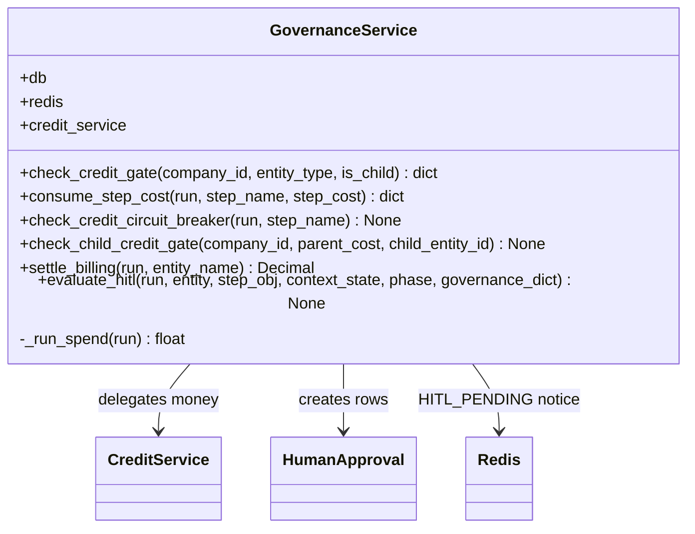

| Method | When | Raises |
|---|---|---|
| `check_credit_gate` | Before a run starts | `InsufficientCreditsError` |
| `consume_step_cost` | After each billable step | Never (logs) |
| `check_credit_circuit_breaker` | After each step | `InsufficientCreditsError` |
| `check_child_credit_gate` | Before spawning a child entity | `InsufficientCreditsError` |
| `settle_billing` | On run completion (top-level only) | — |
| `evaluate_hitl` | Before and after each step | `HITLRejected` / `HITLTimeout` — the loop ends the run (GH-25) |

---

## 5. Credit gates and the circuit breaker

Three checks at three moments.

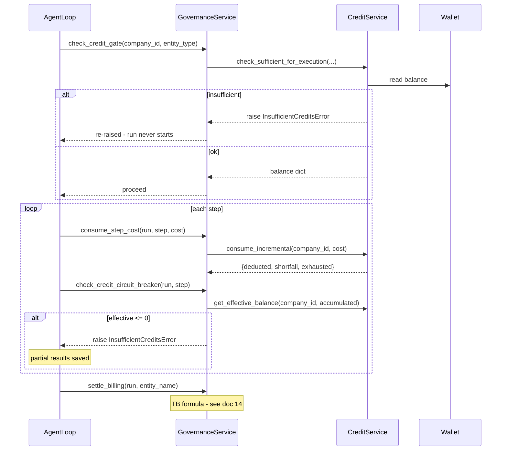

### 5.1 The pre-execution gate

```python
# backend/src/ai/governance/governance_service.py
try:
    balance = await self.credit_service.check_sufficient_for_execution(
        company_id, entity_type
    )
    return balance
except InsufficientCreditsError:
    raise  # Re-raise to be caught by the outer handler
except Exception as e:
    # Non-fatal: log and continue if balance check fails (e.g. DB issue)
    logger.warning(f"Pre-execution credit check failed: {e}")
    return {}
```

Note the two-tier `except`: a genuine credit shortfall propagates, but **any
other error returns `{}` and the run proceeds unbilled-checked**. Availability
over strictness.

The gate is `entity_type`-aware, so a `PROCESS` can require a different
threshold from an `ACTION`.

### 5.2 Incremental consumption

`consume_step_cost` deducts each step's cost immediately rather than settling
only at the end. This is what makes the circuit breaker meaningful — the wallet
reflects spend in near-real-time.

It short-circuits on non-positive cost and **never raises**:

```python
# backend/src/ai/governance/governance_service.py
if step_cost <= 0:
    return {"deducted": Decimal("0"), "shortfall": Decimal("0"), "exhausted": False}
...
except Exception as e:
    logger.warning(f"Incremental deduction failed for step '{step_name}': {e}")
    return {"deducted": Decimal("0"), "shortfall": step_cost, "exhausted": False}
```

A failed deduction returns the full cost as `shortfall` — the work happened but
was not billed.

### 5.3 The circuit breaker

```python
# backend/src/ai/governance/governance_service.py
accumulated = Decimal(str(run.total_cost_usd or 0))
effective = await self.credit_service.get_effective_balance(
    run.company_id, accumulated
)
if effective <= 0:
    raise InsufficientCreditsError(
        f"Execution stopped: credit balance exhausted after step '{step_name}'. "
        f"Accumulated cost: ${accumulated:.4f}. "
        f"Partial results saved. Please top up credits and retry."
    )
```

The error message is user-facing and deliberately reassuring: **partial results
are saved**. A drained run is not a lost run.

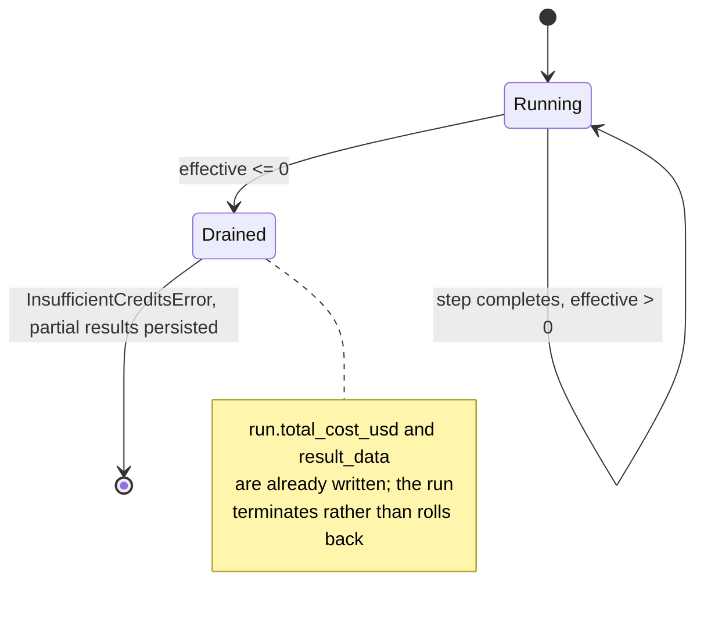

Like the others, it swallows non-credit exceptions (`except Exception: pass`).

### 5.4 The child gate

Before spawning a child entity, the parent's accumulated cost is checked against
the wallet:

```python
# backend/src/ai/governance/governance_service.py
raise InsufficientCreditsError(
    f"Cannot spawn child entity {child_entity_id}: parent run has accumulated "
    f"${parent_accumulated_cost:.4f} cost with no remaining credits. "
    f"Please top up credits and retry."
)
```

This exists because recursion is the platform's main runaway-cost risk: a
`PROCESS` fanning out to dozens of children could otherwise blow past the wallet
between circuit-breaker checks. See
[06 — Execution pipeline](06-execution-pipeline.md) for the recursion model.

---

## 6. The entity governance block

Every entity carries a `governance` JSON block. Its schema is in
[schemas/governance.py](../../backend/src/ai/schemas/governance.py):

```python
# backend/src/ai/schemas/governance.py
class Governance(BaseModel):
    max_cost_usd: Optional[float] = None
    timeout_ms: int = 60000
    max_recursion_depth: int = 5
    execution_limits: Optional[ExecutionLimits] = None
    hitl_checkpoints: List[HITLCheckpoint] = []
```

| Field | Default | Meaning |
|---|---|---|
| `max_cost_usd` | `None` | Hard USD cap for the run |
| `timeout_ms` | `60000` (60s) | Wall-clock limit |
| `max_recursion_depth` | `5` | How deep the tree below this entity may go — enforced when a child run is created (EP-06). `execution_limits.max_recursion_depth`, the builder's old spelling, is folded into it (EP-28) |
| `execution_limits` | `None` | Further per-entity limits |
| `hitl_checkpoints` | `[]` | Human approval checkpoints |

`max_cost_usd` and `timeout_ms` are also what the Meta-Agent's Validator gate 6
insists on being `> 0` before an entity can be promoted — see
[11 — Meta-intelligence](11-meta-intelligence.md).

These values become the loop's `Budget` (tokens / USD / wall-clock / iterations)
described in [05 — Agent kernel](05-agent-kernel.md).

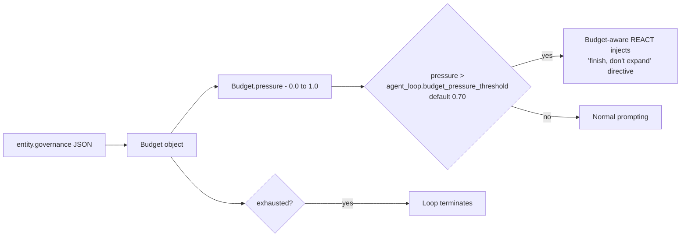

Note the two-level design: `budget_pressure_threshold` is a **soft** nudge to
the LLM ("wrap up"), while `Budget.exhausted` is the **hard** engine stop. The
flag comment makes this explicit:

```python
# backend/src/ai/core/feature_flags.py
# Budget-aware REACT (Phase 12 `07` §2): thread budget pressure into the
# step prompt as a soft constraint, with an explicit "finish, don't expand"
# directive past ``agent_loop.budget_pressure_threshold``. The hard engine
# cap still applies; this nudges the LLM to plan within budget. Default ON.
```

---

## 7. Human-in-the-loop checkpoints

### 7.1 The checkpoint definition

```python
# backend/src/ai/schemas/governance.py
class HITLCheckpoint(BaseModel):
    """A user-configured checkpoint that pauses execution for human approval."""
    trigger_type: HITLTriggerType
    step_ref: Optional[str] = None           # For BEFORE_STEP/AFTER_STEP: step name or step_id
    tool_ref: Optional[str] = None           # For TOOL_CALL: tool_id to gate
    threshold: Optional[float] = None        # For COST_THRESHOLD: USD amount that triggers pause
    expression: Optional[str] = None         # For CUSTOM: a Python-like boolean expression
    timeout_ms: int = 300000                 # How long to wait for approval (default 5 min)
    notification_channels: List[str] = []    # e.g. ["email", "slack", "dashboard"]
    message: Optional[str] = None            # Custom message shown to the reviewer
    auto_approve_on_timeout: bool = False    # If True, auto-approve when timeout expires
```

### 7.2 The five trigger types

```python
# backend/src/ai/schemas/enums.py
class HITLTriggerType(str, Enum):
    """Trigger types for Human-in-the-Loop checkpoints."""
    BEFORE_STEP = "BEFORE_STEP"          # Pause before a specific step executes
    AFTER_STEP = "AFTER_STEP"            # Pause after a specific step completes
    COST_THRESHOLD = "COST_THRESHOLD"    # Pause when execution cost exceeds threshold
    TOOL_CALL = "TOOL_CALL"              # Pause before a specific tool is called
    CUSTOM = "CUSTOM"                    # Custom expression-based trigger
```

| Trigger | Phase | Matched on | `trigger_desc` written to the approval row |
|---|---|---|---|
| `BEFORE_STEP` | `BEFORE` only | `step_ref` == step `name` **or** `step_id` | `BEFORE_STEP: {step.name}` |
| `AFTER_STEP` | `AFTER` only | `step_ref` == step `name` **or** `step_id` | `AFTER_STEP: {step.name}` |
| `COST_THRESHOLD` | `BEFORE` only | the run's spend so far (its usage rows and children, `run_spend`) **plus this step's estimate** (`planning/cost_estimator.estimate_step_cost`) `>= threshold` | `COST_THRESHOLD: ${threshold} before {step.name}` |
| `TOOL_CALL` | `BEFORE` only | step is `TOOL_CALL` and `target.tool_id == tool_ref` | `TOOL_CALL: {tool_ref}` |
| `CUSTOM` | `BEFORE` only | the expression holds — the grammar in §9 | `CUSTOM: {expression}` |

> **Only `AFTER_STEP` fires in the `AFTER` phase.** Every other trigger is
> `BEFORE`-only. A `COST_THRESHOLD` checkpoint asks before the step that would
> cross the line — spend so far plus the step's estimate (GH-08, since
> 2026-10-08) — and, once the run is over it, before every later step: if an
> estimate was low, the next step asks. The trigger names the threshold and the
> step, not the spend, so a parked run's step finds its approval again even
> though a critic call spent a little meanwhile. The approval's snapshot carries
> `run_cost_usd` and `step_cost_estimate_usd`.

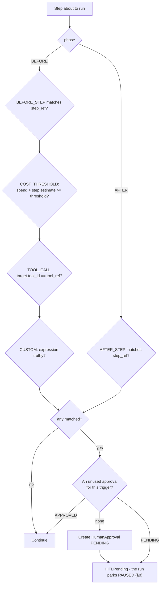

### 7.3 Checkpoints are evaluated in order

`evaluate_hitl` loops over `governance.hitl_checkpoints` and processes each
matching one in order. Two checkpoints matching the same step mean two
consecutive parks: the first approval resumes the run, the second checkpoint
parks it again.

A checkpoint that could never fire — a typo, a missing field, an expression outside the
grammar — is refused when the entity is saved, and one stored before that asks a person
before each step, with a trace event (§9.1, GH-09). Until 2026-10-08 it was skipped with a
bare `continue`, and nothing warned anyone.

### 7.4 The approval row

```python
# backend/src/ai/governance/governance_service.py
approval = HumanApproval(
    run_id=run.id,
    checkpoint_trigger=trigger_desc,
    status="PENDING",
    context_snapshot=build_hitl_snapshot(
        checkpoint=cp, trigger_desc=trigger_desc, phase=phase,
        entity=entity, step=step_obj, context_state=context_state,
        run_cost_usd=run_cost, step_result=step_result,
        step_cost_estimate_usd=step_estimate,       # COST_THRESHOLD only (GH-08)
    ),
    notification_channels=cp.notification_channels,
    timeout_ms=cp.timeout_ms,
)
```

`context_snapshot` is what the reviewer sees
([`governance/hitl_snapshot.py`](../../backend/src/ai/governance/hitl_snapshot.py), PO-05):

| Key | Content |
|---|---|
| `message`, `trigger_type`, `phase` | the checkpoint's message (or a default), its trigger, `BEFORE` or `AFTER` |
| `entity_name`, `step_name`, `step_type`, `step_description`, `tool_id` | what is running |
| `step_prompt` | the step's prompt template **resolved** against the run context |
| `run_input` | the run's `input` |
| `step_output` | `AFTER` only — what the step produced (the step engine passes its result in) |
| `run_cost_usd` | the run's cost so far (for `COST_THRESHOLD`, its usage rows — GH-08) |
| `step_cost_estimate_usd` | `COST_THRESHOLD` only — what the step about to run is expected to cost |

Text fields are capped at 4000 characters and empty keys are dropped. `step_id` stays out
so the approval UI cannot leak the entity's internal plan topology. `GET
/ai/approvals/pending` returns the snapshot and `timeout_ms` with each row.

The `HumanApproval` table is defined at
[orm/execution.py:121](../../backend/src/ai/orm/execution.py:121) — see
[03 — Data model](03-data-model.md).

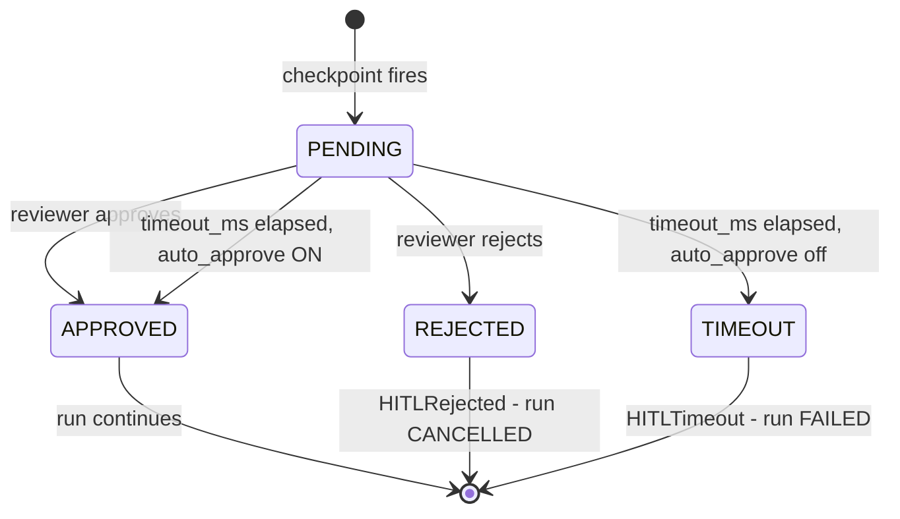

---

## 8. Parking on a decision

A run that meets a HITL checkpoint **does not hold a worker** while a person decides
(GH-07, PO-20, since 2026-10-08). Until then the step waited inside the worker — on Redis
pub/sub plus a re-read of the approval row — for up to `timeout_ms`, holding an Arq slot,
and a few pending approvals starved the pool. Now the run parks the way it suspends on its
children: a snapshot, status **`PAUSED`**, the worker given back, the credit hold kept.

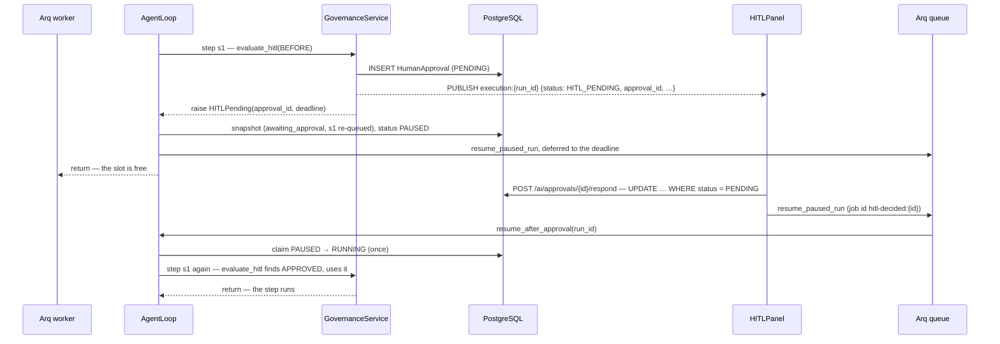

### 8.1 The approval a checkpoint waits on

[`governance/hitl_gate.py`](../../backend/src/ai/governance/hitl_gate.py). When a checkpoint
fires, `evaluate_hitl` first looks for the run's latest approval with the same trigger that
no step has used (`human_approvals.consumed_at IS NULL`):

| Found | Result |
|---|---|
| nothing | open a PENDING approval, publish `HITL_PENDING` on `execution:{run_id}`, raise `HITLPending` — the run parks |
| `PENDING` | raise `HITLPending` on that approval — park again, no second request |
| `APPROVED` | mark it used, then the next checkpoint, then the step runs |
| `REJECTED` | mark it used, raise `HITLRejected("Execution blocked by human reviewer: … — <reviewer notes>")` — the run ends `CANCELLED` (§8.4) |
| `TIMEOUT` | mark it used, raise `HITLTimeout("HITL checkpoint timed out after …ms")` — the run ends `FAILED` |

A decision is used once, so when the checkpoint fires again — the step retried, the next
step past a `COST_THRESHOLD` — a person is asked again, as the blocking wait did.
**Nothing lets a step proceed without an APPROVED decision**; Redis carries only the
best-effort notice and the resume job (GH-22, GH-01).

An `AFTER_STEP` checkpoint fires after the step ran: `HITLPending` carries the step's result
(`step_result`), the executor records the step as done, and the run parks on its output.
`ask_user` (an `ASK_USER` retry, PC-06) parks the same way with trigger `ASK_USER: <step>`;
the reviewer answers by approving it with notes, and the answer is returned when the step
is dispatched again.

### 8.2 Parking

[`core/approval_pause.py`](../../backend/src/ai/core/approval_pause.py). The SingleStep and
DAG executors report `HITLPending` as `ActionResult.awaiting_approval` (the loop catches it
from any other executor too). The loop records what finished, puts the move's steps that
did not run back at the front of `retry_queue` — as they were, the checkpoint's step first —
sets `AgentState.awaiting_approval` (approval id, trigger, phase, step, deadline,
auto-approve) and suspends: `_persist_suspended` writes the snapshot and `PAUSED`, and a
`resume_paused_run` job is deferred to the deadline. The run is not finalised or billed;
events `agent.loop.paused_on_approval` and `agent.loop.suspended`.

### 8.3 Resuming, and the deadline

`resume_paused_run` drives `AgentLoop.resume_after_approval`. Three things enqueue it,
whichever comes first:

| Who | When |
|---|---|
| the respond endpoint | the reviewer answered (job id `hitl-decided:{approval_id}`) |
| the deadline job | `timeout_ms` after the request (job id `hitl-deadline:{approval_id}`) |
| `sweep_paused_runs` (the `sweep_stuck_runs` cron, every 5 minutes) | the approval was decided, or its deadline passed, more than `WAITING_RESUME_GRACE_SECONDS` ago — the resume was lost |

`resume_after_approval` does nothing for a run that is not parked, or whose approval is
still `PENDING` before its deadline. Past the deadline a `PENDING` approval is settled with a
**conditional** update — `TIMEOUT`, or `APPROVED` with *"Auto-approved on timeout"* when
`auto_approve_on_timeout` is set — `WHERE status = 'PENDING'`, so a reviewer's answer that
landed first wins. Then the run is **claimed** (`PAUSED → RUNNING` in one conditional
update, so two resumes cannot both drive it) and the decision folded in:

| Decision | Result |
|---|---|
| `APPROVED` | the loop continues; the re-queued step meets its checkpoint, which uses the approval and runs it (an `AFTER` approval is used at once — the step already ran) |
| `REJECTED` | the step is failed and the run ends **`CANCELLED`** with the reviewer's notes |
| `TIMEOUT` | the step is failed and the run ends **`FAILED`** |

Default `timeout_ms` is **300000 (5 minutes)** and `auto_approve_on_timeout` defaults to
**`False`** — so the safe default is *fail closed on timeout*. A paused run holds no worker,
so a long `timeout_ms` costs nothing but the reviewer's patience.

### 8.4 Answering an approval

`POST /ai/approvals/{approval_id}/respond` takes a JSON body
`{"status": "APPROVED" | "REJECTED", "notes"?}` (`ApprovalDecision`; anything else is a
422). `AIService.respond_to_approval` finds the approval **through its run's company** —
another company's approval is a 404 — and records the decision with `UPDATE … WHERE status
= 'PENDING'`, so an approval is answered once: a second answer, or one after the deadline
settled it, is a 409. The router then enqueues the run's resume (best-effort; the sweep
catches a lost one). GH-23, GH-24.

A decision ends the run (GH-25, HD7). `HITLRejected` and `HITLTimeout`
(`ai/core/exceptions.py`, both `HITLDecisionError`) reach the executor, which reports them
as `ActionResult.blocked = {kind, reason, step_id}` instead of an ordinary failure. The
observer makes that a `blocked` observation and a `hitl_decision` blocker (AK-08), and the
loop stops there: no critic judges the decision, no retry asks the reviewer again, no other
step runs. A rejection ends the run **`CANCELLED`** with the reviewer's notes in
`error_message`; a timeout ends it **`FAILED`**. The event is `agent.loop.human_decision`.
An `ASK_USER` question (PC-06) behaves the same way: no answer is `HITLTimeout`; a refusal,
or an approval with no answer, is `HITLRejected`. In a parallel DAG level, a decision
outranks the other steps' failures, and a waiting checkpoint outranks an ordinary error.

### 8.5 Operational notes

- A paused run is `PAUSED` in the run list and on its page, which keeps polling it; the
  pending request is in the approvals inbox (`GET /ai/approvals/pending`).
- Cancelling a paused run (`POST /executions/{id}/cancel`) makes it `CANCELLED`; a later
  resume does nothing. As for a run cancelled while it waits on children, the work done
  before it parked is not settled.
- A run paused by the supervisor (`PAUSE_HITL`) has no approval in its snapshot; the
  resume and the sweep leave it alone.

---

## 9. Custom expression triggers

`CUSTOM` checkpoints evaluate a small expression in a closed grammar
([`schemas/hitl_expression.py`](../../backend/src/ai/schemas/hitl_expression.py), GH-10,
since 2026-10-08). It is **not** Python `eval`:

```text
expression := clause (("and" | "or") clause)*
clause     := ("step_count" | "cost") op number
            | "has_key(" quoted-name ")"
op         := ">" | ">=" | "<" | "<=" | "=="
```

`and` binds tighter than `or`; there are no parentheses. `step_count` is how many step
outputs the run's context holds (keys not starting `__`), `cost` the run's spend in USD
(its usage rows and children, as for `COST_THRESHOLD`), `has_key('x')` whether the context
holds `x`. The builder's example, `cost > 0.50 or step_count > 5`, works — before, the
hand-rolled evaluator (`_safe_eval_expression`) knew `step_count` and `cost` with `>` and
`>=` only, failed on that very example, and returned false for anything else.

An expression outside the grammar is refused when the entity is saved (§9.1). One stored
before that asks a person before each step instead of never firing.

### 9.1 Checkpoints are checked when the entity is saved

`schemas/governance.checkpoint_problem` says why a checkpoint could never fire: it does not
parse (an unknown `trigger_type`), it lacks the field its trigger needs (`step_ref` for
`BEFORE_STEP` / `AFTER_STEP`, `tool_ref` for `TOOL_CALL`, a `threshold` above 0 for
`COST_THRESHOLD`), its `CUSTOM` expression is outside the grammar, its `timeout_ms` is not
positive, or its `step_ref` is not a step of the plan — checked when the payload carries an
enabled static plan and no dynamic planning, whose steps are named at run time. The entity
create and update requests (and a version draft's changes) refuse it with a **422** naming
the checkpoint: `checkpoint 2 (CUSTOM): expression 'cost > 0.5 && …': expected and / or,
got '&'` (GH-09). The meta-agent's tools and template cloning validate with the lenient
models and are not refused; the run-time rule below covers them.

At run time `evaluate_hitl` asks the same question of each stored checkpoint. One that
cannot be evaluated **asks a person before each step** — trigger `UNUSABLE CHECKPOINT {n}
before {step}`, with a message naming the problem and the checkpoint's own timeout when it
has a usable one — and records a `hitl` span on the run's trace and the event
`agent.hitl.checkpoint_unusable` (`checkpoint`, `problem`). Before, it was skipped with a
bare `continue`.

---

## 10. Rate limiting

[rate_limiter.py](../../backend/src/ai/governance/rate_limiter.py) is a Redis
sorted-set sliding window.

```python
# backend/src/ai/governance/rate_limiter.py
limiter = RedisRateLimiter(redis)
allowed = await limiter.check_and_consume(
    key="tool:search:company_123",
    limit=10,
    window_seconds=60,
)
```

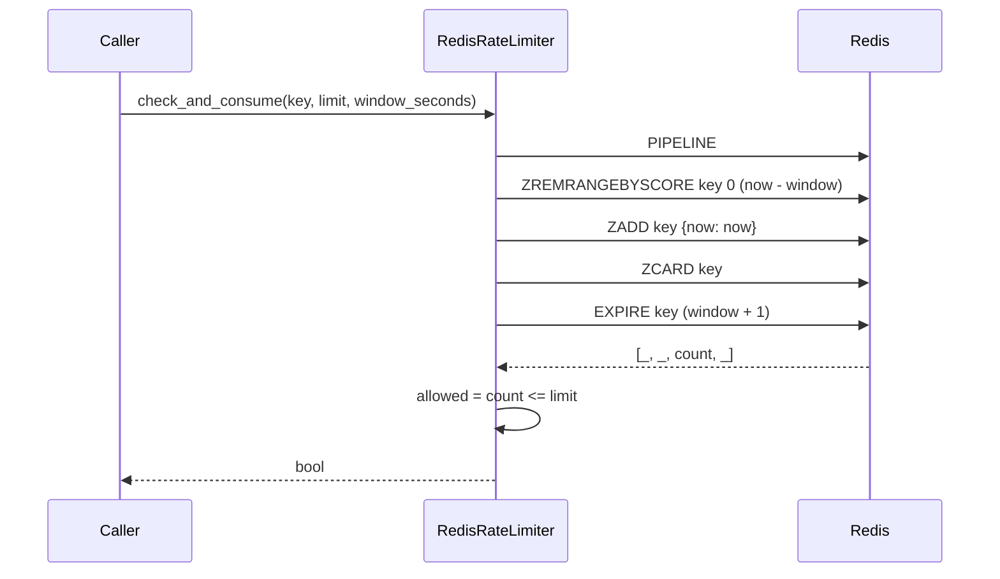

The four pipelined commands do prune, add, count and expire atomically:

| Command | Purpose |
|---|---|
| `ZREMRANGEBYSCORE key 0 window_start` | Drop entries older than the window |
| `ZADD key {now: now}` | Record this request |
| `ZCARD key` | Count entries in the window |
| `EXPIRE key window+1` | Auto-clean idle keys |

Also available: `get_remaining(key, limit, window)` and `reset(key)`.

### 10.1 Two fail-open paths

```python
# backend/src/ai/governance/rate_limiter.py
if not self.redis:
    return True  # No Redis = no limiting
...
except Exception as e:
    logger.warning(f"Rate limiter error for '{key}': {e}")
    return True  # Fail open — don't block on Redis errors
```

No Redis configured, or Redis erroring, means **no rate limiting at all**.

### 10.2 The counting is slightly off by design

The request is added to the set **before** the count, so `count` includes the
current request, and the comparison is `count <= limit`. A `limit=10` therefore
permits 10 requests per window, which is the intuitive reading — but note the
entry is added even when the call is ultimately rejected, so a rejected request
still consumes a slot for the remainder of the window. Under sustained overload
this makes the limiter slightly stricter than the nominal limit.

`RedisRateLimiter` is a **mechanism, not a policy** — it defines no limits of
its own. Callers pass `key`, `limit` and `window_seconds`. Per-run tool budgets
are tracked separately via `tool_call_counts` in `context_state`
([09 — Tools](09-tools.md)).

---

## 11. Tool cost resolution

[tool_cost_resolver.py](../../backend/src/ai/governance/tool_cost_resolver.py)
(206 lines) is the single source of truth for what a tool call costs.

```python
# backend/src/ai/governance/tool_cost_resolver.py
"""
Lookup priority (first hit wins):

  1. ``IntegrationRegistry.service_sku == tool_id``
  2. ``IntegrationRegistry.service_sku`` in :data:`TOOL_SKU_MAP[tool_id]`
  3. :data:`TOOL_FIXED_COST[tool_id]` (e.g. image_generation = $0.04)
  4. :data:`FREE_TOOLS` (or a tenant tool's ``free_reason``): $0, on purpose
  5. otherwise the tool is **unpriced**: $0, a $0 ``usage_logs`` row marked
     ``cost_source: missing`` and a ``tool.cost.missing`` event, every call
"""
```

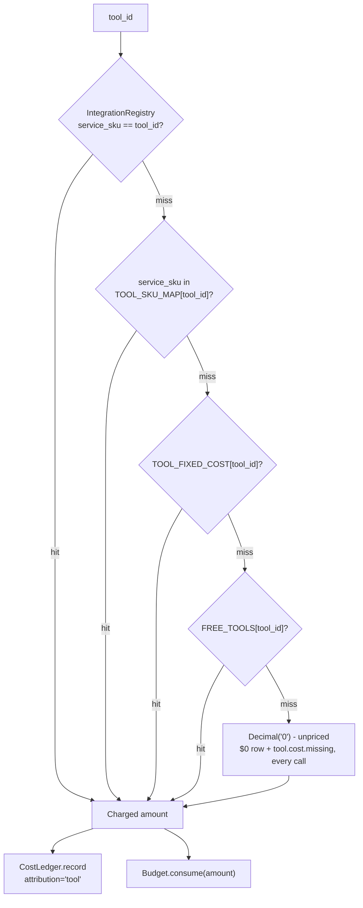

Two things make this important:

1. **It consolidated three duplicated lookups.** The docstring records that
   cost logic previously lived inline twice in `step_executor.py` (direct
   `TOOL_CALL` path and REACT AFC path) plus fixed-cost fallbacks.
2. **The returned amount feeds two consumers** — `run.total_cost_usd` and the
   loop's `Budget.consume(...)`. Same number, so billing and budget can never
   diverge.

> A tool with no price is **unpriced** (GH-05, since 2026-10-08): it is charged $0, and
> every call writes a $0 `usage_logs` row marked `cost_source: missing` (so it shows in
> the run's costs) and a `tool.cost.missing` event. Until then it warned once per process
> and was silently free. A tool that costs nothing here on purpose — local work, the
> company's own account, model calls billed as LLM usage, sandbox time — is in
> `FREE_TOOLS` with that reason; a synthesized tenant tool says so with `free_reason`.
> `tests/unit/test_tool_prices.py` fails on a registered tool that is neither priced nor
> declared free, so add a SKU, a fixed cost or a reason when adding a tool.

Every charge is recorded through `CostLedger` in
[services/cost_attribution.py](../../backend/src/ai/services/cost_attribution.py)
with `attribution="tool"` — see [14 — Billing and credits](14-billing-and-credits.md).

The resolver is **cached per process**, so a rate change requires a worker
restart (or whatever invalidation the cache exposes) to take effect.

---

## 12. Feature flags — the system

[core/feature_flags.py](../../backend/src/ai/core/feature_flags.py) (617 lines).

### 12.1 Resolution order

```python
# backend/src/ai/core/feature_flags.py
"""
Resolution order (first hit wins):

  1. Per-entity override (``entity.metadata_extensions.feature_flags``).
  2. Per-company row in the ``feature_flags`` table.
  3. Global row (``company_id IS NULL``) in the ``feature_flags`` table.
  4. Environment variable: ``AI_FLAG_<KEY>`` (e.g.
     ``AI_FLAG_AGENT_LOOP_ENABLED=true``).
  5. Hard-coded default from ``DEFAULTS`` below.
"""
```

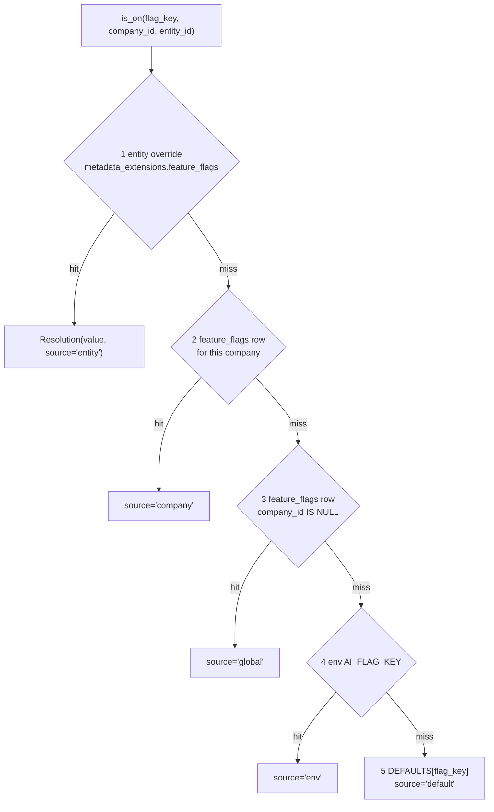

The env-var name is derived mechanically:

```python
# backend/src/ai/core/feature_flags.py
def _env_lookup(key: str) -> Optional[bool]:
    env_key = "AI_FLAG_" + key.upper().replace(".", "_")
    raw = os.environ.get(env_key)
    if raw is None:
        return None
    return raw.strip().lower() in {"1", "true", "yes", "on"}
```

So `bandit.enabled` → `AI_FLAG_BANDIT_ENABLED`, and truthy values are
`1`, `true`, `yes`, `on` (case-insensitive).

`resolve()` returns a `_Resolution` carrying `value`, `source`
(`"entity" | "company" | "global" | "env" | "default"`) and `flag_key` — use it
when you need to know *why* a flag has its value.

### 12.2 The DB table is optional

```python
# backend/src/ai/core/feature_flags.py
"""
The DB table is OPTIONAL — if Alembic hasn't run the migration yet,
flags fall through to env vars + defaults instead of raising. That
makes the system safe to deploy in any order.
"""
```

A genuinely nice property: you can deploy code that reads a new flag before the
migration lands.

Likewise `db` may be `None` — the service then resolves from env plus defaults
only. `FeatureFlags` is designed to be **short-lived**: construct one per Arq
job or per request.

### 12.3 Caching and invalidation

```python
# backend/src/ai/core/feature_flags.py
_REDIS_INVALIDATION_CHANNEL = "feature_flag_invalidations"
_PROCESS_CACHE_TTL_SECONDS = 60
```

Two cache layers:

| Layer | Scope | TTL | Invalidation |
|---|---|---|---|
| `_PROCESS_CACHE` | Module-global, keyed `(flag_key, company_id, entity_id)` | 60s | `invalidate_process_cache(flag_key=None)` |
| `self._cache` | Per-service-instance | Instance lifetime | Instance discarded |

`set()` publishes to the Redis `feature_flag_invalidations` channel so other
workers drop their caches.

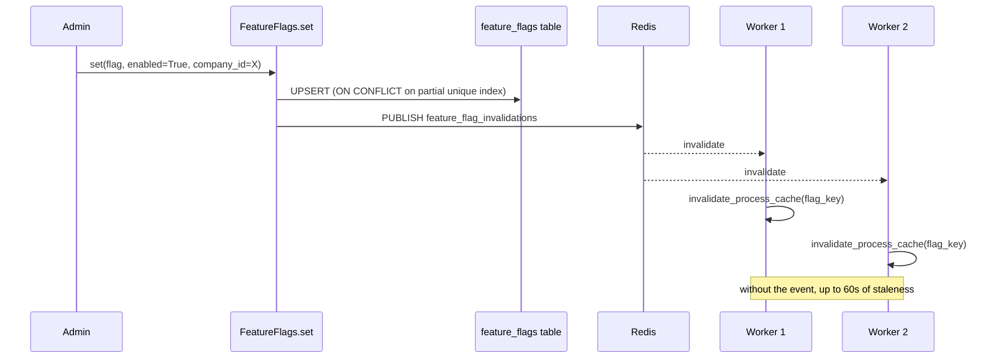

The upsert has a subtlety worth respecting, from the code comments:

```python
# backend/src/ai/core/feature_flags.py
# ON CONFLICT targets MUST match the partial-unique-index columns
# AND predicate exactly. See p11t02_feature_flags migration:
#   entity tier:  (flag_key, entity_id)        WHERE entity_id IS NOT NULL
```

Three tiers (entity / company / global) are enforced by **partial unique
indexes**, so each `ON CONFLICT` clause must reproduce the index predicate
exactly.

### 12.4 Boolean vs numeric flags

Two separate dictionaries and two separate accessors:

| | Boolean | Numeric |
|---|---|---|
| Dict | `DEFAULTS` | `NUMERIC_DEFAULTS` |
| Accessor | `is_on(...)` / `resolve(...)` | `get_float(...)` |
| DB column | `enabled` | `value_json` |

```python
# backend/src/ai/core/feature_flags.py
async def get_float(self, flag_key, *, company_id=None, entity_id=None, default=None) -> float:
    """Resolve a numeric flag (``bandit.epsilon``, ``planner.n_candidates``).

    Order: per-entity ``value_json`` → per-company ``value_json``
    → global ``value_json`` → ``NUMERIC_DEFAULTS[flag_key]`` →
    ``default`` (caller fallback, 0.0 if not given).
    """
```

> ⚠️ `get_float` has **no env-var tier**. Boolean flags can be overridden with
> `AI_FLAG_*`; numeric ones cannot. Numeric overrides require a DB row.

`set()` accepts `enabled`, `value_json`, or both, and raises if neither is
given. It also raises `RuntimeError` if `db is None`.

---

## 13. Feature flags — the complete catalogue

**29 boolean flags** and **4 numeric flags**, extracted from
[core/feature_flags.py](../../backend/src/ai/core/feature_flags.py). Thirteen
flags that nothing read were deleted on 2026-10-01 (AK-10);
`tests/unit/test_feature_flag_census.py` now fails when a declared flag has no
reader, apart from a short `KNOWN_UNREAD` list that names the decision each
one waits on.

### 13.1 Agent loop

| Flag | Default | Controls |
|---|---|---|
| `agent_loop.snapshot_every_iteration` | `True` | Write an `AgentState` `snapshot` node each iteration |
| `agent_loop.budget_aware_react` | `True` | Thread budget pressure into the step prompt |

> There is **no `agent_loop.enabled` master switch.** The comment in the code is
> explicit: *"C4 deleted the legacy `ExecutionEngine.execute_run` path"*, so the
> AgentLoop is the sole run engine. Older docs referencing `agent_loop.enabled`
> are stale.

### 13.2 Critic pipeline

| Flag | Default | Controls |
|---|---|---|
| `critic_pipeline.v2_enabled` | `True` | The v2 critic pipeline |
| `critic_pipeline.different_model_critic` | `True` | Critique with a different model than the actor |
| `critic_pipeline.pre_critic_enabled` | `True` | Pre-action critic gate |
| `critic_pipeline.calibration_enabled` | `True` | False-pass/false-fail calibration (per company, in the weekly job) |

`critic_pipeline.v1_compat` was retired (C1) — the v1 critic body is deleted.

### 13.3 Supervisor and bandit

| Flag | Default | Controls |
|---|---|---|
| `bandit.enabled` | `True` | `PlanStyleBandit` arm selection |
| `task_classifier.v2_enabled` | `False` | Embedding-NN task classifier (v1 rule-based otherwise) |

### 13.4 Meta-Agent

| Flag | Default | Controls |
|---|---|---|
| `meta_agent.board_routing` | `True` | Board is the default Meta-Agent path — **read by nothing** (MI-20) |
| `meta_agent.spec_critic_required` | `True` | Spec critic must run — **read by nothing** (MI-20) |
| `meta_agent.draft_lifecycle` | `True` | DRAFT → ACTIVE lifecycle — **read by nothing** (MI-20) |
| `meta_agent.testdriver_suite_enabled` | `True` | Run the TestDriver suite — **read by nothing** (MI-20) |
| `meta_agent.skill_promotion_cron` | `True` | Weekly skill-candidate scan (per company) |
| `meta_agent.prompt_evolution_cron` | `True` | Weekly prompt-evolution proposal (per company) |
| `meta_agent.curator_consolidation_enabled` | `False` | Merge-plan proposals for duplicate clusters — **read by nothing** (MI-20) |
| `meta_agent.spec_critic_tiebreak` | `False` | Third-model tiebreak on high-stakes disagreement — **read by nothing** (MI-20) |
| `meta_agent.tool_synthesis_enabled` | **`False`** | ⚠️ Agents writing new tools |

The six Board flags gate the seven-role Architecture Board, which has no
production caller (MI-20 in [register 11](defect-register/11-META-INTELLIGENCE-DEFECTS.md)).
They are listed in the census test's `KNOWN_UNREAD` until P10 of the
[consolidated plan](defect-register/CONSOLIDATED-KERNEL-TOOLS-PLAN.md) decides the Board.

The tool-synthesis flag is described in code as the kill switch for *"the
marquee/most-dangerous capability"*:

```python
# backend/src/ai/core/feature_flags.py
# Tool synthesis kill switch (Phase 12 `06` §2.2 control 5). Default OFF;
# the marquee/most-dangerous capability. Even when ON, the tool_synthesis
# meta-tool stays Meta-Agent-only + container-only-exec + DRAFT-register-only.
"meta_agent.tool_synthesis_enabled": False,
```

### 13.5 Tools and cost

| Flag | Default | Controls |
|---|---|---|
| `tools.resilience_v2_enabled` | — | Deleted (P8.6, EP-22): the healing ladder is unconditional |

`tools.cost_attribution_required` was deleted (AK-10): it was the last canary of
the cost-attribution programme and nothing read it. The invariant is enforced by
a test, `tests/integration/test_cost_attribution.py`, not a runtime switch.

### 13.6 Planner

| Flag | Default | Controls |
|---|---|---|
| `planner.v2_enabled` | `True` | Planner v2 |

### 13.7 Sandbox

| Flag | Default | Controls |
|---|---|---|
| `sandbox.container_runtime_enabled` | `True` | Per-tenant container sandbox |
| `sandbox.persistent_browser_enabled` | `False` | Persistent browser profile (ephemeral otherwise) |

The persistent-browser flag has a **master switch above it** —
`settings.SANDBOX_PERSISTENT_BROWSER_ENABLED`. The flag resolves per company and
is threaded into the tool context as `persistent_browser`.

### 13.8 Memory

| Flag | Default | Controls |
|---|---|---|
| `memory.v2_canonical` | `True` | v2 four-domain memory is canonical |
| `memory.viewport_compact` | `True` | Compact viewport rendering |
| `memory.scope_policy_enforced` | `True` | `ScopePolicy` enforcement on CORTEX ops |
| `memory.dreaming_outcome_trigger` | `True` | Trigger dreaming on run completion |
| `memory.embedding_resolver_v2` | `True` | Per-company embedding model resolution |
| `memory.trust_score_learning` | `False` | Learned per-source trust scores |
| `memory.rule_lifecycle_confirmed_only` | `False` | Only `confirmed` rules enter prompts |
| `memory_v2.canonical` | `True` | ⚠️ Legacy alias of `memory.v2_canonical` |

See [08 — Memory and CORTEX](08-memory-and-cortex.md) for what each does.

### 13.9 Numeric flags

| Flag | Default | Meaning |
|---|---|---|
| `bandit.epsilon` | `0.10` | Exploration rate for the plan-style bandit |
| `agent_loop.budget_pressure_threshold` | `0.70` | Pressure past which "finish, don't expand" is injected |
| `meta_agent.testdriver_budget_usd` | `3.00` | Shared budget for the Board's test suite — **read by nothing** (MI-20); `TestDriver` uses its own `$3.00` constant |
| `planner.n_candidates` | `3` | Plan candidates generated per planning call |

### 13.10 Flags that are OFF by default

Worth listing separately — these are the not-yet-rolled-out or deliberately
dangerous capabilities:

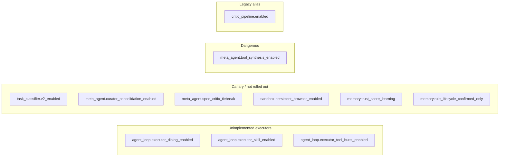

---

## 14. Operational runbook

### 14.1 Turn a flag on for one tenant

```bash
psql -h localhost -p 5433 -U postgres -d hirebuddha -c "INSERT INTO feature_flags (id, company_id, flag_key, enabled) VALUES (gen_random_uuid(), '<company-uuid>', 'memory.trust_score_learning', true) ON CONFLICT (flag_key, company_id) WHERE company_id IS NOT NULL DO UPDATE SET enabled = true;"
```

Prefer `FeatureFlags.set(...)` where you can — direct SQL does **not** publish
the Redis invalidation event, so workers keep the old value for up to 60
seconds.

### 14.2 Turn a flag on globally without touching the DB

```bash
AI_FLAG_MEMORY_TRUST_SCORE_LEARNING=true
```

Set it in the worker and API environment, then restart. Remember: env vars sit
*below* DB rows in precedence, so a company row will still win.

### 14.3 Find out why a flag has its value

```python
res = await FeatureFlags(db).resolve("bandit.enabled", company_id=cid, entity_id=eid)
print(res.value, res.source)   # e.g. True 'company'
```

### 14.4 Unstick a run waiting on HITL

Answer it through the API (`POST /ai/approvals/{id}/respond`) — that also enqueues the
resume. Or decide the row by hand:

```bash
psql -h localhost -p 5433 -U postgres -d hirebuddha -c "UPDATE human_approvals SET status='APPROVED', responded_at=now(), reviewer_notes='manually unblocked' WHERE id='<approval-uuid>' AND status='PENDING';"
```

The `sweep_stuck_runs` cron resumes the run within about `WAITING_RESUME_GRACE_SECONDS`
plus five minutes; nothing waits on a channel.

### 14.5 List stuck approvals

```bash
psql -h localhost -p 5433 -U postgres -d hirebuddha -c "SELECT id, run_id, checkpoint_trigger, requested_at, timeout_ms FROM human_approvals WHERE status='PENDING' ORDER BY requested_at;"
```

A row older than its `timeout_ms` that is still `PENDING` means its run's deadline job
and the sweep have not resumed it yet — or the run ended (cancelled) while it waited
(§8.5).

### 14.6 Suspend or restore a company

```bash
psql -h localhost -p 5433 -U postgres -d hirebuddha -c "UPDATE companies SET status='suspended' WHERE id='<company-uuid>';"
```

Takes effect on the next request — the middleware reads the row every time and
does not cache.

### 14.7 Raise a tenant's budget

Budget lives on the **entity**, not the company. Edit the entity's `governance`
block (`max_cost_usd`, `timeout_ms`, `max_recursion_depth`) via the entity API
or the builder UI — see [06 — Execution pipeline](06-execution-pipeline.md).
For wallet top-ups see [14 — Billing and credits](14-billing-and-credits.md).

### 14.8 Reset a rate limit

```bash
redis-cli DEL "tool:search:company_<uuid>"
```

---

## 15. Key files reference

| File | Lines | What it does |
|---|---|---|
| [core/feature_flags.py](../../backend/src/ai/core/feature_flags.py) | 617 | Flag resolution, 2-tier cache, Redis invalidation, `DEFAULTS` + `NUMERIC_DEFAULTS` |
| [governance/governance_service.py](../../backend/src/ai/governance/governance_service.py) | 436 | Credit gates, circuit breaker, HITL evaluation and wait, billing settlement |
| [governance/tool_cost_resolver.py](../../backend/src/ai/governance/tool_cost_resolver.py) | 206 | Single source of truth for tool cost; `TOOL_SKU_MAP`, `TOOL_FIXED_COST` |
| [governance/rate_limiter.py](../../backend/src/ai/governance/rate_limiter.py) | 111 | Redis sorted-set sliding window |
| [schemas/governance.py](../../backend/src/ai/schemas/governance.py) | — | `Governance`, `HITLCheckpoint`, `ExecutionLimits` |
| [schemas/enums.py](../../backend/src/ai/schemas/enums.py) | — | `HITLTriggerType`, `StepType`, `ExecutionMode` |
| [orm/execution.py](../../backend/src/ai/orm/execution.py) | 138 | `HumanApproval` table |
| [core/budget.py](../../backend/src/ai/core/budget.py) | — | `Budget` — tokens / USD / wall-clock / iterations |
| [services/cost_attribution.py](../../backend/src/ai/services/cost_attribution.py) | — | `CostLedger`, `CostAttribution` |
| [api/admin.py](../../backend/src/ai/api/admin.py) | 1456 | Admin endpoints including flag management |
| [HITLPanel.tsx](../../frontend/src/pages/ai/HITLPanel.tsx) | — | Approval UI |
| [FeatureFlagsPage.tsx](../../frontend/src/pages/admin/FeatureFlagsPage.tsx) | 422 | Flag admin UI |
| [RiskAndExitPage.tsx](../../frontend/src/pages/admin/RiskAndExitPage.tsx) | 343 | Risk and offboarding surfaces |
| [useFeatureFlag.ts](../../frontend/src/hooks/useFeatureFlag.ts) | — | Client-side flag hook |

---

## 16. Gotchas

1. **Almost every gate fails open.** Credit checks, rate limiting, suspension
   middleware, semantic duplicate checks — all swallow non-fatal errors and let
   the request through. A broken gate looks exactly like a passing gate. (A HITL
   checkpoint does not: nothing lets a step proceed without an APPROVED decision, §8.1.)

2. **A HITL checkpoint survives a Redis outage.** The approval row is the record; Redis
   carries only the notice and the resume job, and the sweep re-enqueues a lost resume.

3. ~~**A rejected step is retried, and the reviewer is asked again**~~ (GH-25, fixed
   2026-10-08): a rejection ends the run `CANCELLED`, a timeout `FAILED` (§8.4).

4. ~~**A HITL wait blocks an Arq worker slot**~~ (GH-07, fixed 2026-10-08): the run
   parks `PAUSED` and holds no worker while a person decides (§8).

5. ~~**`COST_THRESHOLD` fires before the *next* step**~~ (GH-08, fixed 2026-10-08):
   it asks before the step whose estimate would cross the line (§7.2). An estimate
   can still be low — then the next step asks.

6. ~~**Malformed HITL checkpoints are skipped silently**~~ (GH-09, fixed 2026-10-08):
   refused on save (422); one stored before asks a person, with a trace event (§9.1).

7. ~~**`CUSTOM` expressions support only `step_count` and `current_cost` with
   `>` and `>=`.**~~ (GH-10, fixed 2026-10-08): `step_count` and `cost` with
   `> >= < <= ==`, `has_key('x')`, joined by `and` / `or` — nothing else (§9).

8. **`get_float` has no env-var tier.** Numeric flags cannot be overridden with
   `AI_FLAG_*`; they need a DB row.

9. **Direct SQL flag writes do not invalidate caches.** Up to 60 seconds of
   staleness per worker. Use `FeatureFlags.set()`.

10. **There is no `agent_loop.enabled` flag any more.** The legacy engine was
    deleted; the loop is unconditional.

11. **`meta_agent.board_routing` is defined twice** in `DEFAULTS` (both `True`).

12. **`critic_pipeline.enabled` and `memory_v2.canonical` are legacy aliases**
    that do not control the modern paths. Use `critic_pipeline.v2_enabled` and
    `memory.v2_canonical`.

13. ~~**An unmapped tool costs $0** and warns only once per process~~ (GH-05, fixed
    2026-10-08): every call writes a $0 row and a `tool.cost.missing` event, and the price
    contract test fails on a tool that is neither priced nor declared free (§11).

14. **`ToolCostResolver` is cached per process.** Rate changes need a restart.

15. **Suspension is enforced by the auth dependency only.** An endpoint that does
    not depend on `get_current_user` (or a sibling) is not covered.

16. **Budget lives on the entity, not the company.** Raising "a tenant's budget"
    means editing entity `governance` blocks.

---

## Where to go next

- [05 — Agent kernel](05-agent-kernel.md) — the `Budget` type and where these
  gates are called inside the loop.
- [14 — Billing and credits](14-billing-and-credits.md) — `CreditService`, the
  wallet, and the TB settlement formula.
- [07 — Planning and critics](07-planning-and-critics.md) — the critic gates and
  `governance.critic_cost_share_pct`.
- [11 — Meta-intelligence](11-meta-intelligence.md) — the Board's own gates and
  `meta_agent.*` flags.
- [09 — Tools](09-tools.md) — tool SKUs, per-run tool budgets, and the sandbox
  flags.
- [04 — Auth, RBAC and tenancy](04-auth-rbac-tenancy.md) — the auth gate that
  runs before all of this.
