# Phase 14 — Implementation Plan

> **Status:** Plan. Not yet executed.
> **Date:** 2026-10-16
> **Covers:** every code change discussed for Phase 14: event-driven automation, per-tenant databases with a dynamic schema, the in-tenant Data API, tenant connections, the tenant runtime (sandbox, code lanes, GitHub, app hosting), and the move from GCP to Azure.
> **Design:** [02 — Technical specification](02_tech_spec.md). **Behaviour:** [03 — Functional specification](03_functional_spec.md). **Environment:** [04 — Azure environment setup](04_azure_environment_setup.md).
> **Roadmap:** decisions D34–D40 (+ D12, D25), open items O10/O11, stories in E06, E07, E09, E36, E37, E41.

---

## 0. Why Phase 14 exists

Today every agent run starts because a person clicks **Run**, every tenant's data sits in one shared database protected only by hand-written `company_id` filters, tenants cannot connect their own Facebook, WhatsApp or GitHub accounts, generated code can only run in a throwaway sandbox, and the whole platform sits on two GCP VMs.

Phase 14 makes the business run on its own and gives each tenant a private, isolated home:

```
 EVENT ──► ROUTER ──► AGENT RUNS ──► TENANT DB (via Data API) ──► data changed = new event
   ▲                      │                                               │
   │                      └──► agent schedules / emits / waits ───────────┘
   └──────────── clock, webhooks, pollers, humans
```

It ends with HireBuddha running fully on Azure.

---

## 1. Principles

1. **Build the new platform on Azure directly.** D38 (Flexible Server) and D34 (AKS) are Azure services; building them on GCP first would mean building twice. GCP keeps serving customers until the switch-over (D39).
2. **Strangler, not big bang.** Each workstream lands behind settings or flags, keeps today's behaviour working, and removes the old path only after verified cutover (roadmap "definition of done").
3. **Tenant key everywhere from day one.** Every job, event, log line, metric and file path carries the tenant key, even before tenant databases exist.
4. **Logical split before physical split.** First separate code into control-plane and tenant-plane sessions while both still point at one database; then point tenant sessions at real tenant databases; then move the data.
5. **Safety rails ship with the feature.** No trigger without loop guard, rate limit and budget check; no connection without per-tenant encryption; no app without code review and rollback.
6. **Every acceptance criterion is proven on the real path** (API → worker → tool → UI), per the roadmap's definition of done. A passing unit test or a seed file is not evidence.
7. **Portable by default.** Azure SDKs only inside adapter modules behind interfaces; charts take cloud settings from values files; CI enforces both ([tech spec §19](02_tech_spec.md#19-portability-on-premise-hybrid-and-other-clouds)). WS1 (storage, secrets, model credentials), WS2 (database credentials, provisioning), WS5 (key wrapping) and WS6 (image builds, sandbox) each build their capability as an interface plus an Azure adapter and a local adapter.

---

## 2. Branching and release strategy

| Step | Action |
|------|--------|
| 1 | Merge the current `roadmap-development-defect-fixes` branch to `main` (per its merge-readiness notes). |
| 2 | Cut `release/gcp` from `main`. GCP production deploys only from this branch from now on: hotfixes only, each cherry-picked forward to `main`. |
| 3 | `main` becomes the Phase 14 line. It deploys automatically to **Azure dev**, and by tag to **Azure staging**. |
| 4 | Long-running changes use short-lived feature branches + settings flags (`AUTOMATION_V2_ENABLED`, `TENANCY_MODE=single\|split`, `STORAGE_BACKEND`, `SANDBOX_RUNTIME`, `CONNECTIONS_V2_ENABLED`). |
| 5 | At switch-over (WS9) Azure production is deployed from a `main` tag; `release/gcp` is archived after the standby period. |

---

## 3. Workstreams at a glance

| WS | Name | Outcome | Roadmap | Size |
|----|------|---------|---------|------|
| WS0 | Azure foundation and delivery pipeline | Dev/staging/prod environments as code; CI/CD to AKS | E41-S01 | M |
| WS1 | Cloud-ready platform | Today's product runs on Azure dev in containers: Blob files, Key Vault secrets, Google federation, Claude via Foundry, production frontend | E41-S02/S03 | L |
| WS2 | Tenant data plane | Control/tenant split, tenant directory, provisioning on Flexible Server, two migration trees, per-tenant sessions | E36-S01/S03/S08, E12-S05 | XL |
| WS3 | Event-driven automation | Events, triggers, scheduler, router, waits, agent tools, safety rails, control-room API | E07-S01–S06 | XL |
| WS4 | Dynamic schema and Data API | Blueprint, schema engine, base pack v1, Data API per tenant, record tools, API keys | E06-S04, E36-S02/S07, D37 | XL |
| WS5 | Connections | Connector catalog, Connection Service, envelope encryption, webhook routing, GitHub App, migration off old tables | E09-S07–S11, D40 | L |
| WS6 | Tenant runtime and apps | Sandbox on AKS (Kata), code lanes, built-in Git + GitHub, builds, App Controller, tenant edge, app users, app ops and metering | E37-S01, S07–S11, D34–D36 | XL |
| WS7 | Data migration tooling | Tenant split tool, credential conversion, file mover, checksums | E36-S04, E09-S09, E41-S04 | L |
| WS8 | Frontend | Automation, Records & Schema, Connections, Apps, tenant settings, platform-admin screens | E07/E09/E36/E37 | L |
| WS9 | Hardening and switch-over | Isolation suite, load, DR drills, rehearsals, cutover, standby, GCP shutdown | E36-S05, E41-S04–S06 | L |

Sizes are relative (S < M < L < XL); calendar estimates wait for staffing (O09).

---

## 4. Milestones and sequence

```mermaid
gantt
    dateFormat  X
    axisFormat  %s
    title Phase 14 sequence (relative, not dated)
    section Foundation
    WS0 Azure foundation          :ws0, 0, 3
    WS1 Cloud-ready platform      :ws1, 1, 6
    section Tenancy
    WS2 Tenant data plane         :ws2, 3, 10
    section Capabilities
    WS3 Automation                :ws3, 5, 13
    WS4 Schema + Data API         :ws4, 8, 16
    WS5 Connections               :ws5, 9, 16
    WS6 Tenant runtime + apps     :ws6, 10, 20
    WS8 Frontend                  :ws8, 6, 20
    section Move
    WS7 Migration tooling         :ws7, 10, 17
    WS9 Hardening + switch-over   :ws9, 17, 24
```



| Milestone | Definition | Depends on |
|-----------|------------|------------|
| **M0 — Azure dev ready** | Environment from [04](04_azure_environment_setup.md) exists; CI deploys a hello-world to AKS; spikes SP-1…SP-10 scheduled | — |
| **M1 — Today's product on Azure dev** | API, workers, frontend, voice webhooks run in AKS against a single Flexible Server DB, files in Blob, secrets from Key Vault, Gemini via federation | WS0, WS1 |
| **M2 — Tenants are real** | Two dev tenants with their own databases; every existing feature works per tenant; isolation smoke tests pass | WS2 |
| **M3 — Business runs itself** | Schedules, event triggers, agent `schedule_agent`/`emit_event`/`wait_for_event`, loop/rate/budget guards, failed-event list, control-room API + screens | WS3, part of WS8 |
| **M4 — Records and schema** | Base pack v1, schema proposals with approval, Data API with keys, record tools in agents, data-change triggers | WS4 |
| **M5 — Connections** | Facebook/Instagram/WhatsApp/LinkedIn/GitHub/mailbox via Connections screen; tokens per tenant; webhooks routed by account; old tables migrated in dev | WS5, part of WS8 |
| **M6 — Tenant apps** | Scratch vs asset lanes, promotion with review, GitHub + built-in Git, build/preview/publish, custom domain, app users, rollback | WS6, part of WS8 |
| **M7 — Staging hardened** | Isolation suite green, load and resilience tests pass, DR drill done, two full migration rehearsals within the agreed window | WS7, WS9 |
| **M8 — Live on Azure** | Switch-over done, standby complete, GCP compute shut down | WS9 |

The owner's direction is to move after the Phase 14 changes are done and tested, so M8 follows M7. If business pressure requires it, an earlier move after M5 is possible (M6 continues on Azure); the plan keeps that option open by making WS9 depend only on WS1–WS5 + WS7 technically.

---

## 5. Workstream details

Each workstream lists: tasks (with the files they touch), done criteria, and tests. File paths are relative to `backend/src/` unless stated.

### WS0 — Azure foundation and delivery pipeline (E41-S01)

| # | Task | Files / artefacts |
|---|------|-------------------|
| 0.1 | Run the [setup guide](04_azure_environment_setup.md) for **dev** by hand to learn the shape; record every value | `docs/phase14/04_*` |
| 0.2 | Codify the same in Bicep (Azure Verified Modules): network, NAT, DNS zones, Key Vaults, ACRs, Log Analytics, Monitor workspace, Grafana, App Insights, identities, AKS (+ node pools), Flexible Servers, Managed Redis, Storage, Front Door | `infra/azure/bicep/` (new) |
| 0.3 | Parameter files per environment; deploy staging and prod from code | `infra/azure/env/{dev,staging,prod}.bicepparam` |
| 0.4 | Cluster bootstrap with Helm: namespaces, KEDA config, cert-manager, egress proxy, platform ingress, tenant app edge (after SP-3), Secrets Store CSI classes, Prometheus scrape config | `infra/k8s/bootstrap/` (new) |
| 0.5 | GitHub Actions with OIDC federation: build images → ACR → `helm upgrade` to dev on merge, to staging on tag; infra workflow with `what-if` on PR | `.github/workflows/` |
| 0.6 | Budgets and alerts per subscription; Defender for Cloud baseline | IaC |
| 0.7 | Run spikes SP-1…SP-10 (tech spec §18.2) and write decision notes | `docs/phase14/spikes/` |

**Done:** dev, staging and prod can be destroyed and recreated from code; a PR shows the infra diff; a merge deploys to dev without manual steps; spike notes exist.

### WS1 — Cloud-ready platform (E41-S02, E41-S03)

| # | Task | Files |
|---|------|-------|
| 1.1 | Dockerfiles for API, worker, child worker, scheduler (placeholder), frontend (nginx); one Helm chart `hb-platform` with values per environment; liveness/readiness probes | `backend/Dockerfile` (split targets), `frontend/Dockerfile` (new), `infra/k8s/charts/hb-platform/` |
| 1.2 | **Storage abstraction**: `StorageBackend`, `LocalDiskBackend`, `AzureBlobBackend`; migrate every file write/read (artifacts, uploads, reports, recordings, document factory outputs, skill files) | `common/storage/` (new), `ai/artifact_service.py`, `ai/artifact_router.py`, `ai/tools/documents/*`, `ai/tools/media/*`, `voice/*` (recordings), `ai/tools/sandbox/skill_files.py`, `main.py` (static mounts) |
| 1.3 | Signed download endpoint `GET /api/v1/files/{id}`; frontend switches from static URLs | `ai/artifact_router.py`, `frontend/src/services/*` |
| 1.4 | **Secrets**: settings load from env injected by the Key Vault CSI driver; remove secrets from images; keep `.env` for dev | `common/config.py`, Helm chart |
| 1.5 | **Google federation**: `genai_factory.py` and `embedding_service.py` accept an `external_account` credential file (`GOOGLE_WIF_CREDENTIAL_FILE`); Vertex project/region unchanged | `common/genai_factory.py`, `ai/memory/embedding_service.py`, `ai/llm/gemini_adapter.py`, `voice/*` (Live), `mobile/realtime.py` |
| 1.6 | **Claude provider switch**: `service_metadata.provider = foundry\|vertex\|anthropic` | `ai/llm/anthropic_adapter.py`, `config/service.py` |
| 1.7 | Azure OpenAI via managed identity (keys optional) | `ai/llm/azure_adapter.py` |
| 1.8 | Redis: `REDIS_URL` with TLS for Azure Managed Redis; run the Arq suite (SP-2 outcome applied) | `common/job_queue.py`, `common/config.py` |
| 1.9 | Telemetry exporter to Application Insights; Prometheus annotations | `common/telemetry.py`, chart |
| 1.10 | Replace hard-coded IST with the company time zone (temporary column on `companies` until the tenant directory exists) | `ai/tools/crm/crm_tools.py`, any `Asia/Kolkata` / IST constant |
| 1.11 | Upgrade local Docker Postgres to `pgvector/pgvector:pg16`; run the full test suite on 16 | `backend/docker-compose.yml` |
| 1.12 | Public URL settings (`STREAMING_HOST`, callback hosts) point at Azure dev hostnames; telephony test numbers configured for dev | `voice/public_urls.py`, `.env` / Key Vault |

**Done (M1):** in Azure dev, a user signs up, builds an agent, runs it, sees the live trace, uploads a document, generates a PDF (stored in Blob), makes a test call through Twilio, and a Gemini + Claude + GPT model each answer, with no key files in any pod.

**Tests:** existing backend and frontend suites in CI against Postgres 16; storage backend contract tests (local + Azurite); a dev smoke test job after each deploy.

### WS2 — Tenant data plane (E36-S01, E36-S03, E36-S08, E12-S05)

| # | Task | Files |
|---|------|-------|
| 2.1 | Create `common/tenancy/` (`directory.py`, `engines.py`, `session.py`, `bases.py`, `migrate.py`) per tech spec §5.3 | new |
| 2.2 | Classify all 48 models into `ControlBase` / `TenantBase` (Appendix A of the tech spec); move `cortex_memory` models onto a tenant base (change in the `hb-cortex-memory` package, then sync the local copy — see the CORTEX repo workflow) | `ai/orm/*`, `auth/models.py`, `billing/billing_models.py`, `config/models.py`, `gateway/models.py`, `ai/*_models.py`, `voice/*models*`, `mobile/*models*`, `cortex_memory/models.py` |
| 2.3 | Remove cross-plane foreign keys; keep UUID columns; add service-level checks | same + new migrations |
| 2.4 | **Logical split**: replace every `AsyncSessionLocal()` / `get_db()` use with `control_session()` / `tenant_session(company_id)` / `get_tenant_db`, while `TENANCY_MODE=single` points both at one database | `ai/core/*` (AgentLoop, arq_jobs, run_persistence, approval_pause, stuck_runs), `ai/service.py`, `ai/router.py`, routers in `ai/`, `voice/`, `mobile/`, `billing/` (control only), `gateway/` |
| 2.5 | Job arguments carry `tenant_key`: `run_execution_recursive`, child runs, `resume_*`, campaign tasks, document processing, dreaming | `ai/core/arq_jobs.py`, `ai/campaign_worker.py`, `common/job_queue.py` |
| 2.6 | Two-session units of work: run finalisation ↔ wallet settlement, usage logging; idempotency keyed by run id | `ai/core/agent_loop.py` (`_finalize`), `billing/credit_service.py`, `ai/usage_service.py` |
| 2.7 | Squash migrations into `migrations/control/` and `migrations/tenant_platform/` baselines; `alembic check` against a restored production copy | `backend/migrations/` |
| 2.8 | Tenant directory + server registry tables; Provisioner service implementing the state machine (tech spec §6.2): DB, identity + federated credential, role grants, KEK/DEK, namespace, quotas, policies, Blob container, Data API placeholder | `common/tenancy/provisioner.py` (new), `infra/k8s/charts/tenant-env/` (new) |
| 2.9 | Sign-up → provisioning; "setting up your workspace" status endpoint | `auth/service.py`, `auth/router.py` |
| 2.10 | Migration runner: parallel batches, version recording, resume | `common/tenancy/migrate.py` |
| 2.11 | Switch dev to `TENANCY_MODE=split`; dev tenants seeded by `scripts/dev_tenants.py` | `backend/scripts/` |
| 2.12 | Inbound routing by phone number / webhook endpoint resolves the tenant **before** opening a tenant session | `voice/webhook_router.py`, `gateway/webhook_inbound.py`, `gateway/telephony_streams.py` |
| 2.13 | Per-tenant health object (DB reachable, schema version lag) | `common/tenancy/health.py` |

**Done (M2):** in dev with `TENANCY_MODE=split`, tenants A and B each have their own database; all existing features work for both; a request authenticated as A cannot read B's runs, entities, documents, campaigns or files; adding a tenant is one API call that ends `active`; a platform migration upgrades all tenants and records versions.

**Tests:** integration tests with two Postgres databases; a first slice of the isolation suite (tech spec §13.3); provisioning idempotency tests (kill at each step and retry).

**Note:** 2.4 is the largest single change in Phase 14 and touches most services. Do it module by module (kernel → AI routers → voice → mobile → campaigns), each in its own PR, with `TENANCY_MODE=single` keeping production behaviour identical.

### WS3 — Event-driven automation (E07-S01 … E07-S06)

| # | Task | Files |
|---|------|-------|
| 3.1 | Envelope v2 (`id` UUIDv7, `dedupe_key`, `trust`, causation/correlation, `chain_depth`) | `gateway/envelope.py` |
| 3.2 | Tenant tables `events`, `triggers`, `trigger_firings`, `waits`; control `time_index`; run columns `trigger_id`, `event_id`, `correlation_id`, `chain_depth`; `RunStatus.WAITING_ON_EVENT` | `migrations/tenant_platform/`, `migrations/control/`, `ai/schemas/enums.py`, `ai/orm/execution.py` |
| 3.3 | New package `automation/`: `events.py` (store, dedupe), `triggers.py` (CRUD, validation, next-fire preview), `filters.py` (filter language), `templates.py` (sandboxed input templates), `router.py`, `scheduler.py`, `waits.py`, `guards.py` (chain depth, rate, concurrency, budget, policy), `relay.py` (sweep) | `automation/` (new, under `backend/src/`) |
| 3.4 | Queue `events` + router worker settings; scheduler process + Helm deployment | `ai/worker.py` (new `EventWorkerSettings`), chart |
| 3.5 | Webhook ingestion writes events then enqueues `route_event`; 503 when the tenant DB is unavailable | `gateway/webhook_inbound.py`, `gateway/internal_event.py` |
| 3.6 | Durable waiting: `RunSuspended` for events; `resume_waiting_run` job; `sweep_stuck_runs` aware of the new status | `ai/core/agent_loop.py`, `ai/core/arq_jobs.py`, `ai/core/stuck_runs.py` |
| 3.7 | Agent tools `schedule_agent`, `cancel_schedule`, `list_schedules`, `emit_event`, `wait_for_event` + entity capability flags (`capabilities.automation.*`) | `ai/tools/automation/` (new), `ai/tools/__init__.py`, `ai/schemas/entity.py` |
| 3.8 | `run.completed/failed/cancelled` and `approval.*` events from the kernel | `ai/core/agent_loop.py`, `ai/governance/hitl_gate.py` |
| 3.9 | Migrate today's paths: webhook endpoint bindings → triggers; remove "company's only agent" fallback; `sheet.row_inserted` campaign branch → trigger + campaign tool; CORTEX resume cron → timers | `gateway/agent_choice.py` (retire), `ai/core/arq_jobs.py` (`process_gateway_event` behind flag, then delete), `cortex_memory` |
| 3.10 | Control-room API `/api/v1/automation/*` (tech spec §7.12) | `automation/router_api.py` (new), `main.py` |
| 3.11 | Notifications for dead events, failing triggers, missed schedules, budget blocks (in-app + email) | `automation/notify.py`, existing email util |
| 3.12 | Metrics: scheduler lag, router backlog, firings by outcome, parked/dead counts | `automation/*`, `common/telemetry.py` |
| 3.13 | Pollers framework (interval jobs that fetch "since cursor" and emit events) for sources without webhooks; first poller: mailbox (`email.received`) | `automation/pollers/` (new) |

**Done (M3):** an owner schedules "every weekday 09:00 Asia/Kolkata"; a webhook starts the right agent through a trigger with a filter; an agent schedules a follow-up in 2 days and it fires once; an agent waits for a reply event and resumes (or times out); a loop A→B→A stops at the depth limit with a visible reason; a duplicate webhook starts one run; a killed router/scheduler loses nothing; pausing the tenant parks events and resuming replays them in order.

**Tests:** unit (filters, cron/DST including the IST no-DST case and a DST zone, catch-up rules), integration (router + scheduler + Redis + two tenants), resilience (kill processes mid-flight), load (1 000 due triggers in one minute; 200 events/s).

### WS4 — Dynamic schema and Data API (E06-S04, E36-S02, E36-S07)

| # | Task | Files |
|---|------|-------|
| 4.1 | Blueprint model + JSON schema validation; tables `schema_blueprints`, `schema_changes`, `audit_log`, `api_keys` | `schema_engine/blueprint.py` (new), migrations |
| 4.2 | Base pack v1 (`account`, `contact`, `activity`, `consent`) as Alembic migrations + generated blueprint entries from one source | `migrations/tenant_business/`, `schema_engine/base_pack/` |
| 4.3 | Change operations, diff, DDL planner (naming rules, `x_` prefix, `custom` schema, lock/statement timeouts, concurrent indexes), impact analysis | `schema_engine/planner.py`, `schema_engine/impact.py` |
| 4.4 | Approval through `human_approvals` (D20); auto-approve policy setting; apply via migration runner; `schema.version.activated` | `schema_engine/apply.py`, `ai/governance/*` |
| 4.5 | **Data API service**: model loading from blueprint, CRUD/list/filters/cursor pagination, `If-Match`, idempotency keys, batch, links, reports, OpenAPI generation, hot reload, problem-details errors, rate limits | `backend/services/data_api/` (new), image `hb-data-api`, chart `tenant-env` |
| 4.6 | Write path: business row + audit + `record.*` event in one transaction, then nudge | `services/data_api/write.py` |
| 4.7 | Tokens: run token minting (platform signing key in Key Vault, JWKS endpoint), scratch token, user token exchange; app/external keys CRUD + rotation | `auth/` (token service), `automation/`, `ai/router.py` (new `/api/v1/data-keys`) |
| 4.8 | Record tools for agents + per-tenant tool argument schemas from the blueprint; `capabilities.records` | `ai/tools/records/` (new), `ai/schemas/entity.py` |
| 4.9 | Data triggers (`record.<object>.*` + `changed` filters) wired into WS3 router | `automation/filters.py` |
| 4.10 | Condition checks for condition triggers (Data API report, no LLM) | `automation/conditions.py` |
| 4.11 | Python SDK used by tools, app templates and tests | `backend/services/data_api/sdk/` |

**Done (M4):** an owner adds "Shipment" with a link to Order; agents see `shipment` in their tools; an agent's proposed field waits for approval and, once approved, appears in the API without a restart; a stale update gets `412`; updating an order to `paid` fires the invoice trigger; an app key limited to `contact:create` cannot read contacts.

**Tests:** DDL planner golden files; schemathesis against generated OpenAPI; concurrency tests for `If-Match`; transaction tests proving the event and the row commit together.

### WS5 — Connections (E09-S07 … E09-S11, D40)

| # | Task | Files |
|---|------|-------|
| 5.1 | Control tables `connector_catalog`, `external_account_routes`, `unrouted_events`; registry `secret_ref` + `OAUTH_APP`; catalog YAML + sync on deploy | `config/models.py`, `connections/catalog/*.yaml` (new), migrations |
| 5.2 | Tenant tables `connections`, `connection_secrets`, `connection_grants`, `connection_audit`, `tenant_keys`; envelope encryption library (Key Vault wrap/unwrap, DEK cache) | `connections/crypto.py` (new) |
| 5.3 | **Connection Service** (`services/connection_service/`): catalog, OAuth start/callback with PKCE, account selection, finalize, test, reconnect, revoke, token broker, refresh job | new service + chart |
| 5.4 | Provider adapters: Meta (Pages, Instagram, WhatsApp embedded signup), LinkedIn, Google (Drive/Gmail), GitHub App, mailbox, generic API key, MCP | `connections/providers/*` |
| 5.5 | App-level webhook endpoint `/webhook/provider/{provider}` with app-secret signatures → routes → events | `gateway/provider_webhooks.py` (new) |
| 5.6 | Tools use the token broker client; remove direct reads of `social_connections` / `email_connections` | `ai/social_connection_service.py`, `ai/tools/social/base.py`, `ai/tools/email/*`, `ai/email_router.py`, `connections/client.py` (new) |
| 5.7 | System registry cleanup: secrets to Key Vault, tenant rows moved to tenant connections, constraint "platform company only", `/integrations` admin-only | `config/router.py`, `config/service.py`, migrations |
| 5.8 | Platform approvals tracking per connector (E09-S11) in the catalog; admin screen data | `connections/catalog`, admin API |
| 5.9 | Register HireBuddha apps with Meta, LinkedIn, Google, X, GitHub (dev + prod apps); start reviews early (non-code, long lead time) | external |

**Done (M5):** an owner connects a Facebook Page and an Instagram account via the Connections screen, chooses which agents may use them, and a new comment starts the community-manager trigger; a token is refreshed before expiry; revoking shows the affected triggers first; the old tables hold no data in dev; no secret appears in any log, trace or prompt (checked by a log scanner in CI).

**Tests:** provider fakes (OAuth server, webhook signer); crypto tests (wrong tenant DEK fails, AAD mismatch fails); grant checks; log-scanner test.

### WS6 — Tenant runtime and apps (E37-S01, E37-S07 … E37-S11, D34–D36)

| # | Task | Files |
|---|------|-------|
| 6.1 | `KubernetesSandboxRuntime` + sandbox agent image (file/exec API, Blob persistence of scratch workspaces); network policies; selection by `SANDBOX_RUNTIME` (SP-1 outcome) | `ai/tools/sandbox/k8s_runtime.py` (new), `backend/docker/sandbox/` (agent), `tenant_manager.py` (Docker path kept for local only) |
| 6.2 | Egress proxy as a cluster service with per-tenant allow-lists | `ai/tools/sandbox/egress_proxy.py` (reuse), chart |
| 6.3 | Code lanes: `code_items`, scratch registration from sandbox tools, retention cleanup via `time_index`, promotion endpoint + checks Job + PR status | `code_lanes/` (new), `ai/tools/sandbox/*`, `ai/tools/meta/tool_synthesis.py` |
| 6.4 | Built-in Git (Gitea) deployment; `git_repos`; repo create/import; push history to GitHub later | chart, `code_lanes/git.py` |
| 6.5 | GitHub flows on top of WS5's GitHub App connection: branch + PR per agent change, review status, merge by approval, webhooks → events | `code_lanes/github.py` |
| 6.6 | Templates (static site, site + forms, mobile backend, CRM/admin) with Dockerfiles and Data API SDK use | `backend/app_templates/` (new) |
| 6.7 | Builds with ACR Tasks; SBOM + scan; `app_builds` | `apps/build.py` (new) |
| 6.8 | **App Controller** (kopf operator, `TenantApp` CRD) → Deployment/Service/route/NetworkPolicy/SA/PDB/KEDA | `backend/services/app_controller/` (new), CRD in chart |
| 6.9 | Tenant app edge (SP-3 outcome), preview and published hostnames, custom domains with verification | chart, `apps/domains.py`, control table `custom_domains` |
| 6.10 | App users and roles + Data API `/v1/auth/*`; row policies | `services/data_api/auth/` |
| 6.11 | App operations API: logs, metrics, restart, stop, rollback, always-on/sleep, limits, outbound allow-list | `apps/router_api.py` |
| 6.12 | Metering: hosting and DB cost SKUs into `usage_logs` | `apps/metering.py`, `billing/*` |

**Done (M6):** an owner asks for a simple CRM; the agent builds it in scratch; promotion opens a PR in the tenant's GitHub with passing checks; a human merges; the build produces an image; preview works; publish puts it on `crm-acme.apps.<domain>` and on `crm.acme.com` with HTTPS; sales staff log in as app users and see only their rows; rollback restores the previous version in one step; hosting cost appears in the wallet.

**Tests:** sandbox tool suite on Kata; network-policy tests (sandbox cannot reach DB/IMDS/other tenants); controller reconcile tests (kind cluster); end-to-end Playwright for build→publish→domain.

### WS7 — Data migration tooling (E36-S04, E09-S09, E41-S04)

| # | Task | Files |
|---|------|-------|
| 7.1 | Tenant split tool: provision → COPY per table (dependency order) → manifest with counts + checksums → compare | `common/tenancy/split.py` (new) |
| 7.2 | Credential conversion: registry tenant rows, `social_connections`, `email_connections` → tenant connections; routes; mark `needs_reconnect` where HireBuddha's own app cannot refresh | `connections/migrate.py` |
| 7.3 | Webhook endpoint bindings → triggers; phone numbers stay control | `automation/migrate.py` |
| 7.4 | File mover: azcopy staging → per-tenant Blob paths; `storage_key` rewrite; checksum compare | `common/storage/migrate.py` |
| 7.5 | Rehearsal report generator (per tenant: rows, checksums, files, credentials, sample run results, timings) | `common/tenancy/rehearsal_report.py` |

**Done:** a rehearsal on a production copy finishes with zero count/checksum mismatches and a timed report.

### WS8 — Frontend (screens per the functional spec)

| # | Area | Screens |
|---|------|---------|
| 8.1 | Automation | Triggers list, trigger editor with next-run preview, control room, event log (with failed/parked + replay), waiting runs |
| 8.2 | Records & schema | Object list, record table/detail with history, schema designer, change review/approval, API keys |
| 8.3 | Connections | Catalog + connected list, connect flow (popup, account picker, permissions), manage connection, Pragya inline connect card |
| 8.4 | Apps | Apps list, new app (from blueprint), app detail tabs (overview, code & reviews, builds, preview & publish, domains, users & roles, logs & metrics, settings), code items (scratch/asset) |
| 8.5 | Tenant settings | Business time zone, automation pause, GitHub connection shortcut |
| 8.6 | Platform admin | System integrations (moved from `/integrations`), connector approvals, tenant directory and DB placement, migration status |

Files: `frontend/src/pages/automation/`, `records/`, `connections/`, `apps/` (new), `frontend/src/router/index.tsx`, `frontend/src/services/*.service.ts`, `frontend/src/pages/IntegrationsPage.tsx` (admin-only), `frontend/src/components/EmailConnectionWizard.tsx` (reused in the connect flow). Under D26 these are transitional screens; Pragya reuses the same APIs and components.

### WS9 — Hardening and switch-over (E36-S05, E41-S04 … E41-S06)

**Hardening (M7):** isolation suite green; load targets met; resilience drills (kill scheduler/router/worker; Redis failover; tenant DB failover); DR drill (PITR restore of one tenant DB; export/restore to a clean environment); security review of Connection Service, Data API, sandbox and App Controller; two full migration rehearsals within the agreed window.

**Switch-over runbook (E41-S05):**

| When | Step | Owner |
|------|------|-------|
| T-14 d | Production apps registered with providers point their callback URLs to unchanged hostnames; confirm provider approvals | Integrations |
| T-7 d | Lower DNS TTL to 60 s; announce the maintenance window; release freeze on `release/gcp`; send the NAT gateway IP to partners that allow-list (Tata Tele etc.) | Release owner |
| T-1 d | Final rehearsal sign-off; Azure prod scaled and warm; on-call roster | Release owner |
| T-0 +0:00 | Put GCP in maintenance mode (banner, API returns 503 for new runs); pause schedules and campaigns | Ops |
| +0:10 | Let running runs finish or checkpoint (max 20 min); stop GCP workers | Ops |
| +0:30 | Final dump of GCP DB; restore control; run the tenant split; convert credentials; move files delta | Data |
| +1:30 | Verify counts/checksums; run smoke tests on Azure with the hosts file (login, run agent, inbound call, WhatsApp, payment callback test, live trace, file download) | QA |
| +2:00 | **Go/no-go.** Go: switch DNS for `app.`, `gateway.`, `api.` to Azure. No-go: remove maintenance mode on GCP (nothing lost) | Release owner |
| +2:15 | Re-run smoke tests through public DNS; reopen; resume schedules on Azure | QA / Ops |
| +2:30 | **Point of no return passed.** Monitor dashboards and error budget; fixes go forward on Azure | All |
| +14 d | Standby ends; final cold backup of GCP to Azure Blob (archive tier); delete GCP compute, disks, IPs, DNS records, credentials; keep only Vertex AI access (E41-S06) | Ops / Finance |

---

## 6. Team tracks (suggested)

| Track | Workstreams | Skills |
|-------|-------------|--------|
| Platform & infra | WS0, WS1, WS9 (ops), parts of WS6 (cluster) | Azure, AKS, Bicep, Helm, networking |
| Data & tenancy | WS2, WS7, WS4 (engine) | PostgreSQL, SQLAlchemy, Alembic |
| Automation | WS3 | Python async, Arq/Redis, distributed systems |
| Integrations | WS5 | OAuth, provider APIs, cryptography |
| Runtime & apps | WS6 | Kubernetes operators, containers, CI |
| Frontend | WS8 | React/TypeScript |
| QA & security | Isolation suite, E2E, load, reviews across all | Testing, security |

Tracks can run in parallel after M2; WS2 is the critical path.

---

## 7. Risks and mitigations

| Risk | Impact | Mitigation |
|------|--------|------------|
| WS2 session refactor breaks hidden flows | High | Module-by-module PRs; `TENANCY_MODE=single` keeps behaviour; isolation and regression suites per PR |
| Runaway autonomous cost | High | Budget reservation before every triggered run; rate/concurrency/chain-depth limits on by default; tenant kill switch |
| Duplicate side effects (double emails, double payments) | High | Dedupe keys on events, one firing per trigger per event, run idempotency, effect-level idempotency (existing E02 work) |
| Arq incompatibility with Azure Managed Redis clustering | Medium | SP-2 early; non-clustered configuration or hash tags |
| Kata sandbox limits (VM sizes, cold start) | Medium | SP-1; ACA dynamic sessions as fallback behind the same interface |
| Many tenant databases to operate | Medium | Pool servers (O10), automated provisioning/migrations/backups from day one, per-tenant health |
| Provider app reviews (Meta, LinkedIn, Google) take months | Medium | Start in week 1 (task 5.9); ship connectors as "preview" until approved |
| Live voice latency across clouds | Medium | SP-8 before moving voice; choose regions accordingly (O11) |
| Telephony WebSockets through Front Door | Medium | SP-7; direct ingress for `gateway.` if needed |
| Partner IP allow-lists missed at switch-over | Medium | Inventory in WS9 T-14 d; NAT IP fixed early in WS0 |
| Data migration mismatch | High | Two rehearsals with checksums; go/no-go gate; rollback before reopening |
| Scope size | High | Milestones are independently valuable; M6 can move after M8 if needed |

---

## 8. Open decisions to close early

| ID | Decision | Needed by |
|----|----------|-----------|
| O10 | Tenant DB placement: pool servers (recommended) or server per tenant; tiers, HA, backup retention | WS2 start |
| O11 | Azure regions (prod, DR), paired Google region, service availability | WS0 start |
| O06 | Backup retention, RPO/RTO, support targets (affects Flexible Server settings) | WS2 |
| TD-13 | Bicep or Terraform | WS0 kickoff |
| SP-1…SP-10 | Spike outcomes (sandbox runtime, Redis mode, app edge, federation, Foundry, PgBouncer/Entra, WebSockets, latency, sleep mode, built-in Git) | Before the dependent tasks |
| — | App template stacks (two or three) | WS6 kickoff |
| — | Default limits (chain depth, schedules per tenant, rates) confirmed by the product owner (O05) | WS3 |

---

## 9. Definition of done for Phase 14

* Every story listed in the roadmap for E07, E09-F04, E36 (S01–S05, S07, S08), E37 (S01, S07–S11) and E41 (S01–S06) meets its acceptance criteria on the real path in staging, with evidence linked from the story.
* The isolation suite, load tests, resilience drills and DR drill pass on the release candidate.
* Two migration rehearsals finished within the agreed window with zero unexplained mismatches.
* Production runs on Azure; GCP compute is deleted; only Vertex AI access remains on Google.
* Superseded paths are removed: `process_gateway_event` routing fallback, Docker-CLI sandbox in production, static file mounts, tenant rows in `integration_registry`, `social_connections`, `email_connections`, `ENCRYPTION_MASTER_KEY` usage.
* Operations docs exist for: provisioning, tenant migrations, connection incidents, app incidents, DR restore, and the Azure runbooks.
