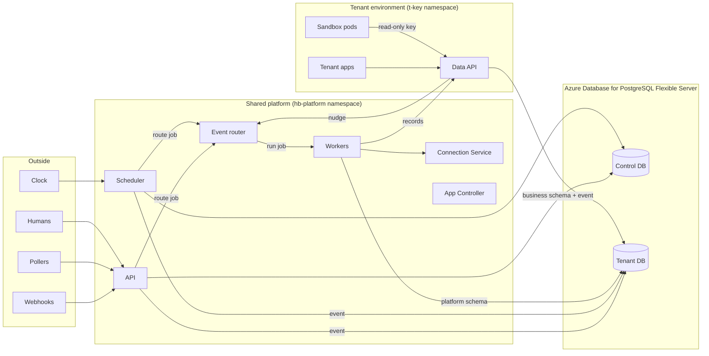
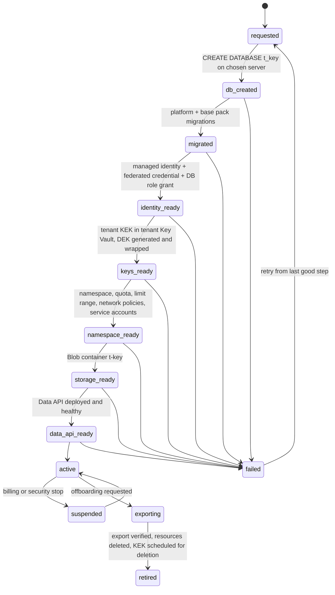
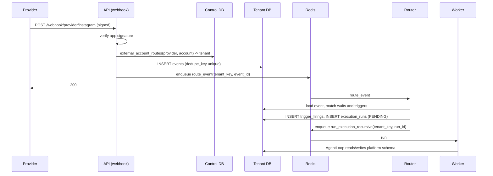
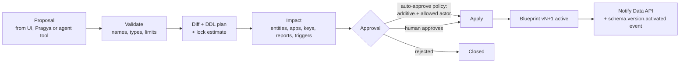
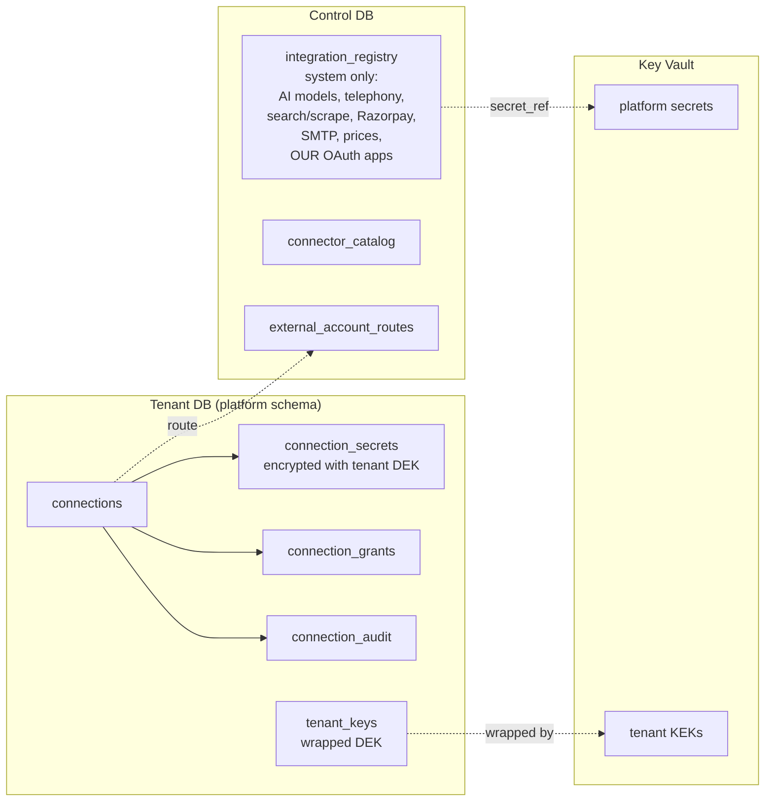
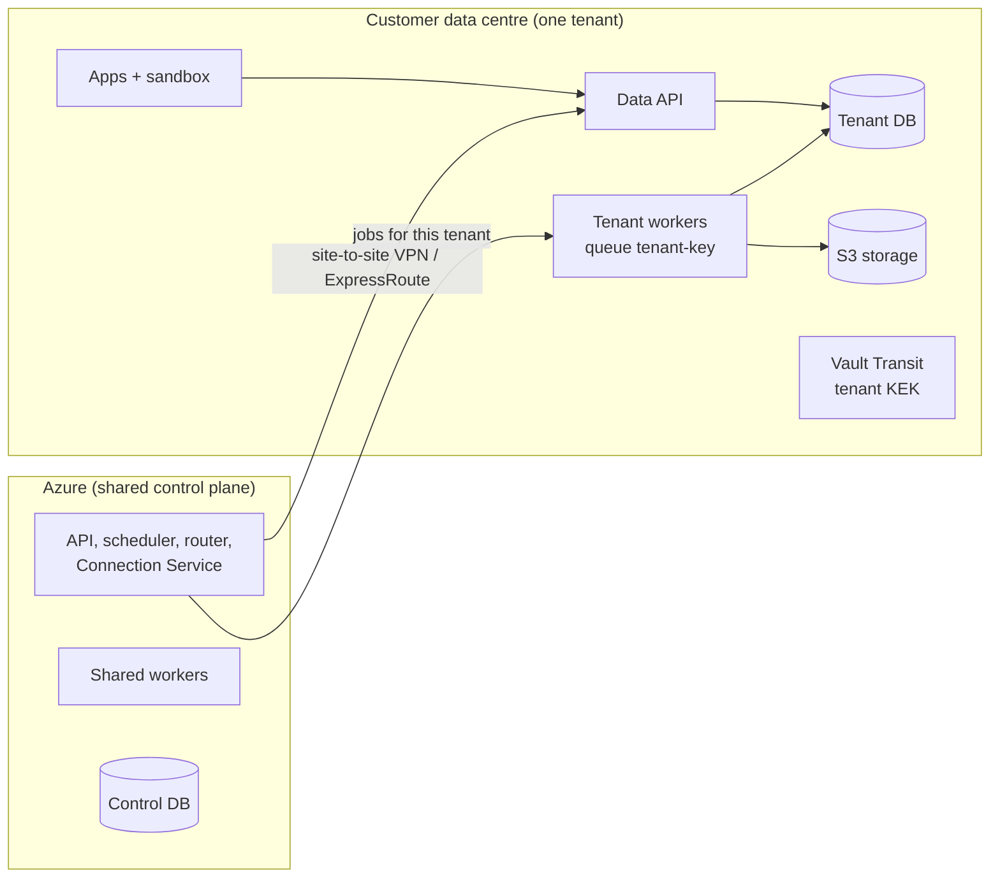

# Phase 14 — Technical Specification

> **Status:** Draft for review. Nothing in this document is implemented yet.
> **Date:** 2026-10-16
> **Scope:** the technical design for every Phase 14 change: event-driven automation, the per-tenant relational data plane with a dynamic schema, the in-tenant Data API, tenant connections, the tenant runtime (sandbox, code lanes, GitHub, app hosting), and the move from GCP to Azure.
> **Read with:** [01 — Implementation plan](01_implementation_plan.md) (who builds what, in which order), [03 — Functional specification](03_functional_spec.md) (what users see), [04 — Azure environment setup](04_azure_environment_setup.md) (how to create the environment).
> **Roadmap anchors:** decisions D12, D25, D34–D40 and open items O10/O11 in [`01-product-decisions.md`](../product-road-map/Refined-Road-Map/01-product-decisions.md); stories in E06, E07, E09, E36, E37 and E41.

---

## Table of contents

1. [Summary](#1-summary)
2. [Where we start from](#2-where-we-start-from)
3. [Target architecture](#3-target-architecture)
4. [Runtime topology on Azure](#4-runtime-topology-on-azure)
5. [Data architecture](#5-data-architecture)
6. [Tenant directory and provisioning](#6-tenant-directory-and-provisioning)
7. [Event-driven automation](#7-event-driven-automation)
8. [Dynamic schema: blueprint and migration engine](#8-dynamic-schema-blueprint-and-migration-engine)
9. [Data API](#9-data-api)
10. [Connections and system integrations](#10-connections-and-system-integrations)
11. [Tenant runtime: sandbox, code lanes, Git and app hosting](#11-tenant-runtime-sandbox-code-lanes-git-and-app-hosting)
12. [Shared platform services on Azure](#12-shared-platform-services-on-azure)
13. [Security model](#13-security-model)
14. [Observability and operations](#14-observability-and-operations)
15. [Moving from GCP to Azure](#15-moving-from-gcp-to-azure)
16. [Configuration changes](#16-configuration-changes)
17. [Testing strategy](#17-testing-strategy)
18. [Technical decisions and spikes](#18-technical-decisions-and-spikes)
19. [Portability: on-premise, hybrid and other clouds](#19-portability-on-premise-hybrid-and-other-clouds)
20. [Appendix A — table placement](#appendix-a--table-placement)
21. [Appendix B — event type catalog](#appendix-b--event-type-catalog)
22. [Appendix C — new and changed APIs](#appendix-c--new-and-changed-apis)

---

## 1. Summary

Phase 14 changes HireBuddha from "a person clicks Run" to "the business runs itself", and gives every tenant its own private data and runtime. In one picture:



The five big moves:

| # | Move | Main decision |
|---|------|---------------|
| 1 | Anything that happens becomes an **event** in the tenant's database; **triggers** decide which agent runs; a **scheduler** owns time; agents can **schedule**, **emit** and **wait**. | D12, E07 |
| 2 | Each tenant gets a **dedicated PostgreSQL database** on Azure Flexible Server with three schemas: `platform`, `business`, `custom`. | D25, D38 |
| 3 | A **Data API** inside each tenant environment is the only door to business records; it is generated from a versioned **schema blueprint** that tenants and agents can grow safely. | D09, D37 |
| 4 | **Tenant connections** (Facebook, WhatsApp, GitHub…) move out of the shared registry into the tenant database, behind a shared **Connection Service** and a new Connections screen. | D40 |
| 5 | Everything runs on **AKS**: shared services in a platform namespace, each tenant in its own namespace, unsafe code in micro-VM sandbox pods, published apps in permanent containers. GCP is switched off after one rehearsed move. | D34–D36, D39 |

---

## 2. Where we start from

Facts from the current code (October 2026) that this design changes:

| Area | Today | File(s) |
|------|-------|---------|
| Execution | `POST /api/v1/execute` writes `execution_runs` (PENDING) and enqueues `run_execution_recursive`; two Arq workers (`arq:queue`, `children`) | `ai/service.py`, `ai/core/arq_jobs.py`, `ai/worker.py`, `common/job_queue.py` |
| Time | Fixed system crons only (CORTEX resume every 5 min, billing, memory, KPI); no tenant schedules; IST hard-coded in CRM tools | `ai/worker.py`, `ai/tools/crm/crm_tools.py` |
| Events | Webhooks normalised into `EventEnvelope`, enqueued as `process_gateway_event`; target agent = endpoint binding → `entity_id` in payload → the company's only agent; `sheet.row_inserted` hard-coded to a campaign; events are not stored | `gateway/envelope.py`, `gateway/agent_choice.py`, `gateway/webhook_inbound.py` |
| Waiting | HITL pause (`PAUSED` + deferred `resume_paused_run`), child fan-out (`WAITING_ON_CHILDREN`), CORTEX `next_resume_at` | `ai/core/approval_pause.py`, `ai/core/arq_jobs.py`, `cortex_memory/models.py` |
| Database | One PostgreSQL 15 (+pgvector) in Docker, 48 tables, one SQLAlchemy engine (`AsyncSessionLocal`), isolation only by hand-written `WHERE company_id = …`, no RLS | `common/database.py`, `migrations/` (92 Alembic versions) |
| Credentials | `integration_registry` holds prices **and** credentials (platform and tenant rows); `social_connections` stores pasted tokens + the tenant's own OAuth client id/secret; `email_connections` holds IMAP app passwords; one `ENCRYPTION_MASTER_KEY` encrypts everything | `config/models.py`, `ai/social_models.py`, `ai/social_router.py`, `ai/email_models.py`, `common/security.py` |
| Sandbox | One long-lived Docker container per company, created through the `docker` CLI on the host, `--network none`, host workspace bind-mounted at the same path, paused/reaped on TTL | `ai/tools/sandbox/tenant_manager.py`, `container_runtime.py`, `workspace.py` |
| Files | Artifacts, uploads, reports and recordings on the VM disk, served by static mounts `/uploads`, `/reports`, `/artifact` | `ai/artifact_service.py`, `main.py` |
| Models | Gemini, Gemini Live, Imagen/Veo and embeddings through Vertex AI with ADC; Claude through Vertex (`AnthropicVertex`); GPT through Azure OpenAI | `common/genai_factory.py`, `ai/llm/anthropic_adapter.py`, `ai/llm/azure_adapter.py` |
| Hosting | Ubuntu VMs on GCP; Apache + certbot; Vite dev server serves the SPA in production; monthly `pg_dump` on the same disk | `start_services.sh`, `deploy/apache`, `deploy/backup` |

What does **not** change: the agent kernel (`AgentLoop`, executors, planner, critics, HITL, CORTEX logic), the billing engine's rules, the voice pipelines' logic. They change *where they read and write*, not *how they think*.

---

## 3. Target architecture

### 3.1 Planes

| Plane | Holds | Where |
|-------|-------|-------|
| **Control plane** (shared) | Identity, users, companies, subscriptions, wallets, billing, usage totals, system integrations, connector catalog, tenant directory, routing indexes (time index, external account routes, phone numbers, webhook endpoints, custom domains) | Control DB `hb_control` on `psql-hb-<env>-control`; shared services in namespace `hb-platform` |
| **Tenant plane** (one per tenant) | Agent definitions, runs, traces, approvals, CORTEX memory, documents index, artifacts index, campaigns and calls, connections, events, triggers, waits, schema blueprint, business records, apps, code items, audit log | Tenant DB `t_<key>` on a pool server or a dedicated server; tenant workloads in namespace `t-<key>`; files in Blob container `t-<key>` |

`<key>` is the **tenant key**: a 10-character lowercase base32 string assigned at provisioning, stored in the tenant directory and never changed. It names every per-tenant resource (namespace, database, Key Vault key, Blob container, managed identity). Human-readable slugs (for hostnames) are separate and can change.

### 3.2 Who runs where

| Component | Kind | Namespace | Talks to |
|-----------|------|-----------|----------|
| API (FastAPI, today's `src.main:app`) | Deployment, HPA | `hb-platform` | Control DB, tenant DBs (platform schema), Redis, Data APIs, Connection Service |
| Workers (Arq: `arq:queue`, `children`, new `events`) | Deployments, KEDA-scaled | `hb-platform` | Same as API + LLM providers |
| Scheduler (new) | Deployment, 2 replicas | `hb-platform` | Control DB (time index), tenant DBs (triggers, events), Redis |
| Event router (new; an Arq worker on queue `events`) | Deployment, KEDA-scaled | `hb-platform` | Tenant DBs, Redis |
| Connection Service (new) | Deployment | `hb-platform` | Control DB, tenant DBs (platform schema), Key Vault (tenant keys), providers |
| Provisioner (new) | Job / Deployment | `hb-platform` | Azure ARM (DB, identity, Key Vault), Kubernetes API, Control DB |
| App Controller (new) | Deployment (operator) | `hb-platform` | Kubernetes API (tenant namespaces), ACR Tasks, tenant DBs |
| Built-in Git (Gitea) | StatefulSet | `hb-platform` | Its own DB on the control server, Azure Files |
| Frontend (production build, nginx) | Deployment | `hb-platform` | — |
| Data API (new; one per tenant) | Deployment (2 replicas min. for paid tiers) | `t-<key>` | Its tenant DB (business/custom schemas), Redis (nudges, rate limits) |
| Tenant apps | Deployments | `t-<key>` | Their Data API; outbound allow-list via egress proxy |
| Sandbox pods | Pods, runtime class Kata | `t-<key>`, scheduled on the sandbox node pool | Egress proxy; their Data API with a short-lived read-only key |
| Egress proxy | Deployment | `hb-system` | Internet via NAT gateway |
| Gateways (Front Door origin gateway, tenant app edge), cert-manager, KEDA | Deployments | `hb-system` | — |

**TD-01:** agent execution stays on **shared** worker pools. A worker opens the tenant DB of the run it is executing. Per-tenant workers are a later enterprise option, not part of Phase 14.

---

## 4. Runtime topology on Azure

```
Azure subscription (per environment)
│
├─ rg-hb-<env>-core   VNet, NAT gateway, private DNS zones, Key Vaults, ACRs, Log Analytics,
│                     Azure Monitor workspace, Managed Grafana, App Insights, managed identities
├─ rg-hb-<env>-data   Flexible Servers (control, pool-01..n, dedicated-*), Managed Redis, Storage account
├─ rg-hb-<env>-aks    AKS cluster aks-hb-<env>   (node resource group: rg-hb-<env>-aks-nodes)
└─ rg-hb-<env>-edge   Front Door profile, DNS zone
```

### 4.1 Network

| Subnet | CIDR (dev) | Use |
|--------|-----------|-----|
| `snet-aks-nodes` | 10.40.0.0/20 | AKS nodes (Azure CNI Overlay; pods use 192.168.0.0/16) |
| `snet-pg` | 10.40.16.0/24 | Delegated to `Microsoft.DBforPostgreSQL/flexibleServers` (private access) |
| `snet-pe` | 10.40.17.0/24 | Private endpoints: Redis, Key Vault, Storage, ACR (staging/prod) |
| `snet-ops` | 10.40.18.0/27 | Optional jump host |

Outbound traffic leaves through a NAT gateway with a **static public IP** — the address partners allow-list (Tata Tele, banks, etc.). Staging and production use 10.41/16 and 10.42/16.

### 4.2 AKS cluster

| Setting | Value |
|---------|-------|
| Network | Azure CNI Overlay, Cilium data plane, Cilium network policy |
| Identity | Managed identity; OIDC issuer + workload identity enabled; Entra ID integration with Azure RBAC for Kubernetes |
| Add-ons | Container Insights, managed Prometheus, Key Vault Secrets Store CSI driver, KEDA |
| OS | Azure Linux on all pools (required by Pod Sandboxing) |
| Outbound | User-assigned NAT gateway |

| Node pool | Purpose | Taint / label | Notes |
|-----------|---------|---------------|-------|
| `system` | Kubernetes system pods | `CriticalAddonsOnly` | 2 nodes in prod |
| `platform` | API, workers, scheduler, router, Connection Service, App Controller, Gitea, frontend | `hb/pool=platform` | Autoscale |
| `apps` | Data APIs and tenant apps (reviewed code) | `hb/pool=apps` | Autoscale |
| `sandbox` | Scratch code only | `hb/pool=sandbox:NoSchedule` | **Pod Sandboxing** (Kata VM isolation): every pod runs in its own lightweight VM. VM size must support nested virtualization. |
| `ded-<key>` (optional) | One enterprise tenant | `hb/tenant=<key>:NoSchedule` | Paid option; AKS supports about 100 node pools per cluster |

Tenants share nodes by default. Isolation between tenants on shared nodes comes from §13.

### 4.3 Namespaces

| Namespace | Contents | Pod Security |
|-----------|----------|--------------|
| `hb-platform` | Shared services (§3.2) | `baseline` |
| `hb-system` | Gateways, egress proxy, cert-manager, KEDA | `baseline` |
| `t-<key>` | One tenant: `data-api`, apps, sandbox pods; `ResourceQuota`, `LimitRange`, default-deny `NetworkPolicy`, service accounts `data-api`, `app-<name>`, `sandbox` | `restricted` |

---

## 5. Data architecture

### 5.1 Servers and databases (D38, O10)

```
psql-hb-<env>-control        (General Purpose, zone-redundant HA in prod)
   └─ hb_control              control plane
   └─ hb_gitea                built-in Git metadata

psql-hb-<env>-pool-01..n     (General Purpose, HA in prod)  ← default home of tenant DBs (recommended for O10)
   └─ t_<key1>, t_<key2>, …   one database per tenant (target ≤ 40 small tenants per server; tune by load)

psql-hb-<env>-t-<key>        (dedicated server for an enterprise tenant)
   └─ t_<key>
```

All servers: PostgreSQL **16** (TD-12), private access only, Microsoft Entra ID authentication (password auth only for break-glass), built-in PgBouncer on, extensions allow-listed: `vector`, `pgcrypto`, `pg_trgm`, `uuid-ossp`, `btree_gin`. Automatic backups with point-in-time restore (7 days dev, 35 days prod), geo-redundant backup in prod.

If O10 is decided as "one server per tenant", only the provisioning step and the tenant directory's `server_id` change; nothing else in this design changes.

### 5.2 Tenant database layout (TD-02)

| Schema | Owner role | Contents | Who may access |
|--------|------------|----------|----------------|
| `platform` | `hb_migrator` | HireBuddha's operational tables for this tenant (Appendix A) and the new tables in §7–§11 | `hb_runtime` (workers, router, scheduler, Connection Service, App Controller): read/write. `hb_dataapi`: insert into `events`, `audit_log`; read `schema_blueprints`, `api_keys`, `app_users`, `app_roles` |
| `business` | `hb_migrator` | Base-pack business tables (v1: `account`, `contact`, `activity`, `consent`) | `hb_dataapi` only |
| `custom` | `hb_migrator` | Tables the tenant or its agents add through the schema engine | `hb_dataapi` only |

Database roles are mapped to Entra identities:

| Entra identity | Postgres role | Databases |
|----------------|---------------|-----------|
| `id-hb-<env>-api` (API) and `id-hb-<env>-worker` (workers, scheduler, router) | `hb_runtime` | `hb_control` (control tables) + every tenant DB |
| `id-hb-<env>-connsvc` | `hb_runtime` (connections tables only, via column/table grants) | every tenant DB |
| `id-hb-<env>-t-<key>` (that tenant's Data API) | `hb_dataapi` | **only** `t_<key>` |
| `id-hb-<env>-migrator` | `hb_migrator` | all |
| `id-hb-<env>-provisioner` | server admin group member | all servers (create/drop database, grant roles) |

No other workload receives database credentials. Sandbox and app pods cannot reach the database subnet at all (§13.2).

### 5.3 Session routing in code

New package `src/common/tenancy/`:

| Module | Responsibility |
|--------|----------------|
| `directory.py` | `TenantDirectory.get(company_id) -> TenantLocation(key, server_host, db_name, status, schema_version, automation_state)`, cached in-process for 60 s and invalidated by a Redis pub/sub message on change |
| `engines.py` | Per-tenant `AsyncEngine` cache (LRU, default 200 engines per process; `pool_size=2`, `max_overflow=3`, target PgBouncer port 6432). Entra access tokens are injected per connection through an `async_creator` and refreshed 5 minutes before expiry (`azure-identity` `DefaultAzureCredential`). Local dev uses password auth. |
| `session.py` | `control_session()` (replaces `AsyncSessionLocal`), `tenant_session(company_id)`, FastAPI dependencies `get_control_db` and `get_tenant_db` (tenant resolved from the authenticated user) |
| `bases.py` | `ControlBase` and `TenantBase` declarative bases. `TenantBase.metadata.schema = "platform"` |
| `migrate.py` | Migration runner CLI: `python -m src.common.tenancy.migrate control\|tenants [--tenant KEY] [--parallel N]` |

Rules:

1. Every ORM model belongs to exactly one base (Appendix A). Models move files only if needed for import hygiene.
2. **No foreign keys across databases.** Tenant tables keep `company_id`, `user_id`, `created_by` as plain UUID columns; integrity is checked in services. Control tables that pointed at tenant rows (`usage_logs.run_id`, `webhook_endpoints.entity_id`, `phone_numbers` agent binding) keep plain UUIDs.
3. A unit of work that touches both planes (for example run finalisation → wallet settlement) uses two sessions and the existing idempotency guards; settlement is keyed by `run_id` so a retry cannot charge twice.
4. Arq job arguments always carry `tenant_key` (or `company_id`) so the worker opens the right database before loading anything.
5. `company_id` filters stay in tenant queries during and after the move as defence in depth.

### 5.4 Migrations

| Tree | Path | Applies to |
|------|------|-----------|
| Control | `backend/migrations/control/` (Alembic) | `hb_control` |
| Tenant platform | `backend/migrations/tenant_platform/` (Alembic, `version_table_schema="platform"`) | every tenant DB, `platform` schema |
| Business base pack | `backend/migrations/tenant_business/` (Alembic, branch label `base_pack`) | every tenant DB, `business` schema |
| Tenant custom | generated by the schema engine (§8), recorded in `platform.schema_changes` | one tenant DB, `custom` schema and `x_` columns |

The runner upgrades tenants in parallel batches (default 10), records each tenant's `schema_version` in the tenant directory, stops a batch on the first failure, and can resume. A release that needs a tenant migration is not "done" until every active tenant reports the new version.

The existing 92 Alembic versions are squashed into one baseline per tree at the cut (`control_0001_baseline`, `tenant_platform_0001_baseline`), generated from the current models and checked with `alembic check` against a database restored from production.

### 5.5 Local development

`docker-compose.yml` keeps one PostgreSQL container, upgraded to `pgvector/pgvector:pg16`, with databases `hb_control`, `t_devacme01`, `t_devbeta001` created by `backend/scripts/dev_tenants.py`. Password auth, same schemas and roles. Developers can run everything on a laptop except Kata sandboxes (the existing `SubprocessRuntime`/Docker runtime remains the local fallback).

---

## 6. Tenant directory and provisioning

### 6.1 Control tables

```sql
-- hb_control
CREATE TABLE tenant_db_servers (
  id            uuid PRIMARY KEY,
  name          text UNIQUE NOT NULL,          -- psql-hb-prod-pool-01
  host          text NOT NULL,                 -- private FQDN
  kind          text NOT NULL CHECK (kind IN ('pool','dedicated')),
  region        text NOT NULL,
  capacity      int  NOT NULL,                 -- max tenants (pool)
  status        text NOT NULL CHECK (status IN ('active','draining','retired'))
);

CREATE TABLE tenant_directory (
  company_id        uuid PRIMARY KEY REFERENCES companies(id),
  tenant_key        text UNIQUE NOT NULL,       -- 10 chars, immutable
  slug              text UNIQUE NOT NULL,       -- hostnames; changeable
  server_id         uuid NOT NULL REFERENCES tenant_db_servers(id),
  db_name           text NOT NULL,              -- t_<key>
  status            text NOT NULL,              -- see state machine
  automation_state  text NOT NULL DEFAULT 'running' CHECK (automation_state IN ('running','paused','stopped')),
  timezone          text NOT NULL DEFAULT 'Asia/Kolkata',
  platform_schema_version text,
  business_schema_version text,
  blueprint_version int,
  data_api_url      text,                       -- http://data-api.t-<key>.svc.cluster.local:8080
  created_at        timestamptz NOT NULL DEFAULT now(),
  updated_at        timestamptz NOT NULL DEFAULT now()
);
```

`companies` gains nothing except the relationship; `timezone` replaces every hard-coded IST.

### 6.2 Provisioning state machine



The Provisioner is idempotent per step (every step checks before it creates) and records each step in `tenant_provisioning_log` (control DB). Company sign-up enqueues provisioning; the user sees "setting up your workspace" until `active`. Existing companies are provisioned by the migration tool (§15).

---

## 7. Event-driven automation

### 7.1 Concepts

| Concept | Meaning |
|---------|---------|
| **Event** | A fact that happened, stored once in the tenant DB: `social.comment.created`, `record.order.updated`, `schedule.fired`, `custom.lead_qualified` |
| **Trigger** | A rule: *when* (schedule, timer, event type + filter, data change, condition) → *run* (entity + input template) under *rules* (concurrency, overlap, catch-up, rate) |
| **Firing** | One decision of a trigger about one event: started a run, or skipped and why |
| **Wait** | A paused run waiting for an event or a deadline |
| **Time index** | A small shared table listing "the next moment something is due" per tenant object, so the scheduler does not scan every tenant DB |

### 7.2 Event envelope v2

```json
{
  "id": "0192f3c1-6b7e-7c39-9a2e-4f6d0c1b2a10",
  "type": "social.comment.created",
  "source": "connector:instagram/17841400000000",
  "subject": "media/17999999999",
  "time": "2026-10-16T09:00:00Z",
  "dedupe_key": "instagram:comment:17999999999_1800000",
  "trust": "verified",
  "causation_id": null,
  "correlation_id": "0192f3c1-6b7e-7c39-9a2e-4f6d0c1b2a10",
  "chain_depth": 0,
  "data": { "text": "Do you ship to Pune?", "author": { "id": "…", "name": "…" } },
  "data_ref": null,
  "schema_version": 2
}
```

* `id` is a UUIDv7 (time-ordered).
* `dedupe_key` is unique per tenant; a second event with the same key is acknowledged and dropped.
* `trust`: `verified` (signature checked or internal), `unverified` (no signature available), `internal` (platform-generated).
* Payloads larger than 256 KB go to Blob (`data_ref`), not the row.
* `chain_depth` = parent event's depth + 1 for events created by runs; it bounds loops (§7.8).

The existing `EventEnvelope` (`gateway/envelope.py`) is extended to v2; `process_gateway_event` is retired after the router takes over (kept behind a flag for one release).

### 7.3 Tenant tables (platform schema)

```sql
CREATE TABLE platform.events (
  id uuid PRIMARY KEY,
  type text NOT NULL,
  source text NOT NULL,
  subject text,
  time timestamptz NOT NULL,
  received_at timestamptz NOT NULL DEFAULT now(),
  dedupe_key text NOT NULL UNIQUE,
  trust text NOT NULL,
  causation_id uuid, correlation_id uuid, chain_depth int NOT NULL DEFAULT 0,
  data jsonb NOT NULL DEFAULT '{}',          -- operational envelope payload, not a business record (D09, D11)
  data_ref text,
  status text NOT NULL DEFAULT 'received'
    CHECK (status IN ('received','routed','parked','dead')),
  attempts int NOT NULL DEFAULT 0,
  last_error text,
  routed_at timestamptz
);
CREATE INDEX ON platform.events (status, received_at) WHERE status IN ('received','parked');
CREATE INDEX ON platform.events (type, time DESC);

CREATE TABLE platform.triggers (
  id uuid PRIMARY KEY,
  name text NOT NULL,
  kind text NOT NULL CHECK (kind IN ('schedule','timer','event','data','condition','manual')),
  enabled boolean NOT NULL DEFAULT true,
  entity_id uuid NOT NULL,                    -- what runs
  entity_version_id uuid,                     -- optional pin
  input_template jsonb NOT NULL DEFAULT '{}', -- {"input": "{{event.data.text}}"}
  event_type text,                            -- 'social.comment.created' or 'record.order.*'
  filter jsonb,                               -- see 7.5
  cron text, timezone text, run_at timestamptz, until_at timestamptz, max_firings int,
  catch_up text NOT NULL DEFAULT 'once' CHECK (catch_up IN ('skip','once','all')),
  overlap text NOT NULL DEFAULT 'skip' CHECK (overlap IN ('skip','queue','allow')),
  max_concurrency int NOT NULL DEFAULT 1,
  rate_per_hour int NOT NULL DEFAULT 60,
  scope text,                                  -- department / process label
  created_by_kind text NOT NULL CHECK (created_by_kind IN ('user','agent','system')),
  created_by_id uuid, created_by_run_id uuid,
  next_fire_at timestamptz, last_fired_at timestamptz, firings int NOT NULL DEFAULT 0,
  paused_reason text,
  version int NOT NULL DEFAULT 1,
  created_at timestamptz NOT NULL DEFAULT now(), updated_at timestamptz NOT NULL DEFAULT now()
);

CREATE TABLE platform.trigger_firings (
  id uuid PRIMARY KEY,
  trigger_id uuid NOT NULL REFERENCES platform.triggers(id),
  event_id uuid REFERENCES platform.events(id),
  run_id uuid,
  decided_at timestamptz NOT NULL DEFAULT now(),
  outcome text NOT NULL CHECK (outcome IN
    ('started','skipped_overlap','skipped_rate','skipped_chain_depth','blocked_budget',
     'blocked_paused','blocked_policy','failed')),
  reason text,
  UNIQUE (trigger_id, event_id)                 -- one decision per trigger per event
);

CREATE TABLE platform.waits (
  id uuid PRIMARY KEY,
  run_id uuid NOT NULL,
  step_ref text NOT NULL,
  event_type text, match jsonb,
  deadline_at timestamptz,
  status text NOT NULL DEFAULT 'waiting'
    CHECK (status IN ('waiting','satisfied','expired','cancelled')),
  satisfied_by_event_id uuid,
  created_at timestamptz NOT NULL DEFAULT now()
);
CREATE INDEX ON platform.waits (event_type) WHERE status = 'waiting';
```

`execution_runs` gains `trigger_id`, `event_id`, `correlation_id`, `chain_depth`. `RunStatus` gains `WAITING_ON_EVENT`.

### 7.4 Control tables

```sql
CREATE TABLE time_index (
  tenant_key  text NOT NULL,
  ref_kind    text NOT NULL CHECK (ref_kind IN ('trigger','wait','connection_refresh','scratch_cleanup')),
  ref_id      uuid NOT NULL,
  due_at      timestamptz NOT NULL,
  lease_owner text, lease_until timestamptz,
  PRIMARY KEY (tenant_key, ref_kind, ref_id)
);
CREATE INDEX ON time_index (due_at);
```

The tenant DB is the source of truth; `time_index` is a cache that the trigger service, wait service and Connection Service keep in step. A nightly reconciler rebuilds each tenant's rows from its tenant DB.

### 7.5 Trigger filters

A small, safe JSON filter language, evaluated in Python (no code execution):

```json
{ "all": [
    { "path": "data.platform", "op": "eq", "value": "instagram" },
    { "any": [
        { "path": "data.text", "op": "contains", "value": "price" },
        { "path": "data.text", "op": "contains", "value": "ship" } ] } ] }
```

Operators: `eq`, `ne`, `in`, `nin`, `gt`, `gte`, `lt`, `lte`, `contains`, `starts_with`, `exists`, `changed` (data triggers: field in the changed set). Maximum depth 4, maximum 20 conditions.

Data triggers use `event_type = 'record.<object>.<created|updated|deleted>'` plus filters on `data.after.<field>` and `data.changed`.

Condition triggers ("stock below 10, checked hourly") are a schedule trigger whose run first calls a deterministic **condition check** (a Data API report query declared on the trigger) and exits without an LLM call when the condition is false. The firing records `skipped_condition_false`.

### 7.6 Flows

**Inbound webhook → event → run**



If the tenant DB is unreachable the webhook endpoint answers **503**, so the provider retries; nothing is acknowledged before it is stored (same principle as SA-09 today).

**Data change → event**: the Data API writes the business row, the audit row and the `record.*` event in **one transaction** (same database), then publishes a nudge `route_event`. A **relay sweep** (every 30 s, per active tenant, `status='received' AND received_at < now()-30s`) re-enqueues anything whose nudge was lost. This is the outbox pattern of D12, with the event table itself as the outbox.

**Schedule → event**: the scheduler (§7.7) inserts `schedule.fired` with `dedupe_key = trigger_id + ':' + scheduled_time`, so a double tick cannot fire twice.

### 7.7 Scheduler

New process `python -m src.automation.scheduler` (Deployment, 2 replicas). Loop every `SCHEDULER_TICK_SECONDS` (default 5):

1. `SELECT … FROM time_index WHERE due_at <= now() AND (lease_until IS NULL OR lease_until < now()) ORDER BY due_at LIMIT 200 FOR UPDATE SKIP LOCKED`; set a 60 s lease.
2. For each row, by `ref_kind`:
   * `trigger`: load the trigger; apply the catch-up rule if `due_at` is older than the grace period (default 10 min): `skip` → record `skipped`, `once` → fire one, `all` → fire each missed time up to 24; insert `schedule.fired` / `timer.fired`; compute `next_fire_at` with `croniter` in the trigger's IANA time zone (`zoneinfo`; DST gaps fire at the next valid minute, DST overlaps fire once); update trigger and `time_index`, or delete the row for a finished timer.
   * `wait`: mark the wait `expired`, enqueue `resume_waiting_run(run_id, reason='timeout')`.
   * `connection_refresh`: enqueue `refresh_connection` on the Connection Service queue.
   * `scratch_cleanup`: enqueue the code-lane cleanup (§11.2).
3. Release the lease by deleting/updating the row.

Today's system crons (`ai/worker.py`) stay on Arq cron; only tenant-visible time moves to the scheduler. The 5-minute CORTEX resume cron is replaced by `wait`/`timer` rows when CORTEX trees are migrated (same semantics, minute precision).

### 7.8 Router and safety rails

`route_event(tenant_key, event_id)` on queue `events`:

1. Load event; return if `status != 'received'` (idempotent).
2. If `automation_state != 'running'` → `parked` (reason `automation_paused`). Parked events are resumed in order when automation restarts.
3. **Waits first:** waiting rows with matching `event_type` and `match` → mark `satisfied`, enqueue `resume_waiting_run`.
4. **Triggers:** enabled triggers whose `event_type` matches (exact or `prefix.*`) and whose filter passes. For each, in a transaction:
   * `chain_depth > AUTOMATION_MAX_CHAIN_DEPTH` (default 5) → `skipped_chain_depth`, emit `automation.loop_blocked`.
   * Rate: Redis token bucket `rl:trig:<key>:<trigger_id>` (`rate_per_hour`) → `skipped_rate`.
   * Overlap/concurrency: count runs of this trigger in non-terminal states → `skip` / `queue` (insert run with `PENDING` and a `not_before`) / `allow`.
   * Tenant concurrency: `AUTOMATION_TENANT_MAX_ACTIVE_RUNS` (default 20; plan-dependent).
   * Budget: the existing credit guard / reservation (E04) — `blocked_budget` with a notification, never a debt.
   * Policy: entity must be `ACTIVE`, published, and allowed to be triggered (`capabilities.automation.triggerable`).
   * Otherwise create `execution_runs` (input from `input_template` rendered with a sandboxed Jinja2 environment, no attribute access to Python objects) and record `started`.
5. Mark event `routed`. Exceptions → Arq retry with backoff (1 min, 5 min, 30 min); after 5 attempts → `dead` + `automation.event_dead` event + notification. Operators can replay dead events (creates a new attempt, same event id, firings stay unique per trigger).

### 7.9 Durable waiting

`wait_for_event` and timers reuse the checkpoint/resume path that HITL already uses:

1. The tool writes a `waits` row (+ `time_index` row if it has a deadline) and raises `RunSuspended(WAITING_ON_EVENT)`.
2. `AgentLoop` checkpoints `context_state`, sets the run to `WAITING_ON_EVENT`, releases the worker.
3. `resume_waiting_run(run_id, event_id | timeout)` (new Arq job) claims the run (`UPDATE … WHERE status='WAITING_ON_EVENT'`), injects the event (or timeout) as the tool result, and continues through `resume_execution`.
4. `sweep_stuck_runs` learns the new status (expired waits with a missed resume are re-enqueued).

### 7.10 Agent tools (new package `src/ai/tools/automation/`)

| Tool | Arguments | Behaviour and limits |
|------|-----------|----------------------|
| `schedule_agent` | `entity` (id or name), `when` (`{"at": iso}` \| `{"in": "3d"}` \| `{"cron": "0 9 * * 1-5", "timezone": "Asia/Kolkata"}`), `input`, `name`, `until`, `max_runs` | Creates a `timer` or `schedule` trigger with `created_by_kind='agent'`. Limits: ≤ 50 active agent-created triggers per tenant, ≤ 5 per run, recurring interval ≥ 15 min, target entity must be in the caller's `capabilities.automation.can_schedule` list (or the same process). Returns trigger id and next fire time. |
| `cancel_schedule` | `trigger_id` | Only triggers created by the same entity or process, unless the caller has admin automation permission. |
| `list_schedules` | `scope` | Triggers the caller may see. |
| `emit_event` | `type` (must start `custom.`), `data`, `subject` | Inserts an event with `causation_id` = the run's triggering event, `chain_depth + 1`, `trust='internal'`. Agents cannot emit `record.*`, `social.*`, `schedule.*` or other platform types. ≤ 20 events per run. |
| `wait_for_event` | `type`, `match`, `timeout` (≤ 30 days) | §7.9. |

All tool calls are audited, metered like other tools, and visible in the run trace.

### 7.11 Record tools (new package `src/ai/tools/records/`)

`describe_schema`, `find_records`, `get_record`, `create_record`, `update_record`, `link_records`, `run_report`, `propose_schema_change`. Each calls the tenant's Data API with a **run token** (§9.3) minted for that run and entity; the entity's `capabilities.records` declares which objects and operations it may use. Tool argument schemas are generated per tenant from the active blueprint so the model sees real object and field names.

### 7.12 Control-room API

`/api/v1/automation/*` (platform API): triggers CRUD and preview of next 10 fire times; firings by trigger; events (filter by type/status/time), event detail with its firings and runs; parked and dead events with replay; waits; tenant and scope pause/resume (`automation_state`, trigger `enabled`, scope-level pause = bulk disable with `paused_reason='scope:<name>'`); health summary (missed schedules, failing triggers, broken connections, dead events, oldest parked event).

### 7.13 Migration of today's paths

| Today | Becomes |
|-------|---------|
| `webhook_endpoints.entity_id` binding | An `event` trigger created per endpoint (`event_type = <endpoint source>.*`); endpoint keeps only tenant routing |
| "The company's only agent" fallback | Removed; unmatched events are `routed` with no firing and visible in the event log |
| `sheet.row_inserted` → campaign branch | An event trigger on `sheet.row_inserted` running the campaign entity; campaign creation becomes a tool the entity calls |
| Campaign pacing deferred jobs | Unchanged in Phase 14 (they are internal pacing, not tenant schedules) |
| CORTEX `next_resume_at` cron | `timer` trigger / `wait` rows |

---

## 8. Dynamic schema: blueprint and migration engine

### 8.1 Blueprint

The blueprint is a versioned JSON document stored in `platform.schema_blueprints` (one row per version, one `active`). It describes every business and custom object the Data API exposes.

```json
{
  "version": 8,
  "base_pack": "1.0",
  "objects": {
    "shipment": {
      "storage": { "schema": "custom", "table": "shipment" },
      "label": "Shipment", "plural": "Shipments",
      "fields": {
        "order":   { "type": "ref", "to": "order", "on_delete": "restrict", "required": true },
        "carrier": { "type": "text", "max_length": 120 },
        "status":  { "type": "enum", "values": ["pending", "in_transit", "delivered"], "default": "pending" },
        "eta":     { "type": "date" },
        "contact_phone": { "type": "phone", "sensitivity": "pii" }
      },
      "indexes": [ ["status"], ["order"] ],
      "unique": [],
      "events": true,
      "row_policies": { "app_user": "owner_user_id = :user_id" },
      "aliases": {}
    }
  }
}
```

Every object automatically gets system columns: `id uuid pk`, `created_at`, `updated_at`, `created_by`, `updated_by`, `row_version int`, `archived_at`, `owner_user_id`.

| Field type | Postgres | Notes |
|-----------|----------|-------|
| `text` | `varchar(n)` | `max_length` ≤ 10 000 |
| `long_text` | `text` | |
| `integer` | `bigint` | |
| `decimal` | `numeric(p,s)` | |
| `money` | `numeric(18,4)` + sibling `<name>_currency char(3)` | |
| `boolean`, `date`, `datetime` | `boolean`, `date`, `timestamptz` | |
| `enum` | `text` + `CHECK (… IN …)` | |
| `email`, `phone`, `url` | `text` + format check in API | |
| `ref` | `uuid` + `FOREIGN KEY` | to base or custom objects only |
| `file` | `uuid` referencing `platform.artifacts` | file bytes in Blob |

No JSON field type for business data (D09).

### 8.2 Naming (TD-06)

* Names match `^[a-z][a-z0-9_]{1,47}$`, are not SQL reserved words, and are not system column names.
* Tenant-defined **tables** live in schema `custom`. Tenant-defined **columns on base-pack tables** are prefixed `x_` (`business.contact.x_loyalty_tier`). Base-pack upgrades never create `x_` columns or `custom` tables, so they cannot collide.

### 8.3 Change operations

| Operation | Allowed directly | Notes |
|-----------|------------------|-------|
| `add_object`, `add_field` (nullable or with default), `add_index`, `add_relation` | yes | additive |
| `rename_field`, `rename_object` | yes | physical rename + `aliases` entry; the Data API accepts the old name for 2 blueprint versions and returns a deprecation header |
| `widen_field` (longer text, bigger numeric) | yes | |
| `make_required`, `add_unique` | after validation | engine counts violating rows first; refuses if any |
| `change_type` (narrowing or incompatible) | no | expressed as add new field → backfill job → switch → archive old |
| `archive_field`, `archive_object` | yes | hidden from API immediately; physical drop only after the retention period (default 90 days) by a separate, approved `purge` change |

### 8.4 Pipeline



* `platform.schema_changes` stores proposal, actor, DDL plan, impact report, approval link (`human_approvals`), status and timings.
* Approval is a governance checkpoint (D20). Default policy: additive changes by an owner/admin apply after a preview; any change proposed by an agent needs human approval unless the tenant enables "auto-approve additive changes by agents"; destructive or narrowing changes always need a human.
* The migration runner applies DDL with `lock_timeout = 5s`, `statement_timeout = 60s`, uses `CREATE INDEX CONCURRENTLY` outside a transaction for tables over 100k rows, and records each statement's outcome. Failure rolls back the transaction (or drops a half-built concurrent index) and leaves the active blueprint unchanged.
* Impact analysis reads entity configurations (`capabilities.records`), app manifests (`platform.apps.declared_objects`), API key scopes, triggers (`record.<object>.*` filters on fields) and saved reports.

### 8.5 Base pack v1

Platform-managed tables in `business`: `account`, `contact` (with lifecycle stage per D10), `activity`, `consent`. Their DDL ships through `migrations/tenant_business/`; their blueprint entries are generated from the same source so the two cannot drift. E06/E13–E18 extend the base pack later (opportunity, segment, campaign, sequence…).

---

## 9. Data API

### 9.1 Service

* Package `backend/services/data_api/` (FastAPI, Python 3.12, same repo, own image `hb-data-api`). One Deployment per tenant namespace, `TENANT_KEY` in its environment, identity `id-hb-<env>-t-<key>`.
* On start: load the active blueprint, build SQLAlchemy Core `Table` objects for every object, generate the OpenAPI document. On `schema.version.activated` (Redis pub/sub channel `tenant:<key>:schema`) reload without restart; requests in flight finish on the old model.
* Health: `/healthz` (process), `/readyz` (DB reachable, blueprint loaded).

### 9.2 Endpoints

| Method | Path | Purpose |
|--------|------|---------|
| GET | `/v1/schema` | Active blueprint (filtered to what the caller may see) |
| GET | `/v1/openapi.json` | Generated OpenAPI 3.1 |
| GET | `/v1/{object}` | List: `filter[field][op]=value`, `sort=-created_at,name`, `page[size]` (default 50, max 500), `page[after]` (opaque cursor), `fields=a,b`, `include=relation` (one level) |
| GET | `/v1/{object}/{id}` | One record; `ETag: "<row_version>"` |
| POST | `/v1/{object}` | Create; `Idempotency-Key` header supported (24 h) |
| PATCH | `/v1/{object}/{id}` | Partial update; `If-Match` required (optimistic concurrency) → `412` on conflict |
| DELETE | `/v1/{object}/{id}` | Archive (`archived_at`); hard delete only where the blueprint allows |
| POST | `/v1/{object}/{id}/links/{relation}` | Link records (many-to-many or ref set) |
| POST | `/v1/batch` | Up to 100 operations in one transaction |
| POST | `/v1/reports` | Aggregates: `group_by`, `count`, `sum`, `avg`, `min`, `max`, time buckets; row cap 10 000; 5 s timeout |
| POST | `/v1/schema/changes` | Propose a change (§8) |
| GET | `/v1/schema/changes/{id}` | Change status and impact |
| POST | `/v1/auth/{app}/signup`, `/login`, `/refresh`, `/magic-link`, `/logout` | App end-user login (§11.6) |

Filter operators: `eq`, `ne`, `in`, `nin`, `gt`, `gte`, `lt`, `lte`, `contains` (trigram), `starts_with`, `is_null`. Unindexed filters on tables above 100k rows are refused with `422 unindexed_filter` unless the caller has the `reports` scope.

### 9.3 Callers and tokens

| Caller | Token | Issued by | Lifetime | Scope |
|--------|-------|-----------|----------|-------|
| Agent run (workers) | **Run token**: JWT `aud=data-api:<key>`, `sub=run:<id>`, `ent=<entity_id>`, `perms` from `capabilities.records` | Platform API signing key (Key Vault key, JWKS served by API) | Run duration, ≤ 2 h, renewable | Declared objects/operations |
| Tenant app | **App key** `hbk_<env>_<random>` (stored hashed in `platform.api_keys`) | Tenant admin / App Controller | Until rotated | Declared objects/operations + row policies |
| App end user | **App user JWT** | Data API `/v1/auth/*` with the tenant app-auth key | 15 min access / 30 day refresh | Row policies of their role |
| Outside system | App key with `external=true` | Tenant admin | Until rotated | As granted; public exposure off by default |
| Scratch code | **Scratch token**: JWT, read-only | Platform API when the sandbox session starts | ≤ 15 min | Read on objects the run may read |
| HireBuddha UI (tenant users) | Platform session JWT exchanged for a short **user token** | Platform API | 15 min | User's role permissions |

### 9.4 Write path

```
BEGIN;
  SET LOCAL statement_timeout = '5s';
  INSERT/UPDATE business.<object> … RETURNING *;          -- row_version = row_version + 1
  INSERT INTO platform.audit_log (actor, action, object, record_id, changed_fields, at);
  INSERT INTO platform.events (type='record.<object>.<verb>', data={id, changed, after:{non-sensitive fields}});
COMMIT;
PUBLISH route nudge (Redis)            -- best effort; the relay sweep covers loss
```

Fields marked `sensitivity: pii|secret` are never copied into event `data` (only their names in `changed`).

### 9.5 Limits and protection

Per-key rate limits (Redis, default 20 req/s burst 100 for app keys, 5 req/s for public keys), request body ≤ 1 MB, batch ≤ 100 ops, response ≤ 10 MB, statement timeout 5 s (reports 30 s for `reports` scope), max 3 `include` relations. All errors use one problem-details JSON shape.

---

## 10. Connections and system integrations

### 10.1 Split (D40)



### 10.2 Control tables

* `integration_registry`: add `secret_ref text` (Key Vault secret name) and service category `OAUTH_APP`; data migration moves every platform secret into Key Vault and nulls `encrypted_api_key`; a check constraint then forces `company_id = <APP company>` (no tenant rows). The `/integrations` screen becomes platform-admin only ("System integrations").
* `connector_catalog`: `id` (`facebook_pages`, `instagram_business`, `linkedin_org`, `whatsapp_business`, `github`, `google_drive`, `gmail`, `outlook_mail`, `imap_mailbox`, `hubspot`, `mcp_server`, …), `provider`, `display_name`, `category`, `auth_type` (`oauth2`, `github_app`, `meta_embedded_signup`, `api_key`, `mailbox`, `mcp`), `scopes`, `capabilities` (actions and webhook events), `oauth_app_ref` (registry row), `status` (`available`, `preview`, `unavailable`, `planned`), `approval` (E09-S11: verification state, expiry, limits), `icon`, `version`. Source of truth: YAML files in `backend/src/connections/catalog/`, synced to the table on deploy.
* `external_account_routes(provider, external_account_id, tenant_key, connection_id, created_at, PRIMARY KEY(provider, external_account_id))`. A second tenant trying to connect an already-routed account is refused with a neutral message.
* OAuth state lives in Redis (`oauth:state:<state>`, 10 min TTL): tenant, user, connector, PKCE verifier (encrypted), return URL.

### 10.3 Tenant tables

```sql
CREATE TABLE platform.connections (
  id uuid PRIMARY KEY,
  connector_id text NOT NULL,
  display_name text NOT NULL,
  external_account_id text, external_account_name text,
  scopes_granted text[] NOT NULL DEFAULT '{}',
  status text NOT NULL CHECK (status IN ('active','expiring','needs_reconnect','revoked','error')),
  token_expires_at timestamptz,
  health jsonb NOT NULL DEFAULT '{}',          -- last_check_at, last_error, last_ok_at
  settings jsonb NOT NULL DEFAULT '{}',        -- non-secret provider settings
  connected_by uuid NOT NULL, connected_at timestamptz NOT NULL DEFAULT now(),
  last_used_at timestamptz, version int NOT NULL DEFAULT 1
);
CREATE TABLE platform.connection_secrets (
  connection_id uuid PRIMARY KEY REFERENCES platform.connections(id) ON DELETE CASCADE,
  dek_version int NOT NULL, nonce bytea NOT NULL, ciphertext bytea NOT NULL,   -- AES-256-GCM
  updated_at timestamptz NOT NULL DEFAULT now()
);
CREATE TABLE platform.connection_grants (
  connection_id uuid REFERENCES platform.connections(id) ON DELETE CASCADE,
  principal_kind text CHECK (principal_kind IN ('all_agents','entity','app')),
  principal_id uuid, actions text[] NOT NULL DEFAULT '{*}',
  PRIMARY KEY (connection_id, principal_kind, principal_id)
);
CREATE TABLE platform.connection_audit (
  id uuid PRIMARY KEY, connection_id uuid NOT NULL,
  action text NOT NULL,   -- connected, token_issued, refreshed, refresh_failed, used, revoked, test_ok, test_failed
  actor_kind text, actor_id uuid, run_id uuid, at timestamptz NOT NULL DEFAULT now(), detail jsonb
);
CREATE TABLE platform.tenant_keys (
  version int PRIMARY KEY, wrapped_dek bytea NOT NULL, kek_key_id text NOT NULL,
  created_at timestamptz NOT NULL DEFAULT now(), retired_at timestamptz
);
```

### 10.4 Encryption (envelope)

* One **KEK** per tenant: RSA-HSM or RSA key `t-<key>` in the tenant-keys vault `kv-hb-<env>-tk-<suffix>` (separate from platform secrets to isolate throttling and blast radius; purge protection on).
* One **DEK** per tenant (256-bit, random) wrapped with the KEK (`wrapKey`), stored in `platform.tenant_keys`. Services unwrap it once and cache it in memory for 10 minutes.
* Secrets are AES-256-GCM encrypted with the DEK; associated data = `connection_id` so ciphertext cannot be swapped between rows.
* Rotation: new DEK version, background re-encryption, old version retired. Offboarding: delete the KEK; after the vault's retention period the tokens are unrecoverable (crypto-shred).

### 10.5 Connection Service

Package `backend/services/connection_service/` (FastAPI, Deployment in `hb-platform`, identity `id-hb-<env>-connsvc`).

| Endpoint | Caller | Purpose |
|----------|--------|---------|
| `GET /v1/connectors` | UI | Catalog entries available to the tenant |
| `POST /v1/connections/start` | UI | Returns the provider authorize URL (OAuth + PKCE) or embedded-signup parameters |
| `GET /oauth/callback/{provider}` | Provider (browser redirect) | Exchanges the code, lists selectable accounts, stores a pending result, redirects to the UI selection step. Registered redirect URI: `https://connect.<domain>/oauth/callback/<provider>` |
| `POST /v1/connections/{pending}/finalize` | UI | Chosen accounts + grants → connection rows, encrypted secrets, routes, provider webhook subscriptions, test call |
| `POST /v1/connections/{id}/test`, `/reconnect` | UI | |
| `DELETE /v1/connections/{id}` | UI | Revoke at provider, delete secret, remove routes, disable dependent triggers, emit `connection.revoked` |
| `POST /internal/v1/tokens` | Workers, App Controller | `{tenant_key, connection_id, principal}` → `{access_token, expires_at}` after grant check; audited; tokens never logged |
| `POST /internal/v1/refresh/{tenant_key}/{id}` | Scheduler (`connection_refresh`) | Refresh before expiry (window 30 min); failure → `needs_reconnect` + `connection.needs_reconnect` event |

Provider-specific notes:

* **GitHub**: GitHub App installation flow (`/installations/new?state=…`); the connection stores `installation_id` and selected repositories; the service mints installation tokens (1 h) with the App private key (Key Vault). Webhooks (`push`, `pull_request`, `issues`, `installation`, `check_suite`) → `github.*` events.
* **Meta (Facebook, Instagram, WhatsApp)**: one HireBuddha Meta app; Pages subscribed with `subscribed_apps`; WhatsApp Business through Embedded Signup (WABA id + phone number id); app-level webhook endpoint `POST /webhook/provider/meta` verifies `X-Hub-Signature-256` with the app secret and routes by page / WABA / phone number id.
* **LinkedIn, Google, X**: OAuth 2.0 with refresh; Google sensitive/restricted scopes only after verification (E09-S11).
* **Mailbox (IMAP/SMTP)**: form-based; reuses `EmailConnectionWizard`; secret = app password.
* **MCP servers**: URL + auth secret; tools discovered but not executable until granted (E09-S02).

Tools stop reading credential tables. `social_connection_service.resolve_connection` and the email tool call `src/connections/client.py`, which calls `/internal/v1/tokens` with the run's identity.

### 10.6 Webhook routing

`POST /webhook/provider/{provider}` (new, app-level, signed) resolves `external_account_routes`; `POST /webhook/inbound/{endpoint_id}` (existing, per tenant endpoint) resolves `webhook_endpoints`. Both produce envelope-v2 events (§7.6). Unknown accounts are written to a control-plane `unrouted_events` table (payload hashed, 7-day retention) and shown to platform admins.

### 10.7 Migration of existing data

| From | To |
|------|----|
| Platform rows of `integration_registry` | Same table, secrets to Key Vault (`secret_ref`) |
| Tenant rows of `integration_registry` (tenant-owned keys) | `platform.connections` (connector `provider_api_key:<provider>`), grants = all agents |
| `social_connections` | `platform.connections` + secrets; status `needs_reconnect` when the row relied on tenant-supplied OAuth client credentials that HireBuddha's app cannot refresh |
| `email_connections` | `platform.connections` (`imap_mailbox`) |
| Pages/accounts in those rows | `external_account_routes` |

Old tables are dropped one release after cutover.

---

## 11. Tenant runtime: sandbox, code lanes, Git and app hosting

### 11.1 Sandbox on AKS (replaces the Docker CLI)

New runtime `KubernetesSandboxRuntime` implementing the existing `SandboxRuntime` protocol (`exec`, `run_browser`, `write_file`, `read_file`, `list_dir`, `ensure`, `pause`, `resume`, `destroy`) in `ai/tools/sandbox/k8s_runtime.py`, selected by `SANDBOX_RUNTIME=kubernetes`.

* `ensure()` creates (or reuses) pod `sbx-<session>` in `t-<key>` with `runtimeClassName: kata-vm-isolation` (name per AKS Pod Sandboxing docs; validated in spike SP-1), `nodeSelector hb/pool=sandbox`, toleration, image `hb-sandbox:<version>` from ACR, non-root, read-only root FS, `emptyDir` workspace (size-limited), CPU/memory limits from the tenant tier, `automountServiceAccountToken: false`.
* The image runs a small **sandbox agent** (HTTP on port 7070, per-pod bearer token) that implements file and exec operations. The platform calls it over the cluster network; tools no longer write to host paths. (This completes the "route tool file IO through the runtime" follow-up noted in `tenant_manager.py`.)
* Scratch workspace persistence: on `pause`/`destroy`, the agent tars changed files to Blob `t-<key>/scratch/<session>/` (retention 7 days by default); `ensure` restores them.
* Network: default deny; egress only to the egress proxy (`hb-system/egress-proxy`, tenant allow-list from settings) and to the tenant's Data API (scratch token required).
* Idle pods are deleted after `SANDBOX_IDLE_DELETE_SECONDS` (default 900); there is no "paused container" on AKS.
* Spike SP-1 compares this with Azure Container Apps dynamic sessions; the `SandboxRuntime` protocol keeps either option open.

### 11.2 Code lanes (D35)

```sql
CREATE TABLE platform.code_items (
  id uuid PRIMARY KEY,
  lane text NOT NULL CHECK (lane IN ('scratch','asset')),
  kind text NOT NULL CHECK (kind IN ('script','tool','skill_script','app')),
  name text NOT NULL,
  scratch_ref text,                 -- Blob prefix while scratch
  repo_id uuid, path text, commit_sha text,   -- once asset
  created_by_run_id uuid, created_by_user_id uuid,
  retention_until timestamptz,      -- scratch only
  status text NOT NULL CHECK (status IN ('active','promoting','promoted','rejected','expired')),
  created_at timestamptz NOT NULL DEFAULT now()
);
```

Promotion (`POST /api/v1/code-items/{id}/promote`):

1. Create a branch in the target repo (GitHub or built-in) with the files and a test scaffold; open a pull request.
2. **Checks** run as a Kubernetes Job in the tenant's sandbox pool: unit tests, `semgrep` (code), `gitleaks` (secrets), dependency audit (`pip-audit` / `npm audit`), and for apps an image build + `trivy` scan. Results are posted to the PR (GitHub Checks API, or Gitea commit status) and stored in `platform.app_builds`/`code_items`.
3. A human with the `code.approve` permission merges the PR (in GitHub, or by approving in HireBuddha, which merges through the App). The merging user is recorded.
4. `code_items.lane = 'asset'`, `commit_sha` set. Nothing at runtime loads code from Blob scratch paths.

Agent-synthesised tools (`ai/tools/meta/tool_synthesis.py`, `ai/tools/sandbox/synthesized_tool.py`) follow the same lanes: experimental use stays scratch; reuse across runs requires promotion.

### 11.3 Git (D36)

* **GitHub (primary):** GitHub App connection (§10.5). Repositories are created in the tenant's organisation or imported. Every agent change: branch `hb/<run-id>-<slug>` + PR.
* **Built-in Git:** one Gitea instance (`hb-platform`, Postgres DB `hb_gitea`, repository storage on Azure Files premium), one organisation per tenant, no public UI in Phase 14 (browsed through HireBuddha). "Connect GitHub later" pushes full history to a new GitHub repository and switches the app's `repo_id`.
* `platform.git_repos(id, provider, external_repo_id, full_name, default_branch, connection_id, created_at)`.

### 11.4 Build

* Builds use **ACR Tasks** (TD-08) against a dedicated registry `acrhbapps<env><suffix>`, repository `t-<key>/<app>`, tag = commit SHA. Source: a tarball fetched with an installation token (GitHub) or from Gitea, uploaded as build context. No Docker daemon in the cluster.
* Dockerfiles come from the app template (§11.6); tenant Dockerfile edits are allowed but scanned.
* Each build records: commit, template version, base image digest, SBOM (`syft`), scan results, duration, cost → `platform.app_builds`.

### 11.5 Deploy, routing and TLS

* **App Controller** (operator, Python `kopf`) owns CRD `tenantapps.hirebuddha.com/v1` (`TenantApp`: tenant key, app name, image digest, env (non-secret), secrets refs, resources, mode `always_on|sleep`, routes, outbound allow-list). From each `TenantApp` it creates `Deployment`, `Service`, route objects, `NetworkPolicy`, `ServiceAccount` (with an app key mounted from a Secret it manages), `PodDisruptionBudget`, and KEDA scaler when `mode=sleep`. Product state (`platform.apps`, `platform.app_deployments`) lives in the tenant DB; the App Controller writes the CR from it.
* **Preview:** `https://<app>-<slug>-pr<n>.apps.<domain>`; expires after 7 days or on PR close.
* **Published:** `https://<app>-<slug>.apps.<domain>` and optional custom domains.
* **Custom domains:** control table `custom_domains(hostname PRIMARY KEY, tenant_key, app_id, status, verification_token, cert_status, created_at)`. Owner adds `CNAME hostname → <app>-<slug>.apps.<domain>` and `TXT _hb-verify.hostname = <token>`; after verification the edge obtains a certificate.
* **Tenant app edge** (spike SP-3): recommended **Caddy with on-demand TLS** (certificates issued at first request, `ask` endpoint checks `custom_domains`, certificate storage in Redis), reverse-proxying by host to `<app>.t-<key>.svc.cluster.local`, behind an Azure Standard Load Balancer with a static IP. The alternative is Gateway API (Envoy Gateway) + cert-manager; it struggles with hundreds of custom-domain listeners, hence the recommendation.
* **Rollback:** the controller keeps the last 5 image digests; rollback = set the previous digest (records are untouched; schema compatibility is checked against the blueprint version the build declared).

### 11.6 Templates and app users

| Template | Stack (proposal, confirm in WS6 kickoff) | Notes |
|----------|------------------------------------------|-------|
| Static website | Astro or plain HTML, served by nginx | No server code |
| Website + forms | Static site + form posts to the Data API (public key with `create` on one object) | Spam protection (rate limit + honeypot) |
| Mobile app backend | FastAPI service using the Data API SDK + app-user auth | Push notifications via a provider connection |
| CRM / admin tool | React (Vite) SPA generated from the blueprint + app-user auth | Role-based screens |

App users (`platform.app_users`, `platform.app_roles`, `platform.app_user_roles`) are per tenant and per app; passwords Argon2id; magic link via the tenant's mail connection or platform SMTP; JWTs signed with a per-tenant app-auth key (wrapped by the tenant DEK). Row policies from the blueprint apply to app-user tokens.

### 11.7 Operating apps and metering

* Logs: stdout → Container Insights, filtered per namespace/app in the Apps screen (last 24 h in UI; longer in Log Analytics).
* Metrics: requests, errors, latency (edge), CPU/memory (managed Prometheus).
* Limits: `ResourceQuota` per tenant tier; per-app requests/limits from the manifest; egress allow-list.
* Metering: hourly job reads Prometheus for each app's CPU/memory requests and egress bytes → `usage_logs` SKUs `app-hosting-vcpu-hour`, `app-hosting-gb-hour`, `app-egress-gb`; daily job allocates database cost per tenant (`tenant-db-pool-share` or `tenant-db-dedicated`).
* Stop and rollback are App Controller operations and work even if workers are down.

---

## 12. Shared platform services on Azure

### 12.1 Files: Blob Storage

New `src/common/storage/` with `StorageBackend` (`put`, `get`, `open_stream`, `delete`, `exists`, `list`, `signed_url`) and two implementations: `LocalDiskBackend` (dev, today's paths) and `AzureBlobBackend` (`azure-storage-blob` aio, `DefaultAzureCredential`, user-delegation SAS). Layout: container `t-<key>` with prefixes `artifacts/`, `uploads/`, `reports/`, `recordings/`, `documents/`, `scratch/`, `skills/`, `sites/`; container `platform` for shared assets. `artifacts.file_path` becomes `storage_key`. Static mounts `/uploads`, `/reports`, `/artifact` are replaced by `GET /api/v1/files/{artifact_id}` → authorization → 302 to a 10-minute SAS URL. Blob versioning and soft delete (14 days) are on.

### 12.2 Secrets and identity

* Platform secrets (JWT signing key, `INTERNAL_TOKEN`, Razorpay, Twilio, Tata, SMTP, provider app secrets) live in `kv-hb-<env>-<suffix>` and reach pods through the Secrets Store CSI driver with workload identity. `.env` files are for local development only.
* `ENCRYPTION_MASTER_KEY` is retired after migration: system secrets are referenced from Key Vault; tenant secrets use tenant DEKs.
* GitHub Actions deploys with OIDC federation (no stored Azure secret).

### 12.3 Redis

Azure Managed Redis, private endpoint, TLS. Used for Arq queues (`arq:queue`, `children`, `events`), run event streams (`run_events:*`), rate limits, OAuth state, schema reload pub/sub, tenant directory invalidation. Spike SP-2 validates Arq against the chosen clustering policy; if multi-key Lua scripts fail under clustering, use a non-clustered configuration (or hash-tag the Arq keys).

### 12.4 Model providers

| Model family | Path on Azure |
|--------------|---------------|
| Gemini, Gemini Live, Imagen/Veo, Gemini embeddings | Still Vertex AI on Google. Pods authenticate with **workload identity federation**: a Google workload identity pool trusts the AKS OIDC issuer; the pod's projected service-account token is exchanged for Google credentials through an `external_account` credential file (no key files). `genai_factory.py` loads credentials from `GOOGLE_WIF_CREDENTIAL_FILE`. Spike SP-4. |
| Claude | Microsoft Foundry (Entra auth) or Anthropic API; `anthropic_adapter.py` gains a provider switch (`service_metadata.provider = foundry\|vertex\|anthropic`). Spike SP-5 checks model availability in the chosen region. |
| GPT | Azure OpenAI (unchanged), moving to managed-identity auth. |

Gemini embeddings stay, so stored vectors remain valid. Live voice latency Azure → Google is measured in SP-8 before the voice path moves.

### 12.5 Edge

* **Azure Front Door (Standard/Premium with WAF)** for `app.`, `api.`, `gateway.`, `connect.` hostnames → origin = platform ingress in AKS (static IP).
* Telephony media WebSockets (`/stream/twilio/*`, `/stream/tata/*`, `/stream/audio`, `/stream/video`) must hold for the full call. Spike SP-7 tests them through Front Door; if timeouts or buffering appear, `gateway.` points straight at the platform ingress (still with TLS), bypassing Front Door.
* Tenant apps use the tenant app edge (§11.5), not Front Door.

### 12.6 Frontend

`npm run build` output served by an nginx container (`hb-frontend`) behind Front Door, with cache headers for hashed assets. The Vite dev server is no longer used outside development.

---

## 13. Security model

### 13.1 Layers

| Layer | Control |
|-------|---------|
| Edge | Front Door WAF (OWASP rules, bot rules, rate limits) on platform hostnames; tenant edge rate limits per host |
| Identity | Entra ID for staff and workloads; platform JWT for users; scoped tokens for the Data API (§9.3) |
| Kubernetes | Namespace per tenant, Pod Security `restricted` for tenant namespaces, Azure RBAC for Kubernetes, images only from the two ACRs (Azure Policy), no host paths, no privileged pods |
| Sandbox | Kata micro-VM per pod, no service-account token, no secrets, egress only via proxy |
| Network | Cilium default-deny + allow matrix (§13.2); databases reachable only from allowed namespaces |
| Data | Separate database per tenant; schema roles (§5.2); per-tenant KEK/DEK; PII never in events |
| Audit | `platform.audit_log` (records), `connection_audit`, `trigger_firings`, Kubernetes audit logs, Key Vault logs |

### 13.2 Network allow matrix (everything else is denied)

| From → To | Allowed |
|-----------|---------|
| `hb-platform` → `t-*/data-api:8080` | yes |
| `hb-platform` → Postgres servers (`snet-pg` :5432/:6432) | yes |
| `t-X/data-api` → its Postgres server :6432 | yes |
| `t-X/app-*` → `t-X/data-api:8080` | yes |
| `t-X/sbx-*` → `t-X/data-api:8080` | yes (scratch token required) |
| `t-X/sbx-*`, `t-X/app-*` → `hb-system/egress-proxy:8888` | yes (allow-list enforced by proxy per tenant/app) |
| `t-X/*` → `t-Y/*` | **no** |
| `t-X/sbx-*` → `t-X/app-*` | **no** |
| `t-X/app-*`, `t-X/sbx-*` → Postgres, Redis, Key Vault, IMDS (169.254.169.254) | **no** |
| `hb-system/tenant-edge` → `t-*/app-*` | yes |
| `hb-system/platform-ingress` → `hb-platform/api`, `connection-service`, `frontend` | yes |

### 13.3 Isolation test suite (E36-S05)

A dedicated suite (`backend/tests/isolation/`) runs in staging on every release: tenant A's user, run token, app key, app-user token and scratch token each attempt to read/write tenant B's records, events, connections, files, triggers and namespaces (Data API, platform API, direct pod-to-pod network, Blob SAS reuse, Key Vault). Every attempt must fail without disclosure. A release cannot be promoted if any case passes.

---

## 14. Observability and operations

* **Traces:** OpenTelemetry (existing) exported to Application Insights; the trace context follows events (`correlation_id`) through router → run → Data API.
* **Metrics:** existing Prometheus metrics (workers, IN-20) plus scheduler lag (`now - min(due_at)`), router queue depth and age, firings by outcome, dead/parked events, Data API latency/errors per tenant, connection refresh failures, app health; collected by managed Prometheus, dashboards in Managed Grafana (`infra/dashboards/` migrated).
* **Logs:** JSON to stdout → Container Insights / Log Analytics; tenant key on every line.
* **Per-tenant health** (E07-S06, E12-S05): tenant directory status, DB reachability, Data API readiness, schema version lag, parked events, broken connections, failing apps → one health object per tenant, shown to the owner and platform admins.
* **Backups and restore:** Flexible Server PITR per server; per-tenant logical export (`pg_dump -n platform -n business -n custom`) nightly to Blob for portability (E36-S06); restore drills monthly in staging.
* **Upgrades:** migration runner gates (§5.4); Data API images roll out tenant by tenant in waves (canary 5% → 50% → 100%).

---

## 15. Moving from GCP to Azure

### 15.1 Data movement

| Data | Method |
|------|--------|
| Control tables | `pg_dump --format=custom` from GCP Postgres (or Azure's PostgreSQL migration service in online mode over a site-to-site VPN for a shorter window) → `hb_control` |
| Tenant-plane tables | **Tenant split tool** `python -m src.common.tenancy.split --source <gcp-dsn>`: for each active company: provision tenant (§6) → `COPY (SELECT … WHERE company_id = $1)` per table in dependency order into `t_<key>.platform` → convert credentials (§10.7) → write a manifest (row counts, per-table checksum `md5(string_agg(id::text \|\| updated_at::text ORDER BY id))`) → compare |
| Files | `azcopy` from the VM disk (artifact, uploads, reports, recordings) into `migration/` then a rewrite job moves each file to `t-<key>/…` and updates `storage_key` |
| CORTEX | Moves with the tenant tables (same database package, tenant base) |
| Redis | Not migrated; queues drain on GCP before the switch; in-flight runs are checkpointed and re-enqueued on Azure |

### 15.2 Switch-over runbook (summary; full runbook in the plan, WS9)

T-7 days: DNS TTL → 60 s; announce window; freeze releases; partners receive the NAT IP.
T-0: pause schedules/campaigns (GCP) → stop accepting new runs → drain/ checkpoint → final copy + split + checksums → DNS to Front Door → smoke tests → reopen → resume schedules on Azure.
Rollback: until reopening, DNS returns to GCP with no data loss. After reopening (the point of no return) fixes go forward.

### 15.3 What stays on Google

The GCP project remains only for Vertex AI model access (D39); compute, disks, IPs and DNS are deleted after the standby period.

---

## 16. Configuration changes

New or changed settings in `common/config.py` (all have local-dev defaults):

| Setting | Purpose |
|---------|---------|
| `PLATFORM_PROFILE` | `local` \| `azure` \| `onprem` — sets the default adapter for every capability (§19) |
| `SECRETS_BACKEND`, `KEY_WRAPPER`, `IMAGE_BUILDER` | Adapter overrides (§19.3) |
| `TRUSTED_PROXY_HEADERS`, `TRUSTED_PROXY_CIDRS` | Which edge (Front Door, Cloudflare, on-premise WAF) may set client-address headers (P-10) |
| `CONTROL_DATABASE_URL` | Replaces `DATABASE_URL` (alias kept one release) |
| `TENANT_DB_AUTH` | `password` (dev) \| `entra_token` \| `vault_dynamic` |
| `TENANT_DB_PORT` | 6432 (PgBouncer) |
| `TENANT_ENGINE_CACHE_SIZE` | Default 200 |
| `AZURE_KEYVAULT_URL`, `AZURE_TENANT_KEYS_VAULT_URL` | Platform secrets / tenant KEKs |
| `AZURE_STORAGE_ACCOUNT_URL`, `STORAGE_BACKEND` | `local_disk` \| `azure_blob` \| `s3` |
| `REDIS_URL` | Azure Managed Redis (TLS) |
| `SCHEDULER_TICK_SECONDS`, `SCHEDULER_GRACE_SECONDS` | 5, 600 |
| `AUTOMATION_MAX_CHAIN_DEPTH`, `AUTOMATION_TENANT_MAX_ACTIVE_RUNS`, `AUTOMATION_AGENT_MAX_SCHEDULES` | 5, 20, 50 |
| `DATA_API_URL_TEMPLATE` | `http://data-api.t-{key}.svc.cluster.local:8080` |
| `DATA_API_JWT_ISSUER`, `DATA_API_SIGNING_KEY_ID` | Run/scratch/user tokens |
| `CONNECTION_SERVICE_URL`, `CONNECT_PUBLIC_BASE_URL` | Internal / OAuth callback base |
| `SANDBOX_RUNTIME` | `subprocess` \| `docker` \| `kubernetes` |
| `SANDBOX_RUNTIME_CLASS`, `SANDBOX_IDLE_DELETE_SECONDS`, `SCRATCH_RETENTION_DAYS` | `kata-vm-isolation`, 900, 7 |
| `APPS_BASE_DOMAIN`, `APPS_IMAGE_REGISTRY`, `GITEA_URL` | App hosting (registry host is a setting, not an ACR assumption — P-09) |
| `GOOGLE_WIF_CREDENTIAL_FILE` | Google federation config |
| `ANTHROPIC_PROVIDER`, `FOUNDRY_ENDPOINT` | Claude routing |
| `APPLICATIONINSIGHTS_CONNECTION_STRING` | Traces |

Removed after cutover: `ENCRYPTION_MASTER_KEY` (kept read-only for the migration), `SANDBOX_WORKSPACE_ROOT` host paths, `SANDBOX_EGRESS_*` Docker network names.

---

## 17. Testing strategy

| Level | What | Where |
|-------|------|-------|
| Unit | Filter language, cron/DST maths, blueprint validation and DDL generation, token scopes, envelope encryption, Data API query building | CI |
| Integration | Tenant routing with two real databases (testcontainers Postgres 16), router + scheduler with Redis, Data API against a generated schema, Connection Service with provider fakes | CI |
| Contract | Data API OpenAPI fuzzing (`schemathesis`) per generated schema | CI |
| Isolation | §13.3 suite | Staging, every release |
| End-to-end | Playwright: create schedule → run fires; connect a fake OAuth provider; propose/approve schema change; promote scratch code; publish an app; custom domain | Staging |
| Resilience | Kill scheduler/router/worker mid-flight; Redis restart; tenant DB failover; duplicate webhooks; lost nudges | Staging |
| Load | k6: 200 events/s routing, 1 000 triggers due in one minute, Data API 500 req/s across 50 tenants | Staging |
| Migration | Full rehearsal with production-like data; counts/checksums; sample runs | Staging (WS9) |
| DR | PITR restore of one tenant DB; export/restore of a tenant into a clean environment | Staging, monthly |

---

## 18. Technical decisions and spikes

### 18.1 Decisions taken in this spec

| ID | Decision |
|----|----------|
| TD-01 | Agent execution stays on shared worker pools; tenant namespaces hold Data API, apps and sandboxes |
| TD-02 | Tenant DB schemas `platform` / `business` / `custom` with role separation; Data API is the only path to `business`/`custom` |
| TD-03 | Events stored in the tenant DB (the event table is the outbox); queue messages carry IDs only; the control plane holds only the time index |
| TD-04 | Separate scheduler process with `SKIP LOCKED` leases; system crons stay on Arq |
| TD-05 | One Data API per tenant generated from the blueprint; row policies enforced in the API |
| TD-06 | Tenant tables in `custom`, tenant columns on base tables prefixed `x_` |
| TD-07 | Shared Connection Service; tokens in tenant DB with per-tenant envelope encryption; tenant KEKs in a separate vault |
| TD-08 | App builds with ACR Tasks into a separate tenant-apps registry |
| TD-09 | GitHub App primary; one shared Gitea for built-in Git |
| TD-10 | Files through `StorageBackend`; Blob + SAS on Azure |
| TD-11 | Operational tables (campaigns, calls, leads, conversations) move to the tenant `platform` schema unchanged in Phase 14; remodelling into GTM business objects is E13–E18 work |
| TD-12 | PostgreSQL 16 for all new servers and local dev |
| TD-13 | Azure resources as code with Bicep (Azure Verified Modules); in-cluster components with Helm. (Terraform is acceptable if the team prefers it; decide at WS0 kickoff.) |
| TD-14 | Application code is cloud-neutral: cloud SDKs live only in adapter modules behind interfaces, so the same code and charts can run on Azure, on-premise, or split between the two (§19) |

### 18.2 Spikes (each ends with a short decision note in `docs/phase14/spikes/`)

| ID | Question | Exit criterion |
|----|----------|----------------|
| SP-1 | AKS Pod Sandboxing vs Azure Container Apps dynamic sessions for scratch code | Existing sandbox tool tests pass; cold start < 10 s; cost per sandbox-hour known |
| SP-2 | Arq on Azure Managed Redis (clustering policy) | Full worker test suite + 1 h soak pass |
| SP-3 | Tenant app edge: Caddy on-demand TLS vs Gateway API + cert-manager | 200 custom domains issued and served in staging |
| SP-4 | Google workload identity federation from AKS for Vertex AI (Gemini, Live, embeddings) | All three work from a pod with no key file |
| SP-5 | Claude via Microsoft Foundry in the chosen region | Adapter tests pass; region and quota confirmed |
| SP-6 | Entra token auth + built-in PgBouncer + per-tenant engines | 200 tenant DBs, token refresh, no connection storms |
| SP-7 | Telephony WebSockets through Front Door | 60-minute call without drops or added latency > 20 ms |
| SP-8 | Gemini Live latency from the Azure region | Within agreed budget vs GCP baseline |
| SP-9 | Sleep-when-idle apps (KEDA HTTP add-on or controller-based) | Wake < 5 s; no lost requests |
| SP-10 | Built-in Git: Gitea vs bare repositories on Azure Files | Push/PR/status flows work through the platform |

---

## 19. Portability: on-premise, hybrid and other clouds

### 19.1 Goal

Azure is the home of the platform (D39). Two other shapes must stay possible **without forking the application code**:

* **On-premise / private cloud:** the whole platform in a data centre we or a partner run.
* **Hybrid (private deployment):** the shared control plane stays on Azure, while one tenant's environment (database, Data API, apps, sandbox, files) runs in that customer's data centre for data-residency reasons (E34).

Portability is a property of the **code and the Helm charts**. Infrastructure-as-code is written per target (Bicep for Azure; whatever the on-premise target uses). Phase 14 keeps the platform portable; it does **not** build or test an on-premise deployment — that becomes its own work item when a customer or cost case needs it.

### 19.2 Rules

| ID | Rule |
|----|------|
| P-01 | Application code depends only on portable contracts: the Kubernetes API, PostgreSQL 16 (wire protocol + the allow-listed extensions `vector`, `pgcrypto`, `pg_trgm`, `uuid-ossp`, `btree_gin`), the Redis protocol, OIDC/JWT, OpenTelemetry and the Prometheus exposition format. |
| P-02 | Cloud SDKs (`azure.*`, `google.cloud.*` for infrastructure, provider CLIs) are imported **only** inside adapter modules under `backend/src/common/platform/<capability>/`. A CI import-contract check (`import-linter`) fails any other import. Model-provider SDKs (`google-genai`, `anthropic`, `openai`) are not infrastructure and stay in `ai/llm/`. |
| P-03 | Each capability has one interface and one adapter per target, chosen by settings: `PLATFORM_PROFILE=azure\|onprem\|local` sets the defaults, and each capability can be overridden (`STORAGE_BACKEND`, `SECRETS_BACKEND`, `KEY_WRAPPER`, `TENANT_DB_AUTH`, `IMAGE_BUILDER`, `SANDBOX_RUNTIME`). |
| P-04 | No managed-service-only behaviour in the data path. Flexible Server–specific functions (`pgaadauth_*`, server parameters) are used only by the provisioning adapter, never by migrations or services. The same migrations run on Flexible Server and on community PostgreSQL. |
| P-05 | Persisted data never contains provider-specific addresses. Files are stored by neutral keys (`t-<key>/artifacts/…`), never Blob URLs; signed URLs are produced at request time by the storage adapter. |
| P-06 | Encrypted data is portable. Ciphertext records the key-wrapper provider and key version; moving a tenant between providers re-wraps its DEK only — connection secrets and app-auth keys are not re-encrypted (§10.4). |
| P-07 | No long-lived static credentials in any target. Azure uses workload identity and Entra tokens; on-premise uses Vault's Kubernetes auth with short-lived dynamic database credentials. |
| P-08 | Helm charts are cloud-neutral. Storage classes, load-balancer annotations, workload-identity annotations, the sandbox runtime class, ingress classes and node-pool labels come from `values-azure.yaml` / `values-onprem.yaml`, never from templates. |
| P-09 | Images are standard OCI images (linux/amd64; arm64 optional) pulled from a configurable registry. Nothing at runtime depends on ACR-specific features. |
| P-10 | The edge is replaceable. Code trusts proxy headers only from a configured list (`TRUSTED_PROXY_HEADERS`, `TRUSTED_PROXY_CIDRS`), so Front Door, Cloudflare or an on-premise WAF can sit in front. |
| P-11 | Observability is configured, not coded: OpenTelemetry exporters and Prometheus scraping are chosen by settings and charts. |
| P-12 | The sandbox stays behind the `SandboxRuntime` protocol; the runtime class name (Azure Pod Sandboxing, or Kata QEMU / Cloud Hypervisor on-premise) is a setting. |

### 19.3 Interfaces and adapters

| Capability | Interface | Azure adapter (built in Phase 14) | On-premise adapter (built when needed) | Local dev / tests |
|-----------|-----------|-----------------------------------|----------------------------------------|-------------------|
| Object storage | `StorageBackend` (§12.1) | `azure_blob` | `s3` (MinIO, Ceph RGW) | `local_disk` |
| Secrets | `SecretsProvider` | `azure_keyvault` (via CSI driver or SDK) | `vault` | `env` |
| Tenant key wrapping | `KeyWrapper` (§10.4) | `azure_keyvault` | `vault_transit` | `local_aesgcm` (dev only) |
| Database authentication | `DbCredentialProvider` (§5.3) | `entra_token` | `vault_dynamic` | `password` |
| Workload identity to other services | `WorkloadTokenSource` | `azure_workload_identity` | `vault_k8s_auth` / projected service-account token | `none` |
| Tenant provisioning | `InfraProvisioner` (§6.2) | `azure` (ARM: database, identity, Key Vault, Blob) | `onprem` (CloudNativePG cluster or database, Vault policy, bucket) | `local` (databases in Docker Postgres) |
| Image builds | `ImageBuilder` (§11.4) | `acr_tasks` | `buildkit` (rootless, in-cluster Job) | `docker` |
| Sandbox | `SandboxRuntime` (§11.1) | `kubernetes` + Pod Sandboxing | `kubernetes` + Kata | `subprocess` / `docker` |
| Google model access | credential file setting (§12.4) | workload identity federation from AKS | federation from the on-premise cluster's OIDC issuer, or a service-account key in Vault | developer ADC |

Interfaces live in `backend/src/common/platform/<capability>/__init__.py`; adapters in sibling modules. The interfaces are part of WS1, WS2 and WS5; Phase 14 implements the Azure and local adapters only.

### 19.4 Component mapping

| Azure (Phase 14) | On-premise equivalent |
|------------------|-----------------------|
| AKS | Self-managed Kubernetes (RKE2, k3s, OpenShift) or AKS on Azure Local |
| Pod Sandboxing | Kata Containers on bare metal (no nested virtualization needed) |
| Azure Database for PostgreSQL Flexible Server | PostgreSQL 16 managed by an operator (CloudNativePG), PgBouncer, pgBackRest backups with point-in-time restore |
| Azure Managed Redis | Redis / Valkey with Sentinel |
| Blob Storage | MinIO or Ceph RGW (S3 API) |
| Key Vault (platform secrets, tenant KEKs) | HashiCorp Vault / OpenBao (KV + Transit) |
| Entra ID, workload identity | Keycloak (people), Vault Kubernetes auth or SPIFFE/SPIRE (workloads) |
| Container registries, ACR Tasks | Harbor; BuildKit Jobs |
| Front Door + WAF | Cloudflare in front, or an on-premise WAF (Coraza / ModSecurity) behind upstream DDoS protection |
| NAT gateway fixed IP | ISP static IPs on the egress firewall |
| Azure Monitor, Managed Grafana, App Insights | Prometheus, Grafana, Loki, Tempo |
| Azure Files (built-in Git storage) | NFS or Ceph RBD/CephFS volumes |

### 19.5 Deployment shapes



| Shape | What changes |
|-------|--------------|
| **Azure** (default) | Nothing: this specification. |
| **On-premise** | `PLATFORM_PROFILE=onprem`, `values-onprem.yaml`, on-premise infrastructure code; every component in §19.4 runs in the data centre; model providers, telephony and social webhooks are still reached over the internet. |
| **Hybrid tenant** | The tenant directory records `location = site:<name>` with that site's Data API URL, database endpoint and key-wrapper. Because workers read and write the tenant's platform schema heavily, a remote tenant gets its own **tenant worker pool** in its site, consuming a dedicated queue `tenant:<key>` (the per-tenant worker option from TD-01). Its files, CORTEX memory and secrets never leave the site. Provider webhooks still enter through the Azure edge and are forwarded over the VPN as events. |

### 19.6 Always cloud-dependent

In every shape these remain internet services: Gemini, Claude and GPT model APIs (unless self-hosted models from E35 are adopted), telephony providers (Twilio, Tata Tele, Exotel), Meta, LinkedIn, Google and GitHub APIs and their webhooks (which need a public HTTPS entry point), and outbound email.

### 19.7 How portability is checked in Phase 14

* **Import contract** (P-02) runs in CI on every pull request.
* **Local profile run:** the backend test suite runs with `PLATFORM_PROFILE=local` against Docker Compose (PostgreSQL 16, Redis, local disk). Because no Azure service is reachable there, a hidden Azure dependency fails the suite.
* **Chart lint:** `helm template` with a stub `values-onprem.yaml` must render without Azure-only annotations in the output.
* **Data portability:** the tenant export (§14) produces a database dump plus neutral-key files that restore into a plain PostgreSQL 16 and an S3 bucket in the DR drill.

---

## Appendix A — table placement

| Table | Plane | Notes |
|-------|-------|-------|
| `companies`, `users`, `refresh_tokens`, `user_devices` | Control | |
| `subscription_tiers`, `subscriptions`, `payment_transactions`, `credit_wallets`, `credit_holds`, `billing_config`, `billing_events`, `usage_logs` | Control | `usage_logs.run_id` becomes a plain UUID |
| `integration_registry`, `model_task_defaults`, `feature_flags` | Control | Registry system-only (§10) |
| `tool_registry_entries` | Control | Platform tool catalog; tenant-specific rows (if any) move to `platform.tool_overrides` |
| `phone_numbers`, `webhook_endpoints` | Control | Routing only; agent bindings become tenant triggers |
| `hierarchical_entities`, `entity_versions`, `entity_assets` | Tenant `platform` | |
| `execution_runs`, `execution_trace_events`, `llm_interaction_logs`, `tool_interaction_logs`, `human_approvals`, `run_subjects` | Tenant `platform` | |
| `documents`, `cortex_trees`, `cortex_nodes`, `cortex_edges` | Tenant `platform` | `cortex_memory` package gets a tenant base |
| `artifacts` | Tenant `platform` | Files in Blob |
| `campaigns`, `campaign_calls`, `campaign_assignees`, `lead_queue`, `contact_uploads`, `call_logs`, `call_content` | Tenant `platform` | TD-11 |
| `voice_sessions`, `whatsapp_sessions`, `conversation_history` | Tenant `platform` | Inbound call routing uses `phone_numbers` (control) to find the tenant first |
| `mobile_call_attempts`, `mobile_call_events`, `mobile_campaign_runs`, `mobile_client_logs` | Tenant `platform` | |
| `email_connections`, `social_connections` | Replaced by `platform.connections` | Dropped after cutover |
| **New control:** `tenant_db_servers`, `tenant_directory`, `tenant_provisioning_log`, `time_index`, `connector_catalog`, `external_account_routes`, `unrouted_events`, `custom_domains` | Control | |
| **New tenant:** `events`, `triggers`, `trigger_firings`, `waits`, `schema_blueprints`, `schema_changes`, `audit_log`, `api_keys`, `app_users`, `app_roles`, `app_user_roles`, `connections`, `connection_secrets`, `connection_grants`, `connection_audit`, `tenant_keys`, `code_items`, `git_repos`, `apps`, `app_builds`, `app_deployments` | Tenant `platform` | |
| **New tenant business:** `account`, `contact`, `activity`, `consent` (+ `custom.*`) | Tenant `business` / `custom` | |

## Appendix B — event type catalog

| Type | Producer | Notes |
|------|----------|-------|
| `schedule.fired`, `timer.fired` | Scheduler | `data.trigger_id`, `data.scheduled_for` |
| `record.<object>.created\|updated\|deleted` | Data API | `data.id`, `data.changed`, `data.after` (non-sensitive) |
| `run.completed`, `run.failed`, `run.cancelled` | Workers | Enables "when X finishes, start Y" without agents calling each other |
| `approval.requested`, `approval.decided` | HITL | |
| `custom.<name>` | Agents (`emit_event`) | Namespace reserved for agents and apps |
| `social.comment.created`, `social.message.received`, `social.mention.created` | Connectors | |
| `whatsapp.message.received`, `whatsapp.status.updated` | Connectors | |
| `email.received` | Mailbox poller | |
| `github.push`, `github.pull_request.opened\|merged\|closed`, `github.issue.opened`, `github.check.completed` | GitHub App | |
| `sheet.row_inserted` | Google Sheets webhook | Existing |
| `crm.<object>.<verb>` | CRM webhooks | Existing adapters |
| `connection.needs_reconnect`, `connection.revoked`, `connection.expiring` | Connection Service | |
| `schema.change.proposed`, `schema.version.activated` | Schema engine | |
| `app.build.succeeded\|failed`, `app.deployed`, `app.unhealthy` | App Controller | |
| `automation.loop_blocked`, `automation.event_dead` | Router | |

## Appendix C — new and changed APIs

| Service | Prefix | New endpoints (summary) |
|---------|--------|-------------------------|
| Platform API | `/api/v1/automation` | triggers, firings, events, waits, pause/resume, health (§7.12) |
| Platform API | `/api/v1/schema` | proposals list, approve/reject (calls the migration runner), history |
| Platform API | `/api/v1/data-keys` | app/external API keys CRUD and rotation |
| Platform API | `/api/v1/code-items` | list, promote, reject |
| Platform API | `/api/v1/apps` | create from blueprint, builds, deployments, publish/unpublish, rollback, domains, app users/roles, logs, metrics, settings |
| Platform API | `/api/v1/files/{id}` | signed download |
| Platform API | `/api/v1/tenant` | timezone, automation state, health |
| Platform API (admin) | `/api/v1/admin/tenants` | directory, move to dedicated server, provisioning log |
| Platform API (admin) | `/api/v1/admin/system-integrations` | today's `/integrations` endpoints, admin-only |
| Platform API | `/webhook/provider/{provider}` | app-level signed webhooks (§10.6) |
| Data API | `/v1/*` | §9.2 |
| Connection Service | `/v1/*`, `/oauth/callback/*`, `/internal/v1/*` | §10.5 |
