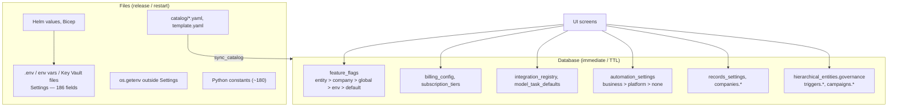

# 01 — Configuration and settings inventory

> **Scope:** every place the product is configured — environment variables, Python settings and constants, YAML/JSON files, deployment values and database rows — what each setting changes in the product, who can change it today, and which settings should move to the database and the UI.
> **Method:** read from the code at `53be0bd` and the local database schema; no code was changed.
> **Billing and costing settings** are listed here briefly and in full in [02](02_costing_and_billing.md).

---

## 1. Summary

| Layer | Where | How many | Changed by | Takes effect |
|---|---|---|---|---|
| A. Platform settings | `backend/src/common/config.py` (`Settings`, read from `.env`, the environment, or Key Vault files mounted at `SETTINGS_SECRETS_DIR`) | 186 settings | Engineers / DevOps (deploy) | Process restart |
| B. Ad-hoc environment reads | `os.getenv` outside `Settings` (10 places) | ~14 variables | Engineers / DevOps | Process restart |
| C. Frontend build variables | `frontend/.env*` (`VITE_*`) | 4 | Engineers (build) | Rebuild |
| D. Deployment values | Helm `infra/k8s/charts/*/values*.yaml`, Bicep `infra/azure/bicep`, `docker-compose.yml` | — | DevOps | Redeploy |
| E. Code constants | Module-level constants in ~60 Python modules | ~180 tunable values | Engineers (code change) | Release |
| F. Files synced to the database | `connections/catalog/*.yaml` (14 connectors), `app_templates/*/template.yaml` (5 templates) | 19 | Engineers; staff override status in UI | Sync / release |
| G. Database configuration | 16 control/tenant tables (feature flags, billing config, tiers, registry, task defaults, automation limits, records settings, company fields, triggers, campaigns, entity governance …) | — | Users in the UI, by role | Immediately or within a cache TTL (15–600 s) |

**Headline findings**

1. Only **layer G** is reachable from the UI. Everything operational that a business owner, a partner or HireBuddha staff would want to tune without a release (credit floors, run quotas, live-call caps, voice guardrails, calling hours, retry back-off, sandbox sizes, preview lifetime, password policy) is in layers A or E.
2. There is **no single settings model**. Five different mechanisms exist side by side — `Settings` (env), feature flags (4-tier DB+env), automation limits (catalogue + platform/business scopes — the best of them), per-table columns (`billing_config`, `records_settings`, `companies`), and per-entity JSON (`governance`). Each has its own validation, caching, permissions and (mostly no) audit trail.
3. **Scope stops at "platform" or "company".** No setting has a *partner* scope, so a reseller cannot set defaults for its tenants (see [03](03_partner_module.md)).
4. A few settings are **read twice with different defaults** or **outside `Settings`** (e.g. `FRONTEND_URL` defaults to `:3000` in `Settings` but to `:5173` in `common/email.py`), and **feature flags accept any key from any admin with no audit** — including the dangerous ones.
5. Roughly **45 settings in layers A/E are good candidates to move to the database** behind a typed catalogue and the UI (§8); about **75** are infrastructure, secrets or bootstrapping and must stay in the environment; the rest are technical limits better left as constants.

---

## 2. Layer A — Platform settings (`Settings`, `common/config.py`)

Loaded once per process by `pydantic-settings` from `.env` (cwd), the environment, and — on AKS — one file per secret under `SETTINGS_SECRETS_DIR` (Key Vault CSI). A setting the environment sets wins over the file. `extra="ignore"`: an unknown or misspelt variable is silently ignored.

Legend for **Move?**: **DB** = move to a database-backed setting with UI; **Keep** = must stay in environment (secret, infrastructure, bootstrap); **Const** = technical limit, fine where it is.

### 2.1 Core, security and edge

| Setting | Default | Effect on the product | Move? |
|---|---|---|---|
| `CONTROL_DATABASE_URL` / `DATABASE_URL` | — (required) | The control database; both names allowed, must agree | Keep |
| `REDIS_URL` | — (required) | Caches, rate limits, run streams, flag invalidation, Arq queues | Keep |
| `SECRET_KEY`, `ALGORITHM` (`HS256`) | — / HS256 | Signs login, URL and e-mail tokens | Keep (secret) |
| `ACCESS_TOKEN_EXPIRE_MINUTES` | 30 | Login session length before refresh | **DB** (security policy, platform scope) |
| `ENCRYPTION_MASTER_KEY` | — (required, ≥32 chars, not a placeholder) | Encrypts every stored third-party credential | Keep (secret) |
| `CORS_ORIGINS` | localhost:3000, a raw IP `34.100.230.121:3000`, dev/app/gateway.hirebuddha.com | Which browser origins may call the API | Keep (but remove the raw IP default) |
| `RATE_LIMIT` | `200/minute` per IP | REST throttling | DB (platform) |
| `WEBHOOK_RATE_LIMIT` | `300/minute` per endpoint | Inbound webhook throttling | DB (platform) |
| `WS_HANDSHAKE_RATE_LIMIT` | `30/minute` per IP | Live socket handshakes | Const |
| `LIVE_SESSIONS_PER_COMPANY` | 20 | Concurrent live AI calls a company may hold; over it calls are refused | **DB** (platform default, tenant/partner override, plan-linked) |
| `FRONTEND_URL` | `http://localhost:3000` | Links in verification/reset e-mails | Keep |
| `EMAIL_LINKS_IN_LOG` | false | Dev only: e-mail links written to the log | Keep (must be off in prod) |
| `INTERNAL_TOKEN` | "" (endpoint disabled) | Guards `POST /internal/event` | Keep (secret) |
| `VIDEO_STREAMING_ENABLED` | true | Browser video calls on/off | DB (feature flag) |
| `STUN_SERVERS`, `TURN_SERVER_URL/USERNAME/CREDENTIAL` | Google STUN / "" | WebRTC ICE | Keep |
| `STREAMING_HOST`, `STREAMING_PROTOCOL` | `localhost:8000`, `ws` | Public address telephony streams and callbacks use | Keep |

### 2.2 Workers, runs and LLM calls

| Setting | Default | Effect | Move? |
|---|---|---|---|
| `WORKER_HEARTBEAT_SECONDS`, `WORKER_BACKLOG_ALERT_SECONDS` | 10, 600 | Health: a worker silent 3 beats is dead; backlog alert | Const |
| `CHILD_WORKER_MAX_JOBS`, `EVENT_WORKER_MAX_JOBS` | 10, 20 | Concurrency of child-run and event workers | Keep (capacity) |
| `*_METRICS_PORT`, `WORKER_METRICS_ADDR` | 9101–9105, 127.0.0.1 | Prometheus endpoints | Keep |
| `WAITING_RESUME_GRACE_SECONDS`, `WAITING_ON_CHILDREN_TIMEOUT_SECONDS` | 120, 3600 | When a parent waiting on children is resumed or failed | DB (platform) |
| `RUNS_STARTED_PER_MINUTE` | 60 | Top-level runs a company may start per minute (0 = off) | **DB** (plan/tenant-linked) |
| `CAMPAIGN_RETRY_BACKOFF_SECONDS` | 600 (doubles per try) | Re-dial delay for busy/no-answer campaign calls | **DB** (per campaign, with platform default) |
| `LLM_CALL_TIMEOUT_SECONDS`, `LLM_CALL_MAX_ATTEMPTS`, `LLM_RETRY_BASE_SECONDS`, `LLM_RETRY_MAX_DELAY_SECONDS` | 300, 3, 1, 30 | Every provider call's timeout and retry policy | DB (platform; per model optional) |

### 2.3 Sandbox, browser and egress

| Setting | Default | Effect | Move? |
|---|---|---|---|
| `SANDBOX_CONTAINER_RUNTIME_ENABLED` | true | Model-written code runs in a per-tenant container (default of flag `sandbox.container_runtime_enabled`) | Keep (safety) |
| `SANDBOX_IMAGE`, `SANDBOX_NETWORK`, `SANDBOX_K8S_*`, `SANDBOX_RUNTIME`, `SANDBOX_AGENT_PORT` | hb-sandbox:local, none, kata … | Which runtime and image | Keep |
| `SANDBOX_MEMORY`, `SANDBOX_CPUS`, `SANDBOX_PIDS_LIMIT` | 1g, 1.0, 256 | Size of a tenant's sandbox | **DB** (plan-linked sizes) |
| `SANDBOX_IDLE_PAUSE_SECONDS`, `SANDBOX_REAP_SECONDS`, `SANDBOX_IDLE_DELETE_SECONDS`, `SANDBOX_SCRATCH_RETENTION_DAYS`, `SANDBOX_K8S_READY_TIMEOUT_SECONDS`, `SANDBOX_SYNC_MAX_BYTES`, `SANDBOX_K8S_WORKSPACE_LIMIT` | 900 s, 1 day, 900 s, 7 d, 480 s, 50 MB, 2Gi | Idle/reap/retention and limits | DB (platform; retention per tenant) |
| `SANDBOX_WORKSPACE_ROOT` | "" (temp dir) | Where tenant workspaces live | Keep |
| `SANDBOX_COST_SKU` | `sandbox-runtime` | Registry SKU sandbox seconds are priced from | Const (see 02) |
| `SANDBOX_PERSISTENT_BROWSER_ENABLED` | false | Master switch above the per-company flag | Keep |
| `SANDBOX_EGRESS_*`, `EGRESS_PROXY_URL`, `EGRESS_PROXY_SECRET` | hb-egress… | Allow-listed outbound proxy | Keep |
| `SANDBOX_EGRESS_ALLOWLIST` | `googleapis.com,google.com` | Hosts synthesized tools may reach | **DB** (platform list + tenant additions with approval) |
| `CHECKS_EGRESS_ALLOWLIST` | npm/pypi | Registries a code-check Job may reach | DB (platform) |
| `LINKEDIN_API_VERSION` | `202509` | LinkedIn API version header | DB (platform; review every 6 months) |

### 2.4 Voice-call guardrails

All global today; they change how every call behaves.

| Setting | Default | Effect | Move? |
|---|---|---|---|
| `VOICEMAIL_DETECTION_ENABLED` | true | Hang up on answering machines | **DB** (per agent/campaign) |
| `VOICEMAIL_NO_SPEECH_SECONDS`, `VOICEMAIL_PHRASE_WINDOW_SECONDS` | 25, 30 | Voicemail heuristics | DB (per campaign) |
| `VOICE_PIPELINE_STALL_SECONDS` | 10 | No first agent audio → call failed | DB (platform) |
| `VOICE_SILENCE_DISCONNECT_SECONDS`, `VOICE_SILENCE_GRACE_SECONDS` | 15, 20 | Both sides silent → wind-down and hang-up | **DB** (per agent) |
| `VOICE_AGENT_STALL_SECONDS`, `VOICE_AGENT_STALL_DISCONNECT`, `VOICE_LEAD_TURN_MAX_SECONDS` | 10, false, 25 | Nudges and hang-ups when the agent stalls | DB (per agent) |
| `VOICE_VAD_RMS_THRESHOLD`, `VOICE_ECHO_SUPPRESS_RMS`, `VOICE_NOISE_GATE_RMS`, `VOICE_NOISE_GATE_HANGOVER_FRAMES`, `VOICE_BARGE_IN_RMS_THRESHOLD` | 300, 600, 40, 10, 1000 | Audio tuning per line quality | DB (per phone provider/number; staff only) |
| `VOICE_AGENT_CACHE_TTL_SECONDS` | 300 | How long agent edits take to reach calls | Const |
| `TATA_AUTH_TOKEN_TTL_SECONDS`, `TATA_STREAM_SUCCESS_KEY` | 43200, `"sucess"` | Smartflo integration details (the key is still the misspelt historical value: *"Verify, then flip"*) | Keep / verify |
| `DEFAULT_PHONE_COUNTRY_CODE` | `91` | Prefixed to 10-digit campaign numbers | **DB** (tenant, from the tenant's country) |

### 2.5 Mobile dialer

| Setting | Default | Effect | Move? |
|---|---|---|---|
| `MOBILE_CALLING_HOURS_START/END`, `MOBILE_CALLING_HOURS_ENFORCED` | 09:30–19:30 **IST**, true | TRAI calling-hours guardrail for reps | **DB** (tenant; in the tenant's time zone and country rules) |
| `MOBILE_REP_DAILY_ATTEMPT_CAP` | 150 | Max call attempts per rep per day | **DB** (tenant / campaign) |
| `MOBILE_ATTEMPT_TTL_SECONDS`, `MOBILE_IDENT_TIMEOUT_SECONDS`, `MOBILE_DTMF_CONFIRM_WAIT_SECONDS`, `MOBILE_MERGE_WAIT_SECONDS`, `MOBILE_DTMF_MERGE_FALLBACK`, `MOBILE_LEASE_SECONDS`, `MOBILE_VERIFICATION_*`, `MOBILE_RECONCILE_WINDOW_SECONDS` | 120, 10, 4, 60, true, 300, … | Call binding/merge timing | Const / platform DB |
| `MOBILE_APP_LATEST_VERSION_CODE/NAME`, `MOBILE_APP_MIN_SUPPORTED_VERSION_CODE`, `MOBILE_APP_DOWNLOAD_URL` | 1, 1.0.0, 1, "" | In-app update prompt | **DB** (staff release screen; today a redeploy to ship an app update) |
| `MOBILE_FCM_SERVICE_ACCOUNT_FILE` | "" | FCM pushes | Keep (secret) |

### 2.6 Phase 14 platform adapters, tenancy, apps, connections, Data API

| Group | Settings (defaults) | Effect | Move? |
|---|---|---|---|
| Cloud adapters | `PLATFORM_PROFILE` (local), `STORAGE_BACKEND`, `STORAGE_LOCAL_ROOT`, `AZURE_STORAGE_*`, `SECRETS_BACKEND`, `AZURE_KEYVAULT_URL`, `WORKLOAD_IDENTITY_BACKEND`, `KEK_BACKEND`, `LOCAL_KEK_DIR`, `AZURE_TENANT_KEYS_VAULT_URL`, `TENANT_KEK_HSM`, `DB_AUTH`, `TOKEN_SIGNER`, `GIT_BACKEND`, `APP_BUILDER`, `APP_RUNTIME`, `DATA_API_MODE`, `SANDBOX_RUNTIME` | Which implementation of storage, secrets, identity, keys, Git, builds, app runtime | Keep |
| Tenancy | `TENANCY_MODE` (single/split), `TENANT_DB_PORT`, `TENANT_ENGINE_CACHE_SIZE` (200), `TENANT_DB_DDL_ROLE`, `TENANT_DB_*_PRINCIPAL(S)`, `PROVISIONING_QUEUE`, `AZURE_*`, `TENANT_IDENTITY_*`, `AKS_OIDC_ISSUER` | Database-per-tenant and provisioning | Keep |
| Storage | `STORAGE_SIGNED_URL_TTL_SECONDS` (600) | Download link lifetime | Const |
| Connections | `CONNECTIONS_PUBLIC_URL`, `CONNECTIONS_RETURN_PATH`, `CONNECTIONS_LEGACY_FALLBACK` (true), `REGISTRY_PLATFORM_ONLY` (**false**), `CONNECTION_REFRESH_WINDOW_SECONDS` (1800), `CONNECTION_EXPIRY_WARNING_DAYS` (7) | OAuth return, migration switches, refresh/expiry warnings | Migration switches: Keep (then delete); warning days: DB (tenant) |
| Automation | `SCHEDULER_TICK_SECONDS` (5), `SCHEDULER_GRACE_SECONDS` (600), `AUTOMATION_GATEWAY_EVENTS` (true) | Scheduler loop and rollback switch | Keep |
| Data API | `DATA_API_SIGNING_KEY(_NAME)`, `DATA_API_TENANT_KEY`, `DATA_API_KEY_ENV`, `DATA_API_URL`, `DATA_API_KEY_RATE/BURST` (20/100), `DATA_API_EXTERNAL_RATE/BURST` (5/25) | Token signing, rate limits per API key | Rates: **DB** (tenant/plan); keys: Keep |
| App users | `APP_USER_ACCESS_MINUTES` (15), `APP_USER_REFRESH_DAYS` (30), `APP_USER_MAGIC_LINK_MINUTES` (15) | Sessions of the tenant's own app users | **DB** (per app / tenant security policy) |
| Kubernetes | `KUBE_API_URL/TOKEN/CA_FILE`, `CHECKS_IMAGE`, `ACR_*` | Cluster access, images | Keep |
| Apps | `APP_BUILD_TIMEOUT_SECONDS` (1800), **`APP_BUILD_COST_PER_SECOND` (0.0001)**, `APPS_DOMAIN`, `APP_PREVIEW_DAYS` (7), `APP_SLEEP_ENABLED` (false), `APP_EDGE_TARGET/IP`, `APP_DATA_API_*_URL`, `PROMETHEUS_QUERY_URL`, `LOG_ANALYTICS_WORKSPACE_ID` | Builds, preview lifetime, domains, metering source | Build cost → **registry SKU** (02); preview days → DB (tenant) |
| Code lanes | `CODE_SCRATCH_RETENTION_DAYS` (7) | Default retention (tenant overrides in `records_settings.scratch_retention_days`) | Already DB-overridable |
| Backups | `BACKUP_KEEP_WEEKS` (5), `PG_DUMP_PATH` | Weekly export retention | Keep |
| Models on Azure | `GOOGLE_WIF_CREDENTIAL_FILE`, `ANTHROPIC_PROVIDER` (vertex), `FOUNDRY_ENDPOINT` | How Google/Claude models are reached | Keep |

---

## 3. Layer B — Environment variables read outside `Settings`

These escape validation, `.env.example` documentation and the Key Vault mount convention.

| Variable | Where | Effect | Issue |
|---|---|---|---|
| `GOOGLE_CLIENT_ID/SECRET`, `MICROSOFT_CLIENT_ID/SECRET` | `auth/router.py:186-211` | Social sign-in | Secrets outside `Settings`; not in `.env.example` |
| `FRONTEND_URL` | `common/email.py:182,215` | Links in verification and dunning e-mails | **Default `http://localhost:5173`**, while `Settings.FRONTEND_URL` defaults to `:3000` |
| `TRACE_MAX_FIELD_BYTES` | `ai/core/trace.py:59` | Max size of a trace field (1 MB) | Undocumented |
| `APPS_NODE_POOL` | `apps/controller.py:65` | AKS node pool for tenant apps | Undocumented |
| `OTEL_SDK_DISABLED`, `OTEL_EXPORTER_OTLP_ENDPOINT` | `common/telemetry.py` | Tracing export | Standard OTel; fine |
| `INSTANCE_ID` | `common/instance.py` | Worker identity | Fine |
| `AI_FLAG_<KEY>` | `ai/core/feature_flags.py` | Env tier of every feature flag | Fine (documented) |
| `HB_ALEMBIC_INI`, `SETTINGS_SECRETS_DIR` | migrate / config | Tooling | Fine |

---

## 4. Layer C — Frontend build variables

| Variable | Effect |
|---|---|
| `VITE_API_BASE_URL` | API origin (falls back to `http://localhost:8000/api/v1` with a console warning) |
| `VITE_PROXY_TARGET` | Dev-server proxy target |
| `VITE_GOOGLE_CLIENT_ID`, `VITE_MICROSOFT_CLIENT_ID` | Social sign-in buttons |

Also hard-coded in the SPA: `vite.config.ts` `allowedHosts` (`dev/app.hirebuddha.com`), and **fallback subscription plans** in `pages/billing/WalletPage.tsx:44` (Starter $29/20 %, Growth $79/30 %, Scale $199/40 %) shown when the API returns no tiers — plans that do not exist server-side (see 02 §10).

---

## 5. Layer D — Deployment values

- **Helm** `infra/k8s/charts/hb-platform/values.yaml` (+ `values-azure.yaml`, `values-onprem.yaml`, per-env files): image tags, replicas (`api.replicas: 1` by decision HD12 — live sockets are in-process), resources, worker queues and KEDA autoscaling, CSI secret objects, and a `config:` block that sets non-secret `Settings` (`PLATFORM_PROFILE`, `STREAMING_PROTOCOL`, `SANDBOX_*`, `WORKER_METRICS_ADDR` …). `hb-bootstrap` sets cluster-level pieces.
- **Bicep** `infra/azure/bicep`: AKS, Postgres, Redis, Key Vault(s), storage, registry, **budget** (`budget.bicep` — Azure cost alert), dev schedule.
- **docker-compose.yml**: local Postgres (pg16, port 5433), Redis, Azurite.

These are correctly infrastructure; none should move to the product database.

---

## 6. Layer E — Code constants (tunable values in Python)

About 180 module-level constants. The ones with a **product effect** (as opposed to protocol constants) are grouped below. ★ marks candidates for the database.

### 6.1 Billing and credits (detail in 02)

| Constant | Value | Effect |
|---|---|---|
| ★ `MINIMUM_EXECUTION_THRESHOLDS` (`billing/credit_service.py:39`) | GRAPH $2.00, LOOP $1.00, PROCESS $0.50, AGENT $0.05, SKILL $0.02, ACTION $0.01; default $0.05 | Free credit needed to start a run / take a call |
| ★ `TOOL_FIXED_COST` (`ai/governance/tool_cost_resolver.py:180`) | image $0.04, video $0.40/s, TTS $0.00045/s, music $0.08 | Price when no registry row |
| ★ `TOOL_SKU_MAP`, `TOOL_CATEGORY`, `FREE_TOOLS` | — | Which SKU prices which tool; which tools are free and why |
| ★ `TOOL_BASELINE_COST`, `MODEL_PRICE_FACTOR`, `_BASE_THINKING_COST` … (`ai/planning/cost_estimator.py`) | e.g. web_search $0.005, opus ×8 | Run-cost estimate → credit hold size |
| `_HISTORY_RUNS` (`ai/core/credit_guard.py`) | 10 | Runs averaged into the hold estimate |
| ★ `ABANDONED_AFTER` (`billing/cron_service.py`) | 24 h | When an unpaid checkout expires |
| ★ `SUBSCRIPTION_TOTAL_COUNT` (`billing/credits_router.py`) | 120 cycles | Razorpay subscription length |
| `TELEPHONY_SKU_MAP`, `GEMINI_INPUT/OUTPUT_SKU`, `tokens_per_second=167` (`voice/usage_logger.py`) | — | Voice pricing SKUs and audio-token estimate |
| `META_TEST_MAX_COST_USD` (`ai/tools/meta/entity_executor.py`) | $1.00 | Budget of a Meta-Agent test run |

### 6.2 Agent runtime

| Constant | Value | Effect |
|---|---|---|
| ★ `MAX_REACT_TURNS` (`ai/constants.py`) | 12 | Tool-calling turns per step |
| `MAX_CONTENT_CHARS`, `MAX_CONTEXT_TRUNCATION_CHARS`, `CONTEXT_SUMMARIZE_THRESHOLD`, `DEFAULT_TIMEOUT_MS` | 50 000, 6 000, 20 000, 60 000 | Context sizing and step timeout |
| ★ `DEFAULT_MAX_RECURSION_DEPTH`, `DEFAULT_MAX_CONCURRENT_CHILDREN` (`ai/governance/composition.py`) | 5, 8 | Default nesting/parallelism (entity governance can override) |
| `MAX_CHILD_RETRIES`, `MAX_FALLBACK_HOPS` | 1, 3 | Retry policy |
| `CRITIC_OUTPUT_TOKENS`, `DEFAULT_THINKING_BUDGET` | 2000, 1024 | Model output budgets |
| ★ `BURST_LIMIT`/`BURST_WINDOW_SECONDS` (`creation_gate.py`), `DEFAULT_DAILY_CREATION_LIMIT` (`anti_sprawl.py`) | 3/60 s, 10/day | How fast agents may create agents |
| Dreaming / graph constants (`ai/constants.py`) | intervals, thresholds | Memory consolidation behaviour |
| `PROMOTE_AFTER`, `RETIRE_AFTER` (`memory/rule_lifecycle.py`) | 3, 3 | Rule lifecycle |

### 6.3 Platform features

| Constant | Value | Effect |
|---|---|---|
| ★ `MIN_PASSWORD_LENGTH`/`MAX` (`auth/service.py`) | 12/128 | Password policy |
| ★ `VERIFICATION_TTL`, `RESET_TTL` (`auth/account_emails.py`) | 24 h, 30 min | E-mail link lifetimes |
| `URL_TOKEN_TTL_SECONDS` | 600 | Short-lived URL tokens |
| ★ `MAX_CPU_CORES`, `MAX_MEMORY_GB`, `MAX_EGRESS_HOSTS`, `KEEP_PUBLISHED` (`apps/service.py`) | 2, 4 GB, 50, 5 | Ceiling for a tenant app's resources | 
| `MAX_UPLOAD_BYTES`, `MAX_ROWS` (`mobile/campaign_setup.py`, `contact_parser.py`) | 10 MB, 50 000 | Contact-upload limits |
| ★ `CONVERSATION_MIN_SECONDS` (`mobile/analytics.py`) | 30 | What counts as a "conversation" in dialer analytics |
| ★ `IN_FLIGHT_FOR`, `CHECK_IN_FLIGHT_SECONDS` (`ai/services/campaign_pacing.py`) | 15 min, 120 s | Campaign pacing |
| `MAX_OBJECTS`/`MAX_FIELDS` (`schema_engine/blueprint.py`), `MAX_PAGE`, `REPORT_ROWS` (`data_api/records.py`) | 200/200, 500, 10 000 | Records engine limits |
| `MAX_ATTACHMENT_BYTES` (email tool) | 18 MB | E-mail attachments |
| `FRAME_SAMPLE_SECONDS` (`gateway/video_gateway.py`) | 5.0 | How often a video call's frame is described (a cost driver) ★ |

---

## 7. Layer F and G — Configuration held in the database

### 7.1 Tables, scopes and screens

| Table (plane) | What it configures | Scope | Who can change it (API) | UI screen | Cache / effect |
|---|---|---|---|---|---|
| `feature_flags` (control) | 18 boolean + 3 numeric flags (agent loop, critics, bandit, planner, sandbox, memory, tool synthesis, video minors) | global / company / entity | app_admin: any; partner_admin & tenant_admin: **own company only**; global: app_admin | `/admin/agent-kernel/feature-flags` (app, partner, tenant admin) | 60 s process cache + Redis invalidation |
| `billing_config` (control) | mf, pf, spf, d, default daily credits, telephony & image overrides | global (`company_id NULL`) / company | app_admin | `/settings/billing` — **global row only** | Read per run/call |
| `subscription_tiers` (control) | name, level, monthly fee, bonus % | platform | app_admin | `/settings/billing` | Immediate |
| `integration_registry` (control) | Model/tool/telephony providers, **prices** (`internal_cost`, `cost_unit`), keys or `secret_ref`, metadata | platform (APP company) / company | app_admin any; partner & tenant admin own company (tenant admins only EMAIL, SOCIAL_MEDIA, API_TOOL, OTHER) | `/integrations`, `/ai-config` | Resolution cache (`config/resolution_cache.py`, ≤600 s) |
| `model_task_defaults` (control) | Which model serves each of 14 task types, with a fallback | company (in practice the APP company) | app_admin | `/ai-config` | Resolution cache |
| `automation_settings` (control) | 12 automation limits + running/paused state | platform row / business row | staff (platform), tenant admins (business) | `/settings/automation`, `/admin/automation` | 60 s; pause 15 s |
| `records_settings` (tenant) | agents auto-approve additive schema changes, scratch-code retention days, public Data API access | business | tenant admin | `/settings/tenant` | Immediate |
| `companies` (control) | name, status (active/suspended), **time zone**, **monthly spend cap (USD)**, logo URL, onboarding state, `default_daily_credits` | company | rename/time zone/cap: app_admin any, partner_admin own + its tenants, tenant_admin own; status: app_admin, partner_admin for its tenants | Platform management, tenant settings, profile | Time zone cached 60 s |
| `tenant_directory`, `tenant_db_servers` (control) | Where each tenant's database lives; pool capacity; automation state | platform | staff | `/admin/tenants` (servers read-only in UI) | 60 s directory cache |
| `connector_catalog` (control) | 14 connectors synced from YAML; staff `status_override`, approval state | platform | app_admin | `/admin/connectors` | On sync |
| `connections.settings` (tenant) | Per-connection options | connection | tenant admin | `/connections/:id` | Immediate |
| `phone_numbers` (control) | Pool numbers, provider, country code, assignment, `monthly_cost_usd` (informational) | platform → company | app_admin; partner/tenant admins assign | `/phone-numbers` | Immediate |
| `campaigns`, `campaign_calls`, `lead_queue` (tenant) | `max_concurrent_calls`, `max_calls_per_hour`, `max_retries`, `max_attempts` | campaign | campaign owners | `/streaming/campaigns` | Immediate |
| `triggers` (tenant) | `rate_per_hour`, `max_concurrency`, `max_firings`, overlap/catch-up | trigger | tenant admins/operators | Agent → Automation tab | Immediate |
| `hierarchical_entities.governance` / `.capabilities` / `.metadata_extensions` (tenant) | Per-agent `max_cost_usd`, `timeout_ms`, `max_recursion_depth`, `max_concurrent_children`, HITL checkpoints, `execution_limits`, debate, `critic_cost_share_pct`, `high_stakes`; tools; per-entity flag overrides | entity (versioned in `entity_versions`) | builder users | Entity builder (six tabs) | Next run |
| `apps.settings` (tenant) | Hosted app options (resources, sleep) | app | tenant admin | `/apps/:id` | Next deploy |

### 7.2 What can be changed from the UI — by role

| Role | Can change on screen |
|---|---|
| **app_admin** | Global billing formula and overrides, subscription tiers, platform integrations and prices, model task defaults, global/company/entity feature flags, platform automation limits, connector status, tenant provisioning, companies (incl. status, spend cap, time zone), phone pool |
| **partner_admin** | Own company and its tenants' name/time zone/spend cap/status; users of own company and tenants; own company's feature flags and integrations; phone-number assignment; **no** billing, pricing or plan settings, **no** per-tenant flags or limits |
| **tenant_admin** | Own company name/time zone/**spend cap**; users; own company's feature flags (including dangerous ones — §9); non-model integrations; automation limits and pause; records settings; connections; agents' governance; campaigns; triggers |
| **users** | Agents (builder), campaigns, triggers, pause automation |

### 7.3 Counting it up

| | Count (approx.) |
|---|---|
| Settings in `Settings` (env) | 186 |
| Ad-hoc env reads | ~14 |
| Tunable code constants | ~180 |
| DB-held settings with a UI | ~75 fields across 16 tables (plus every entity's governance JSON) |
| DB-held settings with **no** UI | per-company `billing_config` rows; `companies.default_daily_credits`; `phone_numbers.monthly_cost_usd` (no effect) |
| Env/constant settings recommended to move to DB + UI (§8) | **~45** |

---

## 8. What can move from files to the database (and be controlled in the UI)

Rules used to decide:

- **Keep in environment:** secrets and keys; anything needed before the database is reachable (DB URLs, Redis, profile/adapters); infrastructure addresses, images, ports; safety master switches staff must be able to force with a redeploy.
- **Move to the database:** values a business, partner or staff member would legitimately tune per customer, per plan or per region without a release; values that differ by country/time zone; prices.
- **Leave as constants:** protocol and memory-safety limits whose change needs engineering judgment.

### 8.1 Recommended moves

| # | Setting(s) | Today | Proposed scope (inherits ←) | Editor | Why |
|---|---|---|---|---|---|
| 1 | `MINIMUM_EXECUTION_THRESHOLDS`, `DEFAULT_MINIMUM_THRESHOLD` | constant | platform ← partner ← tenant | staff (platform), partner (its tenants) | Admission policy is commercial |
| 2 | `TOOL_FIXED_COST`, `APP_BUILD_COST_PER_SECOND`, voice `tokens_per_second` | constant / env | registry SKUs (platform) | staff | Prices belong with all other prices (02 §11) |
| 3 | `LIVE_SESSIONS_PER_COMPANY`, `RUNS_STARTED_PER_MINUTE`, `DATA_API_KEY_RATE/BURST`, `DATA_API_EXTERNAL_RATE/BURST` | env | platform ← plan ← tenant | staff, partner (bounded by its plan) | Capacity is a plan entitlement |
| 4 | `SANDBOX_MEMORY/CPUS/PIDS_LIMIT`, app `MAX_CPU_CORES/MAX_MEMORY_GB/MAX_EGRESS_HOSTS` | env / constant | platform ← plan ← tenant | staff | Plan-linked resource sizes |
| 5 | `MOBILE_CALLING_HOURS_*`, `MOBILE_REP_DAILY_ATTEMPT_CAP`, `DEFAULT_PHONE_COUNTRY_CODE` | env (IST, India) | platform ← country profile ← tenant ← campaign | tenant admin within regulatory bounds set by staff | Regulation is per country; hours should follow `companies.timezone` |
| 6 | `CAMPAIGN_RETRY_BACKOFF_SECONDS`, campaign pacing constants, `CONVERSATION_MIN_SECONDS` | env / constant | platform ← tenant ← campaign | tenant admin | Campaign tuning |
| 7 | Voice guardrails (`VOICEMAIL_*`, `VOICE_SILENCE_*`, `VOICE_AGENT_STALL_*`, `VOICE_LEAD_TURN_MAX_SECONDS`) | env | platform ← agent (voice tab) | builder (bounded) | Agent behaviour differs by use case |
| 8 | Voice audio tuning (`VOICE_*_RMS*`, noise gate) | env | platform ← provider/number | staff | Line quality differs by carrier |
| 9 | `ACCESS_TOKEN_EXPIRE_MINUTES`, password policy, `VERIFICATION_TTL`, `RESET_TTL`, `APP_USER_*` session lengths | env / constant | platform ← tenant (stricter only) | staff; tenant admin may tighten | Enterprise security policy |
| 10 | `LLM_CALL_TIMEOUT_SECONDS`, `LLM_CALL_MAX_ATTEMPTS`, retry delays | env | platform ← model (registry metadata) | staff | Differs per provider |
| 11 | `MAX_REACT_TURNS`, `DEFAULT_MAX_RECURSION_DEPTH`, `DEFAULT_MAX_CONCURRENT_CHILDREN`, agent-creation burst/daily limits | constant | platform ← tenant ← entity governance | staff, tenant admin | Already partly in entity governance |
| 12 | `SANDBOX_EGRESS_ALLOWLIST`, `CHECKS_EGRESS_ALLOWLIST` | env | platform list + tenant additions (approval) | staff approves | Tenants need their own APIs |
| 13 | `MOBILE_APP_LATEST_VERSION_*`, `MOBILE_APP_DOWNLOAD_URL` | env | platform | staff | Ship an app update without a redeploy |
| 14 | `VIDEO_STREAMING_ENABLED`, `FRAME_SAMPLE_SECONDS` | env / constant | feature flag / platform ← tenant | staff | Cost and feature control |
| 15 | `APP_PREVIEW_DAYS`, `CONNECTION_EXPIRY_WARNING_DAYS`, `SANDBOX_SCRATCH_RETENTION_DAYS` | env | platform ← tenant | tenant admin | Retention preferences |
| 16 | `ABANDONED_AFTER`, `SUBSCRIPTION_TOTAL_COUNT` | constant | platform | staff | Billing operations |
| 17 | `LINKEDIN_API_VERSION` | env | platform | staff | Changes twice a year |
| 18 | `RATE_LIMIT`, `WEBHOOK_RATE_LIMIT` | env | platform | staff | Operational |

### 8.2 Must stay in the environment

DB/Redis URLs; `SECRET_KEY`, `ENCRYPTION_MASTER_KEY`, `INTERNAL_TOKEN`, OAuth client secrets, Razorpay keys' *secret part* (should move from `integration_registry.service_metadata` to Key Vault via `secret_ref`); every `*_BACKEND`, `PLATFORM_PROFILE`, `TENANCY_MODE`, Azure/Kube/ACR identifiers; image names; ports; `STREAMING_HOST`, `CORS_ORIGINS`, `FRONTEND_URL`; `SANDBOX_CONTAINER_RUNTIME_ENABLED` and `SANDBOX_PERSISTENT_BROWSER_ENABLED` (master safety switches); worker concurrency; migration switches (`CONNECTIONS_LEGACY_FALLBACK`, `REGISTRY_PLATFORM_ONLY`, `AUTOMATION_GATEWAY_EVENTS`) until they are deleted.

---

## 9. Problems found in configuration

| # | Problem | Where | Effect |
|---|---|---|---|
| C-1 | **Tenant and partner admins can turn on any feature flag for their own company, including `meta_agent.tool_synthesis_enabled` and `tools.video.people_of_all_ages`**, and the API accepts **any `flag_key`** (no check against the catalogue) | `ai/api/admin.py:1334` `set_feature_flag`; `FeatureFlags.set` | Kill switches meant for staff can be flipped by customers; typos create rows nothing reads |
| C-2 | No audit trail for feature flags, billing config, tiers, registry prices, company spend caps (automation limits and records settings keep only the *last* editor in `updated_by`; no history anywhere) | flags, billing, config, company routers | No answer to "who changed the price/flag, when, from what" |
| C-3 | `FRONTEND_URL` read by `os.getenv` with default `:5173` in `common/email.py` while `Settings` defaults to `:3000`; OAuth client ids/secrets read by `os.getenv` | `common/email.py:182,215`; `auth/router.py:186-211` | Wrong links when the env var is missing; secrets bypass the Key Vault convention |
| C-4 | Two sources for a company's daily credits: `companies.default_daily_credits` (set at sign-up, never read again) and `billing_config.default_daily_credits` (what renewals use). The admin "custom daily credits" on company creation is overwritten on the first balance read | `auth/service.py`, `auth/company_router.py:79-96`, `billing/credit_service.py:113` | The override silently does nothing (02 §12, B-6) |
| C-5 | Billing settings screen edits only the **global** `billing_config`; per-company rows exist in the model and API but have no UI, and `GET /billing/config` returns the caller's (APP) company row before the global one | `pages/billing/BillingSettings.tsx`, `billing/billing_router.py:123` | Per-tenant pricing is API-only; the screen could show one row and save another |
| C-6 | Mobile calling hours are fixed to **IST** and India's TRAI rules; `DEFAULT_PHONE_COUNTRY_CODE=91`; `companies.timezone` defaults to `Asia/Kolkata`; `phone_numbers.country_code` defaults `+91` | config, models | Blocks non-Indian tenants; ignores the tenant's own time zone |
| C-7 | `CORS_ORIGINS` default contains a raw public IP (`34.100.230.121:3000`) | `common/config.py:53` | A forgotten dev host is trusted by default |
| C-8 | `extra="ignore"` on `Settings` | `common/config.py:495` | A misspelt variable in production is silently ignored |
| C-9 | `TATA_STREAM_SUCCESS_KEY="sucess"` awaiting verification | `common/config.py:237` | Carried uncertainty in a call-path setting |
| C-10 | `REGISTRY_PLATFORM_ONLY=false`: businesses can still create priced `API_TOOL` registry rows for themselves, and a company row wins over the platform row when tools are priced | `config/router.py`, `tool_cost_resolver.py` | A tenant can set its own tool price (02 B-9) |
| C-11 | `phone_numbers.monthly_cost_usd` and `app_builds.cost` are stored and shown but never billed | `voice/phone_pool_models.py`, `apps/service.py:493` | Looks like a setting; has no effect |
| C-12 | `WalletPage.tsx` falls back to three hard-coded plans when no tiers exist | `pages/billing/WalletPage.tsx:44` | UI offers plans the API rejects (404) |
| C-13 | Two different "health score" formulas (partner router vs reports service) | `auth/partner_router.py:264`, `ai/reports_service.py:454` | Same tenant shows two scores (03) |

---

## 10. Proposed improvement — one settings model

Generalise the pattern `automation/limits.py` already proves (a typed catalogue, scopes that inherit, `null` = explicitly none, validation, on-screen help, a short cache):

1. **`settings_catalogue` in code** — each setting has `key`, `type` (int/decimal/bool/choice/duration/list/money), `unit`, `min/max`, `default`, `scopes allowed` (platform / partner / plan / tenant / entity), `who may edit at each scope`, `sensitivity` (normal / staff-only / dangerous), and help text. Like the flag census test, a test fails when code reads a key that is not catalogued.
2. **`settings_values` table** (control plane): `(key, scope_type, scope_id, value_json, updated_by, updated_at, reason)`, plus **`settings_audit`** (old → new, actor, acting-company, request id).
3. **One resolver** — `entity → tenant → partner → plan → platform → env → code default`, returning the value *and where it came from* (the feature-flag "explain" endpoint already does this), cached per process with Redis invalidation (the flag mechanism already exists).
4. **Bounded delegation** — a scope can only narrow what its parent allows (a partner may lower a tenant's live-session cap, never raise it above the plan; a tenant may tighten password policy, never loosen it). Staff can *lock* a key at a scope.
5. **Fold in** the feature flags (bool keys with entity scope), automation limits (already compatible), records settings, the billing formula (as money/decimal keys with a partner scope), and the ~45 env/constant settings in §8.1.
6. **One generated UI** — a "Settings" screen per scope rendered from the catalogue (label, unit, help, inherited value, "reset to inherited"), with the audit history beside each key; staff get a platform view and a "where is this overridden" search.
7. **Hygiene** — `extra="forbid"` (or a startup warning) on `Settings`; move every `os.getenv` into `Settings`; remove the raw IP from CORS; keep `.env.example` generated from `Settings` so it cannot drift.

The consolidated, prioritised list is in [04](04_consolidated_improvements.md).
