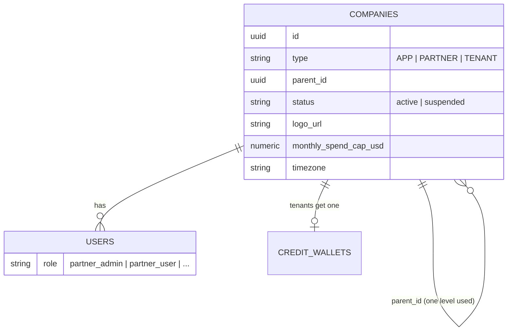

# 03 — Partner module: current rules and a target approach

> **Scope:** what a *partner* (a reseller company of type `PARTNER`, its `partner_admin` and `partner_user` people) can and cannot do today — every rule, with its file — and an approach to make the module functionally rich and robust.
> **Main code:** `backend/src/auth/{models,roles,visibility,company_router,partner_router,service}.py`, `common/tenancy/session.py` (acting company), `ai/{service,reports_service,reports_router}.py`, `billing/*`; UI `pages/PartnerDashboard.tsx`, `pages/dashboards/Partner*Dashboard.tsx`, `pages/reports/Partner*Reports.tsx`, `pages/PlatformManagement.tsx`.
> **Data note:** the local database has **no PARTNER company**; the rules come from the code and schema.

---

## 1. Summary

A partner today is **a company with children and a dashboard**. It can create tenants, manage their users, act inside them, suspend them, and see a health-scored list. It has **no commercial existence**: no partner record (contract, territory, tier), no pricing of its own, no commission or payout ledger, no wallet, no way to fund or grant credits to its tenants, no white-label branding beyond a `logo_url` nothing renders, no partner-scoped settings or templates, and no audit of what it did inside a tenant. The partner fee (`spf`) in the billing formula is a single percentage that is charged even on tenants without a partner and credited to nobody. Several partner screens break or mislead (a dashboard that calls an app-admin-only endpoint, two different health scores, a cost total that double-counts child runs, and raw provider costs shown to partners).

---

## 2. The partner model today



- **Entity:** a `companies` row with `type = 'PARTNER'`; its tenants are rows with `parent_id = partner.id`. There is **no partner-specific table** (no agreement, commission rate, territory, tier, payout details, branding, support contacts).
- **People:** `partner_admin` (manages) and `partner_user` (reads).
- **Depth:** visibility and every partner check use **direct children only** — no sub-partners, no multi-level distribution.

---

## 3. Current rules

### 3.1 Creating partners and tenants

| # | Rule | Where |
|---|---|---|
| P-1 | Only `app_admin` can create a `PARTNER` (or any non-TENANT) company. `CompanyCreate.type` is a free string and `parent_id` is not validated: an app admin can create a TENANT under a TENANT, or a PARTNER under a PARTNER (only a second APP is blocked, by a unique index) | `company_router.py:51`, `schemas.py:61` |
| P-2 | A `partner_admin` can create companies of type **TENANT only**; `parent_id` is forced to the partner's company | `company_router.py:58-61` |
| P-3 | A new tenant gets a wallet (unless `apply_default_daily_credits=false`) and, in split tenancy, its own database is requested. The partner's `custom_daily_credits` for it is overwritten at the first balance read (see 02 B-13) | `company_router.py:79-100` |
| P-4 | Self-registered businesses are TENANTs with **no parent**. `CompanyUpdate` has no `parent_id`, so a tenant **cannot be moved** under a partner (or between partners, or off a partner) after creation — by anyone, through the API | `auth/service.py:create_user`, `schemas.py:79` |
| P-5 | No partner self-sign-up, invitation, referral link or code that attaches a new sign-up to a partner | — |

### 3.2 Visibility and acting inside a tenant

| # | Rule | Where |
|---|---|---|
| P-6 | Partner roles (`partner_admin`, `partner_user`) see their own company and its direct children; nothing else | `visibility.company_scope` |
| P-7 | A partner may work **as** a visible tenant by sending `X-Company-Id`; every tenant-database route using the acting session follows it (agents, runs, records, reports of that tenant, workspace status) | `session.acting_company_id`, `get_acting_tenant_db` |
| P-8 | Acting access is **permanent and silent**: no tenant consent, no time limit, no reason, no audit attribution of "partner X acted in tenant Y" | — |
| P-9 | A partner (or staff) starting a tenant's agent starts **the tenant's** run, billed to **the tenant's** wallet (decision D54) | `ai/service.py:387` |
| P-10 | Templates (`is_template = true`) are visible to everyone; a partner cannot publish templates **only** to its tenants | `ai/service.get_entity` |

### 3.3 People

| # | Rule | Where |
|---|---|---|
| P-11 | `partner_admin` manages users of its own company and of its tenants (create, edit, deactivate) | `auth/service._require_user_admin_over` |
| P-12 | `partner_admin` may assign `partner_admin`, `partner_user`, `tenant_admin`, `tenant_user` | `roles._ASSIGNABLE` |
| P-13 | `partner_user` can see tenants' data but cannot manage users, cannot use `/partner/*` endpoints, and can read the tenant-health report | `partner_router` (`partner_only`), `reports_router.py:117` |
| P-14 | Nothing stops a partner_admin from creating a `partner_admin` *inside a tenant company* (role and company are checked separately), which then has partner visibility of that tenant's (non-existent) children | `roles`, `service` |

### 3.4 Managing tenants

| # | Rule | Where |
|---|---|---|
| P-15 | `partner_admin` can rename its own company and its tenants, set their **time zone** and **monthly spend cap** | `company_router.update_company` |
| P-16 | `partner_admin` can **suspend/reactivate its tenants** (never its own company). A suspended company's users get 403 on every request | same; `dependencies._authenticate_user` |
| P-17 | The tenant's own `tenant_admin` can raise or remove a cap the partner set (no lock) | `update_company` |
| P-18 | A partner cannot set feature flags, automation limits, records settings or integrations **for a tenant** (each is "own company only" for non-staff) — except by acting (`X-Company-Id`) on routes that honour it | `admin.py:1334`, `config/router.py`, `automation/api.py` |
| P-19 | Integrations a partner creates apply to the **partner company only**; tenants never inherit them. Price and model resolution go **tenant → platform**, skipping the partner | `config/router.py:83-88`, `usage_service`, `tool_cost_resolver`, `config/service.py:170` |
| P-20 | Phone numbers: partners may assign agents from any company they can see (own or a tenant's) | `voice/phone_number_router.py:754` |
| P-21 | Campaigns: an app/partner admin may create campaigns on behalf of a tenant; mobile analytics are readable for visible tenants | `campaign_router.py:92`, `mobile/analytics_router.py` |
| P-22 | Partners are approvers for code promotions and admins for Data API tokens and notifications **of their own company** | `code_lanes/service.py:34`, `data_api/tokens.py:33`, `notifications/service.py:24` |

### 3.5 Partner dashboards and reports

| # | Rule | Where |
|---|---|---|
| P-23 | `GET /partner/tenants`: every tenant with a **health score** 0–100 = wallet (top-up + daily) $10+ → 30 pts (pro rata) + active integrations 2+ → 20 + entities 5+ → 25 + runs in 7 days 10+ → 25; green ≥ 70, amber ≥ 40, else red. One query set per tenant, serially | `partner_router.py:34, 264` |
| P-24 | `GET /partner/tenants/{id}/details`: active integrations, 20 latest entities, 10 latest top-level runs **with `total_cost_usd` (base cost, not the billed price)**, users with e-mails | `partner_router.py:71` |
| P-25 | `GET /partner/analytics/summary`: tenant count, entities, runs, cost, wallet total, active/suspended counts. **Cost sums every run including child runs, whose cost is already in their parent's total — child spend is counted twice.** Wallet total counts the top-up bucket only | `partner_router.py:170, 237` |
| P-26 | `GET /reports/analytics/tenant-health` (partner roles): a **different** score — 30-day success rate, minus 20 if wallet (daily + top-up + subscription) < $1 | `reports_service.py:454` |
| P-27 | `GET /reports/analytics/partner-performance` (gross revenue of a partner's tenants) is **app_admin only**; the **partner admin dashboard calls it**, gets 403, and the whole dashboard (`Promise.all`) fails | `reports_router.py:205`, `PartnerAdminDashboard.tsx:16` |
| P-28 | `usage-breakdown` for a partner shows the **partner company's** usage only, not its tenants' | `reports_router.py:105` |
| P-29 | Partner report tabs "Subscription matrix" and "Upsell opportunities" are placeholders | `PartnerAdminReports.tsx:274-283` |

### 3.6 Money

| # | Rule | Where |
|---|---|---|
| P-30 | The partner fee is `sales_partner_fee_pct` (`spf`) in the **global** (or per-company) billing config: `partner fee = c·mf·spf`, added to every tenant's bill — **including tenants with no partner** — and recorded as `partner_fee_amount` in billing events | `billing_service.calculate_tb` |
| P-31 | There is no partner wallet, commission ledger, statement or payout; nothing attributes `partner_fee_amount` to a partner | — |
| P-32 | Partners cannot read the billing config, costing/billing reports, or tiers' admin; cannot set a tenant's price, markup, discount, plan or daily credits | `billing_router` (app_admin only) |
| P-33 | Partners cannot top up or grant credits to a tenant: credit routes use the caller's own company and ignore `X-Company-Id` | `credits_router.py` |
| P-34 | Partners **do** see tenants' base costs (P-24, P-25, cost attribution when acting) — the figure the billing reports hide from everyone but staff to protect margin | — |

### 3.7 Branding

| # | Rule | Where |
|---|---|---|
| P-35 | `companies.logo_url` can be set in onboarding and profile; the SPA does not render a partner's logo for its tenants; no custom domain, colours, e-mail sender or product name per partner | `onboarding_router.py:100`, `profile_router.py:97` |

---

## 4. Gaps against what a reseller needs

| Area | Needed | Today |
|---|---|---|
| Partner record | Agreement, tier, territory, status lifecycle, contacts, payout details, KYC/tax id | A company name and status |
| Hierarchy | Optional sub-partners/agents; move tenants between partners; attach self-sign-ups via referral | One level; parent fixed at creation |
| Pricing | Partner's own price book or markup within platform floor/ceiling; plans for its tenants | Global `spf` only |
| Revenue | Commission or wholesale/retail model; ledger; monthly statement; payout; clawback on refunds | None |
| Funding | Partner prepaid pool; allocate credits to tenants; partner-paid vs tenant-paid tenants | None |
| Delegated admin | Scoped, time-limited, audited access; tenant consent and revoke | Permanent silent `X-Company-Id` |
| Defaults | Partner-scoped settings, flags, limits, models/keys, templates | None |
| Insight | Tenant usage/revenue/margin in the partner's prices; alerts (low balance, churn risk) | Health list with raw costs; broken dashboard |
| Branding | White-label domain, logo, colours, e-mail sender, support links | `logo_url` unused |
| Offboarding | Tenant export rights, delegation revoked, contract end handling | None |

The roadmap already asks for most of this: **E34-S04** ("assignment and delegated roles determine access; pricing/branding privileges are bounded; support actions have audit attribution and time-limited access; tenant offboarding revokes delegation and preserves export rights"), **E04-S02** ("partner pricing edits are scoped"), **E30-F01** (partner lifecycle and revenue).

---

## 5. Target approach

### 5.1 Principles

1. **Partner is a first-class commercial entity**, not just a company type: a profile, an agreement, a tier, and a ledger.
2. **Bounded delegation.** Everything a partner sets is inside limits HireBuddha sets (price floors, plan entitlements, allowed features); everything a partner does inside a tenant is scoped, attributed and revocable.
3. **One settings and pricing resolution chain** — `entity → tenant → partner → plan → platform` (01 §10) — so partners get defaults "for free" wherever settings exist.
4. **Money flows are explicit** — who pays HireBuddha, who pays whom, in which currency (02 §13).

### 5.2 Domain model (new tables)

```text
partner_profiles        company_id (PK, type PARTNER), legal_name, country_code, billing_currency,
                        tax_id, tier_id, status (prospect|onboarding|active|suspended|terminated),
                        agreement_ref, territory (JSON), support_email, support_url, payout_details_ref (vault)
partner_tiers           id, name, commission_pct | wholesale_discount_pct, min_monthly_commit,
                        max_tenants, allowed_features (JSON), pricing_bounds (JSON: min/max markup, floors)
partner_agreements      id, partner_id, version, model (commission|wholesale|referral), terms (JSON),
                        effective_from/to, signed_at, signed_by
partner_assignments     partner_id, tenant_id, relationship (resold|referred|managed), since, until,
                        billing_mode (tenant_pays|partner_pays), price_book_id
partner_access_grants   id, partner_id, tenant_id, grantee_user_id|role, scopes (read|support|admin|billing),
                        reason, granted_by (tenant admin or policy), expires_at, revoked_at
partner_ledger          id, partner_id, tenant_id, period, kind (commission|wholesale_cost|payout|adjustment|clawback),
                        amount, currency, source (billing_event_id/payment_id), created_at
partner_statements      partner_id, period, currency, totals, status (draft|issued|paid), document_ref
partner_branding        partner_id, product_name, logo_ref, colours, custom_domain, email_from, terms_url, support_url
referral_codes          code, partner_id, campaign, expires_at, uses
```

`companies.parent_id` stays as the tree, but **ownership and billing come from `partner_assignments`**, which has history (from/until) so a tenant can move between partners with correct attribution over time.

### 5.3 Commercial models to support (configurable per agreement)

| Model | How a tenant's bill is computed | What the partner earns | Who collects |
|---|---|---|---|
| **Referral** | Platform price book | `commission_pct` × tenant's billed revenue (net of tax, refunds) | HireBuddha; partner paid monthly |
| **Resell — commission** | Partner's price book (markup within bounds) on top of platform base | The markup + optional platform commission | HireBuddha collects from the tenant; pays partner |
| **Resell — wholesale** | Partner's price book to tenant | Retail − wholesale | Partner collects from its tenants (own gateway) and prepays HireBuddha from a **partner pool wallet**; tenants' usage draws from allocations of that pool |

This replaces the global `spf`: the platform formula becomes `c·mf·(1 + pf − d)` and the partner part comes from the partner's price book and agreement. The `partner_fee_amount` column is kept and filled per tenant from the partner's book, and each settlement writes the matching `partner_ledger` row.

### 5.4 Capabilities to add (by area)

**A. Onboarding and lifecycle**
- Staff onboard partners: profile, tier, agreement (versioned, e-signature reference), status lifecycle with checks (KYC/tax id, payout details in Key Vault).
- Partner invites/creates tenants; **referral links/codes** attach self-sign-ups; staff can **reassign** a tenant (with effective date) — attribution follows `partner_assignments`.
- Offboarding: terminate agreement → tenants either move to direct or another partner; delegation revoked; tenant keeps data and export rights (E34-S04).

**B. Delegated administration**
- Replace silent `X-Company-Id` with **access grants**: scopes (read, support, admin, billing), optional tenant approval, expiry (e.g. 24 h support sessions), reason text; break-glass for staff.
- Every request made while acting carries `acting_partner_id` and is written to `audit_log` (who, as whom, what, when); tenants see "Partner access" history and can revoke.
- `partner_user` gets read + support scopes by default; `partner_admin` manages grants.

**C. Partner-scoped defaults**
- Settings, feature flags (from the safe list only), automation limits, credit floors, live-session caps — at **partner scope**, inherited by its tenants, overridable downward within bounds.
- **Partner model/integration pool**: a partner may register its own provider keys/SKUs that its tenants inherit (resolution `tenant → partner → platform`), with the partner's price for them.
- **Partner template library**: templates visible only to the partner's tenants (template `owner_scope = partner`).

**D. Pricing, plans and funding**
- Partner **price books** (02 §13) bounded by tier `pricing_bounds`; partner-defined plans/packs for its tenants mapped to platform tiers.
- Tenant `billing_mode`: tenant pays (gateway) or partner pays (allocations from the **partner pool wallet**, with per-tenant budgets, auto-allocation, low-pool alerts).
- Partner can **grant promotional credits** to tenants from its pool (ledgered).

**E. Revenue and settlement**
- `partner_ledger` written at every settlement and payment (commission, wholesale cost, refunds/clawbacks).
- Monthly **partner statement** (per currency), approval by staff, payout export; dispute/adjustment flow.
- Partner sees tenant revenue and its earnings **in its prices**; never platform base cost (fix P-34).

**F. Insight and alerts**
- One health score (fix P-23/P-26): usage trend, success rate, balance runway (days of credit at current burn), adoption breadth (channels used), support issues; with explanations.
- Partner portfolio: MRR/usage by tenant, churn risk, upsell signals (e.g. no voice/WhatsApp yet — the placeholder tab), plan matrix.
- Alerts to partner admins: tenant low balance, spend cap reached, failed payments, suspended automation, provisioning failures.
- Fix: partner-scoped revenue endpoint (P-27), tenants' usage in usage-breakdown (P-28), no double counting (P-25), concurrency/batching for many tenants (P-23).

**G. White-label**
- Partner branding: product name, logo, colours, favicon; **custom domain** for the app (the Phase 14 custom-domain machinery for tenant apps can be reused for the console); e-mail sender domain and templates; support links; terms/privacy URLs. The SPA resolves branding by host or by the signed-in user's partner.

**H. Robustness and integrity**
- Validate the tree: TENANT parents are APP or PARTNER; PARTNER parent is APP (or a parent PARTNER if sub-partners are enabled, with a max depth); no cycles; `type` is an enum.
- Role/company consistency: `partner_*` roles only in PARTNER companies; `tenant_*` only in TENANT companies (P-14).
- Partner suspension cascades to delegation (grants suspended) but **not** to tenants' service unless the agreement says so.
- Lock settings a partner set where the agreement requires it (e.g. spend cap the tenant cannot raise — P-17).
- Tests: partner isolation suite (a partner never sees another partner's tenants; acting is always audited; pricing bounds enforced).

### 5.5 API and UI sketch

| Surface | Endpoints (new) | Screen |
|---|---|---|
| Staff | `/admin/partners` CRUD, `/admin/partners/{id}/agreements`, `/tiers`, `/assignments` (move tenant), `/statements` (approve, export) | Partners admin |
| Partner | `/partner/profile`, `/partner/branding`, `/partner/price-books`, `/partner/plans`, `/partner/pool` (balance, allocate), `/partner/tenants` (+ invite, referral codes), `/partner/access-grants`, `/partner/ledger`, `/partner/statements`, `/partner/settings` (partner-scope settings) | Partner console: Overview, Tenants, Pricing & plans, Credits pool, Earnings, Access, Branding, Settings |
| Tenant | `/partner-access` (list, approve, revoke), branding resolution | Settings → Partner access |

### 5.6 Phasing

| Step | Delivers | Depends on |
|---|---|---|
| 1 Fix and harden | P-25 double count, P-27 dashboard, one health score, hide base cost, tree/role validation, reassign tenant API, audit of acting | — |
| 2 Partner record | `partner_profiles`, tiers, agreements, lifecycle screens | 1 |
| 3 Delegated access | Access grants, audit, tenant consent/revoke | 1 |
| 4 Partner-scoped settings and templates | Settings model partner scope (01 §10); partner template library; partner integration pool | Settings model |
| 5 Money | Price books (partner), ledger, statements, pool wallet, allocations; remove global `spf` | Billing ledger + price books (02 §13–14) |
| 6 White-label | Branding, custom console domain, e-mail sender | 2 |
| 7 Sub-partners (optional) | Multi-level tree with depth limit and override rules | 2–5 |

The consolidated backlog with priorities is in [04](04_consolidated_improvements.md).
