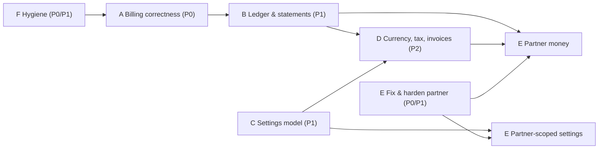

# 04 — Consolidated improvement backlog

> **Built from:** [01 Configuration](01_configuration_and_settings.md) (findings C-#), [02 Costing and billing](02_costing_and_billing.md) (B-#, R-#), [03 Partner module](03_partner_module.md) (P-#).
> **Priorities:** **P0** money leak, security or broken screen — do first; **P1** foundation other items need; **P2** commercial capability; **P3** later / optional.
> **Size:** S ≤ 3 days, M ≈ 1–2 weeks, L ≈ 3–6 weeks (one engineer, including tests).
> **Superseded in part (23 Oct 2026):** the owner's decisions change several items here — no rounding (A9), FX-converted USD prices instead of per-currency price books (D3), no white-label (E12), sub-partners now in scope, partner markups deferred (E9). See [05 §3](05_requirements_decisions_and_conflicts.md) for each conflict and [08](08_implementation_plan.md) for the plan that replaces this backlog.

---

## 1. Workstreams at a glance

| WS | Name | Goal | Items |
|---|---|---|---|
| **A** | Billing correctness | Every unit of cost is charged exactly once, or recorded as owed | A1–A10 |
| **B** | Ledger, statements and reporting | Every balance and every bill is explainable to the customer, partner and staff | B1–B7 |
| **C** | One settings model | Operational settings move from env/code to a scoped, audited, UI-managed catalogue | C1–C9 |
| **D** | Currency, tax, invoicing | Each tenant billed in its currency, with tax and invoices | D1–D8 |
| **E** | Partner module | Partners become a commercial entity with bounded delegation, pricing and earnings | E1–E12 |
| **F** | Hygiene and security | Small fixes that remove risk and confusion | F1–F9 |

---

## 2. Backlog

### WS-A — Billing correctness (stop leaks)

| ID | Item | Source | Pri | Size | Acceptance |
|---|---|---|---|---|---|
| A1 | Calls: deduct incrementally (drain, then record debt) instead of all-or-nothing; record the billing event only for what was billed or owed | B-1, R-S8 | **P0** | S | A call costing more than the balance leaves balance 0 and a debt row equal to the shortfall; event total = billed |
| A2 | Calls: idempotent settlement (claim like runs) | R-S10 | **P0** | S | Running cleanup twice charges once |
| A3 | Standalone-usage settlement job: hourly, settle usage rows with no `run_id` (hosting, DB share, background embeddings, sandbox time, CORTEX maintenance) through TB → wallet → billing event; bill build seconds and phone-number rent via SKUs | B-2, R-C14–R-C16, C-11 | **P0** | M | Sum of `usage_logs` for a company in a month = sum of billed base cost in its events (reconciliation test) |
| A4 | Debt ledger for shortfalls (negative balance or `credit_debts`); new work refused while debt > configurable tolerance; next top-up repays first | B-3 | **P0** | M | Overrun runs create debt; top-up clears it; admission respects tolerance |
| A5 | Settlement failure is persisted (`settlement_pending`) and retried by a job; alert after N failures | B-10, R-S6 | **P0** | S | A forced error during settlement is retried and charged later |
| A6 | LLM calls with no price row write a `cost_source: missing` usage row + event; task defaults refuse unpriced models | B-4 | **P0** | S | Adding a model without a price shows up in the missing-price report; cannot be made a default |
| A7 | Calls: per-call hold sized on expected minutes × price; mid-call credit/cap check every N seconds with a graceful wind-down line; maximum call length setting | R-A11, E04-S04 | P1 | M | A call stops cleanly when credit or cap runs out |
| A8 | Child-run gate uses *free* credit (minus holds) and fails closed; breaker fails closed after N consecutive read failures | B-11, B-12, R-A9, R-A13 | P1 | S | Tests for both failure modes |
| A9 | Rounding policy: billed amounts rounded to currency minor unit at settlement (half-up), base cost kept at 6 dp; remainder tracked | B-21, R-C3 | P1 | S | Wallet and invoices show 2-dp values; totals reconcile |
| A10 | Prices only from price books/registry: remove a tenant's ability to price `API_TOOL` SKUs; "bring your own key" becomes an explicit no-charge mode on a connection | B-9, C-10, R-C8 | P1 | M | A tenant's own row cannot lower a platform price; BYO-key usage shows "provider billed directly" |

### WS-B — Ledger, statements and reporting

| ID | Item | Source | Pri | Size | Acceptance |
|---|---|---|---|---|---|
| B1 | **Wallet ledger** (`wallet_entries`): every grant, deduction, hold, expiry, refund, adjustment, debt with source ids; balances derived/verified from it | 02 §14-6 | P1 | L | Balance = sum of entries for every company (nightly check) |
| B2 | Billing events: split TB by attribution category (LLM, tools, media, voice, sandbox, hosting); key runs by entity **id**; derive tenant/partner rollups | B-5, R-S5 | P1 | M | Category columns sum to total; renaming an agent keeps one group |
| B3 | Tenant billing page: transaction history (top-ups, subscriptions, grants), monthly usage statement by category/agent, downloadable | R-K5 | P1 | M | A tenant admin can reconcile a month to runs and calls (E04-S02) |
| B4 | Show tenants and partners **billed** amounts; base cost only to staff | B-19, P-34 | **P0** | S | No tenant/partner API returns `calculated_cost` or `total_cost_usd` without the billed equivalent replacing it |
| B5 | Notifications: low balance (configurable thresholds), spend cap reached, subscription past_due (wire the existing dunning e-mail), debt created | B-22 | P1 | S | Each event produces one in-app + e-mail notification to billing admins |
| B6 | Audit trail for billing config, tiers, registry prices, spend caps, credit grants (old → new, actor, reason) | C-2 | P1 | S | Every change visible in an audit view |
| B7 | Staff reconciliation report: provider invoices (Vertex, Twilio, Tata, Azure) vs `usage_logs` by SKU and month | — | P2 | M | Variance per SKU shown with drill-down |

### WS-C — One settings model

| ID | Item | Source | Pri | Size | Acceptance |
|---|---|---|---|---|---|
| C1 | Settings catalogue + `settings_values` + `settings_audit` + resolver `entity → tenant → partner → plan → platform → env → default` with "explain" and Redis invalidation (generalise `automation/limits.py`) | 01 §10 | P1 | L | A catalogued key can be set at each allowed scope, explained, audited; test fails on uncatalogued reads |
| C2 | Generated Settings UI per scope (platform, partner, tenant, agent) with inherited values, reset, history | 01 §10 | P1 | M | Staff, partner and tenant admins see only keys and scopes they may edit |
| C3 | Move billing/admission constants: credit floors per level, hold history window, abandoned-checkout hours, subscription cycles, top-up validity, daily-credit reset time zone | 02 §11.2 | P1 | S | Values editable; defaults unchanged |
| C4 | Move capacity limits: live sessions per company, runs per minute, Data API rates, sandbox and app resource sizes — **plan-linked** | 01 §8.1 #3–4 | P1 | M | A plan change changes limits without a deploy |
| C5 | Move regional settings: calling hours (in tenant time zone), rep daily cap, default phone country code — via **country profiles** | C-6, 01 §8.1 #5 | P1 | M | A non-Indian tenant gets its country's defaults |
| C6 | Move voice guardrails to agent/campaign scope (voicemail, silence, stall) and audio tuning to provider/number scope (staff) | 01 §8.1 #7–8 | P2 | M | A campaign can disable voicemail detection |
| C7 | Move security policy: session lengths, password policy, link TTLs (tenant may only tighten) | 01 §8.1 #9 | P2 | S | Enterprise tenant sets 15-min sessions |
| C8 | Fold feature flags into the catalogue with a **safe list** per scope (dangerous flags staff-only), key validation, audit | C-1, C-2 | **P0** (restriction) / P1 (fold-in) | S / M | Tenant admin cannot set `meta_agent.tool_synthesis_enabled` or an unknown key |
| C9 | Move remaining operational values (LLM timeouts/retries per model, egress allow-lists with approval, mobile app version, preview days, retention days, LinkedIn version, rate limits) | 01 §8.1 #10–18 | P2 | M | — |

### WS-D — Currency, tax, invoicing

| ID | Item | Source | Pri | Size | Acceptance |
|---|---|---|---|---|---|
| D1 | Company geography: `country_code`, `billing_currency`, billing address, tax id; captured at sign-up/partner onboarding; defaults from country | 02 §13.2 | P2 | S | New companies have country and currency |
| D2 | `currencies`, `fx_rates` (daily snapshot, staff override, buffer) | 02 §13.2 | P2 | S | Rate lookup by date with source |
| D3 | **Price books** per currency (formula, floors, tiers, top-up packs, fixed prices); one platform USD book reproducing today exactly | 02 §13, B-7 | P2 | L | Switching to the USD book changes no number (golden tests) |
| D4 | Thread currency through wallet, holds, settlement, billing events, payments; lock `fx_rate_id` per money event | 02 §13.3 | P2 | L | Every money row has currency and rate; no cross-currency sums |
| D5 | Payment gateway interface; Razorpay INR orders and plans; Razorpay secrets in Key Vault | B-8, 02 §13.4 | **P0** (secrets) / P2 (INR) | S / M | Indian tenant tops up in INR; secrets no longer in JSON |
| D6 | Tax engine: rules table; India GST (CGST/SGST/IGST, export zero-rated with LUT); tax on top-ups/subscriptions/invoices | 02 §11.3-2 | P2 | M | Correct GST split by place of supply |
| D7 | Invoices and statements: numbering series per billing entity, PDF, e-mail; monthly usage statement per tenant | 02 §11.3-12 | P2 | M | Tenant downloads a GST invoice |
| D8 | Second gateway (Stripe) and currency (e.g. GBP/EUR/USD direct) | 02 §13.5 | P3 | M | — |

### WS-E — Partner module

| ID | Item | Source | Pri | Size | Acceptance |
|---|---|---|---|---|---|
| E1 | Fix partner screens: partner-scoped revenue endpoint (dashboard 403), one health score, no double-counted child cost, tenants' usage in usage-breakdown, parallel/batched tenant reads | P-23, P-25–P-28, B-20, C-13 | **P0** | S | Partner dashboard loads; numbers match staff reports |
| E2 | Tree and role integrity: company `type` enum; valid parents; no cycles; `partner_*` roles only in PARTNER companies | P-1, P-14 | **P0** | S | Invalid combinations rejected; migration reports existing violations |
| E3 | Reassign a tenant between partners / to direct, with effective date (`partner_assignments` history) | P-4 | P1 | S | Revenue attribution before/after the move is correct |
| E4 | Audit every acting request (`acting_partner_id`, user, tenant, action) and show tenants "Partner access" history | P-8 | **P0** | S | Each `X-Company-Id` request writes an audit row |
| E5 | Access grants: scopes, expiry, reason, tenant approval/revoke; replace permanent acting | P-8, E34-S04 | P1 | M | Expired grant → 403; tenant can revoke |
| E6 | Partner profile, tiers, agreements, lifecycle (staff screens) | §5.2 | P1 | M | A partner moves prospect → active with an agreement on file |
| E7 | Partner-scoped settings, safe flags, limits, credit floors, spend-cap locks (via C1) | P-17, P-18 | P1 | M | A partner default applies to all its tenants unless overridden within bounds |
| E8 | Partner integration/model pool and template library inherited by its tenants | P-10, P-19 | P2 | M | Tenant resolves partner's model before platform's |
| E9 | Partner price books and plans within tier bounds; remove global `spf` | P-30, B-6 | P2 | L | Two partners sell the same plan at different prices to their tenants |
| E10 | Partner ledger, monthly statements, payout export, clawbacks | P-31 | P2 | L | Statement equals sum of ledger; refund creates clawback |
| E11 | Partner pool wallet and allocations; partner-paid tenants; promotional grants | P-33 | P2 | M | Partner funds a tenant; tenant runs draw from the allocation |
| E12 | White-label: product name, logo, colours, custom console domain, e-mail sender; referral links/codes; optional sub-partners | P-5, P-35 | P3 | L | Tenant of partner X sees X's brand on X's domain |

### WS-F — Hygiene and security

| ID | Item | Source | Pri | Size |
|---|---|---|---|---|
| F1 | Restrict top-up / subscribe / cancel to admins (or a "billing manager" permission) | B-15 | **P0** | S |
| F2 | Top-up amount bounds and 2-dp validation server-side | B-14 | **P0** | S |
| F3 | Remove the hard-coded fallback plans from the wallet page | C-12 | **P0** | S |
| F4 | One source of daily credits: per-company `billing_config` row (UI) replaces `companies.default_daily_credits` and the lost `custom_daily_credits` | B-13, C-4 | P1 | S |
| F5 | Per-company billing config in the UI; `GET /billing/config` returns the global row explicitly; unique active row per company | C-5, B-18 | P1 | S |
| F6 | Tier archive instead of hard delete; price history | B-16 | P1 | S |
| F7 | All env reads through `Settings` (`FRONTEND_URL`, OAuth ids/secrets, `TRACE_MAX_FIELD_BYTES`, `APPS_NODE_POOL`); warn/forbid unknown env keys; generate `.env.example` | C-3, C-8 | P1 | S |
| F8 | Remove the raw IP from default `CORS_ORIGINS`; resolve `TATA_STREAM_SUCCESS_KEY` | C-7, C-9 | P1 | S |
| F9 | Daily credits reset at midnight in the tenant's time zone | B-17 | P2 | S |

---

## 3. Suggested sequencing

| Milestone | Contents | Outcome |
|---|---|---|
| **M15.1 — Stop the leaks** (≈3 weeks) | A1, A2, A3, A4, A5, A6, B4, C8 (restriction), D5 (secrets), E1, E2, E4, F1, F2, F3 | No unbilled usage, no free overruns, no exposed secrets or margins, partner dashboard works |
| **M15.2 — Foundations** (≈6 weeks) | B1, B2, B5, B6, C1, C2, C3, F4–F8, A7–A10, E3, E5 | Explainable balances; one settings model with UI and audit; calls bounded by credit |
| **M15.3 — Commercial depth** (≈8 weeks) | C4, C5, B3, D1–D4, D6, D7, E6, E7 | Plans with entitlements; country profiles; INR billing with GST invoices; partner records and scoped defaults |
| **M15.4 — Partner economy** (≈8 weeks) | E8, E9, E10, E11, C6, C7, C9, B7 | Partner price books, earnings, pools; regional and security policies on screen |
| **M15.5 — Growth** (later) | D8, E12, F9, sub-partners | White-label, second gateway, multi-level distribution |

---

## 4. Decisions needed from the owner

| # | Decision | Options | Recommendation |
|---|---|---|---|
| Q1 | What happens when a run or call overruns the wallet? | forgive (today) / negative balance with tolerance / post-paid invoice | Negative balance up to a configurable tolerance per plan; enterprise accounts post-paid |
| Q2 | Should hosting and database costs consume credits or be invoiced monthly? | credits / invoice / both by plan | Consume credits hourly/daily (same wallet), visible as their own category |
| Q3 | Wallet currency | USD credits shown converted / wallet in billing currency | Wallet in billing currency (02 §13.4) |
| Q4 | Partner commercial models to support first | referral / resell-commission / wholesale | Referral + resell-commission first; wholesale with pools second |
| Q5 | Who may change a tenant's spend cap and plan? | tenant only / partner only / both with locks | Both; partner may lock |
| Q6 | Which feature flags may customers touch? | none / a safe list / all | A safe list per scope; staff for the rest |
| Q7 | Do tenants ever see provider base cost? | yes / no | No — billed amounts only; base cost for staff |
| Q8 | First non-USD currency and gateway | INR via Razorpay / others | INR via Razorpay with GST, as most tenants are in India |

---

## 5. Traceability to the roadmap

| Roadmap story | Covered by |
|---|---|
| E04-S01 entitlement exactly once | Already met by BC fixes; A2 extends to calls |
| E04-S02 reconcile a bill; currencies explicit; partner pricing scoped | A3, B1–B3, D3–D4, E9 |
| E04-S03 concurrent work without double allocation | A7, A8 |
| E04-S04 controlled exhaustion, live calls closing message, no intentional negative balance | A4 (tolerance decision Q1), A7 |
| E04-S05 budgets per process/agent, reserve | C1 scopes + 02 §14-17 (later) |
| E34-S03 business units, currencies not merged | D4 |
| E34-S04 partner administration bounded, audited, time-limited, offboarding | E4, E5, E6, E7, E9 |
| E30-F01 partner lifecycle and revenue | E6, E10 |
