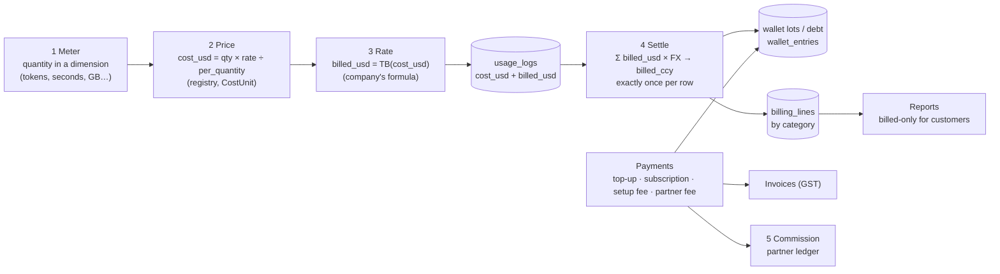
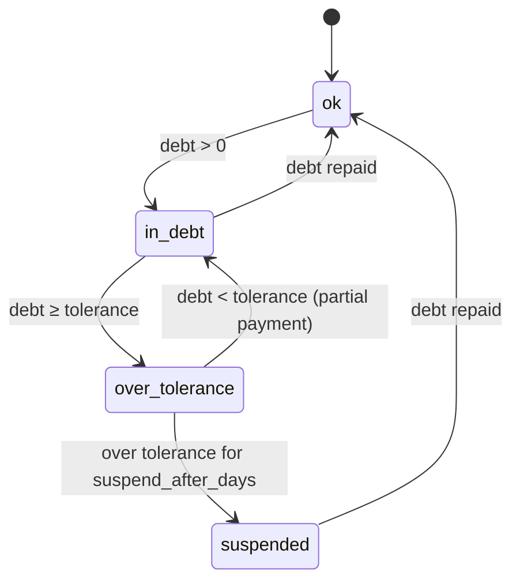
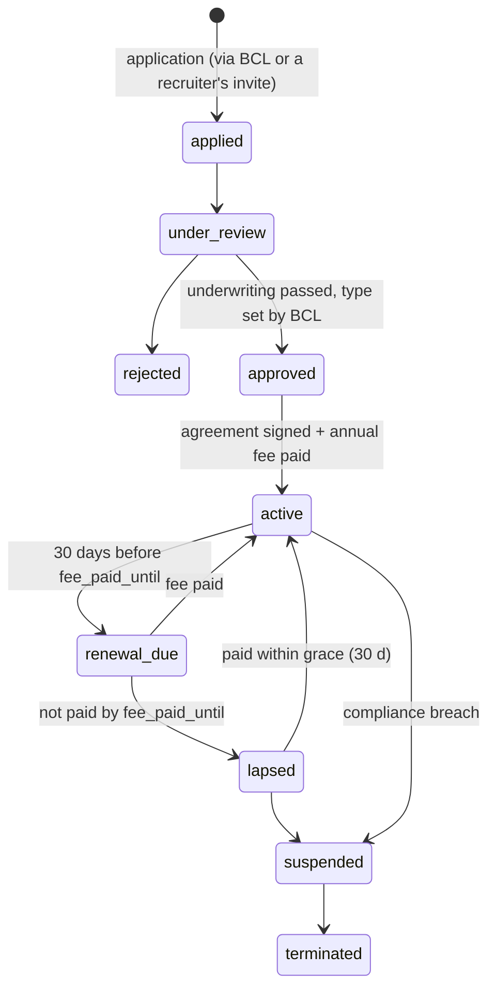

# 06 — Phase 15 technical design

> **Implements:** the requirements in [05](05_requirements_decisions_and_conflicts.md) (REQ-*, decisions Q1–Q8, approaches K-1…K-21) and the P0/P1 findings of [02](02_costing_and_billing.md) and [04](04_consolidated_improvements.md).
> **Planes:** everything money-related is in the **control** database (as today). Tenant databases change only for agent budgets (K-19).
> **Conventions:** USD amounts `NUMERIC(24,10)`; currency amounts `NUMERIC(24,10)` with an ISO 4217 `currency`; no rounding except at the three edges of K-1.

---

## 1. The money pipeline



Changes against today:

| Stage | Today | Phase 15 |
|---|---|---|
| Meter | Calls in started minutes (`ceil`); hosting rounded to 6 dp | Exact quantities (seconds with fractions, bytes→GB without rounding) |
| Price | `cost_unit` free text parsed by regex | `CostUnit` code (enum + table, FK) |
| Rate | Formula applied once on a run's total at settlement | Formula applied **per usage row at write time** (`billed_usd`), so every view can show billed amounts and every row is settled once. The formula is linear, so Σ TB(cᵢ) = TB(Σ cᵢ) — numbers do not change |
| Settle | Runs and calls only; calls all-or-nothing | Runs, calls **and standalone usage** (hourly); drain lots then debt |
| Wallet | 4 bucket columns, USD | Lots with expiry + debt, in the company's currency, with an entry ledger |
| Reports | Base cost visible to tenants | Billed-only for tenants and partners |

---

## 2. Cost units (REQ-CO-2)

### 2.1 The enum and the table

`backend/src/billing/units.py` (new) defines the only list:

```python
class Dimension(StrEnum):
    TOKEN = "token"; CHARACTER = "character"; SECOND = "second"; REQUEST = "request"
    IMAGE = "image"; MESSAGE = "message"; EMAIL = "email"; PAGE = "page"; QUERY = "query"
    GB = "gb"; GB_HOUR = "gb_hour"; GB_MONTH = "gb_month"; VCPU_HOUR = "vcpu_hour"
    DAY = "day"; MONTH = "month"; UNIT = "unit"

class CostUnit(StrEnum):            # code → (dimension, per_quantity, label)
    PER_TOKEN, PER_1K_TOKENS, PER_1M_TOKENS
    PER_CHARACTER, PER_1K_CHARACTERS, PER_1M_CHARACTERS
    PER_SECOND, PER_MINUTE, PER_HOUR            # all dimension SECOND: 1, 60, 3600
    PER_REQUEST, PER_1K_REQUESTS
    PER_IMAGE, PER_MESSAGE, PER_EMAIL, PER_PAGE, PER_1K_QUERIES
    PER_GB, PER_GB_HOUR, PER_GB_MONTH, PER_VCPU_HOUR
    PER_DAY, PER_MONTH, PER_UNIT
```

| Code | Dimension | per_quantity | Example SKU |
|---|---|---|---|
| `PER_1M_TOKENS` | token | 1,000,000 | `gemini-2.5-flash-in` $0.30 |
| `PER_1K_TOKENS` | token | 1,000 | — |
| `PER_1M_CHARACTERS` | character | 1,000,000 | `text-embedding-005-in` $0.025 |
| `PER_SECOND` | second | 1 | `sandbox-runtime` $0.00002; `video_generate` $0.40 |
| `PER_MINUTE` | second | 60 | `tata-tele-voice-in-out` |
| `PER_HOUR` | second | 3,600 | — |
| `PER_REQUEST` / `PER_1K_REQUESTS` | request | 1 / 1,000 | `serp-api-key`, `firecrawl` |
| `PER_IMAGE` | image | 1 | `imagen-4.0-generate-001` $0.04 |
| `PER_GB` | gb | 1 | `app-egress-gb` |
| `PER_GB_HOUR` / `PER_VCPU_HOUR` | gb_hour / vcpu_hour | 1 | app hosting |
| `PER_GB_MONTH` | gb_month | 1 | storage |
| `PER_DAY` / `PER_MONTH` | day / month | 1 | DB share; fixed rents |

- Table `cost_units(code PK, dimension, per_quantity NUMERIC, label, active)` is **seeded from the enum** by migration; a test fails when they differ.
- `integration_registry.cost_unit` becomes `cost_unit_code TEXT NOT NULL REFERENCES cost_units(code)`.
- Each **meter declares the dimension it emits** (LLM → token, embeddings → character, telephony → second, hosting → vcpu_hour/gb_hour/gb …). Pricing refuses a SKU whose dimension differs from the meter's and writes a `cost_source: unit_mismatch` row (like a missing price), so a wrong unit is visible instead of mis-billed.
- Price: `cost_usd = quantity × internal_cost ÷ per_quantity`. No other arithmetic.

### 2.2 Removed code

`parse_cost_unit`, `_UNIT_NOUNS`, `_SCALE`, `_UNIT_RE`, `unit_divisor` (`ai/usage_service.py`); the per-minute/token branching in `voice/usage_logger._log_llm_audio_usage`; the `component_type` free text is replaced by the dimension. UI: `CreateIntegrationModal.tsx` gets a unit dropdown from `GET /api/v1/config/cost-units`.

### 2.3 Migration

`control_0004_cost_units`: create and seed `cost_units`; add `cost_unit_code`; fill it from an explicit mapping (`per_million_tokens`, `1M Tokens`, `per_1m_tokens` → `PER_1M_TOKENS`; `second` → `PER_SECOND`; `per_minute` → `PER_MINUTE`; …); **abort with a list** of any row not mapped; drop `cost_unit`.

---

## 3. Currency, FX and geography (REQ-BL-1/2/4, REQ-CO-3/4)

### 3.1 Tables

```text
currencies        code CHAR(3) PK, name, symbol, minor_units SMALLINT, active, gateway ('razorpay')
                  seed: INR (₹, 2, active), USD ($, 2, active)
fx_rates          id, currency → currencies, units_per_usd NUMERIC(24,10) > 0, effective_from,
                  created_by, reason, created_at        -- append-only; never updated
                  seed: INR 100, USD 1
country_profiles  country_code CHAR(2) PK, name, billing_currency → currencies, default_timezone,
                  phone_country_code, tax_regime ('IN_GST' | 'EXPORT' | 'NONE'),
                  calling_rules JSON (hours, days, daily cap)   -- seed IN → INR/Asia/Kolkata/+91/IN_GST;
                  every other country → USD with tax_regime EXPORT (O-5)
platform_settings key 'billing.display_currency' = 'INR', 'billing.default_currency' = 'INR'
companies         + country_code CHAR(2) NOT NULL DEFAULT 'IN'
                  + billing_currency CHAR(3) NOT NULL DEFAULT 'INR' → currencies
                  + billing_state CHAR(2)  (Indian state code, for GST place of supply)
                  + gstin TEXT, + legal_name TEXT, + billing_address JSONB
```

### 3.2 Rules

| # | Rule |
|---|---|
| FX-1 | A company's `billing_currency` = its country profile's currency, else `billing.default_currency` (INR). Set at creation (self sign-up, partner/admin creation); **changeable only by app admin** through a conversion tool (06 §6.7) once money has moved. |
| FX-2 | The **current rate** of a currency = the `fx_rates` row with the latest `effective_from ≤ now`. USD is always 1. |
| FX-3 | Only `app_admin` writes rates (`POST /api/v1/admin/fx-rates`), with a reason; each change is a new row and an audit entry. |
| FX-4 | **Every money event stores the `fx_rate_id` it used** and both amounts: wallet entries, holds, settlements, billing lines, payments, invoices, commissions. Nothing is re-converted later. |
| FX-5 | Conversion `to_ccy(usd, ccy) = usd × units_per_usd(ccy)`; `to_usd(amount, ccy) = amount ÷ units_per_usd(ccy)`. No rounding. |
| FX-6 | A rate change affects only events after it. Wallet balances (already in the company's currency) are untouched. |
| FX-7 | App-admin views show amounts in the **display currency**: a company-currency amount is shown converted at its **locked** rate via USD; a USD cost at the **current** rate (labelled "at today's rate"). USD shown alongside on hover/column. |
| FX-8 | Top-ups are paid and credited in the company's currency — ₹1,000 paid (before GST) = ₹1,000 of credit. |

### 3.3 Code

`backend/src/billing/currency.py`: `current_rate(db, ccy) -> FxRate`, `to_ccy`, `to_usd`, `format_minor(amount, ccy) -> int` (gateway edge only). Frontend `utils/money.ts`: `formatMoney(amount, currency)` with `Intl.NumberFormat('en-IN', {style:'currency'})`, and a `<Money>` / `<DualMoney>` component.

---

## 4. Metering without rounding (REQ-CO-1)

| Meter | Today | Phase 15 |
|---|---|---|
| Telephony | `ceil(seconds/60)` minutes × per-minute rate | **seconds** (duration from provider status callback, fractional if provided) × rate ÷ per_quantity |
| Live model audio | reported tokens; else `seconds × 167`; per-minute SKUs `ceil` | reported tokens; else `seconds × tokens_per_second` (from the SKU's metadata, default 167); per-minute SKUs: seconds ÷ 60 |
| Hosting | `round(…, 6)` | exact |
| Sandbox | `round(ms/1000, 6)` | `ms / 1000` exact |
| Builds | `duration × APP_BUILD_COST_PER_SECOND` (display only) | `app-build-second` SKU (`PER_SECOND`), billed |
| Video frames, LLM, embeddings | exact | exact |

- `voice.usage_logger.billed_minutes` is deleted; `billing_events.telephony_in/out_minutes` become `telephony_in/out_seconds` (`NUMERIC(24,10)`).
- Precision: `usage_logs.raw_quantity`, `cost_usd`, `billed_usd` → `NUMERIC(24,10)`.
- Each telephony SKU gets `service_metadata.provider_billing_increment_seconds` (e.g. 60) — **used only** by the cost reconciliation report (K-2), never in customer billing.

---

## 5. Rating and billed-only views (REQ-BL-3, Q7)

### 5.1 Rating at write time

- `usage_logs` + `billed_usd NUMERIC(24,10)`, `formula_id` (the `billing_formulas` row used), `category` (see §5.3), `settlement_id` (NULL until settled), `currency`/`billed_ccy` filled at settlement.
- `CostLedger.add` and `UsageService.log_usage` call `rate(company_id, cost_usd) -> (billed_usd, formula_id)` (cached per run like tool prices).
- Fixed-price items (rent, setup fees, partner fees, subscriptions) are **not** rated: they are charged as entries with their own price (§8.3).

### 5.2 Money views

A single serializer layer, `backend/src/billing/money_view.py`:

```python
def money_for(viewer: User, *, cost_usd, billed_usd, billed_ccy=None, currency=None, fx_rate_id=None) -> dict
# app_admin / app_user : {"billed": {...company ccy}, "billed_display": {...INR}, "cost_display": {...}, "cost_usd": …}
# partner_*, tenant_*  : {"billed": {"amount": …, "currency": "INR"}}          -- never a cost field
```

Every endpoint below is changed to use it. A **contract test** walks the OpenAPI schema and fails if a route reachable by a non-staff role returns a field named `*cost*` (other than `billed*`), `internal_cost`, `calculated_cost`, `base_cost`, `margin`.

| Endpoint / stream | Today returns | Change |
|---|---|---|
| Run list/detail, `execution_runs` views | `total_cost_usd` | `billed` (sum of rows' `billed_usd` → ccy) |
| `GET /ai/admin/executions/{id}/cost_attribution`, `/companies/{id}/cost_attribution`, KPI cost | `calculated_cost` | billed by attribution; cost staff-only |
| SSE `cost_charged` frames, budget pressure | `amount_usd` | `billed` in ccy |
| LLM / tool interaction logs | `cost_usd` | billed equivalent or hidden |
| Voice sessions, call logs, campaigns | `total_cost_usd`, `call_cost_usd` | billed |
| Reports: usage-breakdown, credit-forecast, agent-errors, entity-versions, campaign-analytics, personal-tasks | costs | billed |
| Partner endpoints | `total_cost_usd` | billed |
| Wallet balance | USD floats | ccy amounts (§6) |
| Agent governance `max_cost_usd` | cost cap | `max_bill` in ccy (K-19) — `CreditGuard.over_own_cap` compares **billed** estimate |

### 5.3 Categories

`category` is derived from attribution and SKU category at write time:

| Category | From |
|---|---|
| `ai_models` | planner, actor_step, critic_*, reformat_retry, meta_review, dreaming, meta_spec_critic, test_driver |
| `knowledge` | embedding |
| `tools` | tool (non-media) |
| `media` | tool with SKU category IMAGE/VIDEO/SPEECH/MUSIC_GENERATION |
| `voice` | voice_call (telephony + live audio) |
| `video` | video_frame |
| `sandbox` | sandbox |
| `hosting` | hosting (apps vCPU/GB/egress, builds) |
| `database` | tenant DB share, DB storage |
| `phone_numbers` | number rent (entry, §13) |

`billing_events` is replaced for reporting by **`billing_lines`** (control): `(company_id, period_day, category, grouping_type, grouping_id, currency, fx_rate_id, cost_usd, billed_usd, billed_ccy, quantity, dimension)` upserted per settlement; monthly views roll up from it. `billing_events` stays for one release (read-only) then is dropped.

---

## 6. Wallet: lots, debt and enforcement (REQ-WL-*, Q1, Q3)

### 6.1 Tables

```text
credit_wallets   company_id PK, currency, state ('ok'|'in_debt'|'over_tolerance'|'suspended'),
                 debt NUMERIC(24,10) ≥ 0, in_debt_since, over_tolerance_since,
                 cached_available NUMERIC(24,10), updated_at          -- buckets columns dropped
wallet_lots      id, company_id, kind ('daily'|'subscription'|'subscription_bonus'|'topup'|'grant'),
                 currency, original, remaining ≥ 0, granted_at, expires_at, paid BOOL,
                 source_type, source_id (payment / subscription / policy / staff grant), fx_rate_id
wallet_entries   id, company_id, lot_id?, kind ('grant'|'deduct'|'expire'|'debt_add'|'debt_repay'|
                 'hold'|'release'|'adjust'|'refund'), amount (signed), currency, balance_after,
                 debt_after, reason, source_type, source_id, actor_id, created_at   -- append-only
credit_holds     + currency, + amount_ccy, + fx_rate_id
```

### 6.2 Rules

| # | Rule |
|---|---|
| W-1 | A wallet belongs to exactly one company; **no API moves value between companies** (REQ-WL-2). Staff corrections are `adjust` entries with a reason. |
| W-2 | All users of a company spend the same wallet (REQ-WL-3); every deduction entry records the user/run/trigger that caused it, so spend per user is reportable. |
| W-3 | Spend order: **daily → subscription → subscription_bonus → top-up/grant lots by earliest `expires_at`** → debt. |
| W-4 | A **top-up lot expires `wallet.topup_validity_days` after it is granted** (default **90**, app admin, REQ-WL-1). Each lot has its own expiry (K-7). |
| W-5 | Subscription and bonus lots expire at the end of the paid cycle (as today); daily lots per §7. |
| W-6 | Expiry job (every 15 min): lots past `expires_at` → `expire` entry for `remaining`, `remaining = 0`. |
| W-7 | **Paid credit repays debt first**: a top-up or subscription grant creates `debt_repay` up to the debt, the rest becomes a lot. **Daily credits and staff grants do not repay debt** (unless the grant says so). |
| W-8 | `available = Σ remaining of live lots`; `free = available − Σ open holds of other unfinished runs`; the wallet is **negative** when `debt > 0`. |
| W-9 | Every mutation takes the wallet row lock (as today) and writes entries in the same transaction; a nightly check proves `available` and `debt` equal the entries. |

### 6.3 Negative balance and tolerance (Q1, K-14)

`tolerance_usd` comes from the company's plan (`plans.negative_tolerance_usd`; PAYG plan included), converted at the current rate.



| State | Blocked | Continues |
|---|---|---|
| `ok` | — | everything |
| `in_debt` | **new runs** (manual, API, triggers, schedules, inbound webhooks, child spawns), **new calls** (inbound and outbound), **campaign dials**, mobile dialer sessions, sandbox sessions; **automation paused** (`paused_reason='negative_balance'`); **hosted apps stopped** after `billing.app_stop_grace_hours` (default 0) | runs and calls already running, until `over_tolerance`; database share, number rent, storage accrue |
| `over_tolerance` | as above + **running runs stop** (breaker) and **live calls end** after a closing line | non-stoppable accruals |
| `suspended` | sign-in works read-only (billing pages and top-up stay usable); Data API and apps off; numbers **held** (calls refused, not released) | data retained |

- Leaving `in_debt`/`over_tolerance`/`suspended` → `ok`: apps restart, automation paused by the system resumes, campaigns stay paused (owner resumes), notifications sent.
- Enforcement points: `CreditGuard.admit` and `check_credit_circuit_breaker`; `voice.call_admission.call_refusal`; `campaign_executor` per-dial gate; `mobile.service._check_credits`; `automation` trigger guard (`blocked_policy` reason `negative_balance`); `apps` controller (stop/start); sandbox runtime; Data API for `suspended`.
- **Breaker formula** for a running run: stop when `free + tolerance − billed_so_far ≤ 0` (tolerance counts only for work already running).
- **Calls** get a mid-call check every `voice.credit_check_seconds` (30) with the same formula; at the limit the agent says a closing line and hangs up.

### 6.4 Holds

Holds are placed in the company's currency: `estimate_ccy = to_ccy(max(TB(plan estimate), avg billed of last N runs))`, `floor_ccy = to_ccy(min_balance[level])`; admission requires `state == ok` and `free ≥ floor`. A call places a hold of `voice.call_hold_seconds × per-second billed rate` (default 300 s).

### 6.5 Settlement (exactly once)

`backend/src/billing/settlement.py` replaces `GovernanceService._settle/_charge` and the voice path:

```text
settle(company, rows: list[usage_logs], reason, grouping)
  lock wallet
  billed_usd = Σ rows.billed_usd ; rate = current_rate(company.currency)
  billed_ccy = billed_usd × rate.units_per_usd
  draw lots in spend order → 'deduct' entries; remainder → 'debt_add'
  mark rows settlement_id, billed_ccy, currency, fx_rate_id     -- WHERE settlement_id IS NULL
  upsert billing_lines by category ; claim run/call settlement (credit_holds) ; release hold
  update wallet state ; commit ; emit events (state changes → enforcement, notifications)
```

- Runs: at finish (top-level); child rows are settled with the parent (they carry `run_id` of the child; the settle query includes descendants).
- Calls: at hang-up (rows of the call's run).
- **Standalone usage** (no run): hourly job `billing_settle_standalone` per company.
- A failed settlement leaves rows unsettled; the hourly job picks up **any** unsettled row older than 10 minutes, so nothing is ever free (fixes B-10, B-2).

### 6.6 Top-up limits

`wallet.topup_min_usd` (default 5 → ₹500), `wallet.topup_max_usd` (default 10,000), presets; validated server-side with `Decimal` and 2-dp precision in the currency (B-14).

### 6.7 Currency change tool (staff)

Settles open holds, converts every live lot and the debt at one locked rate (entries `adjust` out/in), changes `billing_currency`, writes an audit row. Allowed only with no live subscription.

---

## 7. Daily credits (REQ-DC-*)

### 7.1 Tables

```text
daily_credit_policies   id, name, audience ('direct' | 'partner' | 'all_partners'),
                        partner_id NULL (for 'partner'), duration_days ∈ {0,10,15,30,60,90,180,365},
                        active, effective_from, created_by, updated_at
daily_credit_bands      policy_id, from_day, to_day, amount_usd ≥ 0        -- day 1 = sign-up day
company_daily_credit_overrides  company_id PK, mode ('policy'|'custom'|'none'),
                        amount_usd, duration_days, until, reason, set_by
```

### 7.2 Resolution (which policy a company gets)

1. `company_daily_credit_overrides` — `none` gives nothing; `custom` uses its amount/duration.
2. Tenant has an owning partner (06 §11.3): that partner's `partner` policy; else the nearest upline partner's `partner` policy (configurable: `daily_credits.inherit_up_partner_chain`, default **off**); else the `all_partners` policy.
3. Direct tenant (no partner): the `direct` policy.
4. None found → no daily credits.

The resolved policy id is stored on each daily lot (auditable).

### 7.3 Rules

| # | Rule |
|---|---|
| DC-1 | Only `app_admin` reads or writes policies and overrides (REQ-DC-1). |
| DC-2 | Day number `n` = whole days since `companies.created_at` in the company's time zone, plus 1. A company gets daily credits while `n ≤ duration_days`; the band containing `n` gives the amount (REQ-DC-3, REQ-DC-5). |
| DC-3 | At **00:00 in the company's time zone** the job replaces the daily lot: the old one expires (`expire` entry), a new lot of `to_ccy(amount_usd)` is granted, `expires_at` = next local midnight (K-15, REQ-DC-4). Never added to an existing daily lot. |
| DC-4 | A wallet in `in_debt` or worse still receives the daily lot, but it does not repay debt and admission stays blocked (W-7). |
| DC-5 | Daily-credit lots are `paid = false`: never commissionable, reported as "free credit cost". |
| DC-6 | Policy changes apply from the next local midnight; the grant job is idempotent per company per local date. |
| DC-7 | Only `active` companies receive grants (as today). |

Example: policy *Direct trial* — 30 days, bands days 1–10 = USD 2.00, days 11–30 = USD 0.50 → an Indian direct tenant gets ₹200 a day for 10 days, then ₹50 a day until day 30. Policy *Partner XYZ* — 0 days → its tenants get none.

---

## 8. Pricing and money settings

### 8.1 Billing formula

`billing_formulas`: `id, scope ('platform'|'plan'|'company'), scope_id, mf, pf, d, active, effective_from, created_by` (append-only versions). Resolution: company → plan → platform. **`spf` is removed** from the customer formula (K-10): `TB = c·mf·(1 + pf − d)`. Partner earnings come from §11. The existing `billing_config` rows migrate to `billing_formulas` (spf dropped; if a row had spf > 0, its value is added to `pf` so prices do not change — confirmed in the migration report). `base_cost_telephony` / `base_cost_image_gen` overrides migrate to **company-scoped registry SKU rows created by staff** (the override mechanism is retired).

### 8.2 Tenant-registered prices

Business-owned `API_TOOL` rows no longer price usage (B-9): a company's own registry/connection row is **"provider billed directly"** — the tool call is free on HireBuddha and says so — and only platform rows carry prices.

### 8.3 Fixed-price catalogue

```text
price_items   code PK, name, kind ('recurring'|'one_time'), interval ('month'|'year'|NULL),
              amount_usd, currency_overrides JSONB ({"INR": 2000}), taxable BOOL, active, version
```

Seed: `phone_number_rent` USD 20 / month, `{"INR": 2000}` (K-5); `partner_annual_fee_silver`, `partner_annual_fee_gold` (amounts set by admin); setup/customisation fee rules live in §11.5.
`price_for(item, currency)` = override if present, else `to_ccy(amount_usd)`.

Every price item — including the **per-number rent, both its USD amount and its INR override** (O-2) — is edited by the app admin on **Console → Commercial → Pricing** (`PUT /api/v1/admin/price-items/{code}`). An edit creates a new `version` (old versions kept for audit and for invoices); it applies from the next charge of each recurring item (a rental already charged for its current 30-day period is not re-priced). The editor shows the USD amount, each currency's override (blank = follow FX) and the resulting price per currency at today's rate.

### 8.4 Money settings — catalogue and access (REQ-DC-6)

Stored in `platform_settings` (`key, scope ('platform'|'plan'|'partner_type'|'partner'|'company'), scope_id, value_json, updated_by, updated_at`) with `settings_audit`; the catalogue in code (`billing/settings_catalogue.py`) gives type, unit, bounds, default and editors. All amounts in USD (K-16).

| Key | Default | Scopes | Editor | Effect |
|---|---|---|---|---|
| `fx.rate.<CCY>` (table `fx_rates`) | INR 100 | platform | app_admin | Conversion |
| `billing.display_currency` | INR | platform | app_admin | Admin views |
| `billing.default_currency` | INR | platform | app_admin | Currency for unmapped countries |
| Country → currency (table `country_profiles`) | IN→INR | platform | app_admin | REQ-BL-1 |
| Billing formula `mf, pf, d` | 1, 0, 0 | platform, plan, company | app_admin | Customer price of usage |
| Registry SKU rates (USD) | as seeded | platform | app_admin | Base cost |
| `admission.min_balance.<LEVEL>` | GRAPH 2.00, LOOP 1.00, PROCESS 0.50, AGENT 0.05, SKILL 0.02, ACTION 0.01 | platform, plan, company | app_admin | Free credit needed to start (billed) |
| `admission.min_balance.call` | 0.05 | platform, plan | app_admin | Free credit needed to take/make a call |
| `admission.hold_history_runs` | 10 | platform | app_admin | Hold estimate |
| `voice.call_hold_seconds` | 300 | platform, plan | app_admin | Hold placed per call |
| `voice.credit_check_seconds` | 30 | platform | app_admin | Mid-call checks |
| `plans.negative_tolerance_usd` (on plan) | PAYG 0, tiers set by admin | plan | app_admin | Q1 tolerance |
| `billing.app_stop_grace_hours` | 0 | platform, plan | app_admin | K-14 |
| `billing.suspend_after_days` | 7 | platform | app_admin | K-14 |
| `wallet.topup_validity_days` | 90 | platform, plan | app_admin | REQ-WL-1 |
| `wallet.topup_min_usd` / `max_usd` / `presets_usd` | 5 / 10,000 / [10, 25, 50, 100] | platform | app_admin | Top-up limits |
| Daily-credit policies and overrides (tables) | none | direct, partner, all_partners, company | app_admin | REQ-DC |
| Subscription tiers: fee, bonus %, tolerance, entitlements, limits (tables) | seeds O-12 | plan | app_admin | REQ-SB |
| `price_items.*` (incl. `phone_number_rent` USD amount and per-currency overrides) | rent USD 20 / ₹2,000 | platform | app_admin (Pricing page) | Fixed prices; per-number rent (O-2) |
| `numbers.hold_after_days_over_tolerance` | 7 | platform | app_admin | §13 |
| Partner annual fees, setup-fee ranges, distribution, commission rates, depth, holdback, payout minimum, TDS % (tables §11) | — | partner_type | app_admin | §11 |
| `tax.gst_rate`, legal entity GSTIN/state/SAC, LUT number | 18 %, — | platform | app_admin | §12 |
| `checkout.abandoned_after_hours` | 24 | platform | app_admin | Reaper |
| `subscriptions.total_cycles` | 120 | platform | app_admin | Razorpay |
| `companies.monthly_spend_cap_usd` (+ lock) | none | company | tenant_admin, Gold partner_admin, app_admin (locks: §8.5) | Q5 |
| `alerts.low_balance_pct` / `low_balance_usd` | 20 % of last top-up / none | platform default, company | app_admin default; tenant_admin own | Notifications |
| Agent `max_bill` (governance) | none | entity | builders (tenant) | Per-agent cap in ccy |

### 8.5 Locks (Q5)

`company_locks (company_id, key ('spend_cap'|'plan'), locked_by_role ('app_admin'|'partner'), locked_by, reason, at)`. A lock set by a partner blocks the tenant; a lock set by app_admin blocks the tenant and the partner. The UI shows the lock and who holds it.

---

## 9. Hosting and database usage (Q2)

Settled hourly as standalone usage (§6.5), shown under **Hosting** and **Database**. Indicative **base costs** (USD, to be set by staff from the actual Azure invoice — Central India list prices move); the formula's `mf` adds the margin.

| SKU | Unit | Meter | Indicative base cost | Notes |
|---|---|---|---|---|
| `app-hosting-vcpu-hour` | `PER_VCPU_HOUR` | Requested vCPU × hours (Prometheus or deployments) | 0.035 | Shared AKS node pool; previews included |
| `app-hosting-gb-hour` | `PER_GB_HOUR` | Requested memory GB × hours | 0.0045 | |
| `app-egress-gb` | `PER_GB` | Bytes sent to the internet | 0.12 | Inter-region/zone egress |
| `app-build-second` | `PER_SECOND` | Build duration | 0.0001 | Replaces `APP_BUILD_COST_PER_SECOND` |
| `app-storage-gb-month` | `PER_GB_MONTH` | Blob bytes (artifacts, app files) sampled daily ÷ days in month | 0.02 | Hot LRS |
| `tenant-db-pool-share` | `PER_DAY` | 1 ÷ tenants on the pool server, daily | pool server daily price ÷ N | As today |
| `tenant-db-dedicated` | `PER_DAY` | Whole server, daily | server daily price | |
| `tenant-db-storage-gb-month` | `PER_GB_MONTH` | Database size sampled daily | 0.12 | Premium SSD |
| `tenant-backup-gb-month` | `PER_GB_MONTH` | Weekly export size | 0.05 | D45 exports |
| `sandbox-runtime` | `PER_SECOND` | Sandbox exec/browser seconds | 0.00002 | As seeded |
| `custom-domain-month` | `PER_MONTH` | Per active custom domain | 1.00 | TLS + edge route (optional) |

---

## 10. Entitlements and feature flags (REQ-SB-3, Q6)

### 10.1 Engineering flags become staff-only

`PUT/DELETE /api/v1/ai/admin/feature_flags/*` → `app_admin` only; `flag_key` must be in `DEFAULTS` or `NUMERIC_DEFAULTS` (else 422); every change audited; the Feature Flags page is app_admin only. Existing company/entity rows written by customers are reported and kept (or reset) by a one-off script.

### 10.2 Feature catalogue

`backend/src/billing/features.py` (code catalogue) + `plan_entitlements (plan_id, feature_key, enabled, limit_value)` + `company_entitlement_overrides (company_id, feature_key, enabled, limit_value, until, reason, set_by)`. Resolution: company override → plan → catalogue default. Enforcement: `require_feature(key)` FastAPI dependency on routes, checks in tools/workers, and `GET /api/v1/me/entitlements` for the UI (menus show locked items with "Upgrade").

| Group | Feature key | Covers |
|---|---|---|
| Agents | `feature.agents.builder` | Create/edit agents (ACTION–AGENT) |
| | `feature.agents.process_level` | PROCESS entities |
| | `feature.agents.loop_graph_levels` | LOOP / GRAPH levels |
| | `feature.agents.templates` | Template marketplace and cloning |
| | `feature.agents.versions` | Versions and test runs of drafts |
| | `feature.agents.hitl` | Approval checkpoints |
| | `feature.agents.meta_agent` | Agents that create/run agents |
| | `feature.agents.debate_critics` | Debate and different-model critics |
| Knowledge | `feature.knowledge.base` | Documents and RAG |
| | `feature.knowledge.cortex_explorer` | Memory trees explorer |
| Automation | `feature.automation.schedules` | Schedules |
| | `feature.automation.triggers` | Event triggers and waits |
| | `feature.automation.webhooks_inbound` | Inbound webhook endpoints |
| | `feature.automation.agent_schedules` | Agents creating schedules/signals |
| Voice & messaging | `feature.voice.inbound` | Inbound calls to agents |
| | `feature.voice.outbound_campaigns` | Campaigns / auto-dialer |
| | `feature.voice.mobile_dialer` | Mobile dialer app |
| | `feature.voice.browser_calls` | Browser audio calls |
| | `feature.video.calls` | Video calls |
| | `feature.messaging.whatsapp` | WhatsApp |
| | `feature.messaging.email` | E-mail tools and mailboxes |
| | `feature.messaging.social` | Social posting tools |
| | `feature.phone_numbers` (limit = max numbers) | Claiming numbers |
| Media | `feature.media.image`, `.video`, `.speech`, `.music` | Generation tools |
| Code & compute | `feature.compute.sandbox` | Code execution, terminal |
| | `feature.compute.browser` | Headless browser |
| | `feature.compute.persistent_browser` | Persistent profile (with flag) |
| | `feature.code.lanes` | Code, Git, pull requests |
| | `feature.compute.tool_synthesis` | Agents writing tools (with flag) |
| Business data | `feature.records` | Records, schema engine |
| | `feature.records.data_api_keys` | Data API keys (internal) |
| | `feature.records.public_api` | Public/external API access |
| Apps | `feature.apps.hosting` (limit = max apps) | Hosted apps |
| | `feature.apps.custom_domains` | Custom domains |
| Connections | `feature.connections.oauth` | OAuth connectors |
| | `feature.connections.mcp` | MCP servers |
| Insight | `feature.reports.advanced` | Advanced reports and exports |
| Limits | `limit.users`, `limit.agents`, `limit.live_sessions`, `limit.runs_per_minute`, `limit.sandbox_size`, `limit.storage_gb` | Quantities (replace env `LIVE_SESSIONS_PER_COMPANY`, `RUNS_STARTED_PER_MINUTE`) |

Phase 15 ships the catalogue, the UI and enforcement on routes and menus, with **every feature enabled on every plan** (REQ-SB-3 "for the future"), so nothing changes for customers until the admin restricts a plan.

---

## 11. Partner programme (REQ-PT-*)

### 11.1 Partner types (REQ-PT-1)

| | **Silver** (referral) | **Gold** (resell + deliver) |
|---|---|---|
| Brings | Leads (registered in the portal) | Customers, sold and onboarded by the partner |
| Converts | BCL sales | Partner |
| Delivers solution | BCL | Partner |
| Creates tenants | No (BCL creates them from a converted lead) | Yes |
| Access to tenant data | **None** — billed summaries only | Scoped, audited grants (§11.9) |
| Charges setup/customisation fees | Fee is BCL's; Silver gets a share | Partner sets the fee within the admin's range |
| Earns | Referral commission **for as long as the referred tenant pays** (no end date, O-8) | Resell commission for the life of the relationship |
| Can recruit partners | Yes (subject to approval) | Yes (subject to approval) |

### 11.2 Data model

```text
partner_types        code ('SILVER'|'GOLD'), name, can_create_tenants, tenant_data_access ('none'|'grants'),
                     annual_fee_item → price_items, active
partner_profiles     company_id PK (type PARTNER), partner_type, status, legal_name, country_code,
                     billing_currency, pan, gstin, kyc_status, bank_ref (vault), agreement_id,
                     recruiter_partner_id (upline), depth (1 = recruited by BCL), activated_at,
                     fee_paid_until, probation_until
partner_agreements   id, partner_id, version, terms JSONB (rates snapshot), effective_from/to, signed_at, signed_by
partner_assignments  tenant_id, partner_id, relationship ('referred'|'resold'), since, until,
                     commission_until (NULL = no end — the default for Silver and Gold, O-8; set only by staff,
                     e.g. on a negotiated agreement), source ('lead'|'created'|'link'|'staff')
partner_leads        id, partner_id, company_name, contact_name, email, phone, country, notes,
                     status, bcl_owner_id, exclusive_until, converted_company_id, created_at
partner_applications id, recruiter_partner_id, applicant details, requested_type, status, reviewed_by
commission_rules     partner_type, revenue_kind ('usage_topup'|'subscription'|'setup_fee'|'customisation_fee'),
                     level (0 = originator, 1, 2), rate_pct, cap_pct, months (NULL = no end), active, version
fee_rules            partner_type, fee_kind ('setup'|'customisation'), min_usd, max_usd,
                     split JSONB ({"originator": 75, "level1": 3, "level2": 2, "platform": 20}), active, version
one_time_charges     id, tenant_id, partner_id, fee_kind, amount, currency, status
                     ('draft'|'sent'|'paid'|'cancelled'|'refunded'), payment_id, invoice_id, rule_version
partner_ledger       id, partner_id, kind ('commission'|'override'|'fee_share'|'clawback'|'adjustment'|'payout'|'tds'),
                     amount, currency, fx_rate_id, source_type, source_id, tenant_id, level,
                     status ('accrued'|'held'|'payable'|'paid'|'reversed'), payable_after, statement_id
partner_statements   id, partner_id, period, currency, gross, tds, net, status ('draft'|'approved'|'paid'), document_ref
partner_access_grants (Gold) id, partner_id, tenant_id, scopes, granted_by, reason, expires_at, revoked_at
```

`companies.parent_id` keeps the tree: TENANT → owning partner (or APP), PARTNER → recruiter partner (or APP). `partner_assignments` is the source of truth for attribution over time.

### 11.3 Lifecycle and underwriting



**Underwriting checklist (staff, before `approved`):** identity and business KYC (PAN, GSTIN, incorporation for companies), bank account verified (penny-drop), sanctions/adverse-media check, no duplicate of an existing partner or tenant, territory/vertical conflict check, for **Gold** a capability assessment (team, references, certification on HireBuddha), signed agreement (rates are snapshotted into it), **recruiter has no say in the type**, depth ≤ `partners.max_depth` (3). New partners start on **probation** (e.g. 90 days) with a longer commission holdback.

| Status | Can register leads / create tenants | Earns | Paid out |
|---|---|---|---|
| active | yes | yes | yes |
| renewal_due | yes | yes | yes |
| lapsed | no new tenants | accrues as `held` | no (released if renewed within grace; else forfeited to platform) |
| suspended / terminated | no | no | settled balance minus clawbacks; tenants move to BCL direct (or another partner) — `partner_assignments.until` set |

### 11.4 Annual partnership fee (REQ-PT-2)

A `price_items` row per type, billed to the partner's company in its currency (invoice + Razorpay link), renewal reminders at 30/7/1 days. **Never commissionable, never distributed to uplines** (K-12).

### 11.5 Setup and customisation fees (REQ-PT-3)

- Admin sets, per partner type and fee kind, `min_usd`, `max_usd` and the **split** (sum = 100 %).
- **Gold:** the partner raises a `one_time_charge` for a tenant (amount within range, in the tenant's currency) → the tenant admin sees and pays it (Razorpay checkout) → BCL issues the GST invoice → the split is written to the ledger.
- **Silver:** BCL raises the charge (it delivers); the Silver referrer and its uplines get their split.
- Fees are **paid directly, not from the wallet** (they are not usage credit).
- Example split defaults (editable): Gold — originator 75 %, level 1 3 %, level 2 2 %, platform 20 %; Silver — platform 85 %, originator 10 %, level 1 3 %, level 2 2 %.

### 11.6 Commission and multi-level distribution (REQ-PT-4)

**What is commissionable** (base `B`, in the tenant's currency, net of GST, refunds and chargebacks):

| Revenue kind | Base | When |
|---|---|---|
| Top-ups (`usage_topup`) | Amount the tenant paid | Payment captured |
| Subscriptions | Monthly fee paid (not the bonus) | Each paid cycle |
| Setup / customisation fees | Fee paid | Payment captured (split per §11.5) |
| Daily credits, bonus, staff grants | — | Never (free credit) |
| Annual partnership fees | — | **Never** (K-12) |

Commission is on **cash actually collected** from the customer, so it can never be paid on unpaid debt, free credit or reversed payments.

**Distribution for one revenue event** from tenant `T` whose originating partner is `P0`, with upline chain `P1` (P0's recruiter), `P2`:

```text
r0 = rule(P0.type, kind, level 0).rate        e.g. Gold 20 %, Silver 10 % — no end date (O-8), unless staff set commission_until;
                                              P0 must be eligible (active/renewal_due, KYC done) like any level
r1 = rule(P1.type, kind, level 1).rate        e.g. 3 %
r2 = rule(P2.type, kind, level 2).rate        e.g. 2 %
eligible(Pk) = Pk.status ∈ {active, renewal_due}  ∧  KYC done
               ∧ Pk has own directly-attributed paid revenue ≥ partners.override_min_monthly_revenue in the month (k ≥ 1)
               ∧ months since P(k-1) activated ≤ partners.override_months (e.g. 24)        (k ≥ 1)
pool_cap = rule(P0.type, kind).cap_pct × B     e.g. 25 % (Gold), 15 % (Silver)
payout_k = r_k × B for eligible levels; ineligible shares go to the platform (no compression)
if Σ payout > pool_cap: scale level ≥1 payouts down pro rata first, then level 0
margin guard (monthly, at statement): Σ commissions on usage for T ≤ partners.max_margin_share × (billed − cost of T's usage in the month);
   excess is moved to 'held' and released when later margin covers it, else reversed at quarter end
```

**Worked example** — Gold P0 (recruited by Gold P1, recruited by Silver P2). Tenant tops up ₹1,00,000 (+ GST): `B = ₹1,00,000`. P0 20 % = ₹20,000; P1 3 % = ₹3,000; P2 is Silver with no direct revenue this month → ineligible, its 2 % (₹2,000) stays with the platform. Total ₹23,000 ≤ cap 25 % (₹25,000). Month's usage by T: billed ₹1,00,000, cost ₹40,000 → margin ₹60,000; with `max_margin_share = 50 %` the guard allows ₹30,000 ≥ ₹23,000.

Why these rules (underwriting):
- **Income only from customer sales**, not from recruiting or partner fees → stays a commercial agency arrangement, not a money-circulation scheme (Prize Chits and Money Circulation Schemes (Banning) Act 1978; Consumer Protection (Direct Selling) Rules 2021 principles: no joining-fee income, earnings from actual sales).
- **Activity requirement** for overrides — an upline must keep selling to earn on its network.
- **Depth limit (3)** and the **override sunset (24 months)** bound the upline liability per sale. The originating partner's own commission has **no end date** (O-8); it is bounded by the cash basis, the pool cap, the margin guard and the partner's status (a lapsed or terminated partner stops earning).
- **No compression** — unearned shares return to the platform, so stacking inactive accounts earns nothing.
- **Pool cap + margin guard** — total partner payout can never exceed a fixed share of revenue or of margin.
- **Cash basis + holdback + clawback** — nothing is paid on money that can still be refunded.

### 11.7 Payouts

| Rule | Default (admin-configurable) |
|---|---|
| Ledger entries start `accrued`, become `payable` after `partners.holdback_days` | 30 (probation 60) |
| Monthly statement for the previous month on day 5, per partner and currency | — |
| Minimum payout; below it carries forward | USD 50 (₹5,000) |
| TDS deducted per prevailing rate (Sec. 194H for commission — confirm with tax advisor) | `tds_pct` setting |
| Partner GST: registered partners issue a tax invoice to BCL against the statement; statement shows GST separately | — |
| Refund/chargeback of a commissioned payment → `clawback` entries on every level paid, netted from future payouts | — |
| Payout execution | Phase 15: approved statement exported (bank file/CSV); RazorpayX Payouts later |
| Partner currency | Ledger in the partner's billing currency; tenant revenue converted at the event's locked rate |

### 11.8 Operational risks and controls

| Risk | Control |
|---|---|
| Regulatory: multi-level scheme seen as money circulation / pyramid | K-12 rules; legal review of the agreement before launch; no earnings from recruitment or fees |
| Margin erosion (deep chains, high rates, discounts) | Pool cap, margin guard, depth limit, admin-only rates, simulation report before changing rules |
| Self-dealing (fake tenants to earn fees/commission, partner topping up its own tenant) | Cash basis + clawback; duplicate/related-party detection (same PAN/GSTIN/e-mail domain/payment instrument); probation holdback; daily credits not commissionable |
| Attribution disputes and channel conflict | Lead registration with exclusivity window (90 days), dedupe on domain/phone, assignments with history, staff arbitration |
| Paying on revenue later refunded | Holdback, clawback |
| Open-ended referral commission (O-8: Silver earns for as long as the tenant pays) accumulates a growing long-term liability | Commission only on cash collected; pool cap and margin guard per event; rates versioned (a rule change applies to new agreements, and to existing ones only as the agreement allows); earning stops when the partner lapses or is terminated; R-A10 shows the liability per partner |
| Tax non-compliance (TDS, GST, invoices) | TDS on statements, Form 16A tracking, GST fields mandatory for payouts |
| Data privacy across levels (DPDP Act 2023) | Uplines never see downline tenants; Silver never sees tenant data; Gold through grants with audit |
| Partner churn / termination leaves tenants unsupported | Termination workflow moves tenants to BCL direct; tenant notified |
| FX on cross-border partners | Locked rates per event; statement in partner currency |
| Operational load (payout reconciliation, disputes) | Statements generated by the system, approval queue, dispute status, audit trail |
| Poor delivery by Gold partners damaging the brand | Certification, tenant health monitoring per partner, suspension |
| Cycles or tampering with the tree | Recruiter fixed at application; tree validation (no cycles, max depth); admin-only reassignment with effective date |

### 11.9 Access and visibility

- `company_scope` changes: a partner sees **its own company and the tenants assigned to it** (`partner_assignments` current, `relationship='resold'` for data access). Sub-partner companies and their tenants are **not** in scope; the network screen shows sub-partners' names, status, type and the override earnings only.
- **Silver:** no tenant data access at all (no `X-Company-Id`); billed summaries of referred customers via partner reports.
- **Gold:** `X-Company-Id` is accepted only with an active `partner_access_grant` (scopes `read`, `support`, `admin`, `billing`; default `admin` for tenants it created, with expiry renewal by the tenant admin optional); every acting request writes `audit_log` with `acting_partner_id`.
- `_require_user_admin_over` and role assignment: partner admins manage users of their own company and of **assigned tenants only**; `partner_*` roles only in PARTNER companies, `tenant_*` only in TENANT companies.

---

## 12. Payments, subscriptions, tax and invoices

### 12.1 Plans and subscriptions (REQ-SB-*)

```text
plans                id, code, name, tier_level (0 = Pay-as-you-go), monthly_fee_usd, bonus_pct,
                     negative_tolerance_usd, active, sort, version      -- replaces subscription_tiers
plan_gateway_plans   plan_id, currency, fx_rate_id, amount_minor, razorpay_plan_id, created_at
plan_entitlements    (§10.2)
subscriptions        + plan_id, + currency, + amount_ccy, + fx_rate_id, + locked (via company_locks)
```

| Rule | |
|---|---|
| SB-1 | Only app_admin creates/edits/archives plans (no hard delete); edits create a new version; existing subscriptions keep their version until renewal |
| SB-2 | Price in USD; charged in the company's currency: a gateway plan per (plan, currency, FX version), created on first use (K-18). INR override optional per plan |
| SB-3 | Each paid cycle grants `fee_ccy` as a subscription lot and `fee_ccy × bonus_pct` as a bonus lot (no carry-forward, as today); paid credit repays debt first (W-7) |
| SB-4 | Tenant admin or the Gold partner (for its tenants) chooses/changes the plan unless locked (Q5). Upgrade: effective immediately (gateway plan update; credit difference granted pro rata — **spike SP-15-2** to confirm Razorpay proration); downgrade: at cycle end. Cancel: at cycle end by default (today: immediate) |
| SB-5 | Only admins of the company (or the Gold partner) may pay, change or cancel (B-15) |
| SB-6 | Pay-as-you-go is plan level 0: its entitlements and tolerance apply to every company without a subscription |
| SB-7 | Seed plans (O-12): Starter USD 100 / 10 %, Growth 500 / 20 %, Scale 1,000 / 30 %, Enterprise 5,000 / 40 % |

### 12.2 Payments

- `PaymentGateway` interface (`billing/gateways/razorpay.py`): `create_order(amount, currency)`, `create_plan`, `create_subscription`, `verify_signature`, `fetch`, `refund`. Amount to the gateway = `round_half_up(amount × 10^minor_units)` — the **only** rounding of a payment (K-1).
- Razorpay keys move to Key Vault (`secret_ref`), not JSON metadata (B-8).
- `payment_transactions` + `purpose` (`topup`|`subscription`|`setup_fee`|`customisation_fee`|`partner_annual_fee`), `tax_amount`, `net_amount`, `gross_amount`, `invoice_id`.
- Refunds (staff): reverse the lot (or create debt if spent), reverse commissions (clawback), credit note.

### 12.3 GST and invoices (Q8)

| Rule | |
|---|---|
| TX-1 | Prices are tax-exclusive (O-6): checkout amount = net + GST |
| TX-2 | India: supplier state (BCL's GSTIN) = customer `billing_state` → CGST 9 % + SGST 9 %; else IGST 18 %; customer outside India (USD) → export of services, zero-rated under LUT |
| TX-3 | GST is charged **when money is received** (top-ups are advances for services): one tax invoice per payment. **Wallet consumption is not invoiced again** — the monthly *usage statement* is a non-tax document |
| TX-4 | Invoice numbering: one series per financial year (`HB/2026-27/000123`), gap-free, generated in the payment transaction |
| TX-5 | Customer GSTIN optional (B2C without it); validated format; shown on invoice |
| TX-6 | Invoice PDF stored as an artifact, e-mailed to the company's billing admins, listed on the billing page |
| TX-7 | Credit notes for refunds, linked to the original invoice |

Tables: `invoices (id, number, company_id, payment_id, currency, net, cgst, sgst, igst, total, rounding, place_of_supply, gstin, issued_at, pdf_ref)`, `invoice_lines`, `credit_notes`.

---

## 13. Phone-number rent (REQ-CO-5)

```text
number_rentals  id, phone_number_id, company_id, started_at, next_charge_at, ended_at,
                price_item_version, status ('active'|'held'|'ended')
```

| Rule | |
|---|---|
| NR-1 | A rental starts when a number becomes the company's (claim by an admin, or staff creating/assigning it to a company); it ends on release |
| NR-2 | Charged **in advance** for each 30-day period from `started_at`: `price_for('phone_number_rent', company.currency)` at the item's current version = the currency override if set (₹2,000 seeded for INR), else the USD amount (20 seeded) × rate. Both values are admin-editable in the UI (§8.3, O-2); the version used is stored on the charge. Not through the TB formula. Category `phone_numbers` |
| NR-3 | Charged from the wallet like usage (lots then debt); no refund on release mid-period |
| NR-4 | Over tolerance for `numbers.hold_after_days_over_tolerance` (7) → rental `held`: calls to/from the number refused; staff decide release. Paid → active again |
| NR-5 | Claiming needs `feature.phone_numbers` and its limit; the claim screen shows the monthly price in the company's currency |
| NR-6 | `phone_numbers.monthly_cost_usd` (unused today) is renamed `provider_monthly_cost_usd` (cost side, staff only) |

Job `billing_number_rent` (hourly) charges rentals whose `next_charge_at ≤ now`.

---

## 14. Notifications

| Event | Recipients | Channel |
|---|---|---|
| Low balance (threshold), daily-credit period ending (7 days before) | tenant admins | in-app, e-mail |
| `in_debt`, `over_tolerance`, `suspended`, recovered | tenant admins; Gold partner admins | in-app, e-mail |
| Apps stopped/restarted for balance | tenant admins | in-app, e-mail |
| Payment success (invoice attached), failure, subscription past_due (dunning e-mail, wired) | billing admins | e-mail |
| Lot expiring in 7 days | tenant admins | in-app |
| Partner: fee renewal due/lapsed, statement ready, payout paid, lead status change, tenant at risk | partner admins | in-app, e-mail |
| Staff: unpriced SKU/unit mismatch, settlement backlog, FX changed, partner application, payout approval | app admins | in-app |

---

## 15. API surface (new or changed)

| Area | Endpoints |
|---|---|
| Currency | `GET/POST /api/v1/admin/fx-rates`, `GET /api/v1/admin/currencies`, `GET/PUT /api/v1/admin/country-profiles` |
| Units | `GET /api/v1/config/cost-units` |
| Settings | `GET/PUT /api/v1/admin/billing-settings/{key}?scope=…`, `GET …/explain` |
| Formula | `GET/POST /api/v1/admin/billing-formulas` |
| Price items | `GET/PUT /api/v1/admin/price-items` |
| Daily credits | `GET/POST/PUT /api/v1/admin/daily-credit-policies`, `PUT /api/v1/admin/companies/{id}/daily-credits` |
| Plans | `GET/POST/PUT /api/v1/admin/plans`, `PUT /api/v1/admin/plans/{id}/entitlements`; `GET /api/v1/plans` (customers) |
| Entitlements | `GET /api/v1/me/entitlements`, `PUT /api/v1/admin/companies/{id}/entitlements` |
| Wallet | `GET /api/v1/wallet` (balance in ccy, lots, state), `GET /api/v1/wallet/entries`, `POST /api/v1/wallet/topup`, `POST /api/v1/wallet/topup/verify`, `POST /api/v1/admin/companies/{id}/wallet/adjust` |
| Subscription | `GET/POST /api/v1/subscription`, `POST /api/v1/subscription/change`, `POST /api/v1/subscription/cancel` |
| Billing | `GET /api/v1/billing/usage?period=` (billed lines), `GET /api/v1/billing/invoices`, `GET /api/v1/billing/invoices/{id}/pdf`, `GET/PUT /api/v1/billing/profile` (GSTIN, address) |
| Locks | `PUT/DELETE /api/v1/companies/{id}/locks/{key}` |
| Numbers | claim/release unchanged + rental info in responses |
| Partners (staff) | `/api/v1/admin/partners` CRUD, `/applications`, `/types`, `/commission-rules`, `/fee-rules`, `/assignments` (move tenant), `/statements` (approve, export), `/leads` (BCL sales queue) |
| Partners (self) | `/api/v1/partner/profile`, `/partner/agreement`, `/partner/annual-fee` (pay), `/partner/leads`, `/partner/tenants`, `/partner/charges` (setup/customisation), `/partner/network`, `/partner/invite`, `/partner/ledger`, `/partner/statements`, `/partner/access-grants`, `/partner/reports/*` |
| Reports | §07 report catalogue endpoints under `/api/v1/reports/*` |

---

## 16. Data model summary

| Table | New/changed | Plane |
|---|---|---|
| `cost_units` | new | control |
| `integration_registry` | `cost_unit` → `cost_unit_code` FK | control |
| `currencies`, `fx_rates`, `country_profiles` | new | control |
| `companies` | + country, currency, state, GSTIN, legal name, address | control |
| `platform_settings`, `settings_audit` | new | control |
| `billing_formulas` | new (replaces `billing_config`) | control |
| `price_items` | new | control |
| `usage_logs` | + billed_usd, formula_id, category, settlement_id, currency, billed_ccy, fx_rate_id; precision 24,10 | control |
| `billing_lines` | new (replaces `billing_events`) | control |
| `credit_wallets` | bucket columns → state, debt, currency | control |
| `wallet_lots`, `wallet_entries` | new | control |
| `credit_holds` | + currency, amount_ccy, fx_rate_id | control |
| `daily_credit_policies`, `daily_credit_bands`, `company_daily_credit_overrides` | new | control |
| `plans`, `plan_gateway_plans`, `plan_entitlements`, `company_entitlement_overrides` | new (replace `subscription_tiers`) | control |
| `subscriptions`, `payment_transactions` | + plan/currency/tax/purpose fields | control |
| `invoices`, `invoice_lines`, `credit_notes` | new | control |
| `company_locks` | new | control |
| `number_rentals` | new | control |
| `partner_types`, `partner_profiles`, `partner_agreements`, `partner_assignments`, `partner_leads`, `partner_applications`, `commission_rules`, `fee_rules`, `one_time_charges`, `partner_ledger`, `partner_statements`, `partner_access_grants` | new | control |
| `hierarchical_entities.governance` | `max_cost_usd` → `max_bill` (amount + currency) | tenant |

---

## 17. Security and audit

- Every write to FX, settings, formulas, price items, plans, entitlements, daily-credit policies, locks, wallet adjustments, partner rules and statements writes `audit_log` (actor, acting company, old → new, reason).
- Money endpoints are role-checked at the route **and** filtered by the money-view layer (§5.2).
- Payment and payout secrets in Key Vault; bank details by reference only.
- Partner isolation tests: a partner never reads another partner's tenants, a Silver never reads tenant data, an upline never reads downline tenants, every acting request is audited.
