# 08 — Phase 15 implementation plan

> **Delivers:** [05](05_requirements_decisions_and_conflicts.md) requirements and decisions, through the design in [06](06_technical_design.md) and the UI in [07](07_ui_navigation_and_reports.md); folds in the still-relevant items of [04](04_consolidated_improvements.md).
> **Status:** Plan — no code written. **Date:** 2026-10-23.
> **Decisions:** the owner answered O-1…O-12 on 23 Oct 2026 (05 §4). Ten confirm the proposed defaults; two changed the plan: the per-number rent is admin-editable in the UI (O-2), and Silver referral commission has no end date (O-8).

---

## 1. Approach

1. **Money changes ship behind switches and in shadow first.** The new rating/settlement runs beside the old one and the two are compared per run and per call before the switch is flipped (`BILLING_V2_MODE = off | shadow | on`, a platform setting, staff only).
2. **Golden numbers.** Before touching billing, a golden suite records the billed amount of a fixed set of runs, calls and payments under today's code; at the USD book and FX = 1 the new pipeline must reproduce them (except where 05 changes the rule on purpose — per-second calls, no rounding — which have their own expected values).
3. **Migrations are additive first, destructive last.** New tables and columns land and fill; old columns (`billing_config`, bucket columns, `billing_events`, `cost_unit` text) are dropped only after a release on the new path.
4. **One workstream owns each table.** Avoids two streams changing settlement or the wallet at once.
5. **UI moves by workspace,** not by page: the Business Workspace, Partner Portal and Platform Console each switch to the new shell when their pages are ready; old routes redirect.

---

## 2. Workstreams and tasks

Size: S ≤ 3 d · M ≈ 1–2 wk · L ≈ 3–4 wk (one engineer, with tests). "BE" backend, "FE" frontend.

### WS15-0 — Guardrails first (quick, independent)

| ID | Task | Files | Size | Done when |
|---|---|---|---|---|
| T0-1 | Feature flags **staff-only** (Q6): PUT/DELETE app_admin only; `flag_key` validated against the catalogue; audit rows; report/clean customer-written rows | `ai/api/admin.py`, `ai/core/feature_flags.py`, FE route `/admin/agent-kernel/*` guard | S | Tenant/partner admin gets 403; unknown key 422 |
| T0-2 | Razorpay `key_secret`/`webhook_secret` to Key Vault via `secret_ref` | `billing/razorpay_gateway.py`, `config/registry_secrets.py` | S | No secret in `service_metadata` |
| T0-3 | Payments only by company admins (and Gold partner later) | `billing/credits_router.py` | S | tenant_user 403 on top-up/subscribe/cancel |
| T0-4 | Top-up bounds and 2-dp validation (interim USD) | `billing/credits_router.py` | S | Out-of-range 422 |
| T0-5 | Remove fallback plans in wallet page | `pages/billing/WalletPage.tsx` | S | "No plans available" state |
| T0-6 | Partner dashboard: partner-scoped revenue endpoint; fix child-run double count; one health score (interim) | `auth/partner_router.py`, `ai/reports_service.py`, `pages/dashboards/PartnerAdminDashboard.tsx` | S | Dashboard loads for partner_admin; totals match |
| T0-7 | Settings hygiene: `FRONTEND_URL`/OAuth ids into `Settings`; drop raw IP from CORS default; warn on unknown env keys | `common/config.py`, `common/email.py`, `auth/router.py` | S | — |

### WS15-1 — Units and exact metering (REQ-CO-1, REQ-CO-2)

| ID | Task | Files | Size | Depends | Done when |
|---|---|---|---|---|---|
| T1-1 | `Dimension`/`CostUnit` enum; `cost_units` table seeded from it; parity test | `billing/units.py` (new), migration `control_0004_cost_units` | S | — | Test fails if enum ≠ table |
| T1-2 | Registry `cost_unit_code` FK; mapping migration with abort-on-unmapped report; drop text column (later release) | `config/models.py`, `config/schemas.py`, `config/service.py`, migration | M | T1-1 | All rows mapped locally, dev, prod dry-run |
| T1-3 | Pricing uses `per_quantity` only; delete `parse_cost_unit`, `_UNIT_*`, `unit_divisor`; meters declare dimensions; `unit_mismatch` rows; an LLM/embedding call with no price row writes a `cost_source: missing` row + event (today it writes nothing) and unpriced models cannot be task defaults | `ai/usage_service.py`, `ai/governance/tool_cost_resolver.py`, `voice/usage_logger.py`, `apps/metering.py`, `ai/tools/sandbox/metering.py`, `ai/memory/embedding_service.py` | M | T1-2 | Grep finds no parser; mismatch test |
| T1-4 | Telephony per second: duration from provider callbacks; delete `billed_minutes`; per-minute SKUs priced as seconds ÷ 60; live-audio tokens/second from SKU metadata | `voice/usage_logger.py`, `voice/websocket_handler.py`, `gateway/call_spend.py` | M | T1-3 | 125 s call at $0.60/min costs $1.25 |
| T1-5 | Remove all rounding in meters; precision `NUMERIC(24,10)` for quantities and amounts | `apps/metering.py`, `ai/tools/sandbox/metering.py`, migrations | S | — | No `round(`/`ceil(` in costing paths (lint rule) |
| T1-6 | `provider_billing_increment_seconds` on telephony SKUs (reconciliation only) | registry metadata, seed | S | T1-4 | — |
| T1-7 | Unit dropdown and ₹ preview in SKU editor; `GET /config/cost-units` | `components/CreateIntegrationModal.tsx`, `config/router.py` | S | T1-1 | — |

### WS15-2 — Currency, FX and geography (REQ-BL-1/2/4, REQ-CO-3/4)

| ID | Task | Files | Size | Depends | Done when |
|---|---|---|---|---|---|
| T2-1 | `currencies`, `fx_rates` (seed INR 100, USD 1), `country_profiles` (seed IN), settings keys | migration, `billing/currency.py` (new) | S | — | `current_rate()` tested incl. effective dates |
| T2-2 | Company `country_code`, `billing_currency`, `billing_state`, `gstin`, `legal_name`, `billing_address`; backfill IN/INR | `auth/models.py`, `auth/schemas.py`, migration | S | T2-1 | All companies have country/currency |
| T2-3 | Capture country (and state) at sign-up, onboarding, partner/admin creation; currency derived (FX-1) | `auth/service.py`, `auth/onboarding_router.py`, `auth/company_router.py`, FE `RegisterPage.tsx`, `OnboardingWizard.tsx`, `CreateCompanyModal.tsx` | M | T2-2 | New companies carry currency |
| T2-4 | Admin FX API + audit; display/default currency settings | `billing/currency_router.py` (new) | S | T2-1 | Rate change creates a row |
| T2-5 | FE money utilities (`formatMoney`, `<Money>`, `<DualMoney>`), `/me` exposes currency | `utils/money.ts`, `components/money/*`, `auth/router.py` | S | T2-2 | — |
| T2-6 | Console · Currency & FX page | `pages/console/currency/*` | M | T2-4, T9-1 | 07 §5.6 |
| T2-7 | Staff currency-change tool (06 §6.7) | `billing/currency_change.py` | M | T4-1 | Converts lots/debt at one locked rate |

### WS15-3 — Rating, settlement and billing lines

| ID | Task | Files | Size | Depends | Done when |
|---|---|---|---|---|---|
| T3-1 | Golden suite of today's billed amounts (runs, calls, video, payments) | `tests/golden/billing/*` | M | — | Recorded from current code |
| T3-2 | `billing_formulas` (versions; platform/plan/company); migrate `billing_config` (spf folded into pf); retire overrides into company SKU rows | `billing/formulas.py` (new), migration | M | — | Same prices as before (golden) |
| T3-3 | Rating at write: `usage_logs.billed_usd`, `formula_id`, `category`, `settlement_id`, `currency`, `billed_ccy`, `fx_rate_id`; per-run formula cache | `ai/services/cost_attribution.py`, `ai/usage_service.py`, `ai/orm/usage.py`, migration | M | T3-2, T1-3 | Σ billed_usd = TB(Σ cost) for every run (property test) |
| T3-4 | `billing_lines` table + upsert by category/grouping (entity **id**) | `billing/lines.py` (new), migration | S | T3-3 | — |
| T3-5 | `billing/settlement.py`: settle rows exactly once (lots → debt), runs (incl. descendants), calls, video calls; claim/holds; replaces `GovernanceService._settle/_charge` and the voice path | `billing/settlement.py`, `ai/governance/governance_service.py`, `ai/core/credit_guard.py`, `voice/websocket_handler.py`, `gateway/call_spend.py` | L | T3-3, T4-1 | Calls drain to debt (no free calls); double settle charges once |
| T3-6 | Standalone settlement job (hourly) + sweeper for any unsettled row > 10 min | `billing/jobs.py`, `ai/worker.py` | M | T3-5 | Hosting/DB/background usage billed; reconciliation test (Σ usage = Σ settled) |
| T3-7 | Shadow mode: compute v2 in parallel, write comparison rows, dashboard of diffs | `billing/shadow.py` | M | T3-5 | 2 weeks of clean diffs on dev |
| T3-8 | Retire `billing_events` (read-only one release, then drop) | migration | S | T3-4, T9 reports | — |

### WS15-4 — Wallet: lots, debt and enforcement (REQ-WL-*, Q1, Q3)

| ID | Task | Files | Size | Depends | Done when |
|---|---|---|---|---|---|
| T4-1 | `wallet_lots`, `wallet_entries`, wallet `state`/`debt`/`currency`; service API (grant, deduct, expire, repay, adjust) under row lock; nightly consistency check | `billing/wallet.py` (new; replaces `credit_service.py` internals), migration | L | T2-2 | Balance = Σ entries |
| T4-2 | Migrate buckets → lots (top-up lot keeps its expiry; subscription lots; daily lot) in USD→INR at FX 100 for INR companies | migration script with dry-run report | M | T4-1 | Per-company before/after report reconciles |
| T4-3 | Top-up in company currency; credit = paid net; repay debt first; lot validity = `wallet.topup_validity_days` (90) | `billing/credits_router.py` → `billing/wallet_router.py`, `billing/payment_service.py` | M | T4-1, T6-5 | ₹1,000 top-up → ₹1,000 lot (or debt repaid) |
| T4-4 | Lot expiry job (15 min) | `billing/jobs.py` | S | T4-1 | — |
| T4-5 | Holds and admission in currency; `free`; min balance per level from settings; call holds | `billing/wallet.py`, `ai/core/credit_guard.py`, `voice/call_admission.py` | M | T4-1, T5-1 | — |
| T4-6 | Enforcement states and hooks: runs (admit + breaker with tolerance), calls (admission + 30 s mid-call check + closing line), campaigns, mobile dialer, automation pause/resume, sandbox, Data API (suspended) | `ai/core/credit_guard.py`, `ai/governance/governance_service.py`, `voice/*`, `ai/campaign_executor.py`, `mobile/service.py`, `automation/*`, `ai/tools/sandbox/*`, `data_api/*` | L | T4-1 | Each entry point refused in `in_debt` (tests per point) |
| T4-7 | Apps stop/start on balance state with grace; "stopped for balance" status | `apps/controller.py`, `apps/service.py` | M | T4-6 | App stops after grace; restarts on repayment |
| T4-8 | Suspension after N days over tolerance (read-only) | `auth/dependencies.py`, `billing/jobs.py` | S | T4-6 | — |
| T4-9 | Notifications: low balance, state changes, lot expiry, apps stopped | `notifications/*`, `billing/*` | S | T4-6 | — |

### WS15-5 — Money settings, price items, locks, daily credits (REQ-DC-*)

| ID | Task | Files | Size | Depends | Done when |
|---|---|---|---|---|---|
| T5-1 | Settings catalogue (money keys of 06 §8.4) + `platform_settings` + `settings_audit` + resolver (company → partner → plan → platform → default) with explain | `billing/settings_catalogue.py`, `common/settings_store.py` (new) | M | — | Explain shows source; audit rows |
| T5-2 | Move constants: min balances per level, hold history, abandoned hours, subscription cycles, call hold/check seconds | `billing/credit_service.py`, `billing/cron_service.py`, `billing/credits_router.py`, `ai/core/credit_guard.py` | S | T5-1 | Defaults unchanged |
| T5-3 | `price_items` with versions and currency overrides; `price_for()`; admin API `GET/PUT /admin/price-items` with audit | `billing/price_items.py`, `billing/price_items_router.py` | S | T2-1 | ₹2,000 for INR rent; an edit creates a version and applies from the next charge |
| T5-4 | `company_locks` (spend cap, plan) + enforcement in company and subscription routes | `auth/company_router.py`, `billing/*` | S | — | Tenant cannot change locked values |
| T5-5 | Daily-credit policies, bands, overrides; resolver; local-midnight grant job (idempotent per local date); retire `default_daily_credits` fields and `custom_daily_credits` | `billing/daily_credits.py` (new), `billing/cron_service.py`, `auth/*`, migration | M | T4-1, T8-2 (partner assignment for partner policies) | Examples of 06 §7.3 pass |
| T5-6 | Console pages: Pricing (formula + **price items editor: per-number rent USD amount and ₹ override**, partner annual fees, version history — O-2), Daily credits (with preview), Wallet & admission policy, Platform settings | `pages/console/*` | L | T5-1…T5-5, T9-1 | 07 §5.5; admin changes the number rent on screen |
| T5-7 | Agent budgets in billed currency (`max_bill`), tenant-DB migration of `max_cost_usd` | `ai/core/credit_guard.py`, entity schemas, builder tab, `migrations/tenant_platform` | M | T3-3 | Builder shows ₹ cap |

### WS15-6 — Plans, entitlements, payments, GST (REQ-SB-*, Q8)

| ID | Task | Files | Size | Depends | Done when |
|---|---|---|---|---|---|
| T6-1 | `plans` (incl. PAYG level 0, tolerance, limits), `plan_gateway_plans`; migrate `subscription_tiers`; seed O-12 | `billing/plans.py`, migration | M | T2-1 | — |
| T6-2 | Feature catalogue, `plan_entitlements`, company overrides, resolver, `GET /me/entitlements`, `require_feature` dependency; all features enabled on all plans at launch; limits replace `LIVE_SESSIONS_PER_COMPANY`/`RUNS_STARTED_PER_MINUTE` | `billing/features.py`, route dependencies across routers | L | T6-1 | Turning a feature off for a plan locks route and menu |
| T6-3 | `PaymentGateway` interface + Razorpay INR/USD orders and plans; gateway rounding edge only | `billing/gateways/razorpay.py` | M | T0-2 | — |
| T6-4 | Subscriptions in currency; plan per (plan, currency, FX version); upgrade now / downgrade at cycle end; cancel at cycle end; locks; spike SP-15-2 | `billing/subscriptions.py` (from `credits_router.py`), `billing/payment_service.py`, `billing/cron_service.py` | L | T6-1, T6-3, T4-1 | Renewal at new FX after rate change |
| T6-5 | GST engine (CGST/SGST/IGST/export LUT), tax-exclusive checkout, invoices + PDF + series, credit notes, billing profile (GSTIN, state) | `billing/tax.py`, `billing/invoices.py`, artifact storage | L | T2-2, T6-3 | Correct split by place of supply; gap-free numbers |
| T6-6 | Refunds (staff): reverse lot or create debt; credit note; commission clawback hook | `billing/refunds.py` | M | T6-5, T8-7 | — |
| T6-7 | Console · Plans & entitlements (matrix, impact panel); Business · Plan page; Invoices page | FE | L | T6-1, T6-2, T9-1 | 07 §5.3–5.4 |

### WS15-7 — Number rent and hosting SKUs (REQ-CO-5, Q2)

| ID | Task | Files | Size | Depends | Done when |
|---|---|---|---|---|---|
| T7-1 | `number_rentals`; start on claim/staff assignment, end on release; hourly rent job (30-day periods, in advance, price item, category `phone_numbers`); hold after N days over tolerance | `voice/phone_number_router.py`, `billing/rentals.py`, `billing/jobs.py` | M | T5-3, T4-1 | Claim charges the current rent (₹2,000 seeded); a rent edited in the UI applies from each rental's next period; release stops renewals |
| T7-2 | Claim UI shows monthly rent; rental status | `pages/PhonePool.tsx` → `/calls/numbers` | S | T7-1 | — |
| T7-3 | Hosting/DB SKUs seeded (06 §9): build seconds, storage GB-month (daily sampling), DB storage, backups, custom domain | `scripts/seed_app_skus.py`, `apps/metering.py`, `apps/service.py` | M | T1-3, T3-6 | All appear under Hosting/Database categories |

### WS15-8 — Partner programme (REQ-PT-*)

| ID | Task | Files | Size | Depends | Done when |
|---|---|---|---|---|---|
| T8-1 | Tree and role integrity: company `type` enum; valid parents (TENANT→APP/PARTNER, PARTNER→APP/PARTNER), depth ≤ 3, no cycles; role↔company-type consistency; report existing violations | `auth/schemas.py`, `auth/company_router.py`, `auth/service.py`, migration check | S | — | Invalid combos 422 |
| T8-2 | Partner domain: `partner_types`, `partner_profiles`, `partner_agreements`, `partner_assignments` (backfill from `parent_id`) | `partners/models.py` (new package `src/partners`), migration | M | T8-1 | Every partner tenant has an assignment |
| T8-3 | Visibility rewrite: partner scope = own company + assigned resold tenants; Silver none; user admin limited to assigned tenants | `auth/visibility.py`, `auth/service.py`, `common/tenancy/session.py` | M | T8-2 | Isolation suite passes (06 §17) |
| T8-4 | Access grants (Gold): scopes, expiry, tenant approve/revoke; `X-Company-Id` requires a grant; audit every acting request | `partners/access.py`, `common/tenancy/session.py`, `audit` | M | T8-3 | Expired grant → 403; audit row per request |
| T8-5 | Applications & underwriting workflow; invite links from recruiter; lifecycle states; probation; KYC fields (bank in vault) | `partners/applications.py`, `partners/lifecycle.py` | L | T8-2 | Applicant → active path end to end |
| T8-6 | Annual partnership fee: price items per type, invoice + payment, renewal reminders, lapse/grace/suspend jobs | `partners/fees.py`, `billing/*` | M | T6-3, T6-5 | — |
| T8-7 | Commission engine: rules (versions), cash-basis events from payments, levels, eligibility, cap, no compression, margin guard (monthly), ledger states, holdback, clawbacks | `partners/commission.py`, `partners/ledger.py` | L | T8-2, T6-3 | 06 §11.6 worked example passes; property tests (payout ≤ cap); a Silver referral keeps earning after 12+ months while the partner is active, and stops when it lapses (O-8) |
| T8-8 | Setup/customisation fees: fee rules (range, split), `one_time_charges`, tenant checkout, invoice, split to ledger; Silver path raised by BCL | `partners/charges.py`, FE tenant "Pay charge" | M | T8-7, T6-5 | — |
| T8-9 | Leads: register, dedupe, exclusivity, BCL sales queue, convert → tenant + assignment (`relationship=referred`, `commission_until` NULL — no end date, O-8) | `partners/leads.py` | M | T8-2 | — |
| T8-10 | Statements and payouts: monthly generation, TDS, approval, export, mark paid, GST invoice upload, disputes | `partners/statements.py` | M | T8-7 | Statement = Σ ledger |
| T8-11 | Tenant reassignment (staff) with effective dates; termination workflow (tenants → BCL direct) | `partners/assignments.py` | S | T8-2 | Attribution split correctly across the move |
| T8-12 | Remove `spf` from formula and the partner fee columns' customer meaning; partner fee now from ledger | `billing/*` | S | T3-2, T8-7 | — |
| T8-13 | Rules simulator API | `partners/simulator.py` | S | T8-7 | — |
| T8-14 | Partner Portal pages (07 §4.3–4.4, §5.8–5.9) and Console partner pages (07 §4.1, §5.10) | FE `pages/partner/*`, `pages/console/partners/*` | L | T8-*, T9-1 | — |

### WS15-9 — Billed-only views, UI remodel, reports

| ID | Task | Files | Size | Depends | Done when |
|---|---|---|---|---|---|
| T9-1 | App shell, three workspace layouts, nav config + renderer + per-role snapshot tests, route guards with entitlements and partner type, acting/balance/lock banners | `components/layout/*`, `nav/*`, `router/index.tsx` | L | T6-2 (stub ok) | Menus match 07 §4 for each role |
| T9-2 | Design-system adoption (tokens, core components) | `styles/tokens.css`, `components/ui/*` | M | — | New pages use tokens only |
| T9-3 | **Money-view layer** + OpenAPI contract test (no cost fields for non-staff); convert every endpoint in 06 §5.2 incl. SSE frames | `billing/money_view.py`, `ai/router.py`, `ai/api/admin.py`, `ai/reports_*`, `voice/sessions_router.py`, `ai/campaign_router.py`, `auth/partner_router.py`, `ai/core/agent_loop_sse.py` | L | T3-3 | Contract test green; tenant/partner see billed only |
| T9-4 | Report framework: `ReportShell`, tiles, charts, table, filters, period, export (CSV/XLSX/PDF); backend `/reports/{id}` contract with scope + money view | `components/reports/*`, `ai/reports_router.py` → `reports/` package | L | T9-3 | One renderer for all reports |
| T9-5 | Platform Console reports R-A01…R-A23 | BE + FE | L | T9-4, data from WS3–8 | — |
| T9-6 | Partner reports R-P01…R-P10 | BE + FE | M | T9-4, WS8 | — |
| T9-7 | Business reports R-T01…R-T14 | BE + FE | L | T9-4 | — |
| T9-8 | Business Workspace pages: Home, Billing (wallet, plan, usage, invoices, controls), renamed sections, settings (country/currency, partner access) | `pages/business/*` | L | T9-1, WS4, WS6 | 07 §4.5, §5.1–5.3 |
| T9-9 | Platform Console pages: Home, Companies & Company 360, Finance group, Operations group, AI platform moves | `pages/console/*` | L | T9-1 | 07 §4.1, §5.7 |
| T9-10 | Dashboards per role (07 §8) | FE | M | T9-5…T9-7 | — |
| T9-11 | Redirects from every old route (07 §9) | `router/index.tsx` | S | T9-8, T9-9 | No dead links |
| T9-12 | Staff functions for `app_user` (`users.staff_functions`) and menu filtering | `auth/models.py`, migration, nav | S | T9-1 | — |

### WS15-10 — Migration, QA, rollout

| ID | Task | Size |
|---|---|---|
| T10-1 | Migration runbook and dry runs on a copy of production (control DB), with per-company reconciliation reports (wallet, registry units, formulas, assignments) | M |
| T10-2 | Test suites: golden billing, property tests (linearity Σ TB(cᵢ)=TB(Σcᵢ); conservation Σ usage = Σ settled; balance = Σ entries; payout ≤ cap), partner isolation, money-view contract, enforcement per entry point, e2e per role (Playwright), FX change scenarios, per-second call scenarios | L |
| T10-3 | Shadow period (2 weeks dev, 1 week prod), diff review, switch `BILLING_V2_MODE=on` | M |
| T10-4 | Customer communication: INR billing, per-second calls, 90-day validity of new recharges, number rent, plan changes (existing balances keep their expiry) | S |
| T10-5 | Docs: update reference docs (feature flags, API routes), functional guide per workspace, partner programme guide, runbooks (FX change, refunds, payouts, suspension) | M |

---

## 3. Milestones

Assumed team: 4 backend, 3 frontend, 1 QA, 1 part-time designer, product owner. Weeks are calendar weeks from kick-off.

```mermaid
gantt
    dateFormat  X
    axisFormat  W%s
    section Foundations
    M15.0 Guardrails (WS0)              :m0, 0, 2
    section Money core
    Units & metering (WS1)               :w1, 1, 4
    Currency & FX (WS2)                  :w2, 1, 4
    Rating & settlement (WS3)            :w3, 3, 6
    Wallet & enforcement (WS4)           :w4, 5, 6
    Settings, daily credits (WS5)        :w5, 6, 5
    section Commercial
    Plans, entitlements, GST (WS6)       :w6, 8, 7
    Number rent, hosting SKUs (WS7)      :w7, 10, 3
    Partner programme (WS8)              :w8, 10, 10
    section Experience
    Shell, money views, reports (WS9)    :w9, 3, 19
    section Release
    Shadow, migration, cutover (WS10)    :w10, 18, 6
```

| Milestone | Weeks | Contents | Exit criteria |
|---|---|---|---|
| **M15.0 Guardrails** | 1–2 | WS15-0 | Flags staff-only; secrets in vault; partner dashboard works |
| **M15.1 Money core** | 2–9 | WS15-1, WS15-2, WS15-3 (shadow) | Units are codes; calls per second; FX live in admin UI; every usage row rated; shadow diffs explained |
| **M15.2 Wallet and controls** | 6–12 | WS15-4, WS15-5, T9-3 money views | Lots, debt, enforcement on every entry point; daily-credit policies; money settings in UI; tenants and partners see billed only |
| **M15.3 Commercial** | 9–16 | WS15-6, WS15-7 | INR top-ups and subscriptions with GST invoices; plans with entitlements; number rent; hosting/DB billed hourly |
| **M15.4 Partner programme** | 11–21 | WS15-8 | Silver/Gold, applications, annual fees, leads, charges, commissions, statements; isolation suite green |
| **M15.5 New UI** | 4–22 | WS15-9 | Three workspaces live; report library; old routes redirect |
| **M15.6 Cutover** | 19–24 | WS15-10 | Production migrated; `BILLING_V2_MODE=on`; old tables dropped one release later |

Critical path: T1-3 → T3-3 → T3-5 → T4-1/T4-6 → T6-4 → T8-7 → T10-3.

---

## 4. Data migration order (production)

| Step | Migration | Reversible | Check |
|---|---|---|---|
| 1 | Create reference tables: `cost_units`, `currencies`, `fx_rates`, `country_profiles`, settings | yes | seeds present |
| 2 | Add company geography; backfill IN/INR | yes | none null |
| 3 | Registry unit codes (abort on unmapped) | yes (text kept) | all mapped |
| 4 | `billing_formulas` from `billing_config` | yes | golden prices equal |
| 5 | `usage_logs` new columns; backfill `billed_usd`, `category` for open (unsettled) rows only; historical rows marked settled | yes | Σ checks |
| 6 | Wallet: create lots/entries from buckets (USD→INR at 100 for INR companies; daily lot recreated by policy) | **no** (one-way) — run in a maintenance window with a full backup | per-company report signed off |
| 7 | Plans from tiers; subscriptions linked; gateway plans for live subscriptions recorded | yes | — |
| 8 | Partner profiles/assignments from `companies` | yes | every partner tenant assigned |
| 9 | Tenant DBs: agent `max_cost_usd` → `max_bill` | yes | — |
| 10 | (next release) drop `billing_config`, bucket columns, `subscription_tiers`, `billing_events`, registry `cost_unit` text, `companies.default_daily_credits` | no | after one release on v2 |

Existing balances keep their value (converted to INR) and **their current expiry**; the 90-day rule applies to new recharges only (communicated in T10-4).

---

## 5. Testing strategy

| Layer | What | Gate |
|---|---|---|
| Unit | Units, FX, rating, settlement, wallet operations, daily-credit resolver, commission engine, tax split | every PR |
| Property | Linearity of TB, conservation of usage → settlement, ledger = balance, commission ≤ cap and ≤ margin guard, no rounding in costing (lint) | every PR |
| Golden | Today's billed amounts reproduced (USD, FX 1) except intended changes | before shadow |
| Contract | OpenAPI: no cost field reachable by non-staff roles; menu snapshot per role | every PR |
| Integration | Enforcement at each entry point; settlement idempotency; payments/webhooks/reconciliation; FX change mid-run; per-second calls; number rent lifecycle | nightly |
| Isolation | Partner A vs B; Silver vs tenant data; upline vs downline tenants; acting audited | nightly + release |
| E2E (Playwright) | One journey per role: sign-up (INR) → top-up → run → negative balance → recharge; Gold partner creates tenant, raises a fee, earns, statement; admin changes FX and daily-credit policy | release |
| Shadow | v1 vs v2 billed per run/call for 2–3 weeks | before switch |

---

## 6. Rollout and switches

| Switch (staff setting) | States | Purpose |
|---|---|---|
| `BILLING_V2_MODE` | off → shadow → on | Rating/settlement/wallet v2 |
| `billing.enforcement_enabled` | off → on | Negative-balance blocking (turn on after customers are told) |
| `billing.apps_stop_enabled` | off → on | Stopping apps for balance |
| `entitlements.enforced` | off → on | Plans start gating features (all enabled at first) |
| `partners.programme_enabled` | off → on | Partner portal v2, commissions |
| `ui.workspaces` | per workspace | New shell for Business / Partner / Console |

Order: Console UI first (staff learn it), then Business Workspace, then Partner Portal with the programme.

---

## 7. Delivery risks

| Risk | Mitigation |
|---|---|
| Money migration error (one-way wallet step) | Dry runs on a production copy, per-company reconciliation sign-off, backup, maintenance window |
| Per-second calls lower telephony margin | Reconciliation report from day one (K-2); adjust rate/`mf` before launch |
| FX changes surprise customers | Rate change preview and audit; subscription changes only at renewal; communication template |
| Enforcement blocks good customers (false negative balance) | Shadow period; enforcement switch; staff grace extension; alerts before thresholds |
| Razorpay proration/plan-change behaviour unknown | Spike SP-15-2 in week 8 before T6-4 |
| GST compliance details | Tax advisor review of TX rules and invoice format before M15.3 |
| Multi-level partner scheme regulatory risk | Legal review of the agreement and rules (K-12) before M15.4; launch with depth 3 and conservative rates |
| UI remodel scope creep | Workspace-by-workspace delivery; page mapping 07 §9 is the scope; new reports prioritised R-A01/02/06, R-P01/05, R-T01/02 first |
| Parallel changes to settlement by several engineers | WS ownership rule (§1.4) |

**Spikes:** SP-15-1 Razorpay USD with international payments (week 3); SP-15-2 Razorpay subscription plan change and proration (week 8); SP-15-3 per-second duration accuracy from Tata/Twilio callbacks (week 2); SP-15-4 Prometheus storage/DB size sampling on AKS (week 10).

---

## 8. Effort summary

| Workstream | BE (eng-weeks) | FE (eng-weeks) |
|---|---|---|
| WS15-0 Guardrails | 2 | 0.5 |
| WS15-1 Units & metering | 4 | 0.5 |
| WS15-2 Currency & FX | 3 | 2 |
| WS15-3 Rating & settlement | 8 | — |
| WS15-4 Wallet & enforcement | 9 | 1 |
| WS15-5 Settings, daily credits | 5 | 4 |
| WS15-6 Plans, entitlements, GST | 10 | 4 |
| WS15-7 Rent & hosting SKUs | 3 | 0.5 |
| WS15-8 Partner programme | 14 | 6 |
| WS15-9 Views, UI, reports | 8 | 22 |
| WS15-10 Migration & QA | 4 | 2 (+ QA 10) |
| **Total** | **≈ 70** | **≈ 43** (+ QA ≈ 10) |

With 4 BE + 3 FE + 1 QA this is ≈ 18–20 weeks of build plus the cutover — the 24-week plan in §3 includes slack for reviews, spikes and shadow time.

---

## 9. Definition of done (Phase 15)

1. Every requirement in 05 §2 is met and demonstrated in the e2e journeys.
2. No usage row is unsettled for more than an hour; Σ usage = Σ settled per company per month.
3. Tenants and partners cannot obtain provider cost through any API, export or stream (contract test).
4. All money settings in 06 §8.4 are editable by their editors in the UI, with audit history.
5. Each role sees exactly the menu in 07 §4 (snapshot tests) and every old route redirects.
6. Partner isolation suite and enforcement suite pass; legal and tax reviews signed off.
7. Old billing tables dropped one release after cutover.

---

## 10. Traceability

| Requirement | Tasks |
|---|---|
| REQ-BL-1, REQ-BL-2 | T2-1…T2-3, T2-7, T4-2, T4-3 |
| REQ-BL-3 (and Q7) | T9-3, T0-6, T8-3 |
| REQ-BL-4 | T2-4…T2-6, T9-9 |
| REQ-CO-1 | T1-4, T1-5 |
| REQ-CO-2 | T1-1…T1-3, T1-7 |
| REQ-CO-3, REQ-CO-4 | T2-1, T2-4, T2-6, T3-3 |
| REQ-CO-5 | T5-3, T7-1, T7-2 |
| REQ-DC-1…REQ-DC-5 | T5-5, T5-6 |
| REQ-DC-6 | T5-1, T5-2, T5-6 |
| REQ-WL-1 | T4-1, T4-3, T4-4 |
| REQ-WL-2, REQ-WL-3 | T4-1 (no transfer API; per-user entries), T9-7 (R-T10) |
| REQ-SB-1, REQ-SB-2 | T6-1, T6-4, T6-7 |
| REQ-SB-3 | T6-2, T6-7 |
| REQ-PT-1 | T8-2…T8-4, T8-9, T8-14 |
| REQ-PT-2 | T8-6 |
| REQ-PT-3 | T8-8 |
| REQ-PT-4 | T8-5, T8-7, T8-10, T8-13 |
| REQ-PT-5 | (no white-label work; `logo_url` stays an avatar) |
| REQ-UI-1 | T9-1, T9-2, T9-4…T9-12 |
| Q1 | T4-1, T4-6…T4-8, T6-1 (tolerance per plan) |
| Q2 | T3-6, T7-3 |
| Q3 | T4-1…T4-3 |
| Q4 | T8-7, T8-8 (wholesale pools deferred) |
| Q5 | T5-4, T6-4 |
| Q6 | T0-1 |
| Q8 | T6-3, T6-5 |
| 04 P0 items still open | A1/A2/A3/A5 → T3-5/T3-6; A6 → T1-3 (missing-price rows); B4 → T9-3; C8 → T0-1; D5 → T0-2; E1 → T0-6; E2 → T8-1; E4 → T8-4; F1–F3 → T0-3…T0-5 |
