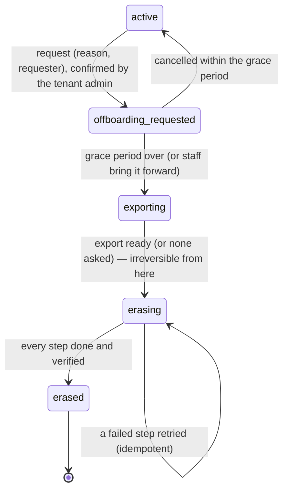

# 13 — Offboarding and erasure of a business

> **Status:** Reviewed and approved by the owner (27 Oct; D-2 changed to *no refund*); **built** (27 Oct) — `backend/src/offboarding`, migration `control_0022_offboarding`, Company 360 → *Close or delete*, Business → Settings → *Data & closing*. What was built and how it was checked: 09 §11. **Date:** 2026-10-27.
> **Why now:** a business can be created with its own workspace by one call (Phase 14 WS2), but nothing removes one. A legitimate erasure request (GDPR Art. 17, DPDP Act 2023 §12) would today be a manual job across a dozen Azure resources, with no proof it was complete. Separately, the owner needs to **test big features in production before go-live** (there is no staging), which needs a way to delete a test business and everything it owns at once.
> **Builds on:** Phase 14 tech spec §6.2 (the tenant state machine already reserves `exporting → retired`), §14 (tenant export), the tenant key design (crypto-shredding by deleting a tenant's KEK).

This document defines two flows:

* **Flow A — Offboarding and erasure** (§5–§9): the standard, legally sound path for a real business. Requested, confirmed, a grace period in which it can be undone, an export on request, then irreversible erasure of personal data while keeping what the law requires, and a completion certificate.
* **Flow B — Immediate delete** (§10): an app admin deletes a test business and its whole workspace at once, from one button, for testing in production until go-live. Guarded so it cannot be used on a real customer by mistake, and switched off at go-live.

---

## 1. Legal frame (for the design; to be confirmed by counsel)

| Source | What it requires of us | How the design answers |
|---|---|---|
| GDPR Art. 17 (right to erasure), Art. 12(3) (respond within one month) | Erase personal data without undue delay when consent is withdrawn or the purpose ends, unless an exception applies (legal obligation, legal claims) | Flow A erases within the grace period + one working day; exceptions are the retained records of §8, each with its legal basis |
| GDPR Art. 20 (portability) | Give the data in a structured, machine-readable format on request | The export of §7 before erasure |
| GDPR Art. 5(1)(e) (storage limitation), Art. 32 (security) | Keep personal data no longer than needed; protect it | Backups and logs expire on fixed schedules (§9); crypto-shredding makes surviving encrypted copies unreadable |
| DPDP Act 2023 §8(7) | Erase personal data when the purpose is no longer served or consent is withdrawn, and have processors erase it too | Flow A covers the platform and its processors (Azure resources); §11 lists third parties |
| DPDP Act 2023 §12, §13 | The data principal's right to erasure and grievance redressal | A request route (§4) for the business, and the business's own end-users through it |
| CGST Act 2017 §35–§36 (with Rule 56) | Keep accounts and invoices for 72 months from the due date of the annual return of that year | Invoices, credit notes and payment records are kept (§8), stripped of what is not needed for tax |
| Companies Act 2013 §128(5) / Income-tax Act | Keep books of account for 8 years | The ledger and invoices (§8), as the platform's own books |
| Contract / legal claims | Keep what proves a charge or a payout while a dispute is possible | The retained records of §8; partner statements |

The platform is a **processor** for the business's own data (its customers, contacts, call recordings, records, documents) and a **controller** for the business relationship (the account, its users, billing). Flow A erases the first entirely and the second except what §8 keeps.

---

## 2. What exists today

| Piece | State |
|---|---|
| Creating a business | `POST /api/v1/companies` or sign-up → `request_and_enqueue` → the provisioner (`src/common/tenancy/provisioner.py`) creates, in order: the tenant database, its migrations, a managed identity with a federated credential and a database role, the tenant KEK and first DEK, a cluster namespace, a storage container `t-<key>`, the Data API; the directory row becomes `active` |
| Removing one | **Nothing.** The provisioner has request, provision and status only. The directory states `exporting` and `retired` exist (`TENANT_STATUSES`) but nothing sets them. There is no company DELETE route; users can be deactivated, companies suspended (billing) |
| Deletion code that exists | Test tooling only: `tests/harness/purge.py` (control rows, walking the foreign keys) and `scripts/dev_tenants.py --reset` (drops local tenant databases) |
| Protections that make deletion slower | Tenant-keys vault (`tenantkeys.bicep`): soft delete 90 days, **purge protection on** (cannot be turned off). Platform vault: soft delete 30 days, purge protection on. Storage (`storage.bicep`): blob versioning, blob and container soft delete 14 days. PostgreSQL: point-in-time restore 7 days, server-wide. `hb-backup`: weekly `pg_dump` of control and every tenant database, last 5 weeks kept. Log Analytics / App Insights: 30 days |

---

## 3. Inventory: everything a business owns

Every item below must be named in the erasure plan; a test (§13) fails when a new table or resource with a company reference is not in it.

| # | Where | What | Personal data | Erasure | Kept (§8) |
|---|---|---|---|---|---|
| 1 | Tenant database `t_<key>` (pool server) | Agents and versions, runs and traces, LLM/tool logs, approvals, memory (CORTEX), documents and embeddings, records (business schema), automation (triggers, events, waits), apps metadata, campaigns and contacts, voice sessions and transcripts | Yes — the business's customers, contacts, transcripts | `DROP DATABASE … WITH (FORCE)` | Nothing |
| 2 | Tenant DB role and grants | `hb_dataapi` sign-in for the tenant identity | No | `DROP ROLE` / revoke | — |
| 3 | Storage container `t-<key>` | Files, uploads, avatars, call recordings, generated media, app build artefacts, invoices' PDFs, the tenant's `hb-backup` dumps (`t-<key>/backups/…`) | Yes | Delete every blob **and its versions**; delete the container | Invoice and credit-note PDFs, copied first to the platform's retained-records area (§8) |
| 4 | Tenant-keys vault | The tenant KEK (`tenant_kek_name(key)`); DEKs are wrapped by it and live in the tenant DB | — (the key protects sealed secrets and encrypted fields) | Delete the key → soft-deleted 90 days, then purged automatically (purge protection forbids an early purge). Disabled and unusable at once | — |
| 5 | Platform vault | Secrets named for the tenant (connections' sealed credentials, Data API keys if vault-held) | Credentials | Delete each secret | — |
| 6 | Managed identity `id-hb-<env>-t-<suffix>` in `rg-hb-<env>-tenants`, its federated credential | Identity for the tenant's Data API | No | Delete the identity | — |
| 7 | Cluster namespace `t-<key>` | Data API Deployment (when per-tenant), apps, previews, service accounts, quotas, network policies, secrets | Possibly (app env) | Delete the namespace (everything in it) | — |
| 8 | Apps | Gitea repositories, ACR images (`<registry>/apps/<key>/…`), DNS names `*.apps.<domain>`, custom domains and their certificates, KEDA scalers | Possibly | Delete repos, image repositories, certificates; release custom-domain records | — |
| 9 | Control database — identity | `companies` row, `users` of the company, refresh tokens, devices, OAuth links, notifications, onboarding state | Yes (names, e-mails, phone numbers) | Delete users and their tokens; the company row is anonymised (§8), not deleted, while retained records point at it | Anonymised company row |
| 10 | Control database — operations | `tenant_directory` (→ `retired`), provisioning log, feature-flag rows, entitlement overrides, locks, settings at company scope, spend caps, daily-credit overrides, webhook endpoints, API keys, connections metadata, phone-number assignments and rentals, `usage_logs`, `billing_lines`, credit holds, shadow rows, admin audit rows naming it | Some (phone numbers, webhook URLs) | Delete operational rows; usage and billing lines aggregated then deleted (§8); audit rows anonymised | Billing summary per month; anonymised audit trail |
| 11 | Control database — money | Wallet, lots and entries, subscriptions, payment transactions, invoices, credit notes, one-time charges, refunds | Billing contact, GSTIN, address | Wallet closed (§6.4); lots and entries kept with the books | Yes — the books (§8) |
| 12 | Control database — partner programme | Partner assignments, access grants and access events, ledger entries naming the tenant, leads converted from it | Partner staff ids; the tenant's name | Grants revoked and deleted; access events deleted; assignments ended | Ledger entries and statements (the partner's books), tenant name replaced by a reference |
| 13 | Redis | Throttles, run streams, session caches keyed by company | Transient | Delete keys by company prefix | — |
| 14 | Logs and traces (Log Analytics, App Insights, OTLP) | Request logs, traces with ids, sometimes payload snippets | Possibly | Not deletable per tenant in practice; expire in 30 days. Purge API for a specific request (§9) | Expire |
| 15 | Backups | Server PITR (7 days, both servers), `hb-backup` dumps (5 weeks), blob soft-deleted copies (14 days), vault soft-deleted keys (90/30 days) | Yes | Tenant dumps deleted; the rest expire on schedule; crypto-shredding makes encrypted fields in them unreadable | Expire |
| 16 | Third parties (§11) | Razorpay customer and subscription, Twilio/Tata number configuration, e-mail provider logs, model providers' request logs | Some | Cancel the subscription; release numbers; request deletion where the provider offers it | As the provider's policy |

---

## 4. Who may ask, who may do

| Action | tenant_admin | tenant_user | partner_admin (its resold tenant) | app_user (support) | app_admin |
|---|---|---|---|---|---|
| Request offboarding of its own business (Flow A) | ✓ | — | — | — | — |
| Request on a business's behalf (with the business's written request attached) | — | — | ✓ (request only; the tenant admin confirms) | ✓ (request only) | ✓ |
| Cancel during the grace period | ✓ | — | — | — | ✓ |
| Download the export | ✓ | — | — | — | ✓ |
| Approve and run erasure at the end of grace | — | — | — | — | ✓ (automatic job; staff can bring it forward) |
| Erase **one person** (an end-user of the business asks) | ✓ (deletes the person's records in its workspace; §6.6) | — | — | — | ✓ |
| Immediate delete (Flow B) | — | — | — | — | ✓ only, test businesses only, while enabled |

A tenant_user's own account deletion is the existing user deactivation plus §6.6 for that user's personal data.

---

## 5. Flow A — states

The company and its tenant directory row move together:

| State | The business can | The platform does |
|---|---|---|
| `offboarding_requested` (grace, default `offboarding.grace_days` = 30) | Sign in read-only, download invoices, export, cancel | Stops new work (as suspension: runs, calls, automation, apps stopped), cancels subscriptions at cycle end, stops number rent, notifies admins on day 0, 7, 1 before the end |
| `exporting` | Download the export | Builds the export (§7); the directory row `exporting` |
| `erasing` | Nothing (signed out; sign-in refused) | Runs the erasure steps (§6), each logged |
| `erased` | — | Directory `retired`; company anonymised; certificate issued (§12) |

Settings (money settings catalogue style, audited): `offboarding.grace_days` (30), `offboarding.export_retention_days` (30, how long the export is downloadable), `offboarding.allow_staff_bring_forward` (true).

---

## 6. Flow A — the erasure steps

One job (`offboard_tenant`, on the provisioner's queue and identity, which already holds the rights to create these resources), one step at a time, each **idempotent** and recorded in `tenant_offboarding_log` (step, attempt, outcome, detail, error) like provisioning. A step that fails is retried from where it stopped; the next step never runs before the previous succeeded. Order:

| # | Step | Detail |
|---|---|---|
| 1 | `quiesced` | Company read-only (as suspension); runs cancelled, calls ended, automation paused, apps scaled to zero, schedules disabled; partner grants revoked; API keys and webhook endpoints disabled; users signed out (token version bumped) |
| 2 | `billing_closed` | Subscriptions cancelled at the gateway; open holds released; standalone usage settled; number rentals ended and numbers released to the pool; open one-time charges cancelled; the final invoice for anything owed; the wallet closed (§6.4); a refund decision recorded if credit remains (§6.4) |
| 3 | `records_retained` | Copies the retained records (§8) to the platform's `retained/<company id>/` area: invoices, credit-note PDFs, the billing summary per month, the ledger. Verified by checksum before anything is deleted |
| 4 | `exported` | Only when asked (§7) |
| 5 | `apps_removed` | Custom-domain certificates and records, Gitea repositories, ACR image repositories, app DNS names |
| 6 | `namespace_deleted` | The cluster namespace (waits until it is gone) |
| 7 | `storage_deleted` | Every blob in `t-<key>` and every version, then the container; the tenant's `hb-backup` dumps are in it |
| 8 | `database_dropped` | `DROP DATABASE t_<key> WITH (FORCE)`, the tenant role; the server's capacity count drops |
| 9 | `secrets_deleted` | Platform-vault secrets of the tenant |
| 10 | `identity_deleted` | The managed identity and its federated credential |
| 11 | `key_deleted` | The tenant KEK — last, so everything above could still be decrypted while it ran (crypto-shredding: soft-deleted copies of anything encrypted under it are unreadable once the vault purges the key) |
| 12 | `control_erased` | Users and their tokens, devices, OAuth links, notifications deleted; operational rows (§3 #10) deleted; usage and billing lines deleted after the summary of step 3; partner access events deleted, grants deleted, assignments ended, ledger entries' tenant name replaced; the company row anonymised (§8); Redis keys deleted |
| 13 | `verified` | A checker looks for anything left: the database on the server, blobs under the prefix, the namespace, the identity, the key (must be soft-deleted), any control row with the company id outside the retained tables, users with the company id. Any finding fails the step |
| 14 | `certified` | The certificate (§12) issued and stored with the retained records; the requester and the business's billing contact e-mailed |

### 6.4 Money at offboarding

* **Credit left**: **no refund** (owner, D-2). Whatever credit is left — paid top-ups, plan credit, bonus, daily — is forfeited when the wallet closes: an `expire` entry per lot with reason `offboarding`, so the books stay balanced. The request screen and the day-0, day-7 and day-1 notices say so, with the amount.
* **Debt**: offboarding does not cancel what is owed. A final invoice is issued; erasure of personal data still proceeds (the debt is kept as a retained record and pursued as a contract claim).
* **Partners**: commissions already payable are paid at the next statement; accrued ones follow the normal holdback; no new commission accrues (no payments after quiescing). A refund claws back commission as today (`hooks.on_refund`).

### 6.6 Erasing one person (not the whole business)

A business's end-user (a contact, a caller) asks the business to erase them. The tenant admin opens **Settings → Data requests → Erase a person**, searches by e-mail or phone, and sees every match: contacts, campaign entries, voice sessions and transcripts, records whose fields hold the value, documents and memory nodes mentioning it (best-effort text match, shown for review). Confirmed, those rows are deleted or the fields blanked; call recordings deleted from storage; embeddings of deleted documents deleted. The request, the matches and the result are logged (without the personal data itself). This is the DPDP §12 duty of the business, which the platform makes possible.

---

## 7. Export (portability)

On request, before erasure: a ZIP in the business's own storage container (moved to the platform's export area before step 7) holding a `pg_dump` of the tenant database's business data (records, contacts, campaigns, agents and their versions, documents' text), the files, and a `manifest.json` (counts, checksums, schema versions). The tenant admin downloads it from a link valid for `offboarding.export_retention_days`; it is deleted then, logged. Phase 14 §14's tenant export is the same artefact.

---

## 8. What is kept, and how

| Kept | Why (basis) | For how long | What is removed from it |
|---|---|---|---|
| Invoices and credit notes (rows and PDFs) | GST (CGST §36: 72 months from the year's annual return due date); books of account (Companies Act §128: 8 years) | 8 years from the end of the financial year | Nothing on the invoice itself (it is a tax document: legal name, GSTIN, address, amounts). It is moved to the retained area, out of any business-facing view |
| Payment transactions, refunds, wallet lots and entries | Books of account; reconciliation with the gateway | 8 years | Payer e-mail and phone, gateway customer id replaced by a reference |
| Billing summary per month and category (from billing lines) | Revenue reporting, partner commission base, disputes | 8 years | Agent and entity ids (grouping) dropped |
| Partner ledger entries and statements | The partner's books, TDS (Income-tax Act) | 8 years | The tenant's name replaced by `Former customer <ref>` |
| The company row | Retained records refer to it | Until the retained records go | Name → `Erased business <ref>`, e-mails, phones, address (except as on invoices), logo, settings blanked; `status = erased` |
| The admin audit trail | Accountability for staff actions, security | 8 years | Actor and target names replaced by references; values that held personal data blanked |
| The offboarding log and the certificate | Proof of erasure | 8 years | Contains no personal data by design |

Nothing else is kept. In particular no conversation, transcript, contact, record, document, memory or file survives step 12.

---

## 9. Backups, soft-deleted copies and logs

They cannot all be erased on the spot; the design is to make them **expire on a published schedule** and make the encrypted parts **unreadable at once**:

| Copy | Lifetime | What we do |
|---|---|---|
| The tenant's `hb-backup` dumps | Deleted in step 7 | — |
| Control-database `hb-backup` dumps (platform-wide) | 5 weeks | Expire; the dumps hold the control rows that step 12 removes |
| PostgreSQL point-in-time restore (server-wide) | 7 days | Expires. A restore within that window is a disaster-recovery act; the runbook then re-runs step 12 for every business erased since the restore point (the offboarding log lists them) |
| Blob soft-deleted copies and versions | 14 days | Step 7 deletes versions explicitly; soft-deleted copies expire |
| Tenant KEK (soft-deleted) | 90 days, then purged by the vault | Sealed secrets and encrypted fields in any surviving copy are unreadable without it; recovering the key needs vault-owner action, which is audited and forbidden by the runbook |
| Log Analytics / App Insights | 30 days | Expire. For a specific complaint, the Log Analytics purge API by company id (staff, runbook) |

The privacy notice states these schedules. The certificate (§12) lists, per copy, the date by which it is gone.

---

## 10. Flow B — Immediate delete (production testing until go-live)

**Purpose.** Until go-live, without a staging environment, a big feature is tested in production with throwaway businesses (as the browser journeys do). The owner needs to remove such a business and **everything it owns, immediately**, from one button — no grace, no export, no retained records.

**Who and where.** `app_admin` only. **Console → Companies → Company 360 → Delete now**, also `DELETE /api/v1/admin/companies/{id}?mode=immediate`.

**Guardrails** (all must pass, else 409 with the reason):

1. **The switch** `offboarding.immediate_delete_enabled` (platform setting, audited) is on. Default **on in dev, off in production**; the owner turns it on in production for a test window and the cutover checklist turns it **off at go-live** (the readiness report flags it on).
2. **A test business**: the company is marked `is_test = true` when it was created (an app admin ticks *Test business* on *Add company*, or the journeys' world sets it), or an app admin marks it test — refused when the company has any **paid** payment, an issued invoice to a non-test customer, a live gateway subscription, or a partner assignment to a non-test partner. A real customer's business can never go through Flow B.
3. **Confirmation**: the admin types the company's exact name and a reason; the button shows the inventory to be deleted (counts per item of §3).
4. **Not the platform company**, not a partner with test tenants still under it (delete those first, or tick *also delete its test tenants*).

**What happens.** The same job and steps as Flow A (§6), run at once, with these differences:

| Flow A step | In Flow B |
|---|---|
| Grace, export | None |
| 2 `billing_closed` | Subscriptions cancelled immediately; nothing invoiced or refunded (test money) |
| 3 `records_retained` | **None** — no retained records: invoices, payments, ledger entries, billing lines, partner ledger entries, audit rows naming it are **deleted** (test data has no legal retention) |
| 12 `control_erased` | The company row and everything referring to it **deleted** (the purge walk of `tests/harness/purge.py` made a product feature: every foreign key and cross-plane reference, with a check that no row of another company is touched) |
| 11 `key_deleted` | Deleted; the vault keeps it soft-deleted 90 days (purge protection cannot be bypassed) — a disabled key that protects nothing that still exists |

**"Nothing left behind" — what that means precisely.** Everything the platform can delete is deleted within minutes and verified by step 13: the database, the role, storage and its versions, the namespace, the identity, apps, secrets, every control row, Redis keys. What **cannot** be removed on the spot, by design of the Azure services and our own protections: the KEK's soft-deleted copy (90 days, unusable), blob soft-deleted copies (14 days), server PITR (7 days), platform-wide `hb-backup` dumps (5 weeks) and logs (30 days). For test businesses that hold no real personal data this is acceptable; the Company 360 page and the certificate say it.

**Why Flow B is safe to have.** It runs only on businesses that were test from the start or proven to have no real money and no real partner, only by an app admin, only while the switch is on, with typed confirmation, audited (`admin_audit_log`: actor, company, reason, inventory counts) and logged step by step.

**Go-live.** The cutover checklist gains: *turn `offboarding.immediate_delete_enabled` off; delete the remaining test businesses with Flow B first, or keep them marked test and excluded from reports*.

---

## 11. Third parties

| Party | What they hold | At erasure |
|---|---|---|
| Razorpay | Customer, orders, payments, subscriptions | Subscription cancelled (step 2). Payment records stay with Razorpay as a regulated payment processor; we keep our reference only |
| Twilio / Tata Tele | Number configuration, call detail records | Numbers released and their webhooks cleared; CDRs follow the carrier's statutory retention |
| Model providers (Vertex, Azure OpenAI, Anthropic) | Request logs per their terms (zero or short retention under the enterprise terms) | Nothing to send; the terms are recorded in the processor register |
| E-mail provider | Delivery logs | Expire per provider; addresses are not re-used |
| Partner (for a resold business) | What it saw while acting with grants | Grants revoked; the partner agreement obliges it to delete copies (agreement clause to add) |

---

## 12. The certificate

A PDF and a JSON record per erased business, stored with the retained records and e-mailed to the requester:

* Business reference (not its name), requester, dates of request, confirmation, erasure start and end.
* Every step of §6 with its time and outcome; the verification findings (none).
* What was kept (§8), its basis and its end date.
* The copies that expire (§9) and the date each is gone.
* For Flow B: "test business — immediate delete", the admin and the reason; no retained records.

---

## 13. Building it — the parts

| Part | Where | Notes |
|---|---|---|
| States and log | `companies.status` gains `offboarding_requested`, `erasing`, `erased`; `companies.is_test`; `tenant_offboarding_log`; settings of §5 and §10 | Control migration |
| The deprovisioner | `src/common/tenancy/deprovisioner.py`: the steps of §6, the reverse of each provisioner step (database, role, storage, keys, namespace, identity, Data API), idempotent | The provisioner identity needs delete rights it may lack today (identity in `rg-hb-<env>-tenants`, key delete in the tenant-keys vault, container delete) — Bicep role assignments |
| The control erasure | `src/offboarding/erase.py`: the inventory (§3) as code, the anonymisation of §8, the purge walk for Flow B | A test fails when a table with `company_id` (or a cross-plane reference to `companies`) is in neither the erased nor the retained list |
| Money | `src/billing/offboarding.py`: close the wallet, final invoice, refunds, forfeiture entries, gateway cancel | Uses `WalletService`, `refunds`, `gateways` |
| Apps | `src/apps/offboarding.py`: domains, certificates, Gitea, ACR, DNS | |
| Person erasure | `src/offboarding/person.py` + Business settings page | §6.6 |
| Export | `src/offboarding/export.py` | §7 (shared with Phase 14 §14) |
| Verification | `src/offboarding/verify.py` | §6 step 13, also a CLI for staff |
| API | `POST /api/v1/settings/offboarding` (request), `DELETE …` (cancel), `GET …` (state, export link); staff `GET/POST /api/v1/admin/offboarding…` (list, bring forward, retry a step); `DELETE /api/v1/admin/companies/{id}?mode=immediate` | Audited |
| UI | Business: Settings → *Close this business*, *Data requests*. Console: Company 360 → *Offboarding* panel and *Delete now* (Flow B), a queue on the console home (R-A25: offboardings in grace, failed steps) | |
| Certificate | `src/offboarding/certificate.py` (the existing small PDF writer) | |
| Runbook | 11 §7: handling a request, a stuck step, a restore that predates erasures | |
| Journeys | The journey world marks its businesses `is_test`; a journey deletes a throwaway business with Flow B and checks that nothing is left (dev and production) | Replaces "persistent" journey businesses with create-and-delete per run once Flow B exists |

**Tests:** each step's idempotency (run twice); a failure mid-way resumes; the verifier finds a planted leftover of every inventory kind; the inventory census; Flow B refused for a non-test company, a company with a paid payment, the platform company, with the switch off; Flow A grace and cancel; retained records anonymised; partner ledger intact; the certificate's content; on dev, a full provision → Flow B → verify cycle against real Azure resources.

---

## 14. Decisions for the owner

| # | Question | Proposed |
|---|---|---|
| D-1 | Grace period | 30 days (`offboarding.grace_days`) |
| D-2 | Refund of unused paid top-up credit at offboarding | **Decided: no refund** — every remaining lot is forfeited at closing (§6.4) |
| D-3 | Retention of tax and accounting records | 8 years from the end of the financial year (covers CGST's 72 months and the Companies Act's 8 years) — counsel to confirm |
| D-4 | Flow B in production | Allowed only while `offboarding.immediate_delete_enabled` is on; off by default in production; turned off at go-live |
| D-5 | Who counts as a test business | `is_test` set at creation, or set later by an app admin only if the company has no paid payment, no live subscription and no non-test partner |
| D-6 | Can a partner request a resold tenant's offboarding | Request only; the tenant admin confirms |
| D-7 | Persistent journey businesses (dev, production) | Once Flow B exists, the journeys create fresh test businesses and delete them each run; the six persistent ones are deleted with Flow B |
| D-8 | Purge protection on the tenant-keys vault | Keep (it guards against malicious key deletion); accept the 90-day soft-deleted, unusable key |
