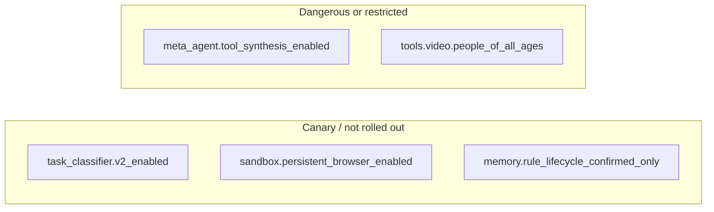

# Feature flags

> The living catalogue of the platform's feature flags (moved here from the Phase 13 reference, `docs/history/phase13/15-governance-and-hitl.md` §13, which is frozen).
> `backend/tests/unit/test_flag_catalogue.py` fails when a flag is added or removed without its row here.

## Feature flags — the complete catalogue

**18 boolean flags** and **3 numeric flags**, extracted from
[core/feature_flags.py](../../backend/src/ai/core/feature_flags.py). Every one is read by
the code it names: flags nothing read were deleted (thirteen on 2026-10-01, AK-10; the
Board's seven with MI-20; four memory flags on 2026-10-09, GH-15/GH-16), and
`tests/unit/test_feature_flag_census.py` fails on a declared flag with no reader.
`tests/unit/test_flag_catalogue.py` keeps this catalogue and those counts equal to the
code (ON-16): a flag added or deleted without its row here fails it.

### 1. Agent loop

| Flag | Default | Controls |
|---|---|---|
| `agent_loop.snapshot_every_iteration` | `True` | Write an `AgentState` `snapshot` node each iteration |
| `agent_loop.budget_aware_react` | `True` | Thread budget pressure into the step prompt |

> There is **no `agent_loop.enabled` master switch.** The comment in the code is
> explicit: *"C4 deleted the legacy `ExecutionEngine.execute_run` path"*, so the
> AgentLoop is the sole run engine. Older docs referencing `agent_loop.enabled`
> are stale.

### 2. Critic pipeline

| Flag | Default | Controls |
|---|---|---|
| `critic_pipeline.v2_enabled` | `True` | The v2 critic pipeline |
| `critic_pipeline.different_model_critic` | `True` | Critique with a different model than the actor |
| `critic_pipeline.pre_critic_enabled` | `True` | Pre-action critic gate |
| `critic_pipeline.calibration_enabled` | `True` | False-pass/false-fail calibration (per company, in the weekly job) |

`critic_pipeline.v1_compat` was retired (C1) — the v1 critic body is deleted.

### 3. Supervisor and bandit

| Flag | Default | Controls |
|---|---|---|
| `bandit.enabled` | `True` | `PlanStyleBandit` arm selection |
| `task_classifier.v2_enabled` | `False` | Embedding-NN task classifier (v1 rule-based otherwise) |

### 4. Meta-Agent

| Flag | Default | Controls |
|---|---|---|
| `meta_agent.skill_promotion_cron` | `True` | Weekly skill-candidate scan (per company) |
| `meta_agent.prompt_evolution_cron` | `True` | Weekly prompt-evolution proposal (per company) |
| `meta_agent.tool_synthesis_enabled` | **`False`** | ⚠️ Agents writing new tools |

The Board's flags (`meta_agent.board_routing`, `spec_critic_required`, `draft_lifecycle`,
`testdriver_suite_enabled`, `curator_consolidation_enabled`, `spec_critic_tiebreak` and the
numeric `testdriver_budget_usd`) were deleted with the unused Board roles (MI-20, D27 in
[register 11](defect-register/11-META-INTELLIGENCE-DEFECTS.md)).

The tool-synthesis flag is described in code as the kill switch for *"the
marquee/most-dangerous capability"*:

```python
# backend/src/ai/core/feature_flags.py
# Tool synthesis kill switch (Phase 12 `06` §2.2 control 5). Default OFF;
# the marquee/most-dangerous capability. Even when ON, the tool_synthesis
# meta-tool stays Meta-Agent-only + container-only-exec + DRAFT-register-only.
"meta_agent.tool_synthesis_enabled": False,
```

### 5. Tools and cost

| Flag | Default | Controls |
|---|---|---|
| `tools.video.people_of_all_ages` | `False` | `video_generate` may depict minors: on sends Veo `person_generation="allow_all"` (restricted in some regions), off `"allow_adult"` (TL-46) |
| `tools.resilience_v2_enabled` | — | Deleted (P8.6, EP-22): the healing ladder is unconditional |

`tools.cost_attribution_required` was deleted (AK-10): it was the last canary of
the cost-attribution programme and nothing read it. The invariant is enforced by
a test, `tests/integration/test_cost_attribution.py`, not a runtime switch.

### 6. Planner

| Flag | Default | Controls |
|---|---|---|
| `planner.v2_enabled` | `True` | Planner v2 |

### 7. Sandbox

| Flag | Default | Controls |
|---|---|---|
| `sandbox.container_runtime_enabled` | `True` | Per-tenant container sandbox |
| `sandbox.persistent_browser_enabled` | `False` | Persistent browser profile (ephemeral otherwise) |

The persistent-browser flag has a **master switch above it** —
`settings.SANDBOX_PERSISTENT_BROWSER_ENABLED`. The flag resolves per company and
is threaded into the tool context as `persistent_browser`.

### 8. Memory

| Flag | Default | Controls |
|---|---|---|
| `memory.v2_canonical` | `True` | v2 four-domain memory is canonical |
| `memory.dreaming_outcome_trigger` | `True` | Trigger dreaming on run completion |
| `memory.rule_lifecycle_confirmed_only` | `False` | Only `confirmed` rules enter prompts |

`memory.viewport_compact`, `memory.scope_policy_enforced`, `memory.embedding_resolver_v2` and
the alias `memory_v2.canonical` were deleted on 2026-10-09 (GH-15, GH-16): nothing read them,
so toggling them changed nothing. `tests/unit/test_feature_flag_census.py` now has no known
unread flag.

See [08 — Memory and CORTEX](08-memory-and-cortex.md) for what each does.

### 9. Numeric flags

| Flag | Default | Meaning |
|---|---|---|
| `bandit.epsilon` | `0.10` | Exploration rate for the plan-style bandit |
| `agent_loop.budget_pressure_threshold` | `0.70` | Pressure past which "finish, don't expand" is injected |
| `planner.n_candidates` | `3` | Plan candidates generated per planning call |

### 10. Flags that are OFF by default

Worth listing separately — these are the not-yet-rolled-out or deliberately
dangerous capabilities:



---
